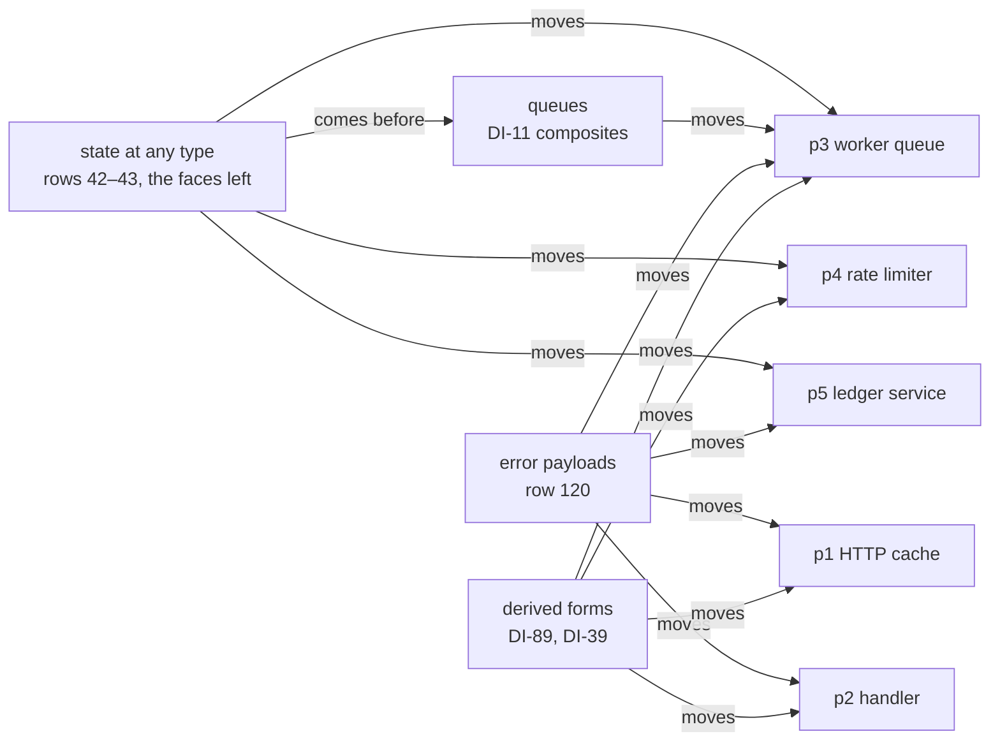

# Dogfood: the rc.112 programs as acceptance tests

Decisions row 206 (ruled 2026-10-04) makes the five model-probe programs tracked acceptance
tests. This folder holds them. Each program has one plan row below. The row names the stage its
battery measures today, what the program waits on, and the slice expected to move it. Each slice
of row 204 moves at least one program forward.

## The folder

- `rc112/` holds the reference texts: the five rc.112 programs, their run scripts, three
  controls, the recorded runs and the checksums. No gate runs them.
- `Stage.lean` holds the words the five batteries share: `verdict`, `Reach`, `Answer` and
  `formAdmits`.
- `P1HttpCache.lean` to `P5LedgerService.lean` hold one battery per program. `Test/All.lean`
  imports each one, so the module-closure gate and the axiom gate cover them.
- Each battery declares two literals that the semantics report reads (`make gen-semantics`):
  - `stage`, the stage the program reaches;
  - `waitsOn`, the requirements of the system map's §8 that its row below explains.
  `generated/semantics.md` prints them in its section "Acceptance programs", with the programs
  each requirement keeps waiting.
- `Scenario.lean` holds what the scenarios share: the script alphabet, the driver, the readers of a
  run's session part and the driver's laws. It also holds a scenario's record. Its last section
  holds the one `note` of the scenarios' logs. A note appends an entry to a log cell, under a
  minted name for the cell's value.
- Every program here imports entry modules (`Effect4.Author`, `Effect4.Run`, `Effect4.Emit`,
  `Effect4.Library`, `Effect4.Laws.Author`), a composed module's own files, or the batteries'
  support (decisions row 332).
- The machine's tape and the laws that name no scenario stand in the library, in the namespace
  `Effect4.Run`. `src/Effect4/Run/Tape.lean` holds the executable definitions: the machine's
  view, the tape, a funded run and rest. `src/Effect4/Laws/Run/Rows.lean` and
  `src/Effect4/Laws/Run/Tape.lean` hold their laws. `Scenario.lean` gives each name that the
  batteries use an alias in its namespace, so a battery writes the short name.
- `Scenario/` holds each scenario's record: its program, its observation, its named runs and its
  controls. `Scenario/TapeData.lean` writes the engine's fixtures of their lowered runs.
  `Test/All.lean` imports each one.

## The reference texts

The model probe's programs seat wrote the five programs on 2026-09-30, and its verifier reran
them with identical lines (`git:98a29895b800556365a2edc9924f3ed12787b820:docs/research/2026-09-30-model-probe/synthesis.md` §2.4). Commit
`ce2ece4f` recorded them
(`git:ce2ece4f:docs/research/2026-09-30-model-probe/programs/ts/hostruns.log`), and `f7ccf52e`
dropped them from the research tree. Every file of `rc112/` is byte-identical to its blob at
`ce2ece4f`.

| Fact | Value | Source |
| --- | --- | --- |
| Effect | 4.0.0-rc.112, the pinned package under `ts/eff/node_modules` | `rc112/hostruns.log`, first line |
| Runtime | bun 1.4.2 | `rc112/hostruns.log`, first line |
| Type check | tsgo 7.0.0-dev.20260629.1: exit 0 on the five programs and two controls; exit 1 on `rc112/red-control.ts` with its three errors | `rc112/typecheck.log` |
| Checksums | SHA-256 of the fourteen TypeScript files | `rc112/sha256.txt` |

The `tsconfig` files resolve `effect` by absolute paths into the main checkout's
`ts/eff/node_modules`. To rerun the recorded checks, follow these steps.

1. Change to `Test/Dogfood/rc112`.
2. Run `shasum -a 256 -c sha256.txt`. Every line reads `OK`.
3. Run tsgo with `tsconfig.json`, then with `tsconfig.red.json`, as `rc112/typecheck.log` records.
4. Run bun on each `run-p*.ts` file with `--tsconfig-override=./tsconfig.bun.json`.
5. Run `run-p2-noenv.ts` without `ADMIN_TOKEN` in the environment.

## The plan rows

Each stage below is the `stage` declaration of the program's battery. A guard in the battery ties
that declaration to the measurement, so the row and the battery cannot disagree while
`Test/All.lean` builds.

| Program | What it does | Stage today | Waits on | Slice of row 204 that moves it |
| --- | --- | --- | --- | --- |
| p1: `rc112/p1-http-cache.ts`, battery `P1HttpCache.lean` | Fetches a quote over HTTP. A 2 s timeout bounds each attempt, failures retry on an exponential schedule, a 404 is a typed `HttpError`, and a `Cache` serves the second lookup. | `Api.Author.build` admits the program, and it runs under a scripted host. It answers the body text where rc.112 answers `42`. It prints as TypeScript and reads back: the retry loop states its cursor's type, and the checked type reader reads it (DI-91; the state plan's T5, part B). Refused: a `Quote` record in the key-value cache (`requestNotSubtype`). The payload part `HttpError{status, url}` builds as a typed failure, runs to `Err.payload` with rc.112's recorded 404 error, prints as a module that declares its `Data.TaggedError` class and fails with `new HttpError({ … })`, and reads back (row 120, part E2). A signed `status` builds since decisions row 317. | R10: DI-89 (`retry`, `catchTag`), DI-39, post-Phase C's W6 (`timeout`), DI-91. R3: row 121 (`status: number`). R7: row 82 (`Cache` keeps code). R6, parked: the retirement notice. | Error payloads (row 120), with the derived forms beside them |
| p2: `rc112/p2-handler-layers.ts`, battery `P2HandlerLayers.lean` | Handles a request over layered services: `UserRepo` runs SQL through a captured client, `AppConfig` reads `Config`, and a middleware provides `CurrentUser`. | `Api.Author.build` admits the handler program at `Response`, bounded as seat W10's brief bounds it. It runs to rc.112's three answers, prints as TypeScript and reads back. Refused: a string or record service carrier (`serviceCarrier: signature none`); a number in a template string (`typing: term`). The payload parts `NotFound{id}` and `Unauthorized{reason}` build as typed failures and run to `Err.payload`, and `tagIs` catches a payload by its `_tag`; each prints as a module that declares its `Data.TaggedError` class and fails with `new`, and reads back (row 120, part E2). | R3: row 130 (`catchTag`'s residual over records). R5 and R7: rows 21, 82, 118 (code-valued services, structured carriers). R13: rows 51, 83 (`Config` at load). Row 131 (number to text); row 123 (decoding inside a program). R10: DI-39, DI-89, row 130 (`catchTag`). | Error payloads (row 120), with the derived forms beside them |
| p3: `rc112/p3-worker-queue.ts`, battery `P3WorkerQueue.lean` | Drains a bounded queue with three workers. Each worker holds a connection that it releases on any exit. A `Deferred<void>` gate ends the run, and the program interrupts the pool. | `Api.Author.build` admits the program, with the queue as two host rows, and it runs under a scripted host. It answers `[3, 5]` (closes, jobs) where rc.112 answers its log. It prints as TypeScript and reads back. Refused: the log's first append at `Ref<never[]>`, at the term's result (`resultNotSubtype`). The gate as `Deferred<void>` builds and runs since T3a. Since the state plan's T5, part B, it prints as `Deferred.make<void, never>()` and reads back. Since the state plan's T3b the log's append is rc.112's `Ref.update` with a binder term: at a cell ascribed `ReadonlyArray<string>` it builds and runs to its lines. rc.112's `finish`, one `Ref.modify` that counts and decides "last", builds and answers a boolean over a number cell. Since the state plan's T5, part A, both rows print as functions of the current value, and each module reads back. The payload part `JobFailed{id, reason}` builds as a typed failure, runs to `Err.payload`, prints as a module that declares its `Data.TaggedError` class and fails with `new JobFailed({ … })`, and reads back (row 120, part E2). | R4: rows 42–43 step 5, the faces (the log's element type as a type argument, `Ref.make<A>`). R10: DI-11 (the queue composite), DI-89 (`forEach`). R3: row 130 (`catchTag`'s residual over records). Row 131. R11. | State at any type: its step 5, the faces. Then queues |
| p4: `rc112/p4-rate-limiter.ts`, battery `P4RateLimiter.lean` | Dogfood 1's fixed-window rate limiter: three requests per window, a refill daemon, five concurrent requests and a shutdown. | Since the state plan's T3b the measured program is rc.112's: one `Window` cell, and each request one `Ref.modify` whose term decides and rewrites the record in one store step. `Api.Author.build` admits it, and it runs to rc.112's `[3, 2, 3]`, with or without a yield before a request's step. Since the state plan's T5, part A, its terms print as functions of the window, so it is printed and read back. The printed request type-checks under tsgo 7 since the literal rule (decisions row 256), and the truth program `pRateRequest` agrees with rc.112 on `[true, false, 3, 1, 3]`. The race control is the earlier three-cell program, which prints and reads back: with a yield between its read and its write it answers `[5, 0, 5]`. | R10: DI-89 (`all`). | The derived forms |
| p5: `rc112/p5-ledger-service.ts`, battery `P5LedgerService.lean` | A `Ledger` service over an `Account` record with a list of variants. It fails with `InsufficientFunds`, keeps listeners and removes them by identity, and wraps a host timer with `Effect.callback`. | `Api.Author.build` admits no program for it. The `Account` record in one `Ref` builds, written and read, since the state plan's T3a. Since T3b the pure part of a deposit is one atomic `Ref.modify` over the record, whose term captures the amount: it builds and runs, and since the state plan's T5, part A, it prints as a function of the account and reads back. A signed number is admitted since decisions row 317, and `minus` answers `10 - 25` as rc.112's `-15` since row 319. The payload part `InsufficientFunds{needed, available}` with natural fields builds as a typed failure, runs to `Err.payload`, prints as a module that declares its `Data.TaggedError` class and fails with `new InsufficientFunds({ … })`, and reads back (row 120, part E2); signed fields build since decisions row 317. `settle` alone runs on the logical clock to `"settled"`. | R4: rows 42–43 step 5, the faces (the state plan's T5). R3: row 121 (`int`). R7: row 82 (listeners, effect-valued answers, the cancel effect). R10: DI-89, DI-39. R6, parked, or the logical clock. | State at any type, and error payloads |

The diagram below shows which slice of row 204 each program waits on. It claims no order among
the programs.

## How to read a stage

A battery measures one `Reach` value (`Stage.lean`) and pins it to its `stage` declaration. The
fields have these meanings:

| Field | Meaning |
| --- | --- |
| `refused` | Each part of the rc.112 program that the language refuses today, with the build's `verdict` |
| `admitted` | `Api.Author.build` elaborates the battery's program from its authoring source, types it and admits it with its row table |
| `answer` | The run's root exit against rc.112's recorded answer: `rc112`, `differs`, `unfinished` or `notRun` |
| `printed` | `Api.print` answers TypeScript syntax for the program. A read-modify-write row prints its binder term as a function of the current value (the state plan's T5, part A) |
| `readBack` | `Api.readable` holds: reading the program's printing gives the program back |

A battery also pins each error payload part apart from the program's stage (`PartReach`,
`Stage.lean`; decisions row 120). It has four fields. The first is the build's verdict. The
second says whether the part's run fails with its record as the first typed failure. The
third is the module printer's answer (`Api.emitModule`): `printed`, or a payload class
refused by name with its tag. The fourth says whether the printed module reads back
(`Api.readModule`). Since part E2 the module declares one `Data.TaggedError` class per tagged
payload type and constructs the payload with `new`.

Each run is a finite probe: one scripted host and one decision tape per run. A stage is not a
theorem. An equal answer is a test on one recorded run, and the battery claims no simulation.

## How a slice moves a program

1. Build the program's battery after the slice lands.
2. If a pin turns red, read what moved: a refused part builds, or a run reaches rc.112's answer.
3. Rewrite the battery's program with the spelling the slice lands.
4. Update the battery's `stage`, then the program's row in this file.
5. Name the moved program in the slice's receipt.

## The scenarios

Decisions row 254 (owner, 2026-10-05) adds scenarios to the acceptance programs. A scenario is a
program, its scripts and one observation, which the outside lanes perform. Decisions row 410
(owner, 2026-10-16) retired the scenarios' claims, their proofs and the gate that checked them.

| Part | Content |
| --- | --- |
| Program | One program through `Api.Author.build`, built on the consumer of a battery above |
| Script | A `List Move` (`Scenario.lean`), where `Move` is the library's `Event` (`src/Effect4/Run/Event.lean`): control decisions, held calls, reply receipts, reply applications and a remote host's run command. The record lists each script once, as a named run |
| Observation | One named structure read from the run. Every control compares it |
| Controls | Green and red comparisons on the observation. A control names the runs that its comparison reads |

The driver plays a script into the run's own journal. It keeps the reply receipt and the reply
application apart, and it selects a live call by its key. The run a script reaches is the run its
journal reaches (`replays`, `Scenario.lean`), so a replay calls no fixture.

Two lanes read a record's named runs. The keyed lane performed them on rc.112 until 2026-10-18
(below). The engine's lane replays the machine tapes that `Scenario/TapeData.lean` writes under
`ocaml/engine/test/scenarios/`.

### The host runs

The keyed lane (`git:38b94bdec:harness/truth/session`) performs a scenario's scripts on its printed
TypeScript module, on effect 4.0.0-rc.112 under bun. The gates retired it on 2026-10-18, and its
script was deleted on 2026-10-20 (`git:8e93a284f:scripts/check-host-protocol.py`). No target
runs it now. This section keeps what a host run compares.

- **A host run** is one named run of a scenario's record: a script, on the program that the
  record opens for it. The lane takes each run from the record (`Wire.runs`, `git:38b94bdec:harness/truth/session/Keyed.lean`), and
  it holds no script. Lean writes the run's fixture: the printed module, the row table, the
  journal rows that the script leaves and the battery's observation (the mode `scenarios`).
- **The host** acts out each row through the lane's recorder, and it writes a recording.
- **Lean's replay** plays the recording's rows with `Run.play`, and it reads the battery's
  observation. That observation must be the script's.

Each field of an observation has one source of evidence on the host
(`git:38b94bdec:harness/truth/session/keyed-observation.ts`). The check writes each entry's source as one table,
`scenario-evidence.md`, among the results in its work folder. The table's last column gives a
reader's limit on an entry, with the scripts where the limit holds.

| Source | Meaning |
| --- | --- |
| Measured by the host | The host reads the field by itself, from the root's exit and the recorder's ledger. |
| Predicted by the ledger | The field holds the session's refusals. The recorder predicts each one, and the check compares it with the verdict of Lean's replay. |
| Measured through a reader | The host reads the field through a note inside the program's state, at the script's end. |
| Replay only | The host has no reader. Lean's replay is the only evidence, and the scenario's whole-observation comparison waits. |

There are four readers: the cells that the module makes, the fibers that it forks, the pending
sleeps and the count of armed dispatchers. A reader is on only where Lean grants it for a run.
The lane performs each script with no reader, with its readers, and with each reader alone.
Each recording must be the bytes of the run with no reader.

A script has no host run where a host has no act for one of its rows. The driver gives the
reason (`performable`, `git:38b94bdec:harness/truth/session/Keyed.lean`). A run that is not funded has no
host run either: a host has no budget (`emitRun`, in the same file).

The lane compares a module's private cell up to its handles. The queue-workers scenario reads
the Queue's cell, whose waiting requests hold `Deferred` handles. A host has no number for a
`Deferred`. So both faces write one image for it, `{"handle": "deferred"}`, each in a writer
named `cellJson`.

- On the host only the cells reader calls it (`git:38b94bdec:harness/truth/session/keyed-recorder.ts`). A `Deferred` in a call's
  request or in an exit stays outside the transport profile.
- On the Lean face a scenario's wire chooses it for an entry (`git:38b94bdec:harness/truth/session/Keyed.lean`). The queue-workers
  wire chooses it for the entry `queue` alone, and every other entry keeps `valJson`.

So a `Deferred` in any other compared value is red.

- The lane compares how many requests stand in the cell, and each request's other fields.
- The lane does not compare which handle stands where.

Two runs of the scenario differ only there. After `parked` the earliest waiting taker is
worker 1's request, and after `rewaiting` it is worker 2's. The two cells differ on the Lean
machine, and their images are equal. The runs `fed` and `rewaiting-fed` show the difference
in an entry that the lane does compare: the next fed job goes to the earliest taker.

Each host run is a finite host run of one script. It establishes no agreement for another
script, no host adequacy and no liveness.

## The earlier dogfood programs

The dogfood notes of 2026-09-15 and 2026-09-16 record findings F1 to F30 over four applications.
Their source files were never committed, so this folder tracks none of them. Program p4 is
dogfood 1's rate limiter, written as an rc.112 user writes it.
