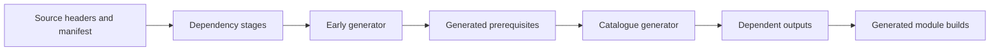

# Generated files

This map names the generated groups, their producers, their inputs, their consumers and
the check that covers each. It owns the generation rule; `docs/ARCHITECTURE.md` owns the
surrounding module boundaries.

## The rule

Every generated file is produced by one `make gen-<group>` rule and listed in the
Makefile's `GENERATED_PATHS`. `make check-gen` regenerates the stale Lean-only groups and
refuses any change to a committed file (`git diff --exit-code` over exactly those paths);
`make -B gen` re-cuts every group, including the host-cut groups.
Then `make check-gen` checks the committed files.
A generated file carries one header line, `GENERATED by <producer>; do not
edit`, and nothing else about its provenance.
The build graph decides whether a producer must run. Drift is the diff.
The producers reached by `make check-full` hash source closures, inputs, outputs, package pins and tool identities.
Other producers retain their named prerequisites in the Makefile.
(Until 2026-09-13 every generated file
carried a git revision and a fingerprint of the producer's import closure, in its header
or in a `.cut-from` sidecar beside it, checked by a separate stamp gate. Any edit to the
core rewrote about three hundred of those labels per commit, and four families sat
outside the one generation command, so a Lean edit turned the hermetic checks red until a
host command was run by hand in the right order. Wave 1 of the checking refactor removed
the labels, the sidecars, the stamp gate and the per-script result caches; the Makefile
is the graph.)

The three tiers are:

- **build artifact**: produced by the build system or build setup and never committed;
- **committed projection**: generated output kept in Git and checked byte for byte
  against a fresh run;
- **vendored input**: copied from an identified source, with provenance recorded.

`make gen` runs every stale group of the Makefile's `GEN_GROUPS` (this file does not restate it).
Each group's marker depends on the markers of the groups whose outputs its producer reads. So a
regenerated group re-cuts the groups that read it, and no other (the codegen refactor's CR-2).
Every Lean producer reads the derived group's modules. The semantics report is no group:
`make gen-semantics` runs it on demand, and neither `make gen`, `make check-gen` nor any gate
waits on it (owner, 2026-10-18). Its committed projection is `generated/semantics.md` alone. The
report's JSON and its document's JSON stay under `.lake/gen/semantics-report`. One typed report
gives the report's JSON and one document (`tools/Tools/Document.lean`). The document gives the
Markdown and its own JSON, which the site splits into pages. Its refusal
controls are `make check-sweep`.
The fixtures group is hermetic in the same way. Its marker also depends on its own outputs,
because Lake does not take a file read by `include_str` as an input. A fixture that changes
alone is written again from Lean, and a committed fixture that Lean does not write is drift.
Its marker depends on every Lean source its writers import, the import closure that
`scripts/lean-imports.py --closure` reads from the headers, and it does not wait for `build`.
When a program changes, the binding battery refuses the old fixture, and the default build is red
until `make gen-fixtures` writes the fixture again.
The group lcnf is another deliberate exception.
It sits in the order between derived and eff, because eff cuts the engine's layout mirror from
the api_engine.ml that lcnf writes.
Its marker is not a link of the hermetic chain, so `check-gen` does not reach it.
The OCaml lane does: `make check-ocaml` depends on the lcnf marker.
So a change of the machine re-cuts the generated engine before the lane builds it.
The group lcnf used to run last, after readme, which made `make gen` a non-fixpoint.
A changed row then needed a second pass before the mirror agreed with the face (tooling plan 4.2).
`make gen-<group>` regenerates one group, and `make clean-gen` forgets the markers.
The recipes hold the Lean lane one at a time.

## Generator bootstrap

`make gen-derived` can run before the Effect4 library builds.
Its freshness inputs include Lean source files and directories, package pins and declared producer inputs.
A missing derived output also triggers its producer.
The variance producer uses its own narrow build.
Neither producer first builds the whole library.

`Effect4Gen.Driver.sourceGraph` parses ordinary source imports with Lean's parser.
The manifest declares imports for generated modules, including missing outputs.
The scheduler includes each generator executable's imports and each manifest row's runtime imports.
It refuses missing import evidence, repeated output paths, self-dependencies and dependency cycles.
Each stage builds its prerequisites, generates temporary files, then compares or installs them.
A failed stage installs none of its outputs.
A difference in check mode stops generation before dependent stages build.
The final narrow build checks every generated Lean module.

## Declarations generated during elaboration

The typed-state group has no generated source file or committed table. `#typed_state`
constructs the skeleton inside `Laws/Program/Typed/State.lean` from its roots and the
`Typed/Sources.lean` declaration. `#frame_rules` constructs checked theorems in
`Typed/Frames.lean`. Lake owns the dependencies and rebuilds both with the input changes;
the normal Laws/Test roots include them and their controls (`Test/Audit/`). A `Source.owner` row receives the entire structure
or every constructor argument. Its descendants are covered; a redundant row is refused. A
`Source.each` row on a containment edge with one child type states a hand predicate at each child
the field holds, beside the child's own clause, and covers nothing (decisions row 151 (a″): the
scope store's registered finalizers).
A shared nested type still needs rows where another path reaches it outside that owner.
`TypedSources.lean` supplies the same ownership accounting to the source gate and the emitter.
Whole-owner frame rules require a new premise for every field update. The old
`TypedStateEmit.lean` file writer is retired.

The proof-ledger command reads obligation theorems and placeholder definitions, searches with
the supplied tactic, and checks the resulting theorem terms through `ProofGraph`.
`#obligation_proved X := term` supplies a proof of the exact statement directly; both routes
share the dependency checks and reject a remaining placeholder for a proved statement.
`#obligation_audit NS` compares complete binder lists and propositions against namesake laws;
argument adapters must already have checked evidence. Rendered counts are a report, not an input. Its missing/stale/wrong-proposition/ceiling controls are
in `Test/Audit/{ProofGraph,Obligations}.lean`. The concrete transition-preservation obligation
set still requires the typing-world instantiation; frame premises are not that proof count.

## The groups

| Group | Producer (`make gen-<group>`) | Inputs | Consumers | Check | Evidence (DI-32) |
| --- | --- | --- | --- | --- | --- |
| variances | `tools/Tools/Variances.lean` (`scripts/generate.py --only variances`): declaration-site variance read off the vendored rc.112 sources | the vendored `vendor/effect-4.0.0-rc.112/src` modules the file pins, the driver's head list | `tools/Effect4Gen/variances.json`, an input of `derived` (the TyView group reads it) | `make check-gen` (in `HERMETIC_GROUPS` and `GENERATED_PATHS`) | reproduced |
| derived | `tools/Effect4Gen/Driver.lean` reads the manifest and parses source imports. `scripts/generate.py` orders dependent outputs before their consumers. `Effect4Gen.Exe` builds without Effect4; `Effect4Gen.CatalogueExe` builds after its generated prerequisites | `tools/Effect4Gen/manifest.json`, source imports, generator and guard sources, package pins, `variances.json`, `wire-tags.json`, `binders.json` | Each manifest group's `Out`; Lean modules and `harness/truth/prelude-atoms.gen.ts` | `make check-gen`; focused module builds after generation | reproduced; tested |
| eff | `src/OCaml5/Tools/EffGen.lean` | `Effect4.Program.Native`, `OCaml5.Eff.*` | `ocaml/eff/eff_{ctors,wire,json,native,layout,subterm}.ml`, `eff_manifest.txt`, the 48-program goldens under `ocaml/eff/goldens/`. The program types themselves are the `lcnf` group's `ocaml/eff/eff_types.ml` | `make check-gen`; `make check-ocaml` (the goldens decode, re-encode and print in OCaml; the `.ty` goldens and `corpus.txt` are Lean's typing verdicts, held by the drift check alone since the OCaml checker was retired on 2026-09-13) | reproduced; tested |
| wire | `src/OCaml5/Tools/EffWire.lean` | `Effect4.Program.Wire` and its corpus | `ocaml/goldens/eff/*.hex`, `manifest.txt`, `same-programs.txt` | `make check-gen`; `make check-ocaml` (`test_lean_wire`) | reproduced; tested |
| cas | `CasGoldens.lean`, `CasFacts.lean`, `CasDiskOracle.lean`, and `CasDiskCuts.lean` under `src/OCaml5/Tools/` | the store word, genesis, machine stores, kind classifications, root policies, admission constructors, accepted transaction cuts, and the finite disk command table | `ocaml/engine/cas/goldens/`, `e4_kind.ml`/`.mli`, `e4_admission.ml`/`.mli`, `e4_root_policy.ml`/`.mli`, and `e4_result.ml`/`.mli` | `make check-gen`; `make check-ocaml` (`engine-tests`) | reproduced; tested |
| store-rocq | `src/OCaml5/Tools/GallinaGen.lean` | store definitions; unchanged tree skeleton | `rocq/StoreCode.v` | `python3 scripts/generate.py --only store-rocq --output-dir DIR`; Rocq compilation | reproduced; proved under explicit primitives |
| ts | `tools/Drivers/TsGen.lean` (`scripts/generate.py --only ts`) | the closed world `OCaml5.Eff.World` reads, `Effect4.Codegen.Templates` (the table of printed clauses) and `Effect4.Codegen.PrintLeaf`, `Ty.normalize`, `Codegen.Types.ofTy`, the name tables `serviceKeyMembers` and `Codegen.Names.reservedExtra`, the variance data, three pinned vendor sources for package tables | `ts/eff/{eff,json,wire,profile,taxonomy,names,forms,packages,templates}.gen.ts`, `ts/eff/test/type-projection.gen.json` | `make check-gen`; `make check-ts` | reproduced; tested |
| readme | `bun ts/eff/ingest/render-readme.ts` (a host producer; writes in place) | `profile.gen.ts`, `forms.gen.ts`, `taxonomy.gen.ts` | `ts/eff/ingest/README.md` | `make check-gen`; the renderer's own `--check` inside `make check-ts` | reproduced |
| lcnf | `src/OCaml5/Tools/LcnfGen.lean`; the recipe is `ocaml/gen/roots.json`, and each output's header carries its exact command | `Effect4.Api`, the to-do host run `Test.Dogfood.Scenario.Todo.HostRun` (law-free), the native kit's entry points `Effect4.Run.Kit` and Lean's authoring surface (`Effect4.Program.Authoring`, with `Program/Authoring/Named.lean`), both in the api closure, the comparison lane's premises `Effect4.Laws.Run.Tree` (`InRocq`, `Plain`), the constructor lane's functions `Test.Codegen.ConstructorLane`, the Modeled lane's codec `Test.Codegen.ModeledLane` (the four lanes' roots, the consumers of the api artifact), the recipe, `ocaml/engine/externs.txt`, `ocaml/engine/tools/api_engine_prelude.ml`, the route's sources (`OCaml5.Lcnf`, `OCaml5.Ml`, the Conform modules it reads) | `ocaml/eff/eff_types.ml`, `ocaml/gen/closure_gen.ml` (the one compiled closure of the api artifact: the roots `Api.run` and `Api.replay`, with the machine's functions as coverage roots, and the native kit's roots of `Effect4.Run.Kit` and `Effect4.Program.Authoring`, which `ocaml/engine/kit` reads; the package-private library `effect4_closure`), `ocaml/gen/api_gen.ml` (the facade over it, `include Closure_gen`, whose interface keeps the public and linkage roots and seals the packages), `ocaml/engine/api_engine.ml`, `ocaml/engine/test/lanes/lanes_gen.ml` (the lanes' unit: the nodes only the to-do, constructor, Modeled and Rocq lanes' roots reach, one walk after the api roots, over the closure, which it includes, so each declaration is compiled once; the test library `effect4_lanes`, never installed), the four lanes' facades `ocaml/engine/test/todo/todo_gen.ml` (the to-do lane's host run, LC-6), `ocaml/engine/test/ctors/ctors_gen.ml`, `ocaml/engine/test/modeled/modeled_gen.ml` and `ocaml/engine/test/rocq/rocq_gen.ml` (each `include Lanes_gen`, its inferred `.mli` keeping that lane's roots and the types they name), the artifacts' inferred `.mli` interfaces, and their closure manifests `ocaml/gen/closure-{api_gen,api_engine}.tsv` (each opens with its walk's identity, `OCaml5.Lcnf.Identity`, and names each declaration's consumers and the unit that compiles it); the public face that the `api_gen` run writes: the manifest of every public name `ocaml/gen/public-names.tsv` (append-only at one version, `OCaml5.Lcnf.Public`) and the facade `ocaml/gen/facade/effect4.ml` with its inferred `.mli` (the library `effect4_gen.effect4`) | `make check-ocaml` depends on this group, so the OCaml lane re-cuts these outputs from the current machine before it builds them (`api_check`, the engine seam in `gen-check.sh`). The lane also runs `scripts/check-export-classes.py`, and its install lane (`ocaml/engine/test/install/`) builds a project outside `ocaml/` against the installed facade; its red controls show that the lanes' unit, a lane's facade, a lane's root and the closure's module are each unbound outside. `make check-gen` holds them against a hand edit; the lcnf group is not in `HERMETIC_GROUPS`. The `check-ocaml` CI job runs `make gen-lcnf` and refuses a difference from the committed files | reproduced; tested |
| rocq-lane | Rocq's extraction of `docs/research/2026-10-16-itrees/rocq/LaneExtract.v`, step 13 of `docs/research/2026-10-16-itrees/reproduce.sh` (the opam switch `rocq`; a research producer, outside `scripts/generate.py`) | the Rocq development of `docs/research/2026-10-16-itrees/rocq/` and the program types it reads from `ocaml/eff/eff_types.ml` | `ocaml/engine/test/rocq/rocq_run.ml` and `.mli` (Rocq's budgeted runner, with Lean's evaluator realized by the lane's `lane_eval.ml`) | `make check-ocaml` (`dune test engine/test/rocq`, the comparison lane); the producer's step 13 refuses a difference from the committed files | reproduced; tested |
| rocq | `make gen-rocq` (the opam switch `rocq`; outside `GEN_GROUPS`, since it needs a host runtime): `src/OCaml5/Tools/GallinaGen.lean` over `OCaml5.Lcnf.Gallina`, then rocq-of-ocaml over `rocq/tools/split_types.ml`'s components | `Effect4.Run.Tree`'s base-phase LCNF (the spec `OCaml5.Lcnf.Gallina.treeSpec`), `ocaml/eff/eff_types.ml` | `rocq/Skeleton.v` (the call tree's control skeleton, a functor over the evaluator `Eval`), `rocq/Eff_types.v` (the program types) | the proofs of `rocq/` (`rocq/README.md`'s compile, by hand, recorded in a landing's receipt); `reproduce.sh` step 12 holds `rocq/Eff_types.v` to its own pipeline's. The printer refuses a constant with no printing rule, and a natural printed as `int` that meets a Nat operation, by name | reproduced; checked by Rocq |
| truth | `harness/truth/Truth.lean --corpus` (`make gen-truth-corpus`, on demand; no gate runs it). It writes each program's module from the one writer (`Tools.Code.programModule`) and the manifest. No host runs | the hand corpus (`Wire.Corpus.all` and the fixtures of `Truth.lean`), each fixture's row table and built-in host answers | `harness/truth/generated/*.ts`, one module per program; `harness/truth/corpus.json`, each program's name, Lean type and Lean run, the scope's key and the host rows. The target lane reads the types, the host rows and the modules (`tools/target/profile.ts`, `tools/Tools/RowTypes.lean`). The reader lane reads the modules (`ts/eff/check.ts`). The OCaml engine's cross face reads the runs (`ocaml/engine/test/reference/corpora.ml`) | none holds the drift; `make check-ts` and `make check-ocaml` read the outputs | reproduced (one run at the slice of 2026-10-20 against the committed bytes) |
| host-protocol | `tools/Tools/HostProtocol.lean` (the `gen-host-protocol` recipe) | `Effect4.Api.HostProtocol` | `harness/truth/session/protocol.gen.ts`, `tape.schema.json` | `make check-gen-full` (drift); `make check-ts` compiles `protocol.gen.ts` in the prelude's closure | reproduced; tested |
| schema-ts | `harness/schema-generation/Emit{Fixture,CoverageFixture,MultiFixture}.lean`, stdout redirected; `harness/schema-generation/export-rpc.ts` under node at the pinned install, where rc.112 writes its own RPC documents | `Effect4.Codegen.Schema`, the fixture declarations; the pinned `effect` | the three `.generated.ts` beside them; `Test/fixtures/schema-documents/effect-rpc-rc112.json`, which `Test/Schema/DocumentJson.lean` reads | `make check-ts`: a fresh run must equal each committed file, and the battery must read every rc.112 document | reproduced; tested Retired 2026-10-18: no target runs it. |
| census | `scripts/generate-effect-runtime-census.sh` (stdout) | the twelve vendored rc.112 sources it names | `generated/effect-runtime-census.tsv`, joined by `Test/Audit/RuntimeCoverage.lean` | `make check-sweep` | reproduced; proved where a row's witness theorem is joined |
| semantics | `tools/Drivers/Semantics.lean` over `tools/Tools/Semantics.lean`, `tools/Tools/SemanticsDocument.lean` and `tools/Tools/Document.lean` (`make gen-semantics`, on demand; no gate) | `tools/ProofGraph/Registry.lean` (concepts, claims, cuts, defaults, roots, requirements, plan scope), the loaded roots and `semantics` tags, the plan (`tools/ProofGraph/Plan.lean`) and the planned goals (`tools/ProofGraph/Goal.lean`), the acceptance batteries' `stage` and `waitsOn` (`Test/Dogfood`, decisions row 206), the scenario batteries' placed claims and planned goals (`Test/Dogfood/Scenario.lean` and four modules of `Test/Dogfood/Scenario/`, decisions row 254), the counterexample register and the decisions register | `generated/semantics.md` (the JSON form and the HTML page are build artifacts) | `make check-gen` (drift); `make check-sweep` (the refusal controls, `tools/Drivers/SemanticsControls.lean`) | reproduced; checked against the loaded roots |
| fixtures | each lane's writer, `ocaml/engine/test/<lane>/write.lean`, run by `scripts/generate.py --only fixtures` (`make gen-fixtures`; hermetic). The writer is the one hand input: the producer finds a lane by its writer, builds the modules that the writer imports, and runs the writer with the native libraries that Lake loads for those modules (`lake query -J +<module>:setup`; the lakefile's `dynlibs`, decisions row 327) | the writers' imports: `Test.Dogfood.Scenario.TapeData` for the scenarios, `Test.Program.QueueMaskData`, `Test.Program.QueueDefsData` and `Effect4.Store.Domain.ProgramWire` for the Queue, `Test.Program.MaskData` for the mask, `Test.Program.SemaphoreScenariosData` for Semaphore, `Test.Program.PoolPublicData` for Pool, `Test.Dogfood.Scenario.Todo.HostLane` for the to-do host run, `Test.Codegen.ConstructorLane` for the constructor lane, `Test.Codegen.ModeledLane` for the Modeled lane, and `Test.Program.Gen`, `Effect4.Run.Kit` and `Tools.JsonBridge` for the native kit. The key hashes the fixtures, the writers and their source closures. These imports reach no law module or battery | `ocaml/engine/test/scenarios/*.txt`, `ocaml/engine/test/queue/queue.txt` and `queue-defs.txt`, `ocaml/engine/test/mask/mask.txt`, `ocaml/engine/test/semaphore/semaphore.txt`, `ocaml/engine/test/pool/pool.txt`, `ocaml/engine/test/todo/todo-host.txt`, `ocaml/engine/test/ctors/ctors.txt`, `ocaml/engine/test/modeled/modeled.txt` and `ocaml/engine/test/kit/verdicts.txt` (the corpus programs' bytes, Lean's verdicts and JSON prints). Each lane's dune test reads them. `git:4017fac26cb787b1a9797011de1fc69afbb1eaef:Test/Dogfood/Scenario/Lowered.lean`, `Test/Program/QueueEngine.lean`, `Test/Program/MaskEngine.lean`, `Test/Program/SemaphoreEngine.lean` and `Test/Program/PoolEngine.lean` bind them by `include_str` | `make check-gen` (drift, and a committed `*.txt` that no writer writes); `make check-ocaml` runs after the group. The producer refuses a fixture folder that has no writer, and an output folder that is a lane's own folder, before it touches a file. The marker also depends on the inventory of fixtures and writers, so a path that leaves is seen | reproduced; tested |
| site | `make site`: after the semantics group, `tools/Drivers/Site.lean` builds the site as one value from the report's document (`.lake/gen/semantics-report/document.json`) and writes it, over `tools/Tools/Site.lean`, `tools/Tools/Document/Html.lean`, `tools/Tools/Document/Json.lean` and `tools/Tools/Document/Specimen.lean` (decisions rows 363 and 364) | the semantics group's outputs, `tools/Tools/Document/page.css` and the looks | `.lake/gen/site/`: each page's `index.html` and `document.json`, `site.json`, `page.css`, `looks.css`, `_headers`, `404.html` and `semantics/report.json` (a deploy artifact, never committed) | `Site.check` and the HTML Standard's content model at each write, and the rules' check | reproduced |
| architecture | `tools/Tools/Architecture.lean` (`make gen-architecture`) | every `.lean` under `src/`, `tools/` and `Test/` (import headers through `Lean.Elab.parseImports`), the roots `Tools.Architecture.roots` loaded for declaration counts, the estates by file walk, the Makefile's `GEN_GROUPS`, the manifest, this table and `lakefile.toml`; the role register `tools/Tools/ArchitectureRoles.lean` is its one hand input; the proof graph is drawn from the semantics report's JSON (`make gen-semantics`) with d3-dag (`tools/Tools/ProofGraphView.js`) | `.lake/gen/architecture-map.html` (a report, never committed) | none: a report | measured |

Retired 2026-09-13 (the scripts ledger): `git:c67ff096:generated/schema-structural-assurance.tsv`, a
2,682-row projection whose 446-line producer carried the SHA-256 of every Schema source
inside itself and refused to run once any of them changed (the owner had deferred its
stamp on 2026-09-08). The Lean module it projected, and the three other hand-frozen
declaration censuses of the test tree, were retired the same day (stage 2 of the checking
refactor): what they froze by hand — constructor order and arity, owned names, receipts —
is held by the derived projection guard (`tools/Effect4Gen/Check.lean`) and the axiom gate. The retained Schema checks run on their inputs as
`make check-sweep` and `check-ts`. Row 39 retires the annotation and
effectful-field harnesses and their `check-schema-host` gate; the pinned
`harness/schema-host` installation remains the host used by `schema-ts`.

The **evidence** column is the word, or words, a group's claim carries, ruled 2026-09-09
(DI-32): *proved* for a theorem, *reproduced* for a byte comparison against a fresh producer
run, *tested* for a finite checker or host run over named inputs. The former fourth word,
*stamped* (a verifying trace over the producer's inputs, with no claim about the committed
bytes), has no carrier since the labels went; every committed group is *reproduced*.

## Fragment predicates

The derived group includes `PrimFold` from `tools/Effect4Gen/Fold.lean`.
It generates `src/Effect4/Machine/Fold.lean` from `Effect4.Prim` in `src/Effect4/Machine/Frames.lean`.
Native code weights consume its algebra, fold, and uniqueness law.

The derived group includes `MlFold` from `tools/Effect4Gen/Fold.lean`.
It generates `src/OCaml5/Ml/Fold.lean` from the OCaml syntax of `src/OCaml5/Ml/Syntax.lean`.
The LCNF route's printer, checker, builtin uses and conformance reader are algebras of it.

The derived group includes `Fragments`, `FragmentLooped`, `FragmentRows`, and `FragmentLoopedRows` from `tools/Effect4Gen/Fragments.lean`.
They generate the existing fragment predicates from one classification table and the program family metadata.
The outputs are `src/Effect4/Program/Fragment.lean` and `src/Effect4/Laws/Program/Fragment{Looped,Rows,LoopedRows}.lean`.
The existing fold connectors remain in the Laws graph.
`docs/core/traversal-census.md` owns the classification rules and their limits.

## Build artifacts that are not committed

**Promoted projections.** Five committed tables are not cut by `make gen`; each has its own
producer. `generated/corpus-index.tsv` (`make corpus`, below) and `generated/row-types.tsv`
(`tools/Tools/RowTypes.lean`, which `make check-ts` runs before its target lane reads it) are
inputs. `generated/assignability.tsv` (`make gen-assignability`), `generated/row-citations.tsv`
(`make gen-row-citations`) and `generated/tsdiag-agreement.tsv` (`make gen-tsdiag`) are reports:
each lane writes its fresh table under `.lake`, and no verdict reads the committed copy
(owner, 2026-10-18: a pin that re-records on a spelling change is cut). The first four are in
`GENERATED_PATHS`, so `make check-gen` refuses a hand edit to them.

**The printed corpus.** `make corpus` runs `tools/Drivers/Corpus.lean` into `.lake/corpus`:
400 programs of Lean's seeded generator (`Test/Program/Gen.lean`) and the wire corpus, each
as `.ts` (the printer's bytes), `.json` (the program Lean's own reader kept) and `.eff` (its
canonical wire bytes), with Lean's `wellTyped` and `readable` verdicts per program in
`index.tsv`, and `modules/<name>.ts`, the program's unchecked module that `make check-ts`
checks as it is. The reader, ingest and diagnostics steps of `make check-ts` read it.
The OCaml engine differential reads it inside `make check-ocaml`.
Its content key follows `Drivers.Corpus`, its source closure, tool identities and outputs.
Nothing under `.lake/corpus` is committed except its index, which
`make corpus` installs as `generated/corpus-index.tsv` and `make check-gen` holds: one row
per program with Lean's `wellTyped` and `readable` verdicts, so a typing or printer change
shows as a diff that names the programs it moved (DI-60), where the generator once pinned
counts.

**The corpus on rc.112 and under tsgo 7. Retired 2026-10-18, deleted 2026-10-20** (owner:
"just retire them... we'll design better checks"; "retire the old truth modules"). The lane ran
the same 400 programs on the pinned runtime and compared Lean's types with the compiler's
(`git:fa7bdc304:scripts/check-corpus.py`). Its committed table went with it
(`git:fa7bdc304:harness/truth/corpus-results.tsv`). Its type oracle followed on 2026-10-20
(`git:8e93a284f:tools/target/corpus.ts`).

**Schema codec comparisons. Retired 2026-10-18,** with the schema-ts lane and its group: no
target runs them. The lane wrote a fresh TypeScript module into
the checker's work folder, which git ignores (`harness/truth/schema-codec/.work/values.ts`, by
`harness/truth/schema-codec/Emit.lean`). It holds the public `Ty.encode` results for the
representative cases of `Test/Codegen/SchemaGenerationContract.lean`. It holds each case's typed
Schema as the code printer writes it (`Codegen.SchemaCode.ofTy`), and that Schema's persisted
document. tsgo 7 checks the module with `check.ts`. Then `check.ts` compares the results with
pinned rc.112 `Schema.toCodecJson` under the generated Schemas. It decodes and re-encodes them on
the host, and checks the rejected legacy Result/Cause shapes. It compares each generated Schema with rc.112's
revival of its document and with rc.112's own code of that revival (`toCodeDocument`). No codec
golden is committed. Finite host evidence, separate from the universal checked-boundary laws in
`Laws/Schema/Codec`.

**Conform outputs.** Source descriptions and conformance reports are build artifacts under
`.lake/conform/`; `scripts/check-conform.py` produces them freshly. The compiler profile's
OCaml is an inspected execution artifact, not a replacement for `ocaml/gen`.

**The truth and host-protocol lanes retired 2026-10-18, deleted 2026-10-20** (owner: "retire
the old truth modules"). The rc.112 truth differential's recorded results, tapes, build ledger,
release lane and scripts went first (`git:fa7bdc304:harness/truth`,
`git:fa7bdc304:scripts/check-truth.py`). Its runner and the print driver went next, with the
ingest's round-trip tool that ran them (`git:8e93a284f:harness/truth/run-truth.ts`,
`git:8e93a284f:ts/eff/ingest/fidelity/roundtrip.ts`). The target checker's two request kinds
that the lane sent went too. The keyed host lane's script and its service runner went with them
(`git:8e93a284f:scripts/check-host-protocol.py`, `git:8e93a284f:harness/truth/service`). The
keyed session's harness stays: the prelude, the to-do application and the diagnostics and
service-identity lanes read `harness/truth/session/`. No target runs the rest of it.
`make gen` does not cut the truth corpus; `make gen-truth-corpus` writes it on demand (the
group `truth` above).

**The keyed session's working receipt** lives under the ignored `.work/` folder beneath
`harness/truth/session/`; it is not a committed projection or an oracle. The v1 serial
adapter in `harness/truth/session/Session.lean` is explicit and separately version checked;
v2 never fills in missing keys from a replay's expected request.

## Host protocol projections

`harness/truth/session/protocol.gen.ts` and `tape.schema.json` are deterministic committed
projections of `src/Effect4/Api/HostProtocol.lean`. The TypeScript adapter and the Lean JSON
driver both use the datum's record fields and transition table. The schema describes record
structure; `Envelope` remains responsible for the actual machine's row/request/completion
judgment. This schema is a tape schema, not a published content-address encoding
(DI-01/04). `make gen-host-protocol` writes both files, and `make check-gen-full` holds them
against drift.

Until 2026-10-18 the keyed host lane also regenerated and compared both files. It emitted
admitted Eff fixtures and binding plans, ran the printed expressions on rc.112 and type-checked
them. It replayed the recorded tapes in Lean with its finite controls (missing, stale and
duplicate keys; wrong row, request or value; receipt and application reordering; zero
application fuel; empty public chunks).

The same lane performed the dogfood scenarios' scripts on their printed TypeScript modules
(decisions row 254). Lean wrote each script's fixture afresh into the work folder, and no
fixture of a scenario is committed. `Test/Dogfood/README.md`, section "The host runs", owns
what a host run compares. The lane pinned the digest of the four fixture families' recordings
(`git:8e93a284f:scripts/check-host-protocol.py`, `CASES_SHA256`).

The same lane performed the to-do's scripts on its emitted Effect service (decisions row 378
(20), `git:8e93a284f:harness/truth/service`). Lean decided each run's checks beside the
script's own run. The gates retired the lane on 2026-10-18, and its script and service runner
were deleted on 2026-10-20.

## Engine boundary

`ocaml/engine/api_engine.ml` is the LCNF projection of `Effect4.Api.run`/`replay` with the
extern table `ocaml/engine/externs.txt` and the hand-written prelude
`ocaml/engine/tools/api_engine_prelude.ml`; `ocaml/engine/tools/gen-check.sh` checks the
seam (no fiber is ever removed from the fiber table; the generated modules build and their
smoke passes; the engine type-checks on its own; the generated file carries the current
prelude). The recipe's first artifact, `ocaml/eff/eff_types.ml`, declares the program types
alone, and both engines open it: the wire, the codecs and every engine instance share one OCaml
type for the program, so no conversion and no ordinal pin stands between them.

### LCNF interfaces

The LCNF recipe lists every public value as a root.
Coverage roots contribute implementation code only.
The retained engine prelude remains public.
`OCaml5.Lcnf.Gen.run` in `src/OCaml5/Lcnf/Gen.lean` stages implementations and exact public names.
`Lcnf_interface.generate` in `ocaml/gen/interface/lcnf_interface.ml` reads each fresh compiler typed tree.
It hides the whole representation of each package in the recipe's abstract list.
Nominal root ascriptions retain package names after proof erasure.
The OCaml compiler checks those ascriptions and each inferred interface.
`scripts/lib/lcnf_interfaces.py` publishes the family only after every artifact passes.
A previous interface cannot block its replacement because inference compiles a fresh copy.

A recipe artifact may list consumers, each a facade file and the roots it re-exports.
The artifact is one walk of its own roots and then all its consumers' roots, so they share every declaration they reach.
An artifact may compile that walk in two scopes (decision D1).
Its `closure` unit compiles every node its own roots reach, and `out` is a facade over it.
`out`'s interface is read off the closure's typed tree (`from`): it keeps the public and linkage roots and seals the packages.
Its `tests` unit compiles every node only the consumers reach, and it includes the closure.
Each consumer's facade includes the tests unit, and `Lcnf_interface` keeps its consumer's roots and the types they name.
So the LCNF route lowers each declaration once, and OCaml compiles it once.
The api artifact compiles its closure in `ocaml/gen/closure_gen.ml`, the package-private library `effect4_closure` of `effect4_gen`.
Its tests unit is `ocaml/engine/test/lanes/lanes_gen.ml`, a test library that nothing installs.
`lake exe lcnfgen --identity` compares closure manifests by declaration, code, target profile, type owner and builtin catalogue.
Run `python3 scripts/generate.py --only lcnf` to regenerate implementations, interfaces, and closure manifests.
Use `--output-dir DIR` to compare fresh outputs with the repository.
The interface controls run through `opam exec --switch=effect4 -- dune runtest --root ocaml gen/interface`.
