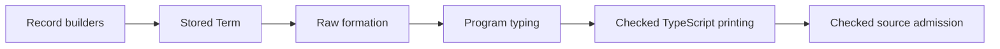

# The application surface: what an agent calls, and the open decisions

The live surface (§1) and the decisions still open on it (§2). The 2026-09-17 consolidation
assessment this document grew from, with its dated action lists, is kept as history in
[`docs/research/history/api-surface-assessment-2026-09-17.md`](../research/history/api-surface-assessment-2026-09-17.md);
rulings live in [decisions.md](decisions.md). The additions of 2026-10-03 (editing, session work,
composition) are §1.1.

## 1. The surface as it stands

A user's file imports five entry modules (decisions row 332): `Effect4.Author`
(`src/Effect4/Author.lean`), `Effect4.Run` (`src/Effect4/Run.lean`), `Effect4.Emit`
(`src/Effect4/Emit.lean`), `Effect4.Library` (`src/Effect4/Library.lean`) and
`Effect4.Laws.Author` (`src/Effect4/Laws/Author.lean`). Each re-exports the rows below that its
user needs, and declares nothing. Row 332 (1) also lists `derive_step` and the module form among
`Effect4.Author`'s exports, and `derive_step_eval` among `Effect4.Laws.Author`'s. None of them is
in the tree (reading, `git grep`): they wait for the module toolkit's G3 and G2 (`docs/STATE.md`).

| module | file | what an agent calls | laws |
| --- | --- | --- | --- |
| `Author` | `src/Effect4/Api/Author.lean`, `Program/Authoring*.lean` | `Module` (rows, services, layers, definitions, main, named types) → `Author.build : Except BuildRefusal Built`, admitted at the module's signature with its named types (decisions row 406 (2)); `Row.host`, `Row.call` by spelling; `ServiceDef.{use,give,layer,constant}`; `Package.install`; `Layer.{value,empty,mergeAll}`, `provide`, `provideAll`, `provideFresh`; `fork`, `daemon p`, `daemon p in s`, `await`, `join`; `Node.{at_,replaceAt,replaceLayerAt}`; `Built.{rebuild,typed,ty,requires,closed,positionOf,runSync,print,bytes}` | `build_table_lawful`, `build_rows_resolve`, `Row.call_scoped`, `carrier_unique`, `var_reserved`, `rebuild_spec`, `rebuild_self` |
| Program objects | `src/Effect4/Program/Object.lean`, `src/Effect4/Api/Object.lean` | `Object.{ofBuilt,open,bytes,read,load,ref,table,services}`; `Built.certificate` | `Object.{open_ofBuilt,open_ok_iff,read_exact,load_bytes,table_root_of_open}` in `src/Effect4/Laws/Api/Object.lean` |
| Service sessions | `src/Effect4/Api/Session.lean` | `Object.session : Object → String → Except SessionRefusal Object` (data to data), `Built.session : Built → String → Except SessionRefusal Built` (its admission, requirement row closed modulo the signature) | `Built.session_ok_iff`, `Built.session_retains` in `src/Effect4/Laws/Api/Session.lean` |
| `Author`: sketches and the edit session (since `90940a540`) | `src/Effect4/Program/Sketch.lean`, `src/Effect4/Program/Edit.lean`, `src/Effect4/Program/SketchWire.lean`, `src/Effect4/Program/Typing/PartsTable.lean` | `Sketch` (a program with its hole table), `Row.hole`, `SigApp.withHoles`; `Sketch.{hole,check,fillAt,omitAt,focusAt,table,refusals}`, the table part by part; `EditSession.{open,feed,feedStep,run,view}` over `Edit`; a sketch's canonical bytes, `Sketch.{encode,decode}`. `Sketch.check` checks the program as written, so it refuses a layer reference (`layerReference`) that program admission accepts; row 373 (7) rules the repair | `holes_conservative`, `Sketch.check_fill`, `Sketch.check_omit`, `Sketch.check_filled_module`; `EditSession.run_coherent`, `EditSession.reached_view`, `EditSession.feed_undo`; `Sketch.decode_encode`, `Sketch.decode_exact`; all through `Effect4.Laws.Author` |
| `Run` | `src/Effect4/Run/Basic.lean`, `src/Effect4/Run/Runner.lean` | `Run.open` (cannot refuse), `Rows.{start,flush,clock,receive,answer,control,tape}` into `List Command`, `Run.{play,step,answer,receive,control}`, `Run.observe : Observation` (first-order, with `fibers`), `Run.inspect : Inspection` (holds the machine), `Run.{work,nextControl,controlOnce}`, `Reactor σ`, `Reactor.tensor`, `Reactor.queue`, `Run.drive`, `runPure`/`runClock`/`runWith` | `open_total`, `journal_replays`, `drive_eq_play`, `drive_envelope`, `runPure_eq_run`, `answer_once`, `answer_accepted`, `bindCall_at`, `nextControl_spec`, `controlOnce_journal`, `play_controls_eq_replay`, `runClock_eq_run`; `Reactor.queue_spec`, `Reactor.tensor_left`, `Reactor.tensor_right` (`src/Effect4/Laws/Run/Runner.lean`) |
| `Run`, the tape | `src/Effect4/Run/Tape.lean` | What a tool reads off a run. The raw replay: `machineOf`, `replayFrom`, `enoughFor`. The machine's view: `MachineView`, `machineViewOf`, `machineView`. The tape of a journal: `Position`, `replyDecision`, `decisionOf`, `receiptRow`, `openedOf`, `readsOn`, `tapeFrom`, `tapeOf`. A run's budget premise and rest: `funded`, `atRest`. Reachable from the `Effect4` root; `Effect4.Api` does not export them yet | `tape_replays`, `funded_replays`, `tapeFrom_cut_replays`, `tapeFrom_position_replays` (`src/Effect4/Laws/Run/Tape.lean`); `applied_selects`, `control_retires` (`src/Effect4/Laws/Run/Rows.lean`) |
| `Run`, the live session (decisions row 373) | `src/Effect4/Run/Live.lean`, `src/Effect4/Run/View.lean`, `src/Effect4/Run/LiveRecord.lean` | `Built.ofSketch` admits before `Live.open`. `Live.feed` and `Live.feedAll` apply commands. `LiveRecord.restore` admits and replays a record. | `Built.ofSketch_error_iff`, `LiveRecord.restore_save`, `Live.view_classifies`, `Live.view_funded`, `Live.replay_at_call_instance` in `src/Effect4/Laws/Api/` |
| `Author`: an application and moved references (2026-10-13) | `src/Effect4/Program/Authoring/Application.lean`, `src/Effect4/Program/RowProtocol.lean`, `src/Effect4/Program/Address.lean` | `Application` (named entries with typed parameters over one row table, as one `Module`), a row's declared protocol; `Eff.rebaseRefs`, `Node.rebaseRefs`, `Path.rebase` | `moduleOf_table`; `conforms_sat`, `agrees_hostRun` (`src/Effect4/Laws/Program/Validated.lean`); `references_move` (`src/Effect4/Laws/Program/AddressMove.lean`) |
| `Supervision` | `src/Effect4/Api/Supervision.lean` | `supervision : Eff Op → List ForkSite`, `ForkSite.parent`, `fiberStatuses`, `daemonsQuiet`, `Supervised`, `Inspection.{fibers,forked,daemonsQuiet}` | `supervision_static`, `supervision_child_flag`, `status_persists`, `spawn_status_fresh`, `daemonsQuiet_iff` |
| `Api` (the older face) | `src/Effect4/Api.lean`, `Api/*.lean` | `check`, `explain`, `blame`, `author`, `Typed.*`, `TypedLayer`/`checkLayer`, `Inspection`, `replay`/`run`/`runSync` (no list of host answers: a host answer is a decision of the tape or the session, DI-23), `print`/`read` (the codegen face, `src/Effect4/Api/Codegen.lean`), `bytesOf`/`ofBytes`, `schemaOf`, `HostSession`, `Runner`, `RunnerBytes` | the DI-85/86 laws, `replay_unique`, the codec laws |

**The JSON an agent sends and reads.** The authoring tool's JSON profile (`Tool.CodecProfile`)
prints a program with each list as an array (`Canonical.print`), the encoding
`ts/eff/eff.gen.ts` types. It reads an agent's JSON in any order, with lists as arrays or as
their cases (`Canonical.ofJsonAnyOrder`).
The law is exactness modulo that normaliser (`Canonical.ofJsonAnyOrder_exact`,
`src/Effect4/Laws/Store/ShapeRead.lean`; decisions row 377 (1)).

Imports are clean: no module of the table imports `Laws`, `Test` or `Aesop`. Of the two library
roots, `Effect4` (`src/Effect4.lean`) imports four of the five entry modules, and `Effect4.Laws`
(`src/Effect4/Laws.lean`) imports the fifth, `Effect4.Laws.Author`. The exposure table
(`exposures`, `tools/Tools/ArchitectureRoles.lean`) gives the five the exposure `entry`, and also
`Effect4.Laws.Author.Explain`, the own import of `#explain` and `#obligations` (row 332, amended
2026-10-09). What the integration already unified: one size fold, `Api.Run` → `Inspection`, the
`Built` face through `Built.typed`, `Layer.all`/`printLayer`/`Built.run`/`authorModule` cut,
`with_` → `provide`.

`Object.session` selects a service of an object and writes its lifetime as the object's main program, data to data (row 441).
The lifetime initializes once, receives optional tagged requests, replies with each method's exit, and repeats until input ends.
Calls keep their definition positions. The original declarations, bodies, layers, and signature declarations remain; protocol rows append.
The lifetime provides nothing: the keys it requires are the signature's services, which the host supplies at every target. Existing admission refuses unsupplied program parameters.
`Built.session` is that construction followed by admission; every requirement left on a successful result is a key the signature types (`ServiceSession.foreign` is empty).
`SessionRefusal` retains service formation, scope, and admission failures, or names a missing service or remaining requirements.
Construction does not establish target printing, transport support, termination, or physical host behaviour.
The host continues through existing call-instance reply admission.

`Reactor.tensor` combines two host states and gives the left answer priority.
For disjoint supported rows, each reactor changes only its own state component.
`Reactor.queue requests` answers the session's request and reply rows.
Its `requests` argument does not initialize state: pass the initial list separately to `Run.runWith`.
The remaining list is the queue's state; replies remain observable through the run's journal.
The equations have compatibility role under `queue-reactor`, serving R6 and R13.
They establish no client/session agreement theorem or host progress.

### 1.1 Editing, session work and composition (2026-10-03)

**Edit, then check the whole candidate.** `Node.replaceAt` replaces an existing node with
another of the same sort. Paths follow structural children: `[]` names the root; for
`bind p q`, `[0]` names `p` and `[1]` names `q`. A missing path or wrong sort returns `none`.
This path language covers the seven program-node sorts; it does not descend into `Term`.
`replaceLayerAt` uses the same operation, so existing layer hoisting and restoration retain
one update mechanism. The lookup, overwrite, restoration and disjoint-path laws are in
[`Laws.Program.References`](../../src/Effect4/Laws/Program/References.lean).

`Built.rebuild` checks a candidate against the original table. A
successful result supplies the newly admitted program and type; the type may differ from the
old one. It reuses the final admission step of `Author.build`, including located typing
refusals. It does not relocate variables or references, or establish unchanged behavior.
Here the outer result reports a structural failure and the inner result reports program admission:

```lean
open Effect4

def editProgram (b : Api.Built) (path : List Nat)
    (replacement : Api.Program) :
    Option (Except Api.BuildRefusal Api.Built) := do
  let node ← (Program.Node.eff b.program).replaceAt path (.eff replacement)
  let candidate ← node.eff?
  pure (b.rebuild candidate)
```

[`AuthorContract`](../../Test/Program/AuthorContract.lean) exercises a changed result type
with a nonempty row table, retains table/names, and refuses an unbound variable or a removed
reference target. Whole-program checking matters: even a layer replacement with the same
local type can invalidate references from elsewhere in the program.

**Read recorded work before choosing a control.** `Run.work` exposes runnable fiber IDs,
queued dispatcher owners, outstanding host calls, received reply keys and timer waits.
Queued work is visible even while another fiber is waiting for the host. `nextControl`
selects a queued flush first, otherwise evaluation of the first runnable fiber in machine
order; it selects nothing for a stuck machine. `controlOnce` executes at most that one
control through the existing checked session and journal, or returns the run unchanged.
Inspect the resulting phases and observation: a selected command may refuse or exhaust its
fuel. Host replies, applying received replies and advancing the clock remain caller choices.
An empty work view does not certify completion or deadlock.

[`RunContract`](../../Test/Run/RunContract.lean) demonstrates a yielded continuation, internal
work alongside a host wait, pending receipts, timer waits and insufficient fuel. The selection
and journal laws live in [`Laws.Run`](../../src/Effect4/Laws/Run.lean). For a control sequence,
`play_controls_eq_replay` compares its resulting machine with raw replay when every newly
recorded phase is `.progressed`. The existing history may contain other phases. That premise
is accepted execution at the supplied budgets, not a general progress or termination theorem.

For successful host replies, `HostSession.preflight_success_prepared_fits` and its
`submit_success_prepared_fits` consumer connect actual acceptance on a non-stuck machine to the prepared value at
the selected external row. Membership requires that row's answer type to satisfy
`Typed.shapeDecides`. The result retains the selected call and decision; it does not apply
the receipt, cover failed replies, or establish full T4 token/world correspondence. The
concrete session fixture is in [`HostSessionContract`](../../Test/Api/HostSessionContract.lean).

**Compose a semantic comparison within its proved fragment.**
[`Denote.StraightEq`](../../src/Effect4/Laws/Program/MeaningEq.lean) relates existing straight
programs by equality of exit and complete stores for every environment and initial store.
Its composition laws cover binding, selection, cause handling and finalization; removing a
suspension is one concrete use. `run_agrees_at_bound` supplies sufficient budgets for both
programs and concludes equal exits/stores from the existing empty initial machine setup.
[`MeaningEqContract`](../../Test/Program/MeaningEqContract.lean) checks a rewrite under failure
and cleanup, including retained state. This comparison does not cover traces, arbitrary
finite-fuel frontiers, loops, scheduling, row tables or target execution. It contributes
to T5, not the general relation. Typing an edited program still uses admission separately.

### 1.2 Named records

The record builders live in [`Program.Authoring.Records`](../../src/Effect4/Program/Authoring/Records.lean).
They produce the existing `Term` language and use the ordinary program checker.

| Builder | Result |
| --- | --- |
| `record fields present` | A record with its full declaration and explicitly supplied fields. |
| `field target name` | The value of a declared required field. |
| `optionalField target name` | An outer option that reports own-field presence. |
| `recordSet target name value` | A new record with that field required at the replacement type. |
| `ascribe ty e` | A term at a declared type: a record with one field declared at `ty` that holds `e`, and a read of that field. The record's check decides it, so it is no cast. |

`ascribe` lives in [`Program.Authoring.Ascribe`](../../src/Effect4/Program/Authoring/Ascribe.lean).
`Effect4.Api` does not export it yet: a client imports the module by name (decisions row 284).

An absent field differs from a present field containing `undefined` or an empty option.
Updating a field can change its type.
Every alternative of a union must support the requested read or update.
Records retain all field names, including names that need TypeScript bracket access.
The key spelling follows decisions row 196.



Checked declaration production and source admission check stored annotations as well as the final result type.
Raw TypeScript printing and reading retain unsupported metadata for exact structural reconstruction.
Source admission also requires permitted lexical bindings, including the host's record helper imports.
A successful source reading establishes no target execution claim.

The structural reader laws live in [`Laws.Codegen.ReadLeaf`](../../src/Effect4/Laws/Codegen/ReadLeaf.lean).
The focused boundary controls live in [`RecordEmission`](../../Test/Codegen/RecordEmission.lean).
The source and runtime controls remain finite checks.

### 1.3 Declared operation modules

`eff_module` lives in [`Program.Authoring.Module`](../../src/Effect4/Program/Authoring/Module.lean).
It generates authoring declarations from one operation list.
Each entry gives its runtime parameters, answer, optional error, optional service requirements and body.
Semicolons separate entries.
Header parameters are explicit typed Lean binders, fixed when the instance is constructed.

```lean
import Effect4.Api.Author
import Effect4.Library.Queue.Defs

open Effect4 Effect4.Program Effect4.Program.Authoring

def numbers := Queue.Definitions.make "numbers" .nat

def program : Src NativeOp := eff do
  let queue ← Queue.bounded .nat 2
  let _ ← numbers.offer queue (nat 7)
  numbers.take queue

def checked := Api.Author.build (numbers.module program)
```

`Queue.Definitions` lives in [`Modules.Queue.Defs`](../../src/Effect4/Library/Queue/Defs.lean).
`Semaphore.Definitions` uses the same command in [`Modules.Semaphore.Defs`](../../src/Effect4/Library/Semaphore/Defs.lean).
The operation bodies remain their existing library builders.

```lean
eff_module Counter using self where
  start : .nat := self.count (nat 3);
  count (n : .nat) : .nat :=
    ifElse (app "eq" [n, nat 0]) (succeed n)
      (self.count (app "sub" [n, nat 1]))
```

The optional `using self` header gives each body the group's invocations before constructing any body.
Forward invocations and recursive invocations need no Lean recursive definition.
Execution remains subject to the existing fuel frontier.

| Generated member | Use |
| --- | --- |
| `Name.make instanceName parameters` | Construct one instance with its names, invocations and definitions. |
| `instance.operation arguments` | Invoke that instance's operation. |
| `instance.defs` | Inspect or explicitly assemble its source definitions. |
| `instance.install module` | Prepend its definitions and retain every other module field. |
| `instance.module main` | Construct a module with those definitions and that main program. |
| `Name.definition.operation name parameters` | Construct one definition under an exact spelling. With `using self`, supply the generated call record last. |
| `Name.calls instanceName` | With `using self`, construct the group's invocation record. |

`Def.of` in [`Program.Authoring.Defs`](../../src/Effect4/Program/Authoring/Defs.lean) checks declared parameter count against the curried operation type.
`Def.qualifiedName` gives each generated invocation a printable TypeScript binding name.
ASCII letters and digits stay readable. Other UTF-8 bytes receive decimal escapes.
The instance and operation components have a separate delimiter.

Install dependencies explicitly through their instances.
Use distinct instance names for distinct specializations.
Repeated installation retains the existing duplicate-definition refusal.
`Package` remains a host library's rows and services.

The defaults are `error .never` and `requires []`.
The body checker checks these columns through ordinary program admission.
The command accepts term parameters of the program, not stored Lean functions or program bodies.
Higher-order builders remain expanded under decisions row 328.

The commands produce the existing root `Eff.defs` block through `elaborateModule`.
They add no stored program representation or semantic theorem.
The general inlining observation remains open under decisions row 329.
Queue and Semaphore definition headers remain outside `DefDecl.readable` because their handle request types do not read back.
Their programs print to TypeScript. The existing reader refuses those headers with `ReadRefusal.shape "definition"`.
The older Queue definitions have the same refusal.

## 2. The open decisions (2026-09-17)

Ten, deduplicated from the 2026-09-17 receipts and scouts, ordered by what depends on what, each
with the recommendation and the reason. A ruling is made only when written into `decisions.md`.

**D-A — records at the boundary.** Decisions rows 165, 178, 195 and 196 settle the record representation and its TypeScript spelling.
Section 1.2 describes the authoring surface.
The decisions register owns the rulings.

**D-B — what a handle publishes, and whether a described handle crosses.** (D's D-2, C's D8.)
*Recommend:* a host reviver mints the index (rc.112's `SchemaRepresentation.ts:574`).
The six `effect/schema/*` declarations need that mechanism for D-E.
The MCP face refuses a row whose request or completion describes a handle from another process, but admits that row in-process.
The schema accepts it either way; this is not a schema check.

**D-C — the table travels by digest.** (C's D3 + D7.) *Recommend yes now:* `Built.digest`,
`(digest, Run.id)` as the wire identity, the `Call`/`Header` carrying the digest. Changes the
wire shape of `Header` and `Call` (compat policy), which is why it is a decision and not §4.

**D-D — the consumer that makes D12 a claim.** (D's D-5.) *Recommend:* the S-5 truth-lane gate
first — every corpus program's recorded exit decodes under its own `Schema.Exit(…)` — then the
printer's `Effect.Effect<A,E,R>` annotation (F5). The gate is the only one of the three that can
fail.

**D-E — where the `Schema.*` text comes from.** (D's D-6.) **Ruled** by decisions rows 392 (2),
P4 (a), and 395 (9). The text is a second algebra of the representation fold,
`Codegen.SchemaCode` (`src/Effect4/Codegen/SchemaCode.lean`, `Api.schemaCode`). rc.112's
`toCodeDocument` is a finite oracle of it in `make check-ts`. The recommendation above it was rc.112's
`toCodeDocument` with a reviver table. rc.112's code quotes a `__proto__` key, so its object
literal drops that field.

**D-F — the MCP server.** (C's D1, D2, D4, D9, D10, D11 — one choice.)
*Recommend:* a Lean `--run` driver `Tools.McpRun` over a `ToolSpec` table inside the gate (`Effect4.Tooling.ToolSpec`).
It offers fourteen tools with `run.play` withheld.
The server holds the journal; `journal_replays` makes the cached `Run` an optimisation.
No reactor crosses the wire.
The run protocol precedes R12's inspection protocol.
Four of its nine commands are buildable; five need a `Doc` that does not exist.
`Built` supplies the reason: a `Module` is a Lean function, and a certificate is a `Prop` record.
Only a Lean host gets `open_total`.

**D-G — the three root modules and the daemon words.** (D-I2, daemons D4.)
*Recommend:* agent imports `Effect4.Author`, `Effect4.Run` and `Effect4.Face`, with `Api.*` as the deep source underneath.
Decisions row 332 settles that file-move wave as five entry modules.
The recommended fiber words are `fork`, `daemon p in s` and `detach p`, without an author-written flag at a pin.

**D-H — one machine edit.** (Daemons D3 + §2.11.) *Recommend yes:* a path on `RunEvent.forked`
(closes "at those paths") and the race-entrant options named once, in the same rebuild.

**D-I — `nativeSignatureWith` and `gen`.** (D-I3, §2.9.)
*Recommend:* keep the custom-carrier check at the declaration site until an application needs a seventh carrier.
Threading it changes `Built`, `Built.ofSketch`, `Run.open` and the program admission statements.
The recommendation also asks whether `gen` stays a printer spelling without an authoring lift.
Under that choice, authored programs never contain `Stmt`.
The alternative is to retire the statement family from `Eff`.

**D-J — how canonical TypeScript is generated.** The owner raised these requests later on 2026-09-17:

> the semantics of how we generate canonical TypeScript representations might need to be refined

> refactor the lowering with LCNF so we can author canonical parts for Effect in TypeScript — the session
> APIs — and prove API correctness, robustness, version handling, data structures

The proposal gives three rules that gates can check:

1. Every TypeScript artifact names the canonical object it folds.
   Programs fold `Eff` through the template table (laws 11/12).
   Types and schemas fold `Document` (the rc.112 mirror, the retraction, the pins).
   Code folds the LCNF closure (session transitions, codecs, atoms; the Conform rungs provide the differential).
   `check-gen` rejects folds from other inputs.
   These include the Lean environment, which `TsGen` reads today, and hand transcription, as in `prelude.ts`.
2. The TypeScript side holds no second schema representation.
   Static types and runtime schemas come from the same `Document`.
   Thus `eff.gen.ts`'s `TaggedUnion` and `Ty.schema`'s `anyOf` become one encoding.
3. Code with a Lean law crosses only by LCNF lowering, never by mirror.
   The proposal lowers `runner.gen.ts` and `prelude.ts` from LCNF beside `ocaml/gen`.
   `advance_step` would then describe the TypeScript host too.

*Recommend:* adopt these rules now; they decide D-E and D-F the same way.
The LCNF-to-TypeScript backend follows D-C/D-F's Lean driver, inheriting a settled `ToolSpec` table.
The session of 2026-09-17 holds the kv walk-through and three inline diagrams.
They show today's schema locations, the proposed pipeline, and the kv module's crossings.

The following observations are not decisions:

- The error column stays wide (D's D-4, a sound answer type relative to the checker judgment, without tightness); D-H was rejected.
- `FiberStatus.root` stays (daemons D1).
- The six `rfl` proofs stay `rfl` (daemons D2).
- `Repr` is not derived (C D12).
