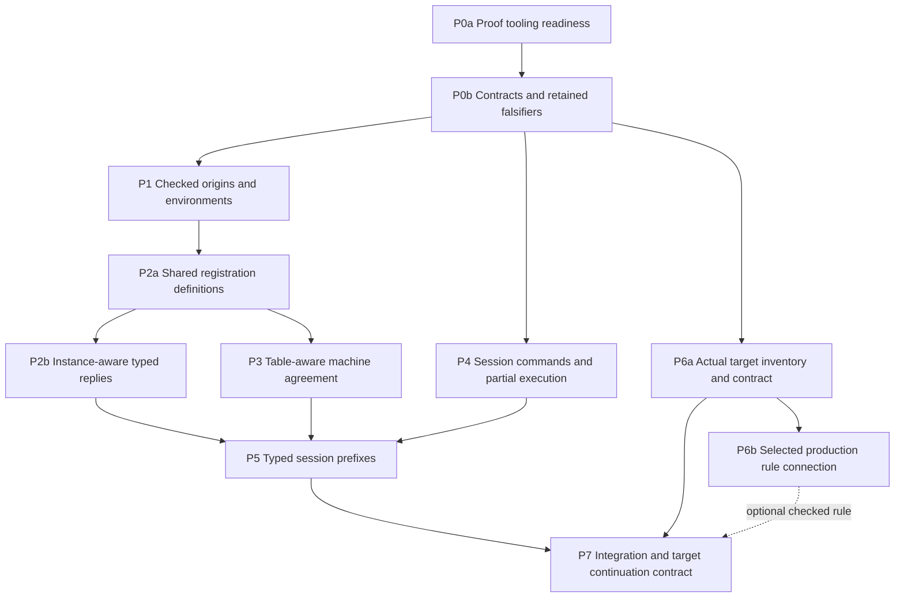

# Host-session and OCaml lowering foundation plan

Status: implementation plan, history rather than authority.
Base: `faad3e9ecb782b9c82362cc0907d68b66b9ef5ed`.
The owner ratifies this direction on 2026-10-04.
Claude coordinates implementation after reviewing this packet.
Codex prepares the packet and independently reviews its landings.

## Goal and boundary

Retain checked call information, connect keyed session commands to reference execution, and expose the actual OCaml translation obligations.
The first typed session theorem covers ordinary values and current errors in shape-decided columns.
It covers `.ofExit` replies without allocation or internal handles.
Allocation, `.ofRefGet`, physical host resources, and crash recovery retain separate obligations.
These theorem limits do not narrow existing program admission or remove existing execution paths.

The packet contains [proof placement](proof-map.md), [tooling readiness](proof-infrastructure.md), [acceptance checks](acceptance.md), and [scout findings](scout-review.md).
The [dispatch](dispatch.md) gives the coordinator's start and stop rules.

## Existing evidence

Source inspection confirms the following declarations at the base.

| Connection | Existing declaration and owner | Limit |
| --- | --- | --- |
| Whole-program checking | `TypedProgram.hasTy`, `src/Effect4/Laws/Program/CheckedTyping.lean` | Its judgment checks expanded references. |
| Conservative checking | `check_restrict`, `src/Effect4/Laws/Program/Signature.lean` | Requires `SigProgram` and `SigExtends`. |
| Row extension | `typedProg_rows_append`, `src/Effect4/Laws/Program/Typed/Residual.lean` | The new call instance needs its own extension law. |
| Machine agreement | `run_eq_ref`, `src/Effect4/Laws/Program/RuntimeR.lean` | The row table is empty. |
| Successful reply membership | `preflight_success_prepared_fits`, `src/Effect4/Laws/Api/HostSession.lean` | Shape-decided template columns; no token correspondence. |
| Checked execution | `reachable_typed`, `obs_typed`, `src/Effect4/Laws/Program/Typed/Commands/Clauses/All.lean` | Requires `AdmittedTape`; the native replay connection uses an empty row table. |
| Recorded replay | `journal_replays`, `src/Effect4/Laws/Run.lean` | Reconstructs a reached Lean run from its exact inputs. |
| Byte replay | `replayRows_eq_replay`, `src/Effect4/Laws/Api/RunnerBytes.lean` | Decoded commands run through the same Lean runner. |

The existing M5, M6, and M7 proofs remain obligations to retain on their stated domains.
The DI-57 scratch probes support local preparation agreement.
They do not establish session projection, the generalized invariant, or a current target execution theorem.
The reviewed DI-57 brief is an untracked historical input in the coordinator checkout.
The [receipt](receipt.md) identifies that input; its old checks are not evidence for this packet's base.

## Ratified implementation choices

1. Retain checked call metadata beside `TypedProgram`, indexed by the exact program and full signature.
2. Use original source origins; connect reference expansion to those origins by a proof.
3. Retain the checker's environment through local runtime transitions and captures.
4. Derive token typing from registration; never assume the desired instance-to-token relation.
5. Distinguish a live registration from one interrupted while settling.
6. Prove table-aware machine agreement independently of reply typing.
7. Connect session commands individually, including committed fuel frontiers and refusals.
8. Bind each target claim to its actual roots, emitted bytes, profile, layouts, externs, and toolchain.

These choices refine the ratified direction rather than change its language behavior.
P0 checks each dispatchable statement in Lean and records remaining representation choices before dependent work starts.
The coordinator records decision amendments in the existing registers.

## Dependency graph

Solid arrows are prerequisites.
P2b and P3 share registration definitions; their proofs answer different questions.

The P2a-to-P3 edge fixes shared definitions before broad proof migration.
It is an implementation ordering choice, not a logical dependence of agreement on typing.
P3 may scout its invariant split while P1 proceeds.
The dotted arrow contributes evidence when available; it does not release an unfinished target obligation.
P4 may prove unchanged command cases before P2a lands.

## Slices and edit ownership

Every seat starts from the coordinator's recorded commit after its prerequisites land.
The branch names below are proposed names, not existing checkouts.
The coordinator alone edits authority documents, root imports, the semantics registry, and generator dispatch.
New library modules remain reachable from the appropriate existing root.
New batteries remain reachable from `Test/All.lean` at assigned import anchors.

### P0a: proof tooling readiness

Seat: tooling coordinator, reviewed by an independent tooling scout.
Goal: release implementation only after the existing proof tools cover the planned workflow.

Follow [tooling readiness](proof-infrastructure.md).
Use the existing semantics registry, obligation ledger, report, and checks.
Repair demonstrated freshness or coverage defects before relying on their results.
Review exact statement ownership, loaded roots, goal retirement, trust checks, and generated report inputs.
Done: the readiness receipt passes independent review and names no unresolved defect that affects the first dispatched slice.
This review needs no second owner approval unless it changes a ratified meaning.

### P0b: contracts, controls, and interface freeze

Seat: coordinator with an independent falsifier seat.
Branch: `codex/foundation-contracts` or the coordinator's own branch.
Goal: make every later statement executable to check and explicit about its assumptions.

- Register the selected questions from [proof placement](proof-map.md).
- Check exact declarations against the base and pinned compiler before assigning their proof bodies.
- Retain the row-183 and fuel controls from [acceptance checks](acceptance.md).
- Freeze registration identity, metadata ownership, observation, and both budget meanings.
- Inventory generated consumers of any changed alphabet before editing that alphabet.
- Reconcile DI-57's obsolete replay signature without inventing a new public replay API.

Editable paths: new contracts under `Test/contracts/` and controls under `Test/Program/` and `Test/Api/`.
Proposed goal owner: `src/Effect4/Laws/Foundation/Obligations.lean`; the coordinator assigns its exact import anchor before dispatch.
Open Effect4 statements live under `src/Effect4/Laws/` and remain reachable from `Effect4.Laws`.
Target statements stay under their named target proof roots and explicit extraction roots.
Coordinator paths: `docs/core/semantics.md`, `docs/core/decisions.md`, `docs/DESIGN-ISSUES.md`, and `tools/Tools/SemanticsRegistry.lean`.
P0 does not implement a new session or target.
Record questions as absent when their exact types require later definitions.
Do not create trivial placeholder propositions to make their counts visible.
Done for each dispatch: its statements check, its controls distinguish rejected claims, and every assigned proof has a consumer.
Repeat this freeze after prerequisites define a later slice's interfaces.

### P1: checked origins, environments, and instances

Seat: checking and origins.
Branch: `codex/checked-call-origins`.
Goal: compute the call instance from the existing checker and transport its evidence to runtime positions.

Editable areas: `Program/CheckedTyping`, `Program/Checker`, `Program/Typing`, `Program/Admission`, and their law modules.
Runtime typing areas: `Laws/Program/Typed/Admission.lean`, `Denotation.lean`, and `LayerArm.lean`.
All `Program` paths in this packet are under `src/Effect4/` unless prefixed otherwise.

Required work: F1, F2, and F3 in [proof placement](proof-map.md).
The metadata projection retains the old checker result and refusal order.
The metadata binds the full signature, including service declarations.
Multiple dynamic calls may share one static origin.
Expansion aliases must select the same entry or carry an explicit distinguishing static key.
The key cannot be chosen by the host or reconstructed from runtime values.

First prove the binder example without references.
Then cover referenced layers, generators, loops, captures, and forked bodies.
Keep produced-value typing as a local premise; P5 proves the strengthened reachable-state invariant.
Claim all existing program-checker cases only after every local transport case checks.
An unproved case remains visible; it does not become a new ordinary-program refusal.
Done: every in-scope external call obtains its unique checked instance, with static environment evidence and extension laws.

### P2a: shared registration definitions

Seat: external registration, with the reference and session seats reviewing the interface.
Prerequisite: P1; P0b freezes the registration contract first.

Land the first-order registration identity and the narrow consumer adaptations needed to compile it.
Assign `CodeMeans.asyncForeign`, `Means`, request readers, and await/reason consumers in the brief.
Use additive definitions and projection connectors where existing consumers need staged migration.
Do not change existing theorem statements to make the migration compile.
Done: the shared definitions and direct consumers pass their narrow builds at one recorded commit.
P2b and P3 start from that commit.

### P2b: registration and prepared completion typing

Seat: external registration and reply admission.
Branch: `codex/checked-call-delivery`.
Prerequisite: P2a's checked definition commit and P1's producer laws.

Editable paths: `Program/Compile.lean`, `Program/Admit.lean`, `Laws/Program/DenoteR.lean`, `Laws/Program/Admit.lean`.
Typing paths: `Laws/Program/Typed/Residual.lean`, `Denotation.lean`, and `Commands/Clauses/Async.lean`.
Session paths: `Api/HostSession.lean` and `Laws/Api/HostSession.lean`.
Handle-law repairs remain within `Laws/Program/Handles/` and retain their current restrictions.

Required work: F4 and F5.
Carry the frozen origin or instance identity in external registration data.
Use one instance lookup for reply checking, preparation, and the retained oracle path.
Derive the token declaration and saved continuation from the actual registration.
Connect the prepared result to the recorded decision payload through `CompletionStrong`.
For `.ofExit`, prove preparation retains the payload and state under the stated profile.
Cover success and failure; the oracle fast path remains a separate case.
Recheck liveness when a reply applies.
Retain row 191's reserved-defect refusal and current handle restrictions.
Done: actual prepared `.ofExit` completions fit the live token on the declared initial reply profile.
The receipt identifies allocation and `.ofRefGet` obligations separately.

### P3: table-aware machine agreement

Seat: reference simulation.
Branch: `codex/table-reference-agreement`.
Prerequisite: frozen registration definitions; no dependence on P2's typing proof.

Editable paths: `Laws/Program/InterpR.lean`, `EvaluateR.lean`, `RuntimeR.lean`, and `Simulation/`.
New local lemmas may live under a proposed `Laws/Program/Table/` directory.
This seat does not edit `Program/` or `Machine/` definitions.

Required work: F6.
Thread the same row table and initial oracle answers through both loads and evaluators.
Share preparation behavior while proving its state and code relations.
Retain `BookMeans`, the generalized machine invariant, and equality of decision-sufficiency receipts after each step.
Equal `obs` follows from that relation; it does not recover saved guards or stacks by itself.
Split the general store invariant from the empty-allocation fact.
Retain the empty-table allocation theorem consumed by `exits_hasTy`.
Keep `run_eq_ref` available with its existing statement.
Prove raw agreement for arbitrary tapes; derive any restricted contract as a corollary.
Done: related loads produce matching declared observations at every table under the frozen budgets.

### P4: session command correspondence

Seat: session and journal laws.
Branch: `codex/session-command-correspondence`.
Prerequisite: P0; rebase once after P2's session definition changes.

Editable paths: new leaves under `Laws/Api/`, plus `Laws/Run.lean` for connecting existing public laws.
Changes to `Api/HostSession.lean`, `Api/Runner.lean`, or `Run.lean` require coordinator serialization with P2.

Required work: F7.
Account for every `Runner.Command` constructor and every resulting phase.
Extract an applied decision from the selected binding and reply at that exact prefix.
Retain the command-sufficiency receipt independently of guard consumption.
Refused commands leave the machine unchanged; binding and receipt retain their session changes.
Committed frontiers retain their machine changes.
A zero-fuel application has no committed change.
A protocol refusal after speculative execution retains the original session.
Do not equate inspection of a final machine with a raw replay result without a connector.
Done: every command and journal prefix has the frozen state and phase correspondence.
A raw `replayEval` corollary states its sufficient-budget or first-frontier restriction explicitly.

### P5: typed session prefixes

Seat: integration proof.
Branch: `codex/typed-session-prefixes`.
Prerequisites: P2, P3, and P4.

Editable areas: new `Laws/Api/` leaves and the necessary typed-state connectors.
The coordinator assigns any shared `Typed/Assembly.lean` change before this seat starts.

Required work: F8a and F8.
Start from an actually initialized session, not an arbitrary value of `Session`.
Relate each native prefix to its typed reference state and exact checked source.
Retain an actual world witness and derive each answer premise at that world.
Derive answer admission from the actual live call and successful executable check.
Prove table-aware one-decision typing with independent compile and command budgets.
Cover insufficient receipts because session journals may continue after them.
Use prefix induction to discharge each local environment and host-answer premise.
F5 supplies `AnswerOk` at the retained world from successful preflight at that prefix.
F8a retains the strengthened origin/environment invariant for the next prefix.
The initial F8 profile starts with an empty oracle; F6 retains arbitrary matching oracle inputs.
Done: the declared `.ofExit` profile has typed prepared completions and typed reachable session prefixes at nonempty row tables.
This result does not claim host responsiveness, general resource ownership, or target execution.

### P6a: the actual target inventory and contract

Seat: OCaml boundary and representation.
Branch: `codex/session-target-boundary`.
Prerequisite: P0; no dependency on the host typing proofs for its inventory.

Editable areas: `ocaml/gen/roots.json`, `src/OCaml5/`, `tools/Conform/`, and selected `ocaml/engine/` files.
The coordinator owns changes to the generated groups and their declared input inventory.

Required work: specify F9 and F10 against the actual artifact.
Check that the target definitions support the proposed kernel proof before freezing it.
Existing partial executable interpreters supply finite checks, not automatically usable universal proof equations.
Inventory the keyed runner's dependency closure before selecting an executable artifact.
Record refusals reached by that closure rather than substituting the existing lower-level engine.
List generator arguments, persisted declarations, builtin rewrites, extern substitutions, carrier operations, and generated layouts.
Bind interfaces, build files, compiler flags, target word profile, and emitted artifacts in the input inventory.
Inventory the required connections from source fields to actual layouts, extern rows, emitted constructors, and projections.
Specify binding-order obligations and distinguish unbound, waiting, and received reply slots.
Bind scalar obligations to actual arithmetic, store updates, and identity supplies.
Refresh the artifact contract after P2a or another prerequisite changes the reached definitions.
Out-of-profile behavior remains outside catchable program failures and fuel frontiers.

Done: the closure inventory names each emitted rule or located refusal, its owner, and the exact next contract.
A located refusal leaves artifact generation open and names its blocking implementation slice.
The coordinator freezes that slice before assigning it.

### P6b: one actual production connection

Seat: OCaml boundary and representation.
Prerequisite: P6a produces the selected artifact and P0b freezes its exact F9/F10 statements.
Editable paths: the specific emitter rule, layout, extern, or prelude files identified by that contract.

Choose a rule reached by that artifact; do not prove an unused model rule.
Connect its actual emitted representation and operation to the named target semantics.
A candidate is the actual `Nat.add` expression under a result bound, after P6a confirms that the artifact reaches it.
A bounded arithmetic equation does not implement refusal outside its bound.
Keep refusal enforcement and other arithmetic rules as separate obligations.
Kernel proof, proved artifact validation, and finite target comparisons remain distinct evidence.
Done: the selected production rule satisfies its exact statement, with its assumptions and scoped axiom output.
A blocking witness leaves P6b open.
A one-rule result leaves F9's remaining representation connections and F11's command proof open.

### P7: integration review and target continuation contract

Seat: coordinator, reviewed independently by Codex.
Prerequisites: the P1–P5 receipts and P6a inventory.
Include P6b's checked rule if it lands; an open P6b does not block source/session integration.

Verify the integrated typed-session result and retain every empty-table compatibility result.
Produce F11's exact remaining rule list, initialization relation, observation, budgets, and trust assumptions.
Check its contract in Lean once the selected target definitions support it.
Otherwise record the missing definitions and the first concrete implementation slice that supplies them.

Done: the integrated source/session evidence passes review and the next target slice has an explicit contract and owner.
F11 remains open until every required rule, initialization case, and command connection is proved.
One F10 theorem cannot release a general target command theorem.
P5 supports the later typed-target composition; untyped target agreement can proceed independently.
An overnight boundary does not change a statement or erase an open obligation.

## Full-program requirement coverage

| Requirement | Work in this wave | Work retained after its initial profile |
| --- | --- | --- |
| R1 | Exact source and full signature in F1–F3, F6 | Arbitrary runtime alphabets. |
| R2 | Checker projection, origin lookup, row extension, format compatibility | General extension obligations outside the touched forms. |
| R3 | Existing data constructors retain their type metadata and membership | Structured errors, recursive types, native schema operations. |
| R4 | Store correspondence; allocation obligations stay explicit | Generic cells and world-reading replies. |
| R5 | Checked environments retain service requirements | Global service-presence theorem and code-valued services. |
| R6 | F4–F8 connect live replies and session execution | Actual host binding against `HostSpec.RowStep`; resources. |
| R7 | Origin, resolver, environment, and capture correspondence | General stored code resolution. |
| R8 | F6, F9–F11 name observations and translation assumptions | Remaining production rules and targets. |
| R9 | Existing M5–M7 scopes retained; executable answer premise discharged | Closed-row service-presence strengthening. |
| R10 | Existing forms retain typing and scope laws | Native library behavior laws and broader composition. |
| R11 | Guard consumption and retired pending replies remain accounted for | Physical cleanup, compensation, whole-run release. |
| R12 | Command receipts, frontier observations, and budget distinctions | Operational progress classification and fairness. |
| R13 | Same load inputs, source, profile, budgets, and journal | General configured loading and durable recovery. |

## Integration discipline

Land explicit-path commits after narrow checks of changed modules and direct consumers.
Use `LEAN_NUM_THREADS=3`; run one Lake process per worktree.
Do not copy the research directory into another worktree.
Use generated outputs only through their declared producers.
The coordinator batches shared alphabet and root-import edits at assigned anchors.
Update touched prose to `docs/core/controlled-english.md` in the same slice.
Keep status in the semantics registry and generated reports; receipts record dated evidence.
Do not run a whole battery or full sweep without the owner's request.

## Completion and monitoring

Each slice finishes only when its proof obligations, controls, generated consumers, and receipt agree.
A target theorem requires every local connection in its statement.
Name external compiler and runtime assumptions separately; an unproved local connection remains open.
No open ledger goal count establishes that readiness.
The [dispatch](dispatch.md) gives monitoring boundaries and the next action after an interruption.
