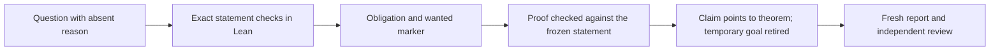

# Proof tooling readiness before feature implementation

Status: source-reviewed setup requirements; execution evidence belongs in the P0a receipt.
Base: `faad3e9e`.
The owner requires this setup and its independent review before feature implementation.

## Question

Can the existing tools represent, check, and report this wave's obligations without hiding missing statements or stale evidence?

## Existing owners

| Concern | Owner | Current boundary |
| --- | --- | --- |
| Concepts, claim roles, and evidence pointers | `Tools.Semantics.registry`, `tools/Tools/SemanticsRegistry.lean` | English descriptions and claim associations are authored. |
| Exact open statement | `ProofGraph.Obligation`, through `src/Effect4/Laws/Auto/Obligations.lean` | The marker records a proposition; constructing it does not prove that proposition. |
| Explicit pending evidence | `#proof_wanted`, in that module | Creates the associated wanted marker without repeating the proposition. |
| Exact proof checking | `#obligation_proved` and `#typed_state_obligations`, in that module | Compare propositions and reject missing, stale, changed, or disallowed evidence. |
| Claim reporting | `buildReport`, `tools/Tools/Semantics.lean` | Derives status from loaded declarations and evidence pointers. |
| Trust and module coverage | `Test/Audit/AxiomGate.lean` | Audits the declared Effect4/Test closure; unrelated target namespaces need explicit coverage. |
| Freshness | Semantics rules in `Makefile` | Declared inputs and loaded-root traces must cover every report consumer. |
| Dependency review | [Proof placement](proof-map.md) and per-slice contracts | The current claim record contains no planned prerequisite graph; P0a adds it to the existing owner. |

## Small extension to the existing claim record

Add proposed `Claim.prerequisites : List String := []` in `tools/Tools/SemanticsRegistry.lean`.
Extend `buildReport` and its existing controls; do not create another claim database.
Reuse the dependency validation in `ProofGraph.check` where exact goal sets exist (`tools/ProofGraph/Ledger.lean`).
Share its graph validation for absent or assumed claims without fabricating propositions or evidence.
Validate unknown IDs, duplicate edges, self edges, and cycles across the full claim graph.
Validate it before selecting exact goals; do not drop edges to theorem, absent, or assumed pointers.
Render these authored edges in both report formats and generate the dependency diagram from them.
Keep declaration status independent of prerequisite readiness.
A theorem with open premises remains a proved conditional theorem; its downstream release remains blocked.

These are planned claim prerequisites, not extracted kernel dependencies.
Lean proof checking establishes the proof term's actual dependency and trust properties separately.
Reviewers compare the authored edges with the exact hypotheses and named consumers.
Implementation ordering, such as shared-file ownership, remains in the slice plan rather than the semantic graph.

Populate only the selected claims and their existing direct prerequisites.
Add existing claim IDs as edges when the new statement consumes their result.
Keep future artifact questions absent until their definitions and exact prerequisites exist.
A renamed or deleted prerequisite must fail until its consumers are updated explicitly.

The initial new-claim edges are F1 to F2, F2 to F3, F2/F3 to F4, and F4 to F5.
F8a consumes F3–F6; F8 consumes F3–F7 and F8a.
F9/F10 feed F11 alongside F7 and every production rule selected by P6a.
F6 and F7 have no logical dependence on the new typing proofs.
This sketch becomes generated output after the semantics registry extension; it is not a second live graph.

## Edit ownership

The tooling coordinator owns `Makefile`, `scripts/status.py`, and the semantics report sources.
The report sources are `tools/Tools/SemanticsRegistry.lean`, `Semantics.lean`, `SemanticsDisplay.lean`, and `tools/Drivers/SemanticsControls.lean`.
Shared graph validation may change `tools/ProofGraph/Ledger.lean`; its existing controls live in `Test/Audit/ProofGraph.lean`.
Place new reporting controls in `Test/Audit/SemanticsCensus.lean` and the existing controls driver.
Do not broaden the whole-library trust exemption list.

P6a owns the selected artifact's manifest correction in `scripts/lib/conform_report.py` and its exact required-input controls.
The coordinator serializes any shared generation or root-import changes.
Assign explicit paths from these areas before opening implementation seats.

## Required lifecycle



P0a confirms the existing controls distinguish these stages.
P0b creates exact goals only when their types exist.
Effect4 production goals live in library law modules; test fixtures test the instrument.
Add each Effect4 goal module to `Effect4.Laws` through the coordinator's assigned import anchor.
Target goals stay under their target proof roots, with explicit extraction and trust coverage.
Do not put production goals solely in `Test/`; the status tool excludes test markers from its library goal count.

Use one registry claim per independently reported question.
Link helpers to their consumer; do not turn every local lemma into a public claim.
Freeze the proposition, binders, definitions, observation, profile, and permitted axioms together.
Check the new proof against that contract before retiring its temporary goal.
The same commit updates the pointer, removes the temporary marker, and regenerates the report.
Retain historical statements in the contract receipt when a change needs explanation.

The ledger supports checked adapters beside obligation markers for its own checks.
New public claims follow the repository rule: retire their temporary goals when the theorem lands.
Do not leave a second live statement merely to retain a count.

## Required tooling review

| ID | Review and falsifier | Required result |
| --- | --- | --- |
| G01 | Missing goal marker, missing theorem, wrong proposition, extra binder, and stale wanted marker | Existing refusal controls reject the intended defect. |
| G02 | Disallowed axiom, unloaded module, and goal marker presented as a theorem | The scoped checker refuses each case. |
| G03 | New law module, test witness root, or target witness root | Extraction loads the module and the report names its actual proposition. |
| G04 | Change each loaded root without changing `Effect4.Laws` | The report becomes stale and regeneration reads the changed root. |
| G05 | Remove the generated report or fail its producer | Missing or failed output cannot retain a successful freshness claim. |
| G06 | Change a semantics registry row, decision, counterexample, toolchain pin, or relevant package input | The owning check and report invalidate through their declared inputs. |
| G07 | Re-run generation with unchanged inputs | Outputs remain identical; no whole battery runs as an accidental prerequisite. |
| G08 | Remove both a claim and its goal from a patch | Review compares against the frozen obligation inventory; disappearing counts do not close work. |
| G09 | Register a conditional theorem with an unproved host premise | The report retains the exact premise; review leaves its prerequisite open. |
| G10 | Change the definitions named by a frozen statement | Contract review checks the meaning again, even if the rendered Lean theorem type stays unchanged. |
| G11 | Unknown prerequisite, duplicate edge, self edge, two-node cycle, and longer cycle | The extended report refuses each invalid graph; isolated and diamond graphs pass. |
| G12 | A proved conditional theorem depends on an open claim | Status stays proved; prerequisite readiness and its open scope remain separately visible. |

G08 and G10 require independent review; existing declaration validation does not decide them.
G09 distinguishes a proved implication from a discharged premise.
The semantics registry titles do not prove that their English descriptions match the cited statements.

## Source findings to resolve

The semantics marker rules depend on `Effect4.Laws.trace` and named tooling files in `Makefile`.
The registry also loads `Test.Program.TypedProgBindRed` and `Test.Program.ProtocolPosts`.
The isolated [tooling fixture](check-tooling-fixtures.py) reproduces stale extraction after an independent witness-root trace changes.
It also reproduces missing-output nonregeneration and includes a positive invalidation control.
P0a repairs both defects and verifies their controls against the actual implementation.
It must cover any new `OCaml5` or `Conform` root used by this wave.

Both semantics Make targets have an order-only dependency on the phony whole `build` target.
Use explicit scoped Lake commands for the readiness receipt until the coordinator repairs that build dependency.
Do not run those Make targets as if they were already narrow checks.

The status tool reads claim counts from `generated/semantics.md`.
It counts open library markers lexically in `scripts/status.py`.
Neither number is a proof-dependency graph or a claim of semantic completion.
Display freshness beside any count used in a release decision.

## Target evidence controls

The selected target witness needs its own loaded root and scoped `ProofRef` check.
Do not import `Conform` into the Laws graph merely to expose a witness to reporting.
Inspect recursive equations and axiom output before treating an executable target interpreter as a proof foundation.
`ofExpr` and `ofPat` are partial in `tools/Conform/Effect4/LcnfMl.lean`.
Their finite execution checks do not supply F10's universal statement.

`manifest` in `scripts/lib/conform_report.py` omits `.mli`, `.tsv`, extensionless `dune`, and `externs.txt` from its suffix inventory.
The isolated tooling fixture confirms those omissions and detects a changed `.ml` file as a positive control.
P6a declares and tests the selected artifact's exact required input and output sets.
Include compiler flags, word profile, roots, declaration closure, layouts, externs, prelude, interfaces, and emitted bytes.
Mutating a relevant input must invalidate the corresponding evidence.

Conform reports may pass while listing open obligations (`tools/Conform/Core/Obligation.lean`).
A certificate consumer uses `validate(..., require_closed=True)` in `scripts/lib/conform_report.py`.
It also supplies independently derived expected subjects and inputs.
Zero reported open obligations does not detect an omitted subject.

## Scoped verification commands

Run these commands in the implementation worktree after checking its active Lean lane.
They are future acceptance commands, not results from this planning review.

```sh
LEAN_NUM_THREADS=3 lake build Test.Audit.ProofGraph Test.Audit.Obligations Test.Audit.SemanticsCensus semantics-controls semantics-report
LEAN_NUM_THREADS=3 lake exe semantics-controls
LEAN_NUM_THREADS=3 lake build Effect4.Laws Test.Program.TypedProgBindRed Test.Program.ProtocolPosts
LEAN_NUM_THREADS=3 lake exe semantics-report /private/tmp/effect4-foundation-semantics
```

Build the registry's actual extraction roots explicitly before running `semantics-report`.
Add the exact root command to the receipt after P0a resolves the inventory.
The driver loads compiled roots dynamically; compiling its executable alone does not refresh them.
Compare two separately generated reports for deterministic bytes.
Run mutation controls in isolated fixtures, never by deleting live evidence during another seat's work.
Inspect the Make dependency database without executing recipes before accepting new marker rules.

## Release condition

The independent reviewer checks the actual P0a diff and literal command results.
The receipt identifies tested controls, freshness repairs, root coverage, and any remaining bounded evidence.
Feature implementation begins only after this review passes for its required tools and exact P0b statements.
A tooling repair needs its own focused test and receipt.
This task prepares that review; it does not report the implementation-stage checks as passed.
