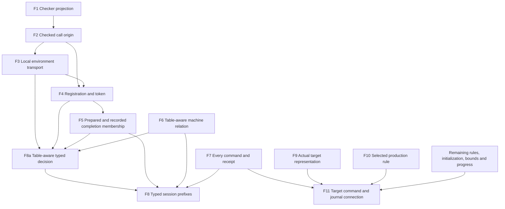

# Proof placement for the host-session foundation

Status: proposed claims and statement shapes, not elaborated Lean declarations.
Base: `faad3e9e`.
P0a reviews the tools; P0b freezes each dispatchable declaration before its proof work.
Every row supplies the five fields required by `AGENTS.md`.
Helpers name their parent claim and the consumer that uses them.

## Claims

| ID and proposed registry claim | Concept, property, and role | Question and consumer | Reach and hypotheses | Does not establish | Requirement or spine |
| --- | --- | --- | --- | --- | --- |
| F1 `checked-call-projection` | Initial Algebras; checker agreement; compatibility | Metadata collection projects to the existing checker result; consumer F2 | Same program and full signature; same successful type and located refusal | Runtime correspondence | R1, R2, M5 |
| F2 `checked-call-origin` | Residual Program Typing; addressed source typing; compatibility | Lookup identifies the addressed call and exact `checkRow` result; consumer F3/F4 | Original root, path, checked binders, expansion aliases, and signature; extension retains existing entries | Reconstructing types from runtime values | R1, R2, R7, M5 |
| F3 `checked-point-environment` | Residual Program Typing; local environment transport; preservation | Load and local binder/capture transitions fit retained environments; consumer external denotation and F8 | F1/F2; fitting incoming environment; typed produced values; each binder, loop, generator, layer, capture, and fork case | Global reachability before F8; service presence from `ServicesFit` alone | R5, R7, M5 |
| F4 `external-registration-token` | Host Session Protocol; `typed-replay-session`; preservation | The actual registration derives its token certificate and saved stack; consumer F5 | F2/F3; typed incoming state; exact operation, request, origin, fiber, and fresh token; live or interrupted outcome | Unconditional liveness after settling | R6, R9, M6 |
| F5 `session-prepared-token-membership` | Host Session Protocol; prepared completion membership; preservation | Actual prepared completion fits the waiting declaration and recorded payload satisfies `CompletionStrong`; consumer F8a/F8 | F4; still-live key; `.ofExit`; shape-decided instantiated columns; no allocation; current error image and reserved-defect rule | `.ofRefGet`, arbitrary handles, allocation, host conformance | R3, R6, R9, M6 |
| F6 `run-eq-ref-table` | Translation and Simulation; reference agreement; simulation | Related loads and command steps retain `BookMeans`, the machine invariant, and equal sufficiency receipts; equal `obs` is a corollary; consumer F8 | Same source, row table, initial oracle answers, compile budget, command budget, and tape; generalized invariant | Reply typing, real host correctness, session bookkeeping | R6, R8 |
| F7 `session-command-correspondence` | Host Session Protocol; `typed-replay-session`; simulation | Each command accounts for machine change, session change, phase, and sufficiency; consumer F8/F11 | Reached session prefixes; every command and phase; exact preflight decision; retained fuel-frontier state | Whole-tape equality after an insufficient receipt without a separate premise | R6, R8, R12, R13 |
| F8a `table-command-typing` | Residual Program Typing; one-decision typing; preservation | Every committed table-aware decision retains typing and the strengthened origin/environment invariant; consumer F8 | F3–F6; actual world; strengthened origin/environment invariant; `AnswerOk` for host answers at that world; independent compile/command budgets; both receipts | Arbitrary row effects or whole-tape progress | R6, R9, M6 |
| F8 `typed-replay-session` | Host Session Protocol; typed replay; preservation | Every declared-profile session prefix has the related typed reference state; consumer public typed entry paths | F3–F7/F8a; initialized checked source; lawful table; empty initial oracle; declared reply profile; exact loads and budgets | Host progress, resources outside the profile, target execution | R6, R9; extends the executable M6 connection |
| F9 `session-target-layout` | Translation and Simulation; actual artifact representation; compatibility | Every selected field/constructor reaches the claimed production layout; consumer F11 | Fixed roots, closure, layout, extern table, prelude, bytes, target profile, and toolchain | Abstract layout laws alone certifying emission | R7, R8, R13 |
| F10 `target-profile-operation` | Translation and Simulation; production operation equation; simulation | One actual translated operation returns a related result/state or the declared refusal; consumer F11 | Named production rule and target semantics; intermediate and allocation bounds; identity relation | All translator rules, all compiler stages, generic arithmetic fidelity | R4, R8 |
| F11 `target-command-replay` | Translation and Simulation; command correspondence; simulation | Initialization and each target command maintain the relation and phase; journals follow by induction | F7/F9/F10 plus every rule reached by the selected command; fixed recorded inputs; explicit compiler/runtime assumptions | Physical I/O conformance, live recovery, unproved production rules | R4, R6, R8, R11, R13 |

## Proposed semantic dependencies

This diagram states planned claim prerequisites, not extracted dependencies of existing Lean proofs.
P0a moves these edges into the semantics registry and generates their report.
Shared-file ordering remains in [the slice plan](plan.md).

F8a assumes the incoming strengthened invariant and an admitted answer at its actual world.
F8 obtains those premises from initialization and the preceding command prefix.
The remaining target premises need their exact inventory before F11 can be dispatched.

## Existing consumers and scope boundaries

`TypedProgram.hasTy` describes checking after reference expansion (`src/Effect4/Laws/Program/CheckedTyping.lean`).
F2 connects that checking to original runtime origins.
`PointTyped` permits an existential environment (`src/Effect4/Laws/Program/Typed/Admission.lean`).
F3 adds local transport to the chosen checking environment.
Its produced-value premise remains explicit until F8 supplies it by prefix induction.
Proving global reachability in F3 would create a cycle through F4 and F5.

`externalAsyncParks` obtains the residual certificate (`src/Effect4/Laws/Program/Typed/Commands/Clauses/Async.lean`).
F4 retains its external precondition and derives the token relation there.
`Evaluating.async_parks_request` also has an interruption case in that file.
F4 covers that outcome instead of assuming a live token remains.

`preflight_success_prepared_fits` supplies actual prepared-value evidence (`src/Effect4/Laws/Api/HostSession.lean`).
F5 connects the instance-aware version to the declaration that the saved continuation consumes.
`AnswerOk` consumes the recorded `Completion` (`src/Effect4/Laws/Program/Typed/Assembly.lean`).
The `.ofExit` preparation identity law connects that payload to `CompletionStrong` for successes and failures.
`preflight_failure_noShapeDefect` remains the reserved-defect component of the failure case in that file.

`AdmittedTape` remains proof-side evidence (`src/Effect4/Laws/Program/Typed/Assembly.lean`).
`DecisionKeeps` currently uses the default empty row table in that module.
`AdmittedTape` also uses one budget for reference compilation and command execution.
`AdmittedReplay` only constrains its tail after a sufficient step (`src/Effect4/Laws/Machine/Lift.lean`).
F8a supplies table-aware one-decision typing with separate budgets and both receipt outcomes.
F8 derives actual answer evidence and composes these steps by session command prefixes.
F5 supplies `AnswerOk` from successful preflight at the retained world and exact prefix.
A reply profile alone does not establish payload membership.
F8a retains the strengthened origin/environment invariant for the next prefix.
It does not replace that premise with another unproved call relation.

`StoresOk.externals` supports `replay_externals` and `exits_hasTy` (`src/Effect4/Laws/Program/RuntimeR.lean`, `src/Effect4/Laws/Program/Typed/Results.lean`).
F6 retains that empty-table proof path after splitting the generalized invariant.

`play_controls_eq_replay` requires sufficient control steps (`src/Effect4/Laws/Run.lean`).
F7 does not infer sufficient work from an `.applied` phase.
`journal_replays` already reconstructs reached Lean runs in that file.
F11 still needs the actual target step relation before invoking journal induction.

## Observation contracts

F6 retains the existing `obs` comparison, including stores and external allocations.
Its stronger state relation retains source, code, live guard, and saved-stack correspondence for F8.
It relates the two Lean machines under identical decision and budget policies.
A storage replacement uses a declared logical projection instead of equating different concrete containers.

F7 compares command phases and resulting states at every prefix.
It records the decision-sufficiency result separately from session phase.
Inspection of the resulting machine is a separate observation from `replayEval`'s result constructor.

F11 names one target observation and one consistent identity correspondence.
That correspondence covers returned values, stores, requests, causes, registrations, and captures.
Internal target work must terminate under the operation's premises or satisfy a separate progress measure.

## Theory amendments before implementation

Register `typed-replay-session`; its required property already appears in `docs/core/semantics.md`.
Add independently reported questions to the existing semantics registry.
Attach local helpers to their parent claim and consumer.
Add missing required properties in the owning concepts before their proof work.
F1 serves checker fold congruence; F2/F3 serve addressed denotation and residual typing.
F9–F11 belong to `translation-simulation`; exact representation helpers name their own embedding judgment.
Use `#proof_wanted` for an open exact statement, then retire it when its theorem lands.
Keep `RequestFits` and `PreparedFits` labeled as proposed interfaces until declarations exist.
Correct the obsolete record-codec exclusion when touching the exact-codecs concept.
Retain each current theorem's hypotheses when replacing historical prose.

## Limits

The plan provides no new Lean theorem.
The first profile excludes capability allocation and world-reading completions from F5/F8.
Whole-run resource release, service presence, fair progress, and general stored handlers remain separate questions.
The empty initial oracle restricts F8 only; F6 still covers equal preloaded oracles.
Existing oracle execution paths remain available.
The actual host binding still owes `HostSpec.RowStep`; representation and reply typing do not prove physical work occurred.
