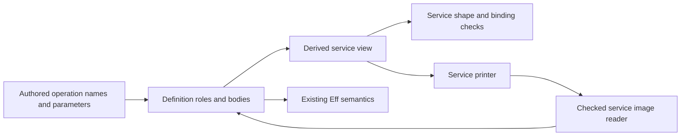

# CO-6b service generation review

The frozen service checks accept two invalid target forms.
The service reader also discards an argument change that changes the returned value.
Resolve these controls before treating the service export boundary as accepted.
The isolated repair candidates pass their finite controls.
No production repair lands in this review.

## Reviewed state

The committed base is `c2288f028fcb563c612864065d7e245ae6759bef`.
The implementation snapshot is uncommitted work over that base.
`pins.json` records the observation time and each source hash.
`followup.json` records the later source comparison and authoring files.
The TypeScript printer and reader bodies retain the defects at that comparison.
The printer's later change adds only `serviceNamesFault_nil`.

The previous implementation review ends at `a78fcad8741d634193e568b51ab7f249c1df12e7`.
The previous review checkpoint is `a15eb1921b397226e5b710b76e2d2b4fdf9a0b3c`.
Effects remains at `bf5ab8fd26ee009abbf465821a3664ea20948a49` in the primary checkout.
The later plan describes S1 and S2 as landed; the observed Git HEAD still precedes that implementation.

The active Claude session is `9ebf38b2-8b2f-44e5-8fd9-2dc0cb5a1f50.jsonl`.
Its recent entries identify `/Users/pooks/Dev/lean4-effect4` as the working directory.
The review reads bounded tails and excludes thinking fields.
Claude reports a narrow law build, then a core and law rebuild after the declaration field change.
That report does not count as a reproduced build here.
Claude owns the role, printer, reader, laws, Queue adapter, generated codec, and pending OCaml bridge work.
Three GPT-6.1 Sol scouts review printing, reading, and authoring independently.

## Evidence boundary

`extract.py` copies exact source segments from the frozen files.
It places them in a fresh namespace with the copied role and declaration carriers.
`extraction.json` records each segment's hash and the namespace adaptation.
The existing compiled core supplies type conversion, target syntax, rendering, and name helpers.
`followup.json` confirms identical helper source files in the primary and review checkouts.
The TypeScript package is `f5878bf879bd5712db964c2cd12802748c707605` in both checkouts.

This probe does not rebuild the changed `Eff` dependency graph.
It does not execute the complete changed `readModule`, `admitModule`, or `emitModule` entry.
Its results establish the listed helper behavior and generated target examples.
No new theorem or axiom gate run is claimed.
The new service laws receive source review only.

## CO6B-NAMES: service outputs collide

**Role:** target validity control for service declaration names.
**Evidence:** finite Lean checks and tsgo rejection.
**Scope:** two services with distinct definition names and valid state request shapes.

`serviceFault` and `serviceNamesFault` accept services named `S` and `SLayer`.
`printServices` emits `S`, `SLayer`, `SLayer`, and `SLayerLayer`.
The key of the second service collides with the layer of the first.
The same controls accept `S` and `T`, whose generated declarations pass tsgo.
`collision.ts` receives TS2451 for the duplicate `SLayer` binding.

The exact source declarations are `serviceFault`, `serviceNamesFault`, and `printService` in
`snapshot/src/Effect4/Codegen/Print.lean`.
`Controls.inc` retains both inputs and the emitted-name observations.

A related finite control shows a missing row comparison.
`serviceNamesFault` refuses a row spelled `S` but accepts a row spelled `SLayer` beside service `S`.
The probe does not execute a host call under that captured row name.

The payload-class collision remains a source-predicted extension of this gap.
`ClassTable.takenNames` does not reserve service outputs.
`ModuleEmission.module` combines payload classes with generated constants.
No payload-class emission example runs in this review.

**Repair:** derive both service output names once and check the combined declaration inventory.
Include definitions, classes, main, hoisted declarations, and external row bindings in that check.
Reuse `SourceBindings.declarationName`, `declarationBinding`, and the existing name policies where their scope applies.
Do not add an independent stored service-name table.
The isolated `RepairCandidates.serviceNamesFree` accepts the positive control and rejects the duplicate and occupied names.

## CO6B-KEYS: method names bypass record key rules

**Role:** target syntax control for generated method objects.
**Evidence:** finite Lean acceptance, tsgo rejection, and a tested repair candidate.
**Scope:** a zero-argument method named `bad-name`.

`serviceFault` accepts the method name.
`methodField` emits a quoted type field.
`methodClosure` and `printService` emit a raw object field, `bad-name: ...`.
`method-name.ts` receives syntax errors from tsgo.
The ordinary `get` method remains the positive control.

The exact source declarations are `methodField`, `methodClosure`, and `printService` in
`snapshot/src/Effect4/Codegen/Print.lean`.
The target renderer is `TypeScript.Render.expr` in the pinned TypeScript package.

**Repair:** reuse `Codegen.Record.keyForm` and the target's `objectWith` form.
Update the service reader and its laws together with the printer.
The existing policy chooses computed keys for `__proto__`.
It chooses quoted keys for other names that need quoting.
The isolated `RepairCandidates.quoteMethods` uses that policy without adding escaping rules.
Both repaired target files pass tsgo.
The host calls both unusual methods and receives `1`.
The `__proto__` method remains an own property and leaves the object's prototype unchanged.
This candidate does not yet pass through the service reader; that connector remains production work.

## CO6B-READ: changed behavior disappears during reading

**Role:** exact-codecs control for the service image.
**Evidence:** finite reader checks and a host observation.
**Scope:** one generated method's captured-state argument.

`readServiceMethod` matches one argument but discards its contents.
`readServiceLayer` therefore returns identical service descriptions for the original and changed layers.
The changed file calls `readS(99)` where the original calls `readS(a0)`.
Only that service argument changes.
Both generated files pass tsgo.
The original service returns `1`; the changed service returns `99`.

The exact source declarations are `readServiceMethod`, `readServiceLayer`, and `roleOf` in
`snapshot/src/Effect4/Codegen/Read.lean`.
`behavior.ts` exercises the two files against Effect `4.0.0-rc.112`.
`checks/host-behavior.log` records the result.

The full checked-reader acceptance path is not executed here.
Source review finds no service-image comparison in `Codegen.Admit.envelopeCheck`.
Its envelope check accepts plain exported constants without comparing their service bodies.
`readModule` also uses `filterMap readServiceLayer`, which drops malformed service constants.
That broader risk needs a `Codegen.admitModule` control in the production slice.

**Repair:** validate the whole service image before accepting its reconstructed roles.
Compare the key, layer, state binder, method parameters, request assembly, and declared types.
A comparison with regenerated service syntax can reuse the printer's convention.
Refuse unmatched service constants instead of dropping them.
The isolated `RepairCandidates.readImageAgrees` accepts the original and refuses the changed argument.
No claimed normalizer may erase this argument: the host observation distinguishes it.

## Shared structure and authoring

The role design keeps one stored program representation.
`Service` and `serviceInfo` are derived views of the definition roles.
Keep that property while consolidating the declaration view.

`serviceMethods`, `servicesOf`, and `methodArgs` describe definitions independently of target rendering.
Place their common view beside definitions and let validation, printing, and reading consume it.
`Authoring.requestTy`, `requestParts`, and `requestOf` already own the nested request convention.
The new `methodArgTys` and `argTuple` repeat that convention.
Extract only the shared counted request operations; do not create another syntax or stored service specification.



The live `DefSrc.serviceMethod` derives public arity from the parameter count.
This resolves manual arity entry at that authoring helper.
Stored arity remains necessary: one product-valued argument differs from two separate arguments.
A later `eff_module` service clause can derive method names from existing operation identifiers too.
`Queue.serviceDefs` currently repeats those names and the service name.
That adapter is an interim surface, not a regression against an implemented service clause.

Queue and Semaphore's first-order methods fit this role route.
`Semaphore.withPermits` and `Pool.use` contain program bodies and remain expanded under row 328.
`Pool.make` carries scope and finalizer obligations.
Roles and reader reconstruction establish none of those lifetime properties.

## Proof placement and remaining obligations

| Obligation | Placement and consumer | Scope and exclusion |
| --- | --- | --- |
| Definition role reconstruction | `exact-codecs`, compatibility, `module-defs-round-trip`; R8, supporting R5 | Readable blocks after successful printing; excludes target typing and execution. |
| Service image admission | Proposed `exact-codecs` exactness control; service reader, R5/R8 | Canonical service syntax; excludes arbitrary TypeScript equivalence. |
| Independent service formation | Plan's proposed located refusal; printer domain, R5 | Independent service-shape judgment; excludes client typing and cleanup. |
| Role inertness | Plan's `translation-simulation` compatibility; R2 | Existing program judgments and meaning; excludes service exports. |
| Client run comparison | Plan's finite host comparison; R8 | Named fixtures and observation; excludes whole-host simulation. |

The new round-trip proof recovers roles from successfully printed service constants.
It does not prove either tsgo acceptance or target execution.
The existing readability premises remain in the theorem.
The later plan explicitly leaves independent service formation and role-inertness theorems unstated.
Treat those as declared open work.
Row 339 deliberately changes stored block bytes; retaining the old encoding is not required.
The role carrier remains in core and the service proofs remain in Laws.
No new core-to-Laws import appears in this reviewed change.

## Commands and outcomes

Run these commands in the attached review worktree:

```sh
python3 docs/research/2026-10-09-co6b-overwatch/extract.py
python3 docs/research/2026-10-09-co6b-overwatch/check.py
```

`check.py` runs one narrow Lean process with `LEAN_NUM_THREADS=3`.
It records exact commands and expected outcomes in `checks/results.json`.
All recorded outcomes match.
The compiler is tsgo `7.0.0-dev.20260629.1` with strict checking and `skipLibCheck`.
The runtime is Bun `1.4.2` with Effect `4.0.0-rc.112`.
The intentionally invalid files must fail for their named duplicate or syntax errors.
The positive and repaired files must pass.

The primary checkout, its owner rulings, and Claude's session remain unchanged by this review.
No full sweep, merge, push, or message to Claude occurs.
The prior host findings retain their checkpoint at
`docs/research/2026-10-09-host-typed-indexed-review/README.md`.
