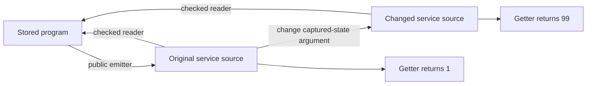

# CO-6b public service boundary review

The checked reader accepts a service method that returns a different value from the reconstructed program's service.
This result now crosses the public API at `356cc11d35be8e36f297903f760ed50b7bbb10af`.
Require a service-image check before treating checked module reading as exact for service exports.

## Reviewed state

The previous review commit is `c698ac965067696980764910183b6b5cceddb01d`.
Its receipt is `docs/research/2026-10-09-co6b-overwatch/README.md`.
This review starts with uncommitted work over `c2288f028fcb563c612864065d7e245ae6759bef`.
Claude commits matching sources as `356cc11d35be8e36f297903f760ed50b7bbb10af` during this review.
`followup.json` confirms that every frozen source matches that commit and the later working files.

The active Claude session remains `9ebf38b2-8b2f-44e5-8fd9-2dc0cb5a1f50.jsonl`.
Bounded tails identify the repository as its working directory.
The later tail shows profiling of the semantics report renderer after the service commit.
The primary checkout also contains unrelated work in `Laws.Program.TyView` and the semantics driver.
This review changes neither those files nor the implementation session.

## Evidence boundary

`freeze.py` captures the compiled dependency closure of `Effect4.Api` into an isolated overlay.
`pins.json` records every artifact hash and the selected source hashes.
`compile.py` recompiles the frozen TypeScript printer, reader, checked emitter, checked reader, and public wrapper.
Its dependencies are pinned builder artifacts, not independently rebuilt dependencies.
The toolchain is `leanprover/lean4:v4.33.1`.

The first compile lacks the executable metadata of imported Lean modules.
The corrected snapshot includes their `.ir` and `.ir.sig` files.
The later narrow compiles all pass.
`checks/setup-missing-ir.json` and its log retain that setup failure.
It is not an implementation finding.

No axiom gate runs here.
No new theorem or planned goal enters the proof graph.
The finite controls import the actual public implementation, without copied service functions or namespace substitutions.
Rendered TypeScript comes from the whole emitted module, including its definition bodies.

## CO6B-READ: the public checked reader loses changed service behavior

**Role:** proposed exact-codecs control for service source reconstruction, serving R5 and R8.
**Evidence:** finite public API controls, strict TypeScript checks, and a finite host comparison.
**Scope:** one service with an initializer and a zero-argument getter; empty row table and the named Effect imports.

`PublicBoundary.service` initializes its captured number to `1`.
Its getter returns that captured number.
`Api.emitModule` produces the whole module.
`Api.readModule` recovers the original program.
`Api.admitModule` accepts the original module and recovers the original program too.
Removing the `Context` and `Layer` bindings produces the expected `unbound` refusal.

`PublicBoundary.changeRequest` changes only the getter call from `readS(a0)` to `readS(99)`.
The mutation leaves the declaration names, types, and definition bodies unchanged.
Both public readers recover the original program from the mutated module.
The checked reader accepts the mutated module.
Reprinting its reconstructed program restores `readS(a0)` and loses the changed argument.

| Observation | Original module | Changed module |
| --- | --- | --- |
| Public checked reading | Accepted | Accepted |
| Reconstructed program | Original program | Original program |
| Strict tsgo check | Pass | Pass |
| Exported service getter result | `1` | `99` |
| Root program result | `1` | `1` |



The implementation declarations are `readServiceMethod`, `readServiceLayer`, and `readModule` in `snapshot/src/Effect4/Codegen/Read.lean`.
The checked entry is `admitModule` in `snapshot/src/Effect4/Codegen/Admit.lean`.
`ModuleReading` retains lexical binding, reconstruction, formation, typing, and envelope checks.
Those checks contain no equality with the reconstructed service wrapper's request expression.

This result strengthens the previous helper-level finding to actual checked source acceptance.
It does not refute the existing print-then-read theorem.
That theorem starts from generated TypeScript syntax; the changed module is outside that image.
It also does not refute a theorem about the root program's result.
The root observation stays unchanged in this control.
The missing observation concerns exported service methods.

## CO6B-NAMES: the public emitter still permits colliding service exports

**Role:** target validity control for the generated declaration inventory.
**Evidence:** public emitter acceptance, checked-reader refusal, and tsgo rejection.
**Scope:** two services with distinct definition names and valid state request shapes.

The public emitter accepts services named `S` and `SLayer`.
The complete emitted module declares `SLayer` twice.
Tsgo rejects those declarations with TS2451.
The checked reader refuses the same module as `unbound`, because its lexical check detects the duplicate.
Services named `S` and `T` pass all three entries.

This result confirms the previous name finding through the public emitter.
It does not claim that the checked reader accepts the duplicate bindings.
The retained unusual-method-name finding remains open; this review does not repeat that test.

## Smallest shared repair

Derive one service declaration view from definition roles.
Use that view for shape validation, emitted binding names, generation, and checked reconstruction.
Keep the definition roles as the sole stored source of truth.

For checked reconstruction, compare every consumed service declaration with the canonical service image derived from the recovered definitions.
The comparison must include the key, state binder, method parameters, request assembly, and declared types.
Refuse an unconsumed service declaration instead of discarding it through `filterMap`.
Retain the original source module as the certificate's index.

For generation, check the combined inventory of actual emitted binding names.
Include each service key and its generated layer name.
Reuse the existing record key policy for method fields when that repair lands.
The previous isolated receipt contains positive and negative repair candidates.
These probes add no production repair.

## Proof placement and limits

The concept is `exact-codecs`.
The existing `module-defs-round-trip` claim supports R8 and the R5 authoring path.
Its theorem remains print-then-read under the named readability premises.
The proposed next obligation states that accepted service wrappers equal their reconstructed canonical image.
Its consumer is checked module reading, not the core interpreter.
State the exact normalization policy before proving that property.
A normalization cannot discard this argument because the getter observation distinguishes it.

The proposed property establishes neither target execution nor an equal-observation result for arbitrary TypeScript.
A separate finite host comparison observes the selected exported methods.
Resource allocation, cleanup, progress, and whole-host simulation remain separate obligations.
No new obligation is proved in this receipt.

The new service battery correctly leaves Queue's reference state outside its readable profile.
The service laws and the battery reach their respective roots.
Independent service formation and role inertness remain explicitly open in the implementation plan.
Those declared limits are not regressions.

## Additional source review

Two GPT-6.1 Sol scouts inspect transport alignment and the new proof and battery connections.
The transport scout finds matching role tags and field order across Lean, TypeScript, and OCaml.
The OCaml bridge retains the role field.
This is source review only; this review does not rerun the transport compatibility gate.
Claude's reported gate success remains a builder report.

## Commands and outcomes

Run in the isolated review worktree against the captured implementation:

```sh
python3 docs/research/2026-10-09-co6b-public-boundary/freeze.py
python3 docs/research/2026-10-09-co6b-public-boundary/compile.py
python3 docs/research/2026-10-09-co6b-public-boundary/check.py
```

`freeze.py` captures the current primary checkout, so a later run requires checking its recorded source hashes.
`compile.py` and `check.py` run one Lean process at a time with `LEAN_NUM_THREADS=3`.
`checks/build-results.json` records the exact narrow compilation commands and successful results.
`checks/results.json` records every probe command and its expected result.
All probe results match their expectations, including the expected duplicate-name rejection.

The TypeScript compiler is tsgo `7.0.0-dev.20260629.1` with strict checking and `skipLibCheck`.
The finite host run uses Bun `1.4.2` and Effect `4.0.0-rc.112`.
The exact source package pins are in `followup.json`.
No full sweep, merge, push, production edit, or message to Claude occurs.

## Checkpoint

The reviewed implementation ends at `356cc11d35be8e36f297903f760ed50b7bbb10af`.
CO6B-READ now has a reproduced public checked-reader counterexample.
CO6B-NAMES now has reproduced public emitter acceptance and public checked-reader refusal.
CO6B-KEYS remains open from the previous receipt.
Retest those controls after a service-image or binding-inventory repair.
Do not repeat unchanged findings on later heartbeat runs.
