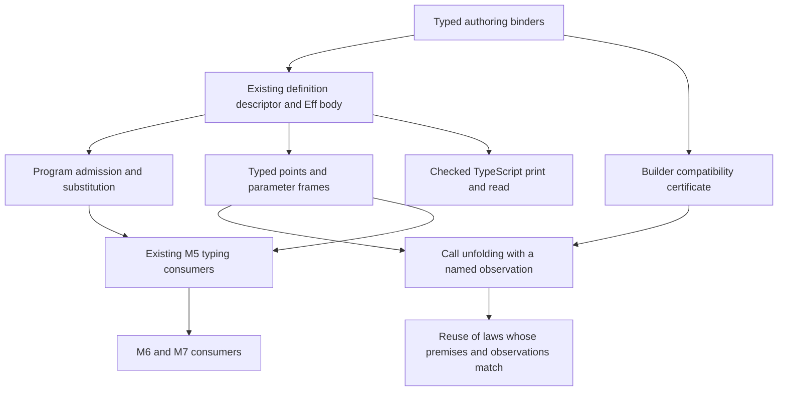
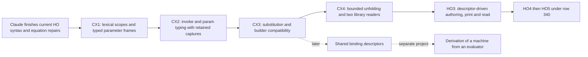

# Context layer: scope for program parameters

The context slice needs a builder compatibility law beside substitution and unfolding.
Applying an arbitrary authoring function to a hole does not establish that law.
Keep row 340's representation, and make supported authoring operations carry the compatibility law once.

Proof role: review and proposed obligations.
Evidence status: source review and passing finite controls.
Scope: the captured program-parameter implementation, before its landing.
This receipt changes no production module, owner ruling or implementation session.

## Reviewed state

The primary checkout is at `52faff49324e4ef3e14d246f4460b30c44c51abe`.
Its program-parameter implementation is uncommitted work.
The review branch starts at `33d1579b2e0c4895f37b4337257b5dd2ccfda15f`.
[pins.json](pins.json) records the capture time, source bytes, dependency artifacts and primary changes.
`Signature.withParams` and module checks live in `src/Effect4/Program/Definitions.lean`.
The retained [design note](snapshot/docs/research/2026-10-09-program-parameters.md) includes the proposed context layer.
These bytes define this review's scope.
Later working-tree changes need another check.
A later source inspection finds slot-indexed `EffsHasTy` in `src/Effect4/Laws/Program/Typing/HasTy.lean`.
Claude owns that continuing judgment repair; this scope assigns no duplicate implementation.
The retained probes still run against their captured inputs.

Claude's repository session identifies `/Users/pooks/Dev/lean4-effect4` as its working directory.
The session is `9ebf38b2-8b2f-44e5-8fd9-2dc0cb5a1f50.jsonl` under the repository-specific Claude log directory.
A bounded recent tail shows work on program syntax, machine hops and denotation equations.
Its reported builds are separate from the reproduced checks below.
Three GPT-6.1 Sol reviewers independently inspect context laws, closure typing and authoring design.
Their source review contributes to this scope, not to a claim of a passing production build.

## Keep the data form; separate the connections

Here, a context means an existing program body with declared program parameters.
It is a typed view of `Eff` and its parameter declarations, not another stored program representation.
A closure means a code address with its captured value environment and lexical program-parameter scope.
`Point` also carries execution data that closure typing alone does not describe.

| Carrier or interface | Owner and contents | Connection to establish |
| --- | --- | --- |
| Program body | `Eff`, `src/Effect4/Program/Eff.lean`. `invoke` owns argument programs as children. | A fold fills lexical program parameters, with value substitution and capture avoidance. |
| Parameter declaration | `ParamDecl`, `src/Effect4/Program/Eff.lean`. Request, answer and error columns describe one program parameter. | Program typing checks each argument under the caller's value and parameter scopes. |
| Definition | `DefDecl` and the root definition block, in `src/Effect4/Program/Eff.lean`. | Definition bodies check under their own program parameters. Ordinary calls have none. |
| Authoring builder | `Src`, `TermSrc`, `src/Effect4/Program/Authoring.lean`. These are Lean functions used during construction. | A compatibility certificate relates construction with holes to construction with actual arguments. |
| Sketch | `Sketch`, `src/Effect4/Program/Sketch.lean`. A hole table extends host rows. | An explicit adapter relates selected sketch holes to lexical parameters. External replies remain separate. |
| Runtime point | `Point`, `src/Effect4/Program/Compile.lean`. Path, environment, parameter stack, fuel, tape, root and completion view. | A relation checks values and argument sites against the scopes at their source paths. |
| Retained program | `ArgSite` and `Capture`, `src/Effect4/Machine/Stores.lean`. Captured environments and parameter frames remain data. | Fork and finalizer consumers retain the required scopes after a call returns. |
| Service method | `DefRole.serviceMethod`, `src/Effect4/Program/Eff.lean`. A public method selects a definition and handles its captured state. | Generated method binding uses the same checked definition descriptor as ordinary authoring. |

The arrows have different roles.
Authoring constructs program data and can refuse invalid input.
Checking gives program admission or a located refusal.
Filling transforms program data, under a typing relation.
Execution interprets program data under a runtime state.
Printing encodes a supported program profile, with its own reader law.
No typing law alone proves execution or printing agreement.



## Corrections that affect the scope

### Hole extraction needs a law

`Src` permits a builder to inspect the argument's program syntax, environment or path.
`inspectBuilder` in [Controls.lean](Controls.lean) returns zero for a hole and one for an ordinary client.
Both resulting programs pass the program checker.
Extracting its body once produces a constant zero with no hole left to fill.
No subsequent filling recovers the original builder's behavior.

The proposed builder certificate must state compatibility with program substitution for every admitted client.
Value renaming alone is insufficient.
For callbacks, the statement also quantifies over the supplied request reader and reachable value scopes.
Use the existing authoring scope and reader relations where they apply.

A supported composition should obtain this certificate from its constituent operations.
A raw `Src` escape hatch may require an explicit certificate when converting an existing builder.
An author who declares a new definition body directly needs no claim about an unrelated Lean function.
Keep that distinction out of the routine authoring interface.

### Substitution must name the typing judgment

`Sketch.check_fill_focusAt` lives in `src/Effect4/Laws/Program/Sketch.lean`.
It uses addressed replacement under the same full effect type and the focus environment.
It is not simultaneous substitution of parameterized programs.

`widerParam`, `declaredExit` and `filledExit` provide a finite control.
Program admission accepts a body with a smaller error column at this parameter.
Wrapping the hole and the filled body in `exit` produces different inferred answer types.
Both pass their program checks.
Therefore, substitution cannot promise equality of inferred types under the current widening rule.
State the relation to the declared upper bound, and prove the checker transport that relation needs.
For a definition call, retain the declaration's requirements union the checked arguments' requirements.
Do not assume that an unused argument has no requirements under the current checker.

### Closure typing needs the lexical parameter scope

`PointTyped` and `BodiesTyped` live in `src/Effect4/Laws/Program/Typed/Admission.lean`.
The captured declarations use the source's global signature and do not constrain `Point.params`.
The new body checker already uses each definition's own parameter declarations.
The typed-point relation must connect those views.

The proposed relation needs the following information:

- The source path determines the value types and lexical program-parameter declarations.
- Each active frame supplies the declared number of argument sites.
- Each site captures values that fit its caller's value scope.
- Its body checks under that caller's program-parameter scope, with its request value appended.
- The remaining frames interpret the caller's scope when `param` returns to an argument site.
- Captured handle values remain valid under the world extensions used by the existing typing proof.

A checked ordinary call can retain an inactive caller frame.
`ordinaryRoot` and `ordinaryFrameCount` reproduce this case.
The ordinary callee has no lexical parameters, yet its point retains a frame.
The default scope should permit such inactive frames when the lexical parameter scope is empty.
A future normalization may clear them, with a separate behavior argument.
Do not require the top frame to describe every currently running definition.

`call_arm`, in `src/Effect4/Laws/Program/Typed/Denotation.lean`, proves the existing ordinary-call case.
It does not establish the new invocation and parameter cases.
`denoteR_invoke`, in `src/Effect4/Laws/Program/DenoteR.lean`, supplies an operational equation.
That equation does not yet connect a point to capture-avoiding program substitution.

### Unfolding needs an observation and a budget relation

`identityRoot` invokes a definition that immediately invokes its passed program.
The inline constant returns with source fuel one.
The call returns with source fuel three, after its invocation and parameter suspensions.
At fuel one or two, the call does not return in the bounded suspension observer.
At fuel four, both return seven.

The first unfolding statement must retain these administrative suspensions or explicitly relate execution budgets.
Do not erase interruption checkpoints without a separate premise and observation.
Address relocation and path-based identities also need a relation before a whole-run expansion claim.
These are proposed obligations, not newly reproduced defects.
The retained control covers pure returns and suspension resolution, not the scheduler or a host runner.

Start with an explicit-environment interpretation of the body and its arguments.
Relate the addressed call to that interpretation before claiming equality with arbitrary inline clients.
Recursive definitions need the existing fuel induction or another stated recursion relation.
A finite expansion claim needs a fragment that excludes the relevant recursive calls.

### Law reuse keeps each law's premises

`Pool.use_types` lives in `src/Effect4/Laws/Library/Pool/Ops.lean`.
It requires the resource type, a kept pool reader and a body typing premise across reachable scopes.
`protectedBy_has` lives in `src/Effect4/Laws/Step/Waiting.lean`.
It requires acquisition typing for every restore function that keeps the stated typing judgment.
Its body and release premises also remain.
These laws establish typing.
They do not establish cleanup execution, fairness or eventual return.

An authoring compatibility law can transport a construction law.
A call unfolding law can transport a behavior law only under its observation and congruence premises.
Neither connection makes every existing theorem apply to every client automatically.

### Second-class parameters can outlive a call in runtime state

No program value stores an argument site in the proposed value language.
That is the useful representation restriction.
It does not prohibit a fork or finalizer from retaining the site in machine state.
`Point.capture` and `Point.ofCapture` carry parameter frames through `Capture`.
Delayed finalization and forked parameter use therefore belong in the typing obligations and controls.
They must not disappear under a stronger informal claim that sites never escape a call's lifetime.

## The authoring surface to aim for

Extend `Def.of`, `Defined` and `eff_module`, rather than adding another module-building API.
They live in `src/Effect4/Program/Authoring/Defs.lean` and `src/Effect4/Program/Authoring/Module.lean`.
The existing value-parameter names and the new program-parameter declarations need distinct internal names.
The author should declare each binder once.
The descriptor should generate holes, calls, typing premises and printing metadata from that declaration.

This is proposed surface syntax, not a compiling example:

```lean
eff_module PoolDefinitions (A : Ty) (B : Ty) (E : Ty) where
  use (pool : .refOf (Pool.cellTy A))
      (body : program A B E) : B error E :=
    Pool.use A pool body
```

`program` marks an authoring binder; it does not add a function constructor to `Ty`.
Here, `A`, `B` and `E` specialize the Lean builder to closed types before emission.
This example does not advance generic stored definitions ahead of HO-4.
The conversion of `Pool.use` also needs the builder compatibility certificate described above.

| Author binder | Construction interface | Generated responsibility |
| --- | --- | --- |
| Value argument | `TermSrc` | Pack the ordinary request and generate its projection. |
| Program with no input | `Src NativeOp` | Declare a unit request and hide its application. |
| Program with one input | `TermSrc → Src NativeOp` | Supply a lexical hole that calls its parameter slot. |

Start with value binders followed by program binders.
Refuse interleaving with a located authoring refusal until a consumer needs it.
That order avoids another stored argument-order table.
Give each callback its lexical hole directly; do not add string lookup to the authoring environment.
The object-language request, answer and error types still require declarations because `Src` erases them.

The same descriptor should drive service methods.
Count public value arguments separately from captured service state and program arguments.
Ordinary definitions still pack their value request; public methods may expose separate value arguments.
The descriptor owns that conversion once.
Keep `protectedBy`'s restore callback internal when defining Pool or Semaphore methods.

## Proposed proof placement

These are proposed semantics registry additions or extensions, not new proved declarations.
Record each accepted property in `docs/core/semantics.md` and the registry before working its proof.
Use a placed `proof_goal` for an open question, then replace that body in place.
Keep all proof obligations in the Laws graph.

| Obligation | Concept and required property | Claim, role and consumer | Reach and hypotheses | Limits | Unlock |
| --- | --- | --- | --- | --- | --- |
| Typed parameter frames and world transport | `residual-program-typing`; fundamental elaboration | Helpers for `invocation-arm` and `denote-typed`; preservation. Consumers are invocation, parameter, capture and load cases. | Checked root, lexical scopes at paths, fitting captured values, argument columns, remaining frames and admitted world extension. | No progress or liveness. Inactive frames do not grant parameter access. | R4; keeps the M5 input to M6 and M7 connected. |
| Invocation and parameter typing | `residual-program-typing`; fundamental elaboration | Extend `invocation-arm`; fundamental property. `denote-typed` and `load-typed` consume the arms. | Correct request membership, valid argument sites, declared widening, requirements and fuel decrease. Revisit ordinary `call_arm` under the new relation. | The existing ordinary-call proof does not discharge either new arm. | R4; a checked definition remains usable by the typed run. |
| Capture and restoration of frames | `store-typing`; stored-program membership | Preservation helpers for the same typing claims and existing retained-program consumers. | Typed capture, environment extension, world growth, forked execution and delayed finalizer restoration. | No resource lifetime or eventual finalization theorem follows from typing. | R4; supports later R7 claims without dropping captured arguments. |
| Program substitution | `initial-algebras-folds`; substitution | Proposed `context-substitution`, role substitution. Authoring compatibility and argument expansion consume it. | Capture-avoiding value and program substitution, lexical scopes, admitted argument columns and requirements. Existing addressed replacement is a helper where its exact-type premise holds. | No equality of inferred types under widening. No implicit conversion of external Sketch holes into lexical parameters. | R4 and the later R14 adapter. |
| Builder compatibility | `initial-algebras-folds`; substitution compatibility | Proposed `authoring-context`, role compatibility. Existing-operation conversion and generated definition constructors consume it. | Construction commutes with admitted program substitution across request readers and reachable scopes. | Arbitrary Lean functions do not satisfy the statement merely by typing. | One shared authoring guarantee instead of a proof for each ordinary module. |
| Call unfolding | `translation-simulation`; equal-observation connection | Proposed `invoke-unfolds`, role simulation. Module behavior transport consumes it. The design note already requests this claim. | Fixed root, typed sites, captured scopes, matching decisions, named observation and explicit budget/checkpoint relation. Finite expansion states its recursion restriction. | No same-fuel equality, arbitrary trace equality, backend agreement or universal Effect compatibility. | R7 and the existing M7 path on the stated fragment. |
| Parameter checker connection | `residual-program-typing`; checker and judgment connection | Proposed `invoke-typed` from the design note; compatibility. Module admission and the typing arms consume it. | Formed declarations, argument count, lexical scope, request typing, column widening and required services. | A successful finite checker example is not this theorem. | R4; a refusal and a successful check name the same judgment. |
| Parameter printing and reading | `exact-codecs`; module embedding | Extend `module-defs-round-trip`, role compatibility. The supported module printer and reader consume it. | Declared binder order, fresh names, supported child programs, canonical module profile and service binding metadata. | Exact reading is separate from execution agreement and host compatibility. | HO-3 and R2; no new public binder bookkeeping. |

Keep `invoke-typed` separate from the runtime invariant and from `invoke-unfolds`.
Their premises and consumers differ.
The checker, operational typing and meaning claims should not share an ambiguous status label.

## Small landing sequence



| Slice | Main seam | Acceptance |
| --- | --- | --- |
| CX1 | `Program/Typing/Annotate.lean`, `Program/Typing/Focus.lean`, `Laws/Program/Typed/Admission.lean` | One lexical scope view serves checked paths and typed points. Empty lexical scope permits inactive frames without permitting `param`. |
| CX2 | `Laws/Program/Typed/Denotation.lean` and existing capture/load consumers | Typed invocation, parameter return, ordinary call and world growth reach the existing M5 consumers. Capture tests exercise fork and delayed release. |
| CX3 | Existing folds and authoring laws, with a small Laws module if needed | Substitution states its type relation. A supported composition gets its builder certificate from shared laws. The syntax-inspecting builder remains a negative control. |
| CX4 | `Laws/Program/DenoteR.lean` and a focused context law module | Unloading keeps the observation, budget and decision premises. Pool and Semaphore instantiate the shared connector without another interpreter. |
| HO-3 | `Program/Authoring/Defs.lean`, `Program/Authoring/Module.lean`, existing module printer and reader | One descriptor supplies authoring and target binders. No author writes parameter indices, frame manipulation or duplicate argument counts. |

All paths in the table are relative to `src/Effect4/`.
Claude owns the current syntax and equation repairs.
A complementary reviewer can prepare the negative controls, obligation statements and author-facing examples without editing those files.
Coordinate production file ownership before assigning the proposed slices.

The diagram orders acceptance, not all editing.
Descriptor design and printing probes can proceed beside the proof work.
Do not present their success as completion of the semantic obligations.

## Later consolidation, with a narrower claim

`Node.childEnv` in `src/Effect4/Program/Typing/Focus.lean` queries the checker for earlier siblings' types.
Making the checker call it directly would not remove duplication safely.
It can introduce recursive rechecking or a dependency cycle.

The compiler and reference denotation already share `Point.childWith`.
The printer uses generated binder counts and its own name-depth rules.
The remaining duplication therefore needs a precise inventory, not a claim that six independent implementations all need replacement.

Use the existing binding signature to describe which child receives which binders.
Interpret that description separately over types, runtime values and printed names.
Feed synthesized child types into the typing interpretation instead of recursively invoking the checker from the descriptor.
Prove each interpretation's connection to its consumer once.
Keep constructor-specific semantic behavior outside a descriptor that only owns binding.

[Fiore and Hur's second-order equational logic](https://www.cl.cam.ac.uk/~mpf23/papers/Types/soeqlog.pdf) supports explicit variables, parameterized metavariables and substitution.
It does not justify treating every host-language function as such a context.
[Ager, Biernacki, Danvy and Midtgaard](https://tidsskrift.dk/brics/article/view/21783) derive abstract machines through transformations of specified evaluators.
Applying that method to this scheduler requires a separate derivation and correspondence argument.
It is not a prerequisite for the proposed authoring improvement.
This review does not verify the note's precise Plotkin attribution for unloading.

## Reproduced checks and remaining controls

[check.py](check.py) compiles the retained `Compile.lean` and runs [Controls.lean](Controls.lean) sequentially.
It uses `LEAN_NUM_THREADS=3` and treats warnings as errors.
The overlay contains copied dependency artifacts named in [pins.json](pins.json).
The script verifies their hashes before running Lean.
[checks/validation.json](checks/validation.json) records the toolchain and consumed evidence hashes.
The dependency artifacts are inputs to these checks; this review does not rebuild their source closure.
The checks establish finite evidence against those inputs.

| Control | Observed result | Boundary |
| --- | --- | --- |
| Syntax-inspecting builder | Hole construction and actual-client construction return different constants. Both constants typecheck. | Refutes unconditional conversion of arbitrary builders. |
| Same-fuel unfolding | Inline returns at fuel one; the two-hop call first returns at fuel three. | Pure suspension observer only. |
| Nested forwarding | The argument reads captured value 41, across a definition whose request is 999. | Checked module; observation starts at the addressed call after the preceding bind. |
| Ordinary call | A definition without lexical parameters retains one inactive caller frame and returns seven. | Refutes the proposed universal top-frame invariant. |
| Absent arguments and unbound parameter | The checker refuses both inputs. | Finite controls, not a checker characterization theorem. |
| Smaller error column | Both `exit` programs check, but their inferred answer types differ. | Refutes exact inferred-type equality under the stated widening. |

[checks/results.json](checks/results.json) records the exact Lean commands and exits.
[checks/Compile.log](checks/Compile.log) and [checks/Controls.log](checks/Controls.log) retain their outputs.
No new theorem lands, and this review runs no module axiom gate.
No full battery, TypeScript compiler, host comparison, merge or push runs for this scope review.

The implementation slices still need these controls:

- A nested invocation forwards a callback whose body itself invokes another parameter.
- A fork and a delayed finalizer use captured program arguments after the original call returns.
- A world extension retains fitting captured reference and deferred handles.
- Duplicate, omitted and reordered argument programs exercise requirements and repeated execution.
- Interruption around invocation and parameter suspensions tests the chosen unfolding observation.
- Printing refuses unsupported binders and reads supported binders without name capture or service-arity drift.

These controls are planned, not reported as passing.
Promote only the controls consumed by each slice into its registered battery.
Keep this scope note and its retained bytes as review evidence.
