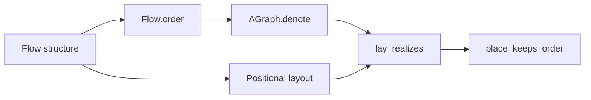

# D1 graph-order landing review

The landed statements check within the permitted trust boundary.
Correct the phrase “Above means before” before using it as a visual guarantee.
The theorem establishes the other implication.

Proof role: independent review of named tool laws under decisions row 336, point 8.
Evidence status: Lean checks of pinned declarations and finite direction controls.
Scope: structural graph order and layout positions, excluding scheduling and wait edges.

## Reviewed state

The reviewed commit is `ec1cce6fa0e3cd62dee1c19c7230faa1aa16a13e`.
Its preceding layout commit is `bfe97080657ecb87d4551fc8a4511580369f698d`.
The earlier layout review is retained at `git:6d21c721:docs/research/2026-10-09-layout-review-receipt.md`.

The finishing criteria are pinned compilation, trust inspection, and positive and negative controls for the stated implication.
The review changes research files only.

The bounded Claude session tail identifies the primary checkout and the graph-order landing.
Later messages and working changes cover path drawing, organic curves and tokens.
Session reports establish intent only.
The checks here establish the recorded results independently.

## Checked connection

`AGraph.denote` in `tools/Tools/View/AlgGraph.lean` interprets the four graph constructors as vertex and edge predicates.
`Flow.order` in `tools/Tools/View/FlowOrder.lean` interprets sequence as connection and parallel branches as overlay.
`lay_realizes` relates that order to positional paths in the layout.
`place_keeps_order` then establishes vertical separation for structurally ordered vertices.
The width function must be nonnegative everywhere.



The statements quantify matching occurrences.
They do not identify every repeated key with one unique drawing object.
The key-lookup connection from the preceding review remains open.
Wait edges and scheduler execution remain outside this structural-order statement.

## New finding D1R-1

The opening comment in `FlowOrder.lean` says “Above means before”.
Its own scope paragraph correctly says that converse is false.
The control uses two parallel branches: node `a`, and the sequence `b`, `c`.
The layout puts `a` above `c`, while the graph contains no edge from `a` to `c`.
The graph contains the positive edge from `b` to `c`.
All keys in this control differ.

Replace the slogan with “Structural precedence implies vertical separation”.
This is a wording correction, not a defect in the proved theorem.
The model header also cites `lay_keeps_order`, while the landed declarations are `lay_realizes` and `place_keeps_order`.
Use those actual names in the receipt and model comment.

## Commands and outcomes

```sh
python3 docs/research/2026-10-09-d1-review/run.py
```

The script extracts the pinned source into a temporary overlay.
It uses the existing dependency artifacts from the preceding narrow build.
It compiles `AlgGraph`, `FlowLaws` and `FlowOrder` sequentially with warnings as errors.
It sets `LEAN_NUM_THREADS=3` for each command.
The overlay leaves both active checkouts unchanged.

[build.json](build.json) records source hashes, exact commands and measured outcomes.
[output.txt](output.txt) retains the trust output.
The twelve inspected laws depend only on `[propext, Quot.sound]`.
All seven finite controls pass.
No whole-tree axiom gate or window execution runs in this review.

The first probe preparation missed dependencies under Lean's selected module prefix.
A mirrored artifact directory repaired that review setup.
The first direction controls also lacked explicit decision procedures for the predicate model.
The final controls supply them and pass.
Neither preparation error came from the landed proof files.

## Checkpoint

D3 arithmetic laws remain reviewed through `bfe97080`.
D1 graph-order laws are reviewed through `ec1cce6f`.
D1R-1 is the new comment correction.
D3R-1, the keyed endpoint connection, and D3R-2 retain their preceding scope and recommendations.
The later `232e71c5` row-argument merge and current drawing edits remain outside this pinned review.
This review does not reopen explicitly deferred work.
No production file, owner ruling, or implementation session changes.
