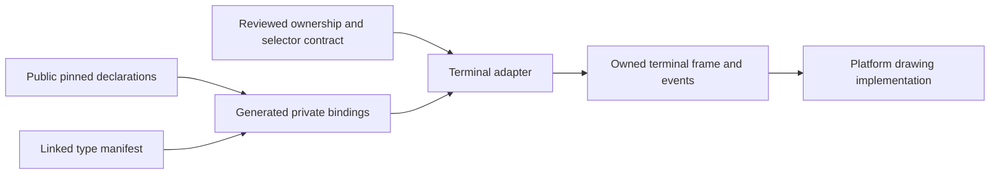

# Ghostty bindings: bounded probe

Use public `libghostty-vt` for a terminal adapter.
Keep Ghostty's internal application interface outside the binding generator.
Its public library supplies terminal state for a drawing implementation that the application owns.
It does not supply a public portable GPU canvas.

Proof role: proposed external binding and presentation adapter.
Evidence status: source inspection and finite C compiler checks.
Scope: selected public declarations, one local compiler platform, no library execution.

## Pins and stopping point

The Ghostty pin is `246f702876b924a1cb7cade1e99274d1470302fc`.
The Effect4 source base is `bfe97080657ecb87d4551fc8a4511580369f698d`.
The parallel landing review covers `ec1cce6fa0e3cd62dee1c19c7230faa1aa16a13e`.

The probe finishes when it identifies the public interface, demonstrates binding extraction, and maps the smallest adapter into Effect4.
It records the required contracts and the limits of the evidence.
It changes research files only.
It performs no Ghostty installation, application build, linking, window launch, merge or push.

Three GPT-6.1 Sol scouts cover the upstream interface, declaration extraction and local module map.
The parent repeats the declaration checks and verifies the pinned upstream bytes.
[Source hashes](upstream-sources.json) retain that verification.
[The executable probe](abi/README.md) retains its inputs, commands, diagnostics and limits.

## Upstream interface

The [public umbrella header](https://github.com/ghostty-org/ghostty/blob/246f702876b924a1cb7cade1e99274d1470302fc/include/ghostty/vt.h) describes terminal parsing, state, reflow, input encoding and observations.
It explicitly describes the interface as unstable.
The [internal application header](https://github.com/ghostty-org/ghostty/blob/246f702876b924a1cb7cade1e99274d1470302fc/include/ghostty.h) directs outside users to the public headers.
It serves Ghostty's macOS application and includes platform-specific assumptions.
Generate from public headers only.

`ghostty_type_json` already provides a versioned description of the linked binary's types.
It includes sizes, alignment, field offsets, enum values and tagged-union arms.
The public documentation asks bindings to use it instead of fixed offsets.
It requires consumers to check the schema version and required descriptors.
It promises no compatibility across versions.
See [types.h](https://github.com/ghostty-org/ghostty/blob/246f702876b924a1cb7cade1e99274d1470302fc/include/ghostty/vt/types.h) and [its JSON schema](https://github.com/ghostty-org/ghostty/blob/246f702876b924a1cb7cade1e99274d1470302fc/src/terminal/c/types.schema.json).
This probe inspects that contract but does not call the export.

The generated layer should combine three inputs.
Function declarations come from Clang's header tree.
Physical type layout comes from the linked binary's manifest.
A small reviewed contract supplies ownership, selector types, buffer lengths and callback rules.

## Reproduced checks

[compiler-run.json](abi/compiler-run.json) reports ten selected C function types from sixteen public headers.
Apple Clang 21.0.0 checks them on `arm64-apple-darwin25.2.0`.
Two positive C units compile without diagnostics.
Two negative C units fail at their intended incompatible types.
Offline replay checks the generated bytes against the retained files.

The result establishes declaration agreement for these C function types.
It establishes no linked binary agreement or terminal behavior.
The positive declarations derive from the same headers they check.
The independent negative cases show two specific mistakes that the checks detect.

One control deliberately supplies `uint8_t*` where a terminal-column getter requires `uint16_t*`.
The raw `void*` operation accepts it.
The typed wrapper rejects it.
The incorrect call never executes.

The [terminal header](https://github.com/ghostty-org/ghostty/blob/246f702876b924a1cb7cade1e99274d1470302fc/include/ghostty/vt/terminal.h) assigns output types by selector.
It also distinguishes direct callback pointers from addresses of scalar option values.
These rules need one reviewed table, shared by every generated language binding.
A declaration parser alone cannot recover them.

## Platform evidence

The [upstream CI configuration](https://github.com/ghostty-org/ghostty/blob/246f702876b924a1cb7cade1e99274d1470302fc/.github/workflows/test.yml) names the following library jobs.
The probe inspects their configuration without reproducing their runs.

| Platform | Inspected upstream configuration | Evidence from this probe |
| --- | --- | --- |
| macOS | Native and cross-build library jobs | C header checks on arm64 only |
| Linux | arm64, x86-64 and musl builds | Source inspection only |
| Windows | GNU cross-build and native static/dynamic-link checks | Source inspection only; generic MSVC cross-build remains commented out |
| Browser or other WebAssembly host | Freestanding Wasm build, schema and allocation checks | Source inspection only; the application still needs its drawing and input implementation |
| iOS and Android | Dedicated SDK/NDK library builds | Source inspection only |

None of these rows establishes a portable window, font or GPU implementation for Effect4.
Each platform needs a linked smoke test before an integration claim.

## Small module and shared data

Keep the foreign library's allocation and synchronization inside one adapter.
Its proposed author interface has five operations.

| Proposed operation | Data crossing the interface |
| --- | --- |
| `open` | Positive checked dimensions; a session-scoped terminal reference or failure |
| `write` | Owned input bytes; ordered output events |
| `resize` | Checked cell and pixel dimensions; output events |
| `frame` | An owned cell snapshot, cursor and dimensions |
| `close` | Retirement of the reference and release of owned resources |

The table describes proposed operations, not implemented authoring operations.
A scoped helper can use the existing finalization route around these operations.
No native pointer, allocator, callback closure or borrowed view enters stored program syntax.
A reference's numeric encoding establishes no lifetime or allocation correspondence.

The first frame operation copies all required data.
Dirty-row drawing waits for an acknowledgement contract that relates snapshot consumption to successful presentation.
The native adapter keeps one serial owner initially.
Callbacks copy application events into a queue.
The render-hold callback needs special treatment inside the adapter.
It captures the retained frame synchronously when a hold starts.
Deferring that capture until an application event runs can expose an intermediate frame.
The adapter never recursively feeds VT bytes from a callback.
These are source-derived requirements, not runtime results.
See the [render-state update contract](https://github.com/ghostty-org/ghostty/blob/246f702876b924a1cb7cade1e99274d1470302fc/include/ghostty/vt/render.h).

Keep three data sorts separate: program addresses, terminal cell coordinates and host resource references.
An explicit mapping can relate a cell to an authoring object.
A cell's position alone supplies no program identity.

## Fit and gaps in the current drawing code

`Tools.View.Call` and `Tools.View.Dev` live in `tools/Tools/View/Picture.lean`.
They describe drawing calls, not terminal state transitions.
`Tools.View.Page` in `tools/Tools/View/Page.lean` supplies an existing character fixture.
The C drawing implementation lives in `tools/view/paint.h`, `replay.h`, `draw.c` and `play.c`.
`OCaml5.Lcnf.Externs` in `src/OCaml5/Lcnf/Externs.lean` maps declared external operations for LCNF lowering.
It is not a C-header generator.

The terminal probe exposes two concrete drawing needs.
They are new consumers, not regressions in the current authoring view.

| Need | Current distinction | Smallest proposed change |
| --- | --- | --- |
| Terminal colors | `Dev.fill` uses semantic `Role`; `Rgb` in `Look.lean` represents resolved color data | Retain resolved terminal colors separately from authoring roles; share a checked color carrier when both consumers need it |
| Terminal graphemes and wide cells | `Dev.cells` and `paint_utf8_cells` use character counts | Add a terminal-cell drawing adapter with explicit cell spans; keep the existing character-view operation's meaning |
| Input | `play.c` handles platform input directly | Add a data event carrier only for the events both adapters consume |
| Object selection | `Picture.pick` answers drawing keys | Supply a separate cell-to-object map when the authoring view needs one |

The frame must retain each cell's codepoints and span before font shaping occurs.
Glyph positions and font resources stay with the drawing implementation.
The grapheme getter requires storage for the full reported length.
A fixed small array cannot establish that requirement.

Claude currently owns path drawing and token changes in the picture and C drawing files.
This packet proposes no competing edits there.

## Obligations before an implementation claim

These proposals do not add registry claims or theorem declarations.
Their implementation slice must place any new claim before proving it.
Existing judgments remain separate from foreign execution.

| Question and proposed role | Concept and requirement | Reach and consumer | Evidence still owed |
| --- | --- | --- | --- |
| Adapter data admission; boundary | `exact-codecs`, R8; reuse `decode-encode` and `decode-iff` where their premises hold | Checked dimensions, copied frame data and event payloads at the declared type; host row consumer | Named data profile and its admission connection; no pointer lifetime follows from codec laws |
| Terminal resource ownership; boundary | `host-session-protocol`, R6, and `scope-lifetime-finalization`, R11 | Creation, session identity, cancellation and release in the host adapter | Concrete `HostSpec` assumptions and lifecycle controls; no progress or exactly-once external effects follow from encoding |
| Snapshot and callback protocol; adapter invariant | `host-session-protocol`, R6 and R8 | Serial mutation, copied output, render holds and buffer capacity | A named observation and protocol model; any theorem remains conditional on the native calls meeting that model |
| Model-to-library comparison; external observation | `translation-simulation`, R8 | Selected input bytes, dimensions, screen, cursor and output-byte observations | Native positive and negative controls on each supported platform; a finite comparison supplies no universal simulation |

No new `Eff` constructor follows from this packet.
If an application calls the terminal, use the existing host-row route with checked call instances and reply admission.
The Forms-to-`Eff`-to-checked-TypeScript route stays the program route.
A WebAssembly or native binding remains a separate host implementation.

## Next bounded slice

Build one native terminal adapter against the pinned public library.
Validate the linked type manifest before its first call.
Copy a small screen fixture and record cursor, colors, spans and output bytes.
Exercise resize, split input, render holds, wrong selectors, short buffers and closed references.
Keep drawing in a separate consumer until frame ownership and text span rules pass those controls.
Then choose one drawing implementation and compare its frame consumption against the copied data.

This probe recommends no general-purpose binding framework and no production dependency change yet.
