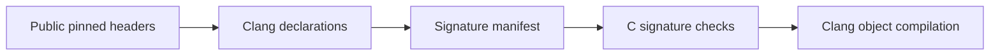

# Public Ghostty C declaration probe

The generated checks compile against the pinned public headers.
They check selected declarations only.
They do not link or execute Ghostty.

Evidence status: finite compiler check.
Proof role: proposed target-binding support; no Lean theorem.
Scope: public terminal and render-state headers at `246f702876b924a1cb7cade1e99274d1470302fc`.

## Reproduce

Run from any directory:

```sh
python3 /Users/pooks/.codex/worktrees/module-design-review/lean4-effect4/docs/research/2026-10-09-ghostty-probe/abi/run.py
```

The command downloads the bounded header closure into `/private/tmp/ghostty-abi-246f7028`.
It verifies each downloaded header against the retained manifest before generating checks.
It invokes Clang with C11, all selected warnings, and warnings as errors.

Replay without network access after the first download:

```sh
python3 /Users/pooks/.codex/worktrees/module-design-review/lean4-effect4/docs/research/2026-10-09-ghostty-probe/abi/run.py --offline
```



## Retained data

`manifest.generated.json` records header URLs, hashes, byte counts, declaration ranges, C function types and parameters.
The manifest stores no downloaded headers.
`run.py` selects operations but extracts their C function types from Clang's declarations.
It refuses missing operations, duplicate declarations and unsupported C function type shapes.
It checks regenerated manifest and C bytes against the retained files.

`compiler-run.json` records compiler identity, target, commands, hashes and outcomes.
The diagnostic files retain compiler output.
Positive checks must compile without diagnostics and produce nonempty objects.
Each negative check must fail with one incompatible-type error naming its intended consumer.

## Controls

| File | Expected result | Observation |
| --- | --- | --- |
| `signatures.generated.c` | compiles | Extracted function-pointer types match the public declarations. |
| `negative-signature.generated.c` | refuses | `ghostty_terminal_vt_write` returns `void`; the control expects `GhosttyResult`. |
| `selector-controls.generated.c` | compiles | Correct narrow wrappers compile; raw getters also accept deliberately wrong output storage. |
| `negative-selector.generated.c` | refuses | A `uint8_t*` output fails against the wrapper's documented `uint16_t*` output. |

The getter control demonstrates a limit of automatic binding generation.
Both public getters accept `void*`.
The compiler cannot infer the required output type from the selector.
The narrow wrappers use manually selected public enum documentation.
Their types do not come from automatic prototype extraction.
The probe never executes the deliberately wrong calls.

## Public boundary

The selected terminal operations create, free, feed, resize and read a terminal.
The render-state operations create, free, update, read and clean a snapshot.
The manifest names the exact operations and their declarations.

[Terminal declarations](https://github.com/ghostty-org/ghostty/blob/246f702876b924a1cb7cade1e99274d1470302fc/include/ghostty/vt/terminal.h) document selector types and terminal ownership.
[Render declarations](https://github.com/ghostty-org/ghostty/blob/246f702876b924a1cb7cade1e99274d1470302fc/include/ghostty/vt/render.h) document snapshot updates and dirty-state cleanup.
An update consumes terminal dirty state.
Snapshot dirty flags remain until the caller cleans them after rendering.
Row data becomes invalid after a snapshot update.
Synchronised rendering and callback reentrancy need separate contracts.

This probe does not check allocator lifetime, handle ownership, threading, buffer access or implementation ABI compatibility.
It checks only the recorded host target.
It builds no Zig code or native application.
It supplies no GPU, font, window or macOS-internal bindings.
[The public API](https://github.com/ghostty-org/ghostty/blob/246f702876b924a1cb7cade1e99274d1470302fc/include/ghostty/vt.h) explicitly remains unfinished and unstable.
