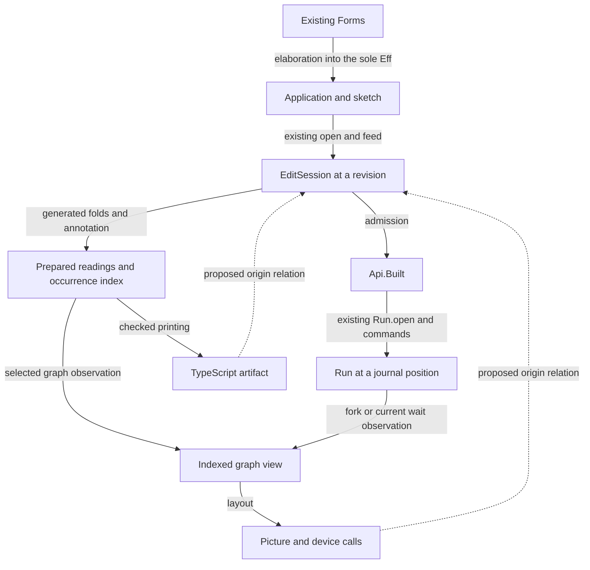

# Graph and tree audit

The first shared data should be scoped locations, indexed views, and answers tied to their inputs.
Keep `Eff` as the program representation.
Extend the existing session, query, and run carriers at their boundaries.

Before integration, distinguish occurrence identity from content identity and immediate edges from reachability.
The controls reproduce a layout collision despite distinct input keys.
They also show why a type cache needs its checking context.
The proposed operations remain research, except where an existing theorem is named.

## Scope and ownership

Base: `de2af69151186b775c020b9fa7f942181a7ba442`.
Review branch: `codex/graph-tree-audit`.
Primary at the final checkpoint: `cff2b3d18db1f2f7d99efa14aba3af3f736a1b20`.
The committed graph, address, edit, and checker-law files have no intervening changes.
Claude's `625cf314` moves type text into `Tools.Code` and the code-panel wrapper into `Tools.View.Program`.
Those committed moves leave the frontier, layout, and cache-premise findings unchanged.
The receipt's executable controls remain pinned to the base.

The bounded Claude session tail identifies its current work as the renderer algebra and TypeScript printer repairs.
The session's cwd is `/Users/pooks/Dev/lean4-effect4`.
Git confirms renderer commit `de2af691` and the later TypeScript printer work.
The later bounded tail reports those organization edits and a passing build before their commit.
This receipt treats that build as reported, not reproduced.
Decisions row 337, point 9, now rules the series, parallel, and cross-edge choices.
The proposal retains those choices and specifies the data and observations needed beneath them.
This audit does not reproduce Claude's renderer checks.
It changes no production file, ruling, root import, or implementation session.

Three GPT-6.1 Sol agents investigate graph consumers, tree laws, and primary literature independently.
The parent reproduces the controls below in the existing review worktree.
The [plan](2026-10-09-graph-tree-audit-plan.md) defines the finishing criteria.

## The structures that already own the data

| Structure | Owner | Meaning and boundary |
| --- | --- | --- |
| Program occurrence tree | `Eff`, `Node`, `Node.child`; `src/Effect4/Program/Eff.lean`, `src/Effect4/Program/Node.lean`, `src/Effect4/Program/NodeLenses.lean` | Seven syntax sorts share generated child indices. A path names an occurrence within its root. |
| Authoring state | `EditSession`; `src/Effect4/Program/Edit.lean` | The application, sketch, and address table stay together. The table may include refusals and unreached entries. |
| Admitted executable | `Api.Built`; `src/Effect4/Api/Built.lean` | The program, row table, and admission certificate stay together. A typed sketch alone does not supply this certificate. |
| Running state | `Run`; `src/Effect4/Run/Basic.lean` | The built program, checked host session, budgets, command journal, and verdicts belong to the run. |
| Compiled location | `Point`; `src/Effect4/Program/Compile.lean` | The full point requires its owning run and root mapping. Its numeric root index is not the program itself. |
| Stored content | `Store.Ref`, `Genesis.address`; `src/Effect4/Store/Domain/Node.lean` | A digest identifies candidate bytes. Equal hashes alone do not prove equal content. |
| Proof dependencies | `Plan`, `LoadPaths.Graph`; `tools/ProofGraph/Plan.lean`, `tools/Tools/LoadPaths.lean` | Edges record proof dependencies. Reachability does not prove an arbitrary proposition. |
| Rendered graph | `Graph`, `Laid`; `tools/Tools/View/Graph.lean` | Ordered nodes, edges, placement, and routes serve drawing. Their order does not establish causality. |

Canonical program bytes already exist through `Wire` and `Canonical`.
No `Content (Eff NativeOp)` instance or program connector for storage at every depth appears in the reviewed tree.
Decisions row 336 rules that direction; it does not implement the connector.
Likewise, `rebaseRefs` remains a ruled operation without an implementation in this tree.

## Proposed shared data

These names describe proposed records and functions, not a landed API.
Each record is derived metadata around an existing owner.
None introduces another program syntax.

### 1. A location belongs to one revision

Define an authoring location from a document identifier, a revision, and an existing path.
A revision identifies the whole checking input: application, program, definitions, and holes.
Use a separate term-slot location containing an authoring location and the existing `ExtSlot`.
Do not add term indices to the existing node-path language.

The application wrapper owns revisions beside `Tools.Session.State`.
It rejects a command whose revision is obsolete before calling `EditSession.feed`.
Undo creates a new revision, even when it restores earlier content.
Request `id` remains a correlation value, not a revision or authority.
A digest remains a content lookup aid, not a replacement for this location.

Internal operations may use a checked reference produced by lookup.
External locations remain plain data and pass through lookup each time.
A missing path and an obsolete revision receive different answers.

Consumers: MCP requests, selections, delayed view responses, and edits from several clients.
Existing laws: `Node.at_append`, `Node.envAt_append`, `EditSession.reached_view`, and `EditSession.feed_undo`.
New obligation: an accepted request names the revision and occurrence on which the operation acts.
This is a tool-boundary contract until the public face makes a larger claim.

### 2. An answer names its input and judgment

Extend `Tools.Query.Answer` with input context around its existing result.
Retain the current meaning of `ok`: the request runs, even when checking refuses the program.
Do not turn request success into typing, program admission, or execution success.

A checking answer carries the existing type or refusal result.
A run answer carries the existing inspection and run position.
A rendering answer carries its output artifact and input revision.
Separate response types keep their different meanings visible to callers.
They can share context and provenance records without sharing one status enumeration.

Attach a theorem reference only after the tool checks the premises it names.
Retain the existing premise checks and law references in `Tools.Query` and `Tools.Session`.
A law name sent as JSON is a reference to evidence, not a new proof object.
Expose finite checks and unfinished graph walks separately from theorem references.

Consumers: inspectors, compatibility reports, proof navigation, and application status views.
Existing laws: `fillPremises_sound`, `omitPremises_sound`, `Table.typedAt_table`, and `EditSession.reached_view`.
New obligation: response context matches the checked input and the actual judgment.

### 3. An index serves a chosen graph observation

Derive an ordered index from the existing node and edge arrays.
Keep node identity, edge identity, labels, multiplicity, and order.
Store incoming and outgoing edge positions once.
Keep payloads in their existing arrays; indexes point into them.

Keep two contracts distinct.
An internal compatibility index retains current lookup behavior, including first-match duplicates.
A new public graph input check may refuse duplicate identities and missing endpoints.
That stricter input domain requires separate controls and an explicit boundary.
Use distinct identifier constructors for real nodes and routing points.
A routing point contains an edge identifier and a rank.
String encoding belongs at the rendering boundary and needs its own injectivity check.

Expose separate graph views for syntax children, proof dependencies, fork history, and current waits.
A combined fiber drawing explicitly labels fork and wait edges.
Algorithms select the edge observation they read.
They do not silently erase labels or collapse parallel edges.

A tree index adds parent, child order, and subtree interval to the same occurrence enumeration.
The nearest `Eff` descendants require a selected-family frontier across all seven sorts.
That frontier is different from immediate syntax children.

Consumers: `Build.frontier`, `Graph.ranks`, `Graph.orders`, `Run.fiberGraph`, and motion joins.
First obligation: indexed lookup equals the existing lookup, including order and duplicate policy.
Current `List.find?` keeps the first occurrence.
A map populated by ordinary replacement may keep the last occurrence instead.

A DAG operation requires an order that covers every vertex and places each predecessor first.
A cyclic graph requires a separate operation, such as strongly connected components.
An unfinished walk retains its pending frontier.
It does not present a partial set as all reachable vertices.

### 4. A prepared reading retains its reuse conditions

Wrap existing lines, table segments, and code panels in a tool-side prepared reading.
Do not create another annotated program tree.
Start with a key containing the revision, path, and reading profile.
The profile includes every rendering input that affects the stored result.
Keep mutable rendering policy outside syntax and checker tables.

`Run.frames` uses one program for many frames.
`Run.frame` currently repeats `EditSession.open` and `Tools.Code.codePanel` for that program.
Prepare the opened session and code panel once, then combine them with each run snapshot.
Recompute fork highlights, line states, judgments, journal text, and the fiber graph for each snapshot.
Do not cache the whole highlighted `Program.sessionPage` as a fixed program reading.
This consumer offers a small optimization without persistent content storage.

Cross-address line reuse uses `Tools.View.Program.lines_at` with the same text function.
Cross-address typing reuse uses `tableAt_rebase` with the same effective signature, environment, and subtree.
Cross-edit table reuse uses the exact-type premises of `table_splice` and the existing edit session.
A hash match alone establishes none of these premises.

Resolve the effective signature through the existing application and sketch, including definitions and holes.
The current query and session tools use the empty application.
Adding a context label alone does not extend that checking domain.

### 5. Provenance is a relation between artifacts

Record links between existing source locations and output locations beside each TypeScript or picture lowering stage.
Output locations carry an artifact identifier, revision, profile, and local position.
A link may have several sources and several outputs.
Generated output may have no source occurrence; the record marks that case explicitly.

Layer hoisting can join several source occurrences into one declaration.
Picture lowering can split one drawing call into several device calls.
A single global node identifier cannot represent both relationships accurately.

Runtime endpoints use existing run, fiber, call, and journal identities.
A live run retains its admitted program revision when an editor advances to another revision.
A run position includes its run identity and a journal prefix.
Changing a source selection does not move the running computation.

Existing `Keyed.lower_key` establishes key retention for its lowering.
It does not establish unique source origin, occurrence correspondence, or revision continuity.
Existing replay laws establish the recorded command interpretation under their premises.
They do not infer causality from screen positions or timestamps.

Consumers: select an output and inspect its source; inspect a theorem and find its consumers.
New obligations belong to each connector's observation and program fragment.
A source link alone never grants an editing operation on generated output.

## Ordinary application data

Application records can use the same graph index and layout without becoming an `Eff` program.
Their identifiers and payloads remain owned by the application.
A graph input check establishes its stated identity and endpoint properties only.
It does not establish a business rule, program typing, or execution behavior.
A source link or theorem reference appears only when a connector actually supplies it.

Here, application records differ from `SigApp`, the configuration that interprets program operations during checking.
They can share indexed graph algorithms while retaining different domain contracts.
The rendering layer reads a prepared view and emits hit targets tied to its input context.
The authoring or application owner interprets those targets before accepting an update.

## Data sketch

The following signatures describe the proposal's records and sums.
They are schematic, not compiled declarations or new stored syntax.
Indexes and prepared readings have private constructors behind their consuming operations.

```text
AuthorLocation = { document, revision, path : List Nat }
TermLocation   = { owner : AuthorLocation, slot : ExtSlot }
OutputLocation = { artifact, revision, profile, position }
RunLocation    = { runId, journalPrefix, endpoint }

LocatedAnswer Input Result = { input : Input, result : Result, evidence }
PreparedReading Result     = { inputRevision, readingProfile, result : Result }

GraphIndex Node Edge = { nodes, edges, incoming, outgoing, positionOf }
LayoutItemId NodeId EdgeId = node(NodeId) | routePoint(EdgeId, rank)
OriginLink Source Target = { sources : Array Source, targets : Array Target, connector }
```

An `AuthorLocation` cannot stand where an `OutputLocation` or `RunLocation` is required.
`positionOf` and both adjacency directions derive from the owned arrays.
They never become independently editable sources of graph truth.
An origin link with no source explicitly identifies generated output.
Its connector can name a checked law instance or an unproved provenance record.
The client cannot promote that record into proof by changing a status field.

## Proposed application face

The wrapper retains the existing `open`, `feed`, and `view` pattern.
These signatures illustrate the proposal; they do not replace `EditSession` or `Run`.

```text
open(application, sketch)                 -> document revision
focus(revision, path)                     -> located answer
feed(revision, edit)                      -> next revision and existing delta
view(revision, viewProfile)               -> prepared view
origins(outputLocation)                  -> source locations and connector
inspect(runId, journalPosition)           -> existing run inspection
```

A caller supplies neither adjacency maps nor cache invalidation flags.
Each operation chooses its index and verifies its reuse premises internally.
A graph-building caller supplies identifiers, payloads, and meaningfully labelled edges.
Layout policy remains a rendering input.



The diagram does not assert a correspondence theorem for every arrow.
The next table names the laws that currently justify selected computations.

## Existing theorem support

| Computation | Existing declaration and source | Premises and limits |
| --- | --- | --- |
| Combine readings | `cata_prod`, `cata_fusion`; `tools/Tools/View/Algebra.lean` | Product equality is proved. Fusion requires the algebra equation at each layer. No cost theorem follows. |
| Relocate lines | `lines_at`; `tools/Tools/View/Program.lean` | Same subtree and text function. Address and depth move by `Node.under`. |
| Relocate a checking result | `Checker.check_rebase`, `tableAt_rebase`; `src/Effect4/Laws/Program/Typing/Rebase.lean` | Same signature and environment. Refusal and entry paths move; absolute layer targets do not. |
| Replace a typed focus | `NodeHasTy.replace_envAt`, `table_splice`; `src/Effect4/Laws/Program/Typing/Replace.lean`, `src/Effect4/Laws/Program/Typing/Splice.lean` | The replacement has the focus's exact type in its environment. This does not establish equal behavior. |
| Rebuild one syntax layer | `build_view`, `cata_build`; `src/Effect4/Program/LayerView.lean` | Structural reconstruction across the family. This is not the construction-request theorem. |
| Reuse a lookup in compilation | `resolve_of_at`; `src/Effect4/Laws/Program/Agreement.lean` | Same root and full `Point`, with the stated lookup premise. |
| Rank a forward drawing edge | `ranks_forward`; `tools/Tools/View/Graph.lean` | The source precedes the destination, and the destination exists. No general cycle analysis follows. |
| Interpret equal content keys | `address_eq_or_collision`, `address_inj`; `src/Effect4/Store/Domain/Node.lean` | Hash injectivity is an explicit premise of the latter. Exact byte comparison supplies a different route. |
| Relate a run to its journal | `journal_replays`; `src/Effect4/Laws/Run.lean` | The existing run and command interpretation define the observation. This is not arbitrary host equivalence. |

The algebra bank has a concrete consolidation opportunity.
`TyFoldExtras.lean` generates product and fusion support beside the type algebra.
The seven-sort program product currently lives in `Tools.View.Algebra`.
Share generator machinery when a core consumer needs that interface.
Keep compatibility wrappers until callers move, and keep the core/law import boundary.
Do not make core consumers import rendering tools.

The probe uses the existing product fold for total-node and effect-node counts.
It agrees with two independent current enumeration consumers on every retained example.
This demonstrates one usable interface without adding another traversal.

## Reproduced findings and controls

### GT-01: routing identity can collide

Status: confirmed finite defect at the reviewed commit.
Source: `Graph.pointKey`, `Graph.items`, and `Graph.layout` in `tools/Tools/View/Graph.lean`.

The input has three nodes, distinct node keys, distinct edge keys, and valid endpoints.
The edges form a chain plus a direct edge from its first node to its last.
Naming the middle node `long@1` collides with the direct edge's generated routing point.
The layout contains four boxes and fails `Laid.boxesApart`.
Renaming that node to `b` produces three separated boxes.

The defect lies within the public `Graph` carrier.
No current fiber naming convention is shown to trigger it.
Use a disjoint node-or-routing-point identifier before widening graph consumers.

### GT-02: nearest programs are not immediate children

Status: confirmed design correction and finite control.
Source: `Build.effAddresses`, `Build.frontier`, and `Build.filling` in `tools/Tools/View/Build.lean`.

The view audit proposes replacing each `view_eff` child with a hole.
For `.gen`, the immediate child is `Stmts`.
For a fork, the immediate child is `ActionTerm`.
Effect holes cannot replace those sorts.

The current construction works across these intermediary sorts.
The replacement needs a family-wide traversal that stops at the next effect child.
Keep intermediate constructors, leaf data, child order, and the existing hole numbering.
Prove exact filling agreement before replacing request construction.

The independent index matches current frontiers on nine programs.
The examples include generators, actions, effect lists, layer lists, and nested programs.
The prototype checks its preorder and distinct-path assumptions with assertions.
It does not establish agreement for every program.

| Nested example | Current predicate calls | Indexed prefix tests |
| --- | ---: | ---: |
| 17 effect nodes | 1,617 | 16 |
| 33 effect nodes | 9,121 | 32 |
| 65 effect nodes | 58,177 | 64 |

These counts exclude path-element comparisons, allocation, enumeration, and replacement costs.
They measure the frontier search only, not total runtime.
A generated traversal can avoid materializing and repeatedly comparing full paths internally.
That stronger cost result remains to be measured.

### GT-03: context is part of a reusable typing result

Status: confirmed negative cache control.
Source: `Checker.check` and `Checker.check_rebase`.

The identical program `.succeed (.var 0)` checks as a natural number under `[.nat]`.
It checks as a string under `[.string]` and refuses under the empty environment.
Changing only its base path keeps the natural-number result.
The probe also applies the existing relocation theorem at that program.

Cache pure syntax summaries by content where their laws allow it.
Cache checking results only with their effective checking context.
Reference expansion and runtime layer sharing remain separate observations.

### GT-04: algebraic connect changes the edge observation

Status: confirmed finite distinction, supported by the primary definition.

Take two paths, `a → b` and `c → d`.
Boundary sequencing adds `b → c`, yielding three immediate edges.
Algebraic connect adds every edge from the first vertex set to the second, yielding six edges.
The finite reachability relations agree; the immediate-edge sets differ.

Row 337 chooses series, parallel, and cross-edge presentation.
It does not equate boundary sequencing with all-to-all connect.
The graph extraction still needs an exact edge observation.
For immediate control edges, fold into fragments carrying entries and exits.
Connect the exit boundary to the entry boundary under the form's actual control rule.
Failure, finalizers, forks, and joins need their own boundaries.
Do not infer a series-parallel fragment merely from the absence of loops.

### GT-05: proof-view input checks do not establish a DAG

Status: confirmed input-boundary gap; no current generated cycle is alleged.
Source: `validatePlan` and `layoutGraph` in `tools/Tools/ProofGraphView.js`.

The current validator accepts a diamond, a two-node cycle, and a self-loop.
It refuses a missing dependency endpoint.
An independent topological walk visits all four diamond nodes and no two-cycle node.
The rendering path assumes a DAG after validation.

Check that a topological order covers every node before DAG reduction and layout.
Report an unavailable graph with the cycle evidence at this boundary.
Do not change the proof declarations to accommodate malformed report data.
The probe executes validation only, not a browser or the external layout library.

## The shared operation bank

| Operation | First consumers | Required contract | Cost opportunity |
| --- | --- | --- | --- |
| Ordered lookup index | Graph layout and motion joins | Same first-match lookup, or explicitly validated unique keys | Avoid repeated linear searches. |
| Incoming and outgoing adjacency | Ranking, layout, proof navigation, fiber views | Same endpoints, edge labels, order, and multiplicity | Build adjacency once per view. |
| Subtree interval and selected-family frontier | Construction requests and subtree repaint | Same generated child order and exact selected descendants | Replace repeated whole-address searches. |
| Product fold | Counts, text summaries, dependency summaries | Existing projection equations | Combine traversals; measure allocations separately. |
| DAG fold | Dependency summaries and graph ranking | Covering topological order and deterministic local algebra | Evaluate each vertex once per reading. |
| Strongly connected components | Current waits and cyclic application graphs | Exact component partition and retained original edges | Process cyclic regions separately from the component DAG. |
| Reverse dependency closure | Cache invalidation and proof consumers | Every reverse edge of the chosen reading | Recompute only affected readings. |
| Prepared static program view | `Run.frames` and application panels | Same program, checking input, and rendering profile | Avoid repeated checking and printing per frame. |

Expected hash-map bounds still depend on key hashing and comparison costs.
Explicit dense arrays give different bounds and require stable numbering within the view.
Materializing a dense graph still costs its output size.

A DAG fold can reuse the tree algebra only after an agreement theorem links the index to the original tree.
Merging equal subtrees additionally requires equal inherited inputs for that reading.
Cycles do not gain a terminating fold from the tree's initiality.
Component decomposition exposes cycles; it does not solve a cyclic semantic equation.
Keep any fixed-point solver as a separate contract with its own monotonicity and termination premises.

The existing visited-set walks supply useful starting implementations.
`ProofGraph.Plan.walkWithin` reports exhaustion rather than presenting a partial answer as complete.
`Tools.LoadPaths.loadBearing` returns its visited set after a fixed loop bound without exposing a remaining stack.
This is a source-inspected limit, not a reproduced large-environment defect.
Use the complete-or-unfinished distinction when consolidating these walks.

## Proof obligations for implementation

These are proposals, not new semantics registry entries or planned goals.
Place each obligation before implementing it.

| Obligation | Concept and consumer | Reach | Does not establish |
| --- | --- | --- | --- |
| Index agrees with occurrence lookup and frontier | `initial-algebras-folds`, R14; construction and editing | All seven sorts, generated child order, exact addresses and order | Typing or execution equivalence |
| Indexed graph operations agree with current observations | Tool laws under rows 334 and 336; layout and navigation | Valid identities and endpoints; chosen edge and duplicate policy | Causality or program behavior |
| Relocated cache agrees with recomputation | `initial-algebras-folds`, R14; checking and view consumers | Same effective signature, environment, subtree, or rendering profile as applicable | Sharing runtime state |
| DAG evaluation agrees with the original fold | `initial-algebras-folds`, R14; repeated pure summaries | Coherent acyclic index and equal inherited inputs | A cyclic evaluator or cost bound |
| Revision admission selects the intended input | Tool input contract; session commands and located answers | Exact document revision, application, and location | Program admission or host permission |
| Origin relation agrees with a lowering | The connector's existing concept and claim; output inspection | Named output observation and program fragment | Arbitrary editing through the view |

The graph-to-tree connector should state equality with the existing fold.
It should not introduce a second denotation or prove pairwise agreement between every consumer.
Each local algebra equation discharges the appropriate existing fusion premise.

## Primary literature

[Mokhov, Algebraic Graphs with Class](https://www.cs.tufts.edu/~nr/cs257/archive/andrey-mokhov/algebraic-graphs.pdf), sections 2–5, defines overlay and connect.
Connect adds the Cartesian product of vertex sets.
Overlay identifies duplicate vertices and edges; that quotient does not retain occurrence multiplicity.
The paper also shows that an expression-based edge deletion can grow quadratically.
Use its equations for a declared graph observation, not as a blanket performance claim.

[Meijer, Fokkinga, and Paterson](https://maartenfokkinga.github.io/utwente/mmf91m.pdf) derive fold uniqueness and fusion in a lazy domain setting.
Their strictness premises belong to that setting.
The repository's total Lean laws state the premises our implementation actually uses.
Neither source establishes the runtime cost of this implementation.

[Tarjan, Depth-First Search and Linear Graph Algorithms](https://sites.cs.ucsb.edu/~gilbert/cs240a/notes/TarjanDFS.pdf), section 4, proves its component algorithm and linear bounds.
This supports a component operation over indexed adjacency.
Retain original identities and edges beside the component graph for explanations and queries.

The repository already retains Huet's zipper and Allais's binding-universe paper under `vendor/papers/program-graphs/`.
Their inventory supplies further design references.
This audit does not claim a fresh full reading or an Effect4 zipper theorem from those papers.

## Proposed landing order

1. Separate routing identities and share compatible lookup across layout and motion.
2. Prepare fixed program readings once per run and measure the resulting frames.
3. Replace construction frontier search across the full syntax family, with an exact agreement law.
4. Add revision context and located answers when the interaction slice consumes them.
5. Add cache reuse under existing splice and relocation laws.
6. Add provenance at individual lowering connectors and DAG summary reuse where a consumer needs it.

This order retains row 336's views-before-interaction rule.
Public graph input checks remain distinct from internal indexing.
Strongly connected components and reverse invalidation are later candidates.
Freeze their first consumer's contract before adding either public operation.

Coordinate the construction and view slices with Claude before implementation.
The immediate parallel work can cover identity, input controls, and shared indexing.
Storage at every program depth, absolute-reference relocation, and a general fixed-point engine remain separate slices.

## Verification receipt

The [Lean controls](2026-10-09-graph-tree-probes/Controls.lean) compile and execute at the reviewed base.
They include existing-law readers, finite evaluations, and negative controls.
They add no general theorem to the library.

Commands run from the isolated review worktree:

```sh
LEAN_NUM_THREADS=3 lake build Tools.View.Build Tools.View.Graph Effect4.Laws.Program.Typing.Rebase
LEAN_NUM_THREADS=3 lake env lean --run docs/research/2026-10-09-graph-tree-probes/Controls.lean > docs/research/2026-10-09-graph-tree-probes/lean-output.json
python3 docs/research/2026-10-09-graph-tree-probes/compare.py
node docs/research/2026-10-09-graph-tree-probes/proof-input.mjs
```

The narrow build reports 389 jobs and passes.
The Lean controls pass.
The comparison checks all nine retained examples and both invalid-order controls.
The JavaScript input controls pass under Node `v22.23.2`.
No TypeScript compiler runs; these controls execute the existing JavaScript validator.

The first probe compilation exposes missing record fields in the probe.
Explicit record fields repair it; the corrected probe passes before retaining its outputs.

Retained evidence:

- [Actual Lean results](2026-10-09-graph-tree-probes/lean-output.json).
- [Comparison and counts](2026-10-09-graph-tree-probes/comparison-output.json).
- [Executed comparison](2026-10-09-graph-tree-probes/compare.py).
- [Proof-view validation control](2026-10-09-graph-tree-probes/proof-input.mjs).
- [Proof-view results](2026-10-09-graph-tree-probes/proof-input-output.json).

Axiom output: no axiom sweep runs, and this receipt claims no new trust result.
Existing-law applications compile under the repository's normal Lean settings.
The finite evaluations do not prove general graph or runtime properties.
The new Markdown passes the repository language check.
The source paths and retained evidence links resolve.
No merge, push, production repair, or full battery runs.
