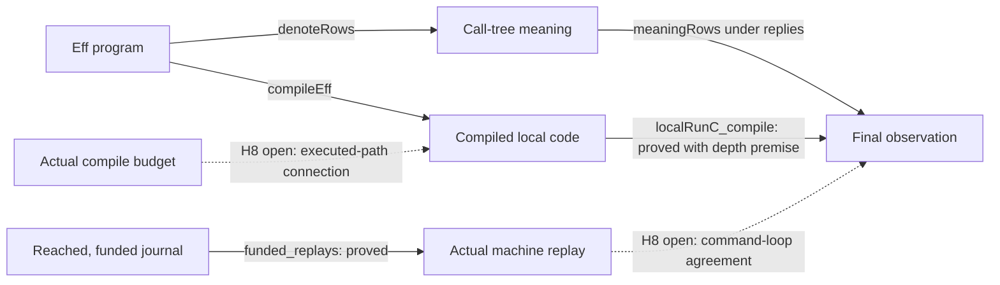

# H8 review: landed steps and the remaining connections

The landed steps pass the narrow build and the isolated controls.
The session agreement remains a planned goal.
Keep its present scope when connecting it to the new local runner.

Reviewed commits: `97d69de47b256c59728d97097565dd09471beba0` and `1f4ee194deef717a374e348c3bf42fbeebe44d80`.
The review starts from `21d8e031f31318db62afea392b3d043beef2e0be`.
All review files live under `docs/research/2026-10-09-h8-overwatch/`.
Production files and owner rulings remain unchanged.

## What the landed steps establish

`localRunC_compile` connects compiled code to `meaningRows` over `StraightRows`.
Its file is `src/Effect4/Laws/Program/Agreement/Calls.lean`.
The compile budget covers `depthRows`.
The result compares final exits, stores and remaining replies, or the absence of a final result.
The outer stack and interruptibility mask remain parameters.
Reply admission and actual machine scheduling are separate obligations.

The second commit passes the row table through `src/Effect4/Laws/Program/Agreement/Machine.lean`.
`evaluateNative_plain` keeps the actual completed-exit view and its code and stack premises.
`Owes` retains its exit and yield alternatives, command bounds and quiet-store premises.
`run_eq_meaning` retains its public statement.
This generalization reuses the existing drive proofs without duplicating their scheduling behavior.

The only root-import addition is `Agreement.Calls` under `Effect4.Laws`.
The core root gains no law import.

## H8R-01: final observations do not identify a waiting state

Status: checked abstraction limitation, not a refutation of the landed theorem.
Source: `ReachesC` and `RunsTo` in `src/Effect4/Laws/Program/Agreement/Calls.lean` at `97d69de4`.

`ReachesC` compares final observations for every remaining local budget, after a fixed budget shift.
Two distinct waiting calls satisfy it with zero shift and different stores.
A non-host asynchronous step that repeats forever also satisfies it against a waiting host call.
`different_frontiers` and `stalled_observation` in `Probe.lean` prove those controls.
The stalled code fails `PlainCode` and does not refute agreement on `StraightRows`.

Consequence: the relation alone identifies neither the actual waiting call nor the retained state.
Its prose must say final-observation relation where it currently says execution reachability.
`RunsTo.frontier` deliberately forgets the outer stack and mask too.

The frozen session goal observes only `none` at the frontier.
It does not request frontier-state equality.
Therefore this limitation does not require a wider representation for H8.
The command-loop proof still needs the direction from a machine exit to a local result.
Otherwise local absence alone excludes no unrelated machine exit.

Smallest next action: clarify the relation and prove the command-loop connection in both required directions.
Add an actual transition-prefix relation only when a consumer needs waiting-call identity, retained state, or registration correspondence.
MCP inspection and module interruption proofs may need those finer observations later.

## H8R-02: funding does not bound the depth of an untaken branch

Status: checked control of a proposed proof shortcut, not a refutation of the frozen goal.
Sources: `localRunC_compile`, `funded_replays` and `DenoteRowsEqSession`.
Their files are `src/Effect4/Laws/Program/Agreement/Calls.lean`, `src/Effect4/Laws/Run/Tape.lean` and `src/Effect4/Laws/Api/SessionMeaning.lean`.

`shallowPath` in `Probe.lean` selects a short branch beside a deeper branch.
The session finishes with compile fuel below `depthRows`.
It satisfies the fragment, funding, rest, host-control and equal-observation checks.
Selecting the deeper branch with the same budgets fails the joint funding and rest check.

`funded_replays` retains the run's existing compile budget.
It provides no whole-program depth bound.
The command-fuel stability results leave compilation fixed too.

Smallest next action: use an argument about the executed path, or prove an appropriate compile-budget extension connection.
That connection must cover waiting runs as well as finished runs.
Do not add a whole-program depth premise to `denoteRows_eq_session` merely to reuse `localRunC_compile`.
That would exclude the checked successful run.
Claude is already investigating this connection.

## The remaining proof graph

Every proposed step below serves concept `translation-simulation`, claim `rows-denotation-session`, role simulation, and requirement R6.
Its frozen pointer is `denoteRows_eq_session` in `src/Effect4/Laws/Api/SessionMeaning.lean`.
Decisions rows 310, 313 and 323 bound its scope.

| Proposed step | Reach and hypotheses | Consumer | What it does not establish |
| --- | --- | --- | --- |
| Command-loop observation agreement | The H8 calls-aware machine invariant, fixed row table and applied reply tape, funded execution and rest | `denoteRows_eq_session` | Host implementation agreement, reply admission, handle allocation, or stronger frontier observations |
| Compile-budget connection | Actual executed paths, including waiting calls; enough command execution under the frozen session premises | Connection from `funded_replays` to the local agreement | Whole-program structural depth follows from funding |
| Call-free specialization of `localRunC` | A suitable call-free invariant through local steps; unchanged reply tape | Reuse of existing plain-run proofs inside H8 | All arbitrary frames are call-free |

These are proposed helper boundaries, not added goals or changed statements.
Their exact declarations belong in Claude's decomposition before proof work.

## Consolidation after the landing

The strongest candidate is a shared constructor algebra for fragment membership.
The existing converters already produce `Straight.alg`, `Looped.alg`, `StraightRows.alg` and their fold equations.
Their sources are `src/Effect4/Laws/Program/Folds/Straight.lean`, `Looped.lean` and `DenoteRows.lean`.
The variants differ at operation admission, `catchIf` and `iterate`.

| Existing author-facing predicate | Operation choice | Conditional handler | Iteration |
| --- | --- | --- | --- |
| `Straight` | Synchronous operation | Excluded | Excluded |
| `Looped` | Synchronous operation | Excluded | Check body |
| `StraightRows table` | Synchronous operation or `dataRow table` | Check body and handler | Excluded |

Proposed shape: one private exhaustive algebra with these choices, followed by the existing named predicates.
Keep these choices internal instead of adding author configuration.
Keep the core membership computation below the Laws import boundary.
Use the existing fold equations to connect the old predicates before moving their consumers.
`Looped.of_straight`, `straightRows_of_straight`, and compilation plainness consume this shared classification.

Preserve the new-constructor classification check in `docs/core/traversal-census.md`, section 7.10, and decision 35.
The current converters read existing definitions.
They do not remove those definitions or their repeated constructor choices.
A wildcard or default-false classifier would silently repeat the earlier failure.
Existing proof sites also depend on definitional reduction, so this is a separate migration.

A second candidate shares denotation control rules through the existing `EffAlgebra`.
`denote` and `denoteRows` repeat sequencing, selection, handlers and finalization.
Their sources are `src/Effect4/Laws/Program/Denote.lean` and `DenoteRows.lean`.
The `Effects.Signature`, operation interpretation and conditional-handler policy supply the variation.
`seqRows` already supplies the signature-polymorphic version of `seqExit`.
`denoteRows_straight` and `localRunC_compile` are concrete consumers.

Keep the specification interpretation independent from `localStep` and `localStepC`.
Share specification control rules, not the specification and implementation themselves.
Keep budgeted `denoteB` separate until its unfinished-result and retained-store behavior has an explicit connection.
This proposal adds no program representation.

## Checks and evidence limits

The exact commands and measured results are in `receipt.json`.
`build.log` records the narrow build of the changed modules and selected consumers.
`probe.log` records the final Lean check and the selected declarations' transitive axioms.
`Probe.lean` holds the positive and negative controls and the theorem readers.

The controls check reply consumption, state retention during finalization, remaining replies, and the nonempty-table yield route.
The existing session battery also builds.
It retains controls for host interruption, clock changes, delayed reads, funding, rest and allocating handle rows.

The inspected proved declarations use only `propext` and `Quot.sound`.
`denoteRows_eq_session` still depends on `sorryAx`, as its planned-goal declaration intends.
No whole-tree axiom gate or kernel replay runs here.
No TypeScript compiler, external host, renderer or performance test runs here.

The first probe attempt had a namespace error and a tuple-pattern error.
Both were in the review fixture and are repaired.
`probe-attempt-1.log` retains that diagnostic output.
The final probe passes with warnings treated as errors.
The initial diagnostic log retains its exact whitespace.
`document-check.json` records that narrow exception and checks every other changed file.

## Ownership and checkpoint

The active Claude session is `9ebf38b2-8b2f-44e5-8fd9-2dc0cb5a1f50` in the primary repository.
A bounded recent JSONL tail establishes its task and cwd.
The reader excludes thinking fields.
Its current file is `src/Effect4/Laws/Program/Agreement/Machine.lean`.
Those uncommitted changes are outside this review.

The prior Ghostty findings remain recorded on branch `codex/ghostty-binding-probe`, commit `43942ab3`.
This review neither repeats those findings nor claims their proposed repairs landed.
`checkpoint.json` records reviewed commits and the remaining findings for the next run.
