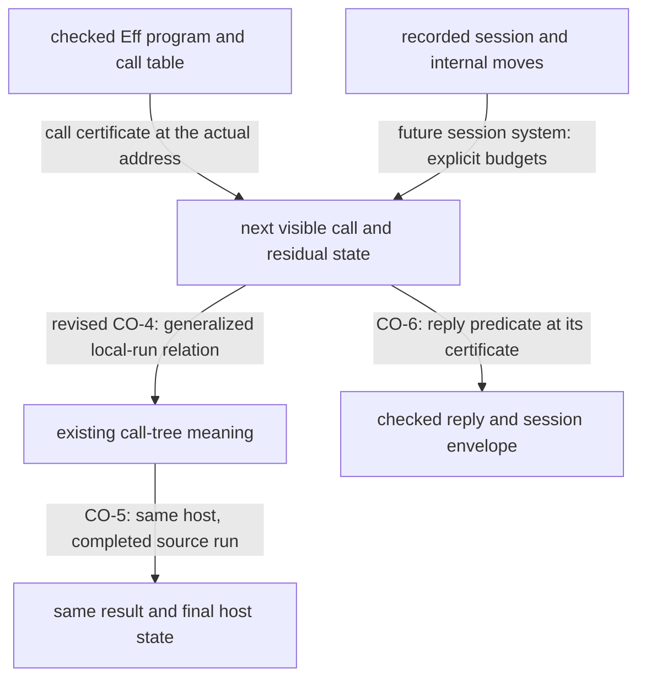

# Host coalgebra review

## Coordinator note

The generic completed-run theorem passes this narrow review.
The checked session adapter needs two contract repairs before it uses that theorem.
Keep the checked call instance available, and retain H8 until the separate connection for stopped runs is proved.
These findings concern the consumer design.
They do not refute the generic theorem.

## Reviewed state

- Effect4 base: `df9d1c40`.
- Initial Effect4 reviewed head: `a2cc7df57b268e29d8f8bf6ddda6a3e821b8cc9b`.
- Follow-up Effect4 landing: `0a108d2f91dce4a0f8a2fa7899228e2541ccf8ea`.
- Review branch base: `1424f8e402d43b09ec45deca033f12940d33bcfa`.
- Generic package first captured as working changes above `a4ee7a14248ee5976039b73039319efa87834986`.
- Claude commits that package as `8ddb936a1677c37765a7e8186d4c1fc2375a4b6e` during this review.
- The subsequent adapter commit is `b0dd60797244a04b47bcb1f6eecfe71f7a02ae04`.
- All 14 copied source files match `b0dd607`.
  `landing-match.json` records the comparison.
- The follow-up landing pins Effects at `b0dd607` and adds `HostRuns.lean`.

Only the coalgebra note changes from `df9d1c40` to `a2cc7df5`.
The later landing adds the meaning-to-host connection and the dependency pin.
The review branch has the same implementation as `df9d1c40`.
`note.md` pins the reviewed note.
`input-pins.json` records the original capture.
`upstream-delta.patch` records the subsequent package change.

A bounded tail of Claude's repository session identifies the package implementation, release, and dependency update.
Its recorded working directory is `/Users/pooks/Dev/lean4-effect4`.
The edits, commits, and matching sources independently confirm the package work.
Claude reports broader package gates.
This review does not reproduce those gates.

Three GPT-6.1 Sol reviewers independently inspect the generic contract, reply admission, and stopped-run connection.
The parent reproduces the controls below.
Neither active implementation checkout nor the implementation session changes because of this review.

## HCO-01: reply admission needs the checked call instance

Evidence status: checked finite control and source inspection.
Proof role: counterexample control for `reply-at-call-instance`, requirement R6, decisions row 323.
Scope: local checked calls and handle-free data replies.

The note's sections 5.2(6) and 5.4 propose exact session admission as one protocol over `RowSig table`.
`RowSig` carries only the row position and request value.
Its answer carrier is `ExitV`.
`Effects.Protocol` sees only that operation and answer.

`InstanceProbe.lean` checks one `List<A> → Option<A>` row at two local environments.
The request is the empty list in both environments.
The checked answers are `Option<Nat>` and `Option<String>`.
The numeric reply succeeds at the first instance and fails at the second.
The string reply gives the reverse result.
`none` succeeds at both.
A predicate receiving only the identical row, request, and reply cannot distinguish these calls.

Source declarations:

- `RowSig`, `src/Effect4/Laws/Program/DenoteRows.lean`.
- `callAt`, `src/Effect4/Program/Typing/Call.lean`.
- `admitInstance`, `src/Effect4/Program/Admit.lean`.
- `instanceAt` and `preflight`, `src/Effect4/Api/HostSession.lean`.
- `Protocol`, `package/Effects/Coalgebra/Protocol.lean`.

The smallest repair keeps the existing call certificate beside the residual relation or observation.
Reuse `Protocol.Cert` from `src/Effect4/Laws/Effects/Protocol.lean` when defining that connection.
Specialize an answer predicate at the certificate.
Do not reconstruct its type from the runtime request.
This keeps stored `Eff` unchanged.
A certificate without a connection to the actual checked call would not solve the problem.

Membership alone also omits existing reply admission premises.
`admitInstance` excludes handles on success and reserved defects on failure.
`preflight` checks the session envelope and live binding separately.
The proposed no-refusal result must retain those premises.
A protocol's `Meets` property supplies no progress guarantee.

Limit: the probe checks local typed environments, not two closed session executions.
It establishes the missing information at the proposed operation interface.
It proves no replacement adapter.

## HCO-02: the simulation does not replace H8's stopped-run result

Evidence status: kernel-checked control, finite evaluations, and a theorem reader.
Proof role: premise control for `rows-denotation-session`, requirement R6.
Scope: a finite generic system and the same host on both sides.

`IsSim` imposes no requirement where the source system cuts.
`package/Probe.lean` constructs a system that always cuts and proves its simulation by a program.
Against the counter host, its run returns a cut with state 5.
The program returns value 11 with state 7.
Both evaluations pass alongside the simulation witness.

The positive control applies `Program.run_of_sim_program` to the battery's actual machine.
That machine finishes and the theorem gives the matching program result and host state.
The theorem correctly requires source completion.

`denoteRows_eq_session` in `src/Effect4/Laws/Api/SessionMeaning.lean` also covers an absent exit under its stated premises.
Its proof uses answered replay, settled forms, and the at-rest condition.
The original CO-4 cannot recover that whole statement from `IsSim` alone.
The revised CO-4 in `0a108d2f` instead generalizes the local machine relation to a host.
That direction can retain the required stopped-state evidence.
Its theorem and premises remain open.
The generic completed-run law still does not supply them.

Keep H8 in place while proving the separate connection for stopped states.
Either rule out spurious cuts under H8's premises, or use a stronger relation on that restricted fragment.
CO-5 still needs a connection between `Run.drive` and `System.run` before the generic finished-run law applies.
The always-cut control is not a counterexample to H8 or to the generic completed-run theorem.

## HCO-03: define how internal moves reach the next visible call

Evidence status: source inspection.
The later session-system obligation remains open.
The revised CO-4 postpones that system until after the generalized local run.
Proof role: decomposition proposed for `rows-next-call`, requirement R6.
Scope: the existing single-fiber fragment and its explicit budgets.

`Holds` includes the loaded machine, and settled forms include `Myield`.
Neither form is a result or a host call.
The generic `Step` has only those two visible cases.
Returning a cut for a fixed state keeps every deeper unfolding cut.
An actual session may resume that yield through `flush`.

The future session system must state the internal normalization policy.
The landed CO-3 connects two interpretations of a call tree and needs no such policy.
Name its compile budget, command fuel, and permitted evaluate/flush decisions.
Reuse `holds_evaluate`, `holds_flush`, and `holds_answer` from `src/Effect4/Laws/Program/Agreement/Hosted.lean`.
Keep their raw machine relation separate from the checked session envelope.
`holds_answer` assumes a successful machine-step receipt.
It does not prove checked reply acceptance.

The reusable interface should expose the next visible call with its residual continuation and checked call certificate.
Its proof should connect the hidden internal moves to the existing machine relation.
This concentrates scheduling detail without erasing the evidence needed by reply admission.
It adds no stored program representation.

## HCO-04: correct two claims in the design note

Evidence status: rerun finite control and existing source evidence.
Proof role: premise clarification.
This review adds no library theorem.

First, section 2 describes `funded` as answering every decision and as progress.
`Run.funded` in `src/Effect4/Run/Tape.lean` checks that the recorded journal has no unread remainder.
The existing `HostCallReview.driver 0` control remains funded with no exit.
Its independent host can produce an exit.
`driver 4` finishes and agrees with that host.
`funded-rerun.log` records this rerun.
Funding the recorded prefix does not promise future replies or fair scheduling.

Second, sections 3.1 and 5.1 imply finite trees with one program depth.
The package already refuses that claim through `E4-ALG-CE-008`.
`unboundedContinuationFamily` has a well-founded continuation for each natural-number answer, with no uniform depth bound.
Source: `EffectsTest/Algebra/ExtractionContract.lean` in `lean4-effects`.
`Program.unfold_system` correctly states approximation at every depth.
The new generic contract uses that narrower statement.
Update the note to match it.

## HCO-05: place the new connection in the proof graph

Evidence status: source inspection at `0a108d2f`.
Proof role: missing semantics registry placement for a compatibility helper, requirement R6.

`HostRuns.lean` names `rows-denotation-reactor` as its planned consumer.
That claim has no entry in `tools/ProofGraph/Registry.lean` at the reviewed commit.
The four new theorems have no semantic tags, and their module has no default concept entry.
`tools/Tools/Semantics.lean` assigns placement through those tags or exact module entries.
The docstring explains the intended use but does not place the declarations in the generated graph.

State H9 as a planned goal with its exact observation and premises.
Register its claim and tag the connection helpers under `translation-simulation`.
This satisfies the repository's proof-placement rule without changing the proved equations.
Do not give H9 a stronger statement merely to obtain a semantics registry entry.

## Follow-up landing: a useful connection with limited scope

`HostRuns.lean` is copied exactly from `0a108d2f`.
`HostRunsProbe.lean` adds only an import and an exact dependency check after that source.
Its four theorems compile and stay within the permitted axioms.

`meaningUnder_eq_run` relates the existing meaning to the routed store-and-host interpretation.
`meaningRows_eq_run` specializes the same connection to the reply tape.
Neither theorem claims session correctness, typed replies, or progress.
The revised CO-4 also recognizes that reply-tape agreement cannot establish request agreement.
These are useful advances.
They do not resolve HCO-01 or the remaining stopped-run obligations.

One optional consolidation remains in `interpret_rowsHandler`.
It proves a state reassociation by induction over programs.
`Effects.interpret_mapHom` in `Effects/Experimental/Transport.lean` could supply the generic interpretation step.
That route first needs a reusable monad homomorphism between paired and nested state.
`MonadHom.stateT` alone does not provide it.
Consider that connector if another consumer needs the same reassociation.
This is an abstraction opportunity, not a correctness defect.

## Recommended connection

The following arrows describe the remaining session obligations.
The separate meaning-to-host connection is now proved in the follow-up landing.



Keep the program-in/program-out construction at `interpret`.
`Comodel.run_through` already supplies its generic composition law.
The `b0dd607` adapter adds the direct connection from existing handlers through `Comodel.ofHandler`.
Its two round trips and run equation are definitional equalities.
This avoids a second manually maintained interpretation.

Keep protocol evidence, checked session admission, and host progress as distinct obligations.
The existing world-indexed protocol is a consolidation opportunity for the certificate connection.
No claim here settles the deferred indexed-signature or promise design.

## Verification

All final listed verification commands exit 0.
The package commands run from this folder's `package` directory.

```sh
LEAN_NUM_THREADS=3 lake build Effects.Coalgebra EffectsTest.Coalgebra.CoalgebraContract
LEAN_NUM_THREADS=3 lake env lean Probe.lean
LEAN_NUM_THREADS=3 lake build ProofGraph.Axioms
LEAN_NUM_THREADS=3 lake env lean AxiomProbe.lean
```

The remaining commands run from the review worktree root.

```sh
LEAN_NUM_THREADS=3 lake env lean docs/research/2026-10-09-host-coalgebra-review/InstanceProbe.lean
LEAN_NUM_THREADS=3 lake env lean docs/research/2026-10-09-host-calls-review/Probe.lean
```

`generic-build.log` records the build of the original package capture.
`adapter-build.log` records the narrow rebuild after `b0dd607`.
`collector-build.log` records the copied exact dependency walk's build.
`generic-probe.log`, `adapter-probe.log`, and `instance-probe.log` record the new controls.
`axioms.log` records the original 18-declaration check.
`adapter-axioms.log` adds the three adapter laws to that check.
Every listed declaration stays within `propext` and `Quot.sound`.
None reaches an open goal.
The copied collector is pinned in `input-pins.json`.
`consumer-check.log` records four additional connection laws from `0a108d2f`.
Their check uses an isolated import overlay and existing unchanged Effect4 build products.
The overlay adds the reviewed package modules without changing the review worktree's dependency pin.
The first attempt lacks `Effects.Family`.
The overlay supplies that unchanged dependency.
The preparation script also handles read-only copied artifacts.

From the review worktree root:

```sh
python3 docs/research/2026-10-09-host-coalgebra-review/prepare-consumer.py
LEAN_NUM_THREADS=3 lake env bash -c 'export LEAN_PATH="/Users/pooks/.codex/worktrees/module-design-review/lean4-effect4/.lake/host-coalgebra-review-overlay:$LEAN_PATH"; exec lean docs/research/2026-10-09-host-coalgebra-review/HostRunsProbe.lean'
```
This is not the whole-library gate.

No TypeScript code changes, and no TypeScript compiler runs.
No full sweep, merge, push, or message to Claude occurs.
All changed files are review sources, input pins, logs, and this receipt under the current research folder.
Build products remain outside the commit.
The two retained patch files retain exact diff bytes.
Whitespace checking excludes those patches, whose context lines may contain one space.
It also excludes the retained `upstream-record/docs/CLAIM-BOUNDARY.md`, which ends with a blank line.
The captured evidence bytes stay unchanged.
The strict language check covers this receipt and `PLAN.md`.
Its result is in `language.log`.

## Checkpoint

CO-1 and CO-2 have local package commits and the narrow evidence above.
The Effect4 note and connection are reviewed through `0a108d2f`.
The package sources are reviewed through `b0dd607`.
HCO-01, HCO-04, and HCO-05 remain open.
The revised CO-4 addresses the direction of HCO-02 and postpones HCO-03 to the later session system.
Their controls remain obligations for that work, not regressions in the landed interpretation connection.
The prior HCF-01 through HCF-03 findings have no relevant source changes in this review.
Their receipt remains `docs/research/2026-10-09-host-review-followup/README.md`.
The next review should inspect the generalized local-run relation and proof placement, without repeating unchanged findings.
