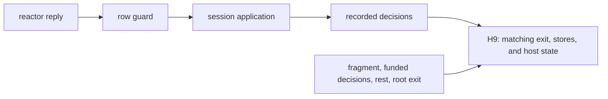

# Host driver and host adapter review

The driver connection to H9 passes the narrow review through `d4c869ee`.
The new host utilities still need placement behind the declared public entries.
Keep the `Effects.Program` dependency outside the core while exposing those utilities.
The review changes no production file, owner ruling, or Claude session.

## Reviewed state

| Item | Commit |
| --- | --- |
| Previous reviewed implementation | `b98d81c33ffa1721fe61b23d38d167b6e0dd9eca` |
| Previous review checkpoint | `295bd8fba8da9d4c98605146700cb1bd4c5de835` |
| Driver and audit command | `e72edc4ed878af3661fa4bb0d6e6c55f8ec66cf9` |
| Host adapter | `d4c869ee321d83abdc4ee0b8d66b2007cfa06c97` |
| Effects dependency | `b0dd60797244a04b47bcb1f6eecfe71f7a02ae04` |

`pins.json` and `pins-d4c869ee.json` record the source hashes.
The two snapshot directories retain the compiled source and changed battery.
The existing isolated overlay supplies the previously reviewed dependencies.

Three GPT-6.1 Sol agents review the driver, its placement, and the audit command independently.
The active Claude session remains `9ebf38b2-8b2f-44e5-8fd9-2dc0cb5a1f50.jsonl` in the repository-specific project directory.
Bounded tail reads confirm `/Users/pooks/Dev/lean4-effect4` as its working directory.
The session reports the driver, audit command, then host adapter checks.
The checks below reproduce the relevant builds and add independent controls.
The host adapter starts as working changes and lands as `d4c869ee` during this review.
No reviewer messages Claude.

## Resolved conditionally: HCO-06 driver correspondence

**Role:** simulation, claim `rows-denotation-driver`, concept translation-simulation, requirement R6.
**Evidence:** compiled theorem readers and controls; exact axiom dependency audit.
**Scope:** `StraightRows`, admitted exit replies, funded recorded decisions, a run at rest, and a root exit.

`runWith_denotes` in `src/Effect4/Laws/Api/HostDrive.lean` connects the driver's actual host state to H9.
`runWith_hostAnswered` supplies the matching-answer premise under the envelope, exit-only, and funding hypotheses.
`runWith_guarded_denotes` supplies the first two hypotheses through `Reactor.guardRows`.
It retains the fragment, funding, rest, and root-exit hypotheses.

`DriverControls.lean` applies the theorem to the existing two-call program.
The host state changes the second reply.
The result is number `4`, with two applied replies and final host state `2`.
The receipt does not infer progress from this equality.

| Control | Observation and premise |
| --- | --- |
| Wrong-shaped raw reply | the host advances without an applied reply; it violates `Reactor.Envelops` |
| The same reply behind the guard | the host state stays `0`; the call waits and the root has no exit |
| Accepted reply with zero application fuel | the host advances; the reply stays pending and the recorded suffix is unread |
| Handle allocation success | the new guard refuses it |
| Failure on the same handle row | the new guard admits it |
| Checked numeric call instance | the session admits the reply; the template guard refuses it |

The zero-fuel control changes the budget after parking.
It tests a driver suffix, not a globally reached run under the changed budget.
HCO-06's unconditional claim remains false; the landed theorem states the necessary conditions.



## Host composition through the driver

`Reactor.ofHost`, `reactorHost_ofHost`, and `runWith_host_denotes` land in `src/Effect4/Laws/Api/HostDrive.lean` at `d4c869ee`.
They connect a host of `RowSig table` to the existing driver.
The round trip yields `hostGuard table host`, not the unrestricted host.
`hostGuard_of_meets` removes that guard only under its named reply predicate.

`HostAdapterControls.lean` applies `runWith_host_denotes` to the same two-call host.
It obtains the same result, applied replies, and final host state.
Its negative control duplicates row keys.
The adapter then answers the first occurrence where the positional host answers the second.
This demonstrates why the theorem requires distinct keys.

The changed production battery records and replays four repository scenarios.
The narrow build reproduces those finite evaluations and the shortened-transcript control.
Those evaluations do not apply the new theorem; the isolated reader does.
A production theorem reader remains a small follow-up.

## New: HCO-09 describe the guard's limits precisely

**Role:** documentation of the simulation hypotheses.
**Evidence:** `DriverControls.lean` and the theorem statements at `d4c869ee`.
**Scope:** `docs/STATE.md` and the guard descriptions.

STATE says the driver meets H9's premises when the reactor obeys the envelope and returns exits.
It then says a guarded reactor always does.
The waiting control has an admitted guard, funded decisions, and rest, but no root exit.
The guard supplies reply conditions, not every H9 premise.

The docstring of `runWith_guarded_denotes` says handle rows answer nothing through the guard.
`answerAdmits` admits an allowed failure on a handle row.
The coalgebra note repeats the broader wording.

**Next action:** retain the theorem's funding, rest, and completion conditions in STATE.
Describe the handle restriction as refusal of successful allocation replies.
Neither correction changes a theorem or expands CO-7.

## New: HCO-10 put executable utilities behind the public entries

**Role:** author interface and core-law separation, decisions rows 39 and 332.
**Evidence:** source imports and the paired public-entry controls.
**Scope:** executable helpers and their proofs at `d4c869ee`.

`Effect4.Run` exposes `Run.runWith`, but not `Reactor.guardRows` or `rowPosition`.
`Effect4.Laws.Author` exposes `journal_replays`, but not `Reactor.ofHost`.
`PublicRunControls.lean` and `PublicLawsControls.lean` reproduce those missing declarations.
Directly importing `HostDrive` reaches them, as the positive theorem readers show.

`ArchitectureRoles.exposures` assigns the current location to `.proof`.
`Exposure.userImportable` excludes direct imports of that category.
The import gate remains in report mode; this is a public-interface gap, not a compiler restriction on direct imports.

`answerAdmits`, `Reactor.guardRows`, and `rowPosition` need only existing core types.
The generic adapters depend on `RowSig` and `Effects.Comodel`, whose closure includes `Effects.Program`.
Moving the whole file into the core would violate the existing program-representation boundary.

**Next action:** move only the plain guard and lookup definitions behind `Effect4.Run`, preserving their names.
Keep their proofs and generic adapters in Laws.
Expose the latter through the existing `Effect4.Laws.Author` entry.
No new public entry or stored program representation is required.

Proposed author surface after that extraction:

```lean
import Effect4.Run

-- repository is the application's Reactor; the guard uses the existing reply predicate.
def driver := repository.guardRows
def result := Run.runWith program driver initial
```

## Consolidation checkpoint

HCO-07's raw allocation wording in `RowProtocol` remains unchanged.
HCO-08 remains open for its original helpers, despite the new, separate guarded-driver route.
`guardRows_meets`, `guardRows_of_meets`, and `hostAnswered_guardRows` have no new external consumer.

The old `rowAdmits` allows raw allocation against an empty allocation table.
The new `answerAdmits` rejects allocation successes so its envelope law works at every machine.
These predicates are different by design; renaming one as the other would lose a premise.

Define a named restricted protocol for the nonallocating driver fragment.
Connect it to the existing row protocol under explicit nonallocation and checked-column hypotheses.
Then reuse that protocol in host guarding and the proposed typed-handler consumer.
The connector serves `rows-denotation-driver`, concept translation-simulation, requirement R6.
Keep call-instance reply admission and allocation context separate until their planned connector lands.

`answer_tape` also repeats binding and preflight setup from `answer_accepted` in `src/Effect4/Laws/Run.lean`.
Consider one shared application receipt when that proof is next edited.
This is a consolidation opportunity, not a failed proof.

## Audit command controls

`#axiom_audit` compiles and audits the new law module with `RowProtocol`.
At `e72edc4e`, it reports 66 declarations within `[propext, Quot.sound]`, with no goals or dependencies on goals.
At `d4c869ee`, it reports 81 declarations under the same ceiling and goal conditions.
These are exact command outputs, not whole-library gate results.

The clean synthetic module passes.
The private `hiddenChoice` declaration fails because it reaches `Classical.choice`.
The command finds it even though the declaration is not public.

The suspected restricted-import omission is not reproducible through valid imports of the current command.
Lean refuses to import the non-module command into a module reader.
A non-module reader loads the private declarations and proof bodies transitively.
The paired controls retain both the import refusal and the actual private-declaration failure.
No defect is reported for that hypothesis.

This command checks the axiom dependency ceiling.
It does not replace the full gate's declaration flags, root separation, or module-closure checks.

## Verification

Every Lean command sets `LEAN_NUM_THREADS=3` and runs sequentially in the isolated worktree.
The compiler is Lean `4.33.1`.
The scripts retain exact commands, return codes, and output under `checks/` and `checks-d4c869ee/`.
Expected negative exits are checked separately from compilation failures.

| Command | Result |
| --- | --- |
| `LEAN_NUM_THREADS=3 python3 docs/research/2026-10-09-host-driver-review/compile.py` | frozen driver, audit command, and changed session battery compile |
| `LEAN_NUM_THREADS=3 python3 docs/research/2026-10-09-host-driver-review/probe.py` | driver reader, boundary controls, and paired audit controls pass |
| `LEAN_NUM_THREADS=3 python3 docs/research/2026-10-09-host-driver-review/compile.py --followup` | frozen host adapter and changed session battery compile |
| `LEAN_NUM_THREADS=3 python3 docs/research/2026-10-09-host-driver-review/probe.py --followup` | adapter reader, duplicate-key control, and exact audit pass |
| `LEAN_NUM_THREADS=3 python3 docs/research/2026-10-09-host-driver-review/probe.py --entries` | both public-entry gaps reproduce beside existing usable declarations |
| `python3 docs/research/2026-10-09-host-driver-review/verify.py` | source hashes, registry join, and source import boundary pass |

The new source imports only extend the Laws graph.
The Laws root reaches the driver module.
The generated registry marks `rows-denotation-driver` proved and leaves R6 open.
No full sweep, root gate, TypeScript compiler, physical host test, merge, or push runs.
The authoring-to-TypeScript path is unchanged by these commits.

Early fixture corrections add the driver's final flush and use the normalized row returned by `externalRow`.
The restricted-import probe becomes a checked refusal after Lean rules that configuration out.
These corrections change review fixtures only.
