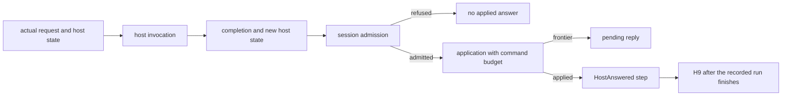

# Host generalization review

CO-4, CO-5, and the H9 checker pass this review's narrow checks.
The next drive connection must distinguish a host invocation from an applied answer.
The existing driver can advance host state without applying that answer.
The new H9 theorem correctly leaves answer correspondence as a premise.

## Reviewed commits

| Item | Commit or source |
| --- | --- |
| Previous reviewed Effect4 commit | `0a108d2f91dce4a0f8a2fa7899228e2541ccf8ea` |
| Previous review checkpoint | `2051b39880336866aa52bb14c52ee304255aa2b5` |
| CO-4 | `feb968d7fdbce63089cd40ff5f467d6e2bd3de58` |
| CO-5 | `37d566d80dbb5c3b89d2f61a4b90d6f955618364` |
| H9 checker and production reader | `8a61361518c5409e1aeae309ebb287ded641c47c` |
| Reviewed documentation | `ed2e8c015062d9849adf0077a47c4e5f851ee106` |
| Effects package | `b0dd60797244a04b47bcb1f6eecfe71f7a02ae04` |
| Review branch base | `2051b39880336866aa52bb14c52ee304255aa2b5` |

The review captures five working files before CO-4 lands.
`verify-pins.py` confirms that all five match the landed bytes.
`snapshot-h9/` holds the two subsequent CO-5 files from their commit.
`input-pins.json`, `landing-match.json`, and `h9-pins.json` record their hashes.
`snapshot-checker/` and `checker-pins.json` retain the later checker and its production battery.

A bounded recent Claude-session tail confirms its repository and current task.
Its session is `9ebf38b2-8b2f-44e5-8fd9-2dc0cb5a1f50.jsonl` under the repository-specific Claude project directory.
The session reports CO-4, then CO-5, with CO-6 next.
This review independently checks the committed source and its results.
Three GPT-6.1 Sol agents review separate source obligations.
Two agents also review the CO-5 change.
No review agent writes production files or messages Claude.

## Meaningful resolution: HCO-02

CO-4 resolves the earlier stopped-run concern for H8.
`localRunC_compile` in `src/Effect4/Laws/Program/Agreement/Calls.lean` now ranges over a host and its state.
`RunsToD` distinguishes completion, an unanswered call, and a compile frontier.
`meaning_settled` in `src/Effect4/Laws/Program/Agreement/Hosted.lean` uses those distinctions.
Its stopping premise requires the host to give no further answer at the final position.
`meaning_settled_tape` derives that premise from an empty remaining tape.

`DenoteRowsEqSession` in `src/Effect4/Laws/Api/SessionMeaning.lean` retains its public proposition.
`denoteRows_eq_session` retains its statement.
The comparison also confirms unchanged statements for `replay_Mexit_of_localRun`, `replay_Mexit`, and `run_eq_meaning` in `src/Effect4/Laws/Program/Agreement/Segment.lean`.
`landing-match.json` retains the normalized statements.

The proof uses the existing program meaning.
`hostRun` in `src/Effect4/Laws/Program/HostRuns.lean` runs `denoteRows` under the host.
`runRowsH_bind` uses `Effects.Comodel.run_bind` from `Effects/Coalgebra/Comodel.lean`.
The connection introduces no stored program representation.

## CO-5: a finished session under the same host

`denoteRows_eq_session_host` in `src/Effect4/Laws/Api/SessionMeaning.lean` states H9.
Its premises require a reached, funded, host-driven run at rest, in `StraightRows`, with a root exit.
`HostAnswered` requires the host's answers to match the actual requests and applied exits along the machine's decision tape.
Its state parameter follows each answer's returned state.
The observation is the exit, stores, and final host state.
It establishes neither driver progress nor physical-host conformance.

`Holds.hostAnswer_eq` in `src/Effect4/Laws/Program/Agreement/Hosted.lean` connects each machine request to the local runner's request.
`tape_holds_host` in `src/Effect4/Laws/Api/SessionMeaning.lean` supplies one induction for H8 and H9.
H8 takes the reply host as its instance.
`H9Controls.lean` applies H9 to a real two-call session.
The requests are `2` and `3`.
The host changes state after each answer, making its replies `2` and `4`.
The checked final host state is `2`.

## HCO-06: host invocation does not imply reply application

**Role:** a control for the proposed `Run.drive` connection to H9.
**Evidence:** finite evaluation and a kernel-checked negative statement in `H9Controls.lean`.
**Scope:** a scalar row, one driver round, and an actual parked session.

`Run.driveFrom` in `src/Effect4/Run/Basic.lean` passes the reactor's returned state into its next round.
It does so after playing the reply rows, regardless of their verdicts.
`Rows.answer` in that file separates binding, submission, and application.

| Control | Host state after invocation | Applied answers | Session result |
| --- | --- | --- | --- |
| Numeric row receives a string | `1` | `0` | submission refused; no answer enters the tape |
| Numeric reply, zero command fuel | `1` | `0` | admission passes; application reaches a frontier; reply remains pending |

The first control starts from a reached run.
Its whole decision tape contains only the startup evaluation.
`HostAnswered` on that tape therefore requires the final host state to equal the initial state.
The fixture checks that the actual driver result cannot satisfy that proposition from state `0` to state `1`.
This refutes an unconditional drive connection, not H9.
H9 explicitly requires both answer correspondence and a finished run.

The second control changes the budget after parking.
It checks a driver suffix, not a globally reached run under the changed budget.
Its admitted reply remains pending, and the machine applies no answer.
The distinction prevents the budget control from making a stronger claim than its fixture supports.

### The subsequent checker handles the distinction

`hostAnsweredCheck` in `src/Effect4/Laws/Api/SessionMeaning.lean` reconstructs host state from applied answer decisions.
`hostAnsweredCheck_sound` connects its returned state to `HostAnswered`.
`CheckerControls.lean` verifies its result against the actual driver's state.

The finished session returns `some 2` from the checker.
A wrong initial host state makes the checker return `none`.
A host that declines an applied answer also produces `none`.
Each negative driver case returns `some 0`, while the driver has returned state `1`.
Therefore, checking only `isSome` is insufficient for the drive connection.
The production battery compares against `some run.2`, which detects this mismatch.

The checker reconstructs the applied-answer history.
It does not prove that every host invocation produced an applied answer.
The general drive producer remains open.

### Smallest next change

Prove one accepted-and-applied round's connection to `HostAnswered`.
Consume the existing reply admission and application receipts.
Keep sufficient command fuel and the preceding answer correspondence explicit.
Compose those rounds through the existing driver.
Keep compile fuel separate from command fuel and the driver's round count.

Keep the returned host state when a reply cannot apply.
A general external host may already have performed work.
A rollback would need its own contract.

## Remaining placement and interface work

HCO-05 remains partly open.
H9 has a concept and R6 attribute.
`tools/ProofGraph/Registry.lean` still has no `rows-denotation-reactor` claim or H9 witness at the reviewed commit.
The CO-5 note explicitly records that missing join.
The production battery reader lands later at `8a613615`.
`H9Controls.lean` also applies the theorem at a request-sensitive host.
At review close, the coordinator has an uncommitted `rows-denotation-host` claim and typed-protocol work.
Those working changes are outside these frozen checks.
The review does not change the claim registry.

HCO-01 remains open for the typed host interface.
`preflight_row` in `src/Effect4/Laws/Api/SessionMeaning.lean` proves registered-row provenance through both admission paths.
It does not replace the call's checked instance with the row template.
The retained numeric/string instance control still distinguishes their reply admission.
The typed protocol remains CO-6 work under the revised plan.

The description of `localRunC_compile` still describes reply tapes and unused replies.
Its statement now quantifies over arbitrary host state.
Update that description and the module description in `src/Effect4/Laws/Program/Agreement/Calls.lean`.

HCO-03 remains deferred to the future session system.
HCO-04 has no relevant source repair in these commits.
The earlier HCF findings have no relevant source changes.

## Proof placement

| Obligation | Concept and claim | Reach | Consumer |
| --- | --- | --- | --- |
| Existing H8 observation | `translation-simulation`; `rows-denotation-session`; R6 | reached, funded, host-driven `StraightRows` runs at rest, including absent exits | session meaning |
| New H9 observation | `translation-simulation`; proposed `rows-denotation-reactor`; R6 | H8 premises, matching host answers, and a finished root | CO-6 host utilities |
| HCO-06 negative controls | helper boundary for `rows-denotation-reactor` | one rejected application; one unfunded driver suffix | proposed drive producer |
| Checked instance control | `host-session-protocol`; `reply-at-call-instance`; R6 | two checked data-only call instances | typed host protocol |

These probes add no production claim or planned goal.
Conditional theorems leave their premises open.
Finite evaluation establishes no arbitrary-host progress or target execution result.

## Verification

The compiler is Lean `4.33.1`, commit `819816b2e0a3bf405af45ae5c7af2491d8f5bee6`.
All Lean commands set `LEAN_NUM_THREADS=3` and run sequentially.
An isolated import overlay holds existing dependency artifacts and the newly compiled snapshot modules.
The review changes no dependency pin or production source.
The overlay initially misses a `ProofGraph` import.
Copying the missing existing artifacts resolves that local setup failure.
The subsequent frozen-source builds pass.

| Command | Result and evidence |
| --- | --- |
| `python3 docs/research/2026-10-09-host-generalization-review/verify-pins.py` | five files match CO-4; five public statements match the prior commit |
| `LEAN_NUM_THREADS=3 python3 docs/research/2026-10-09-host-generalization-review/compile-review.py` | five CO-4 modules pass; `checks/build-results.json` |
| `LEAN_NUM_THREADS=3 python3 docs/research/2026-10-09-host-generalization-review/check-review.py` | request/state/cleanup controls, eleven selected laws, seven direct consumers, and the checked-instance control pass |
| `LEAN_NUM_THREADS=3 python3 docs/research/2026-10-09-host-generalization-review/compile-review.py h9` | two CO-5 modules pass; `checks/h9/build-results.json` |
| `LEAN_NUM_THREADS=3 python3 docs/research/2026-10-09-host-generalization-review/check-h9.py` | H9 reader, refusal and budget controls, fifteen selected laws, and existing session battery pass |
| `LEAN_NUM_THREADS=3 python3 docs/research/2026-10-09-host-generalization-review/compile-review.py checker` | the checker module passes |
| `LEAN_NUM_THREADS=3 python3 docs/research/2026-10-09-host-generalization-review/check-checker.py` | checker controls, sixteen selected laws, and the new production session battery pass |

`HostControls.lean` checks two rows, changed requests, changing host state, cleanup after failure, recovery, host nonanswer, and separate budget frontiers.
The direct consumers are `LoopAgreement`, `RuntimeR`, `MeaningEq`, `MeaningSound`, `AgreementContract`, `QueueWorkload`, and `Test.Api.SessionMeaning`.
The final exact dependency walk reports `[propext, Quot.sound]` for every selected law.
`checks/checker/checker-axioms.log` retains that output.
This is a selected-law audit, not the whole-library axiom gate.
No TypeScript compiler, external host, full sweep, merge, or push runs in this review.

## Checkpoint

CO-4, CO-5, and the checker are reviewed through `8a613615`.
Documentation is reviewed through `ed2e8c01`.
HCO-02 is resolved for H8 by the general-host local run.
HCO-06 records the next producer's required distinction.
HCO-01 and the claim registry part of HCO-05 remain open at the reviewed commit.
The later brief is `6e0f4e2f`.
Its requested drive controls overlap HCO-06.
Later runs compare against these commits and reuse these controls.
