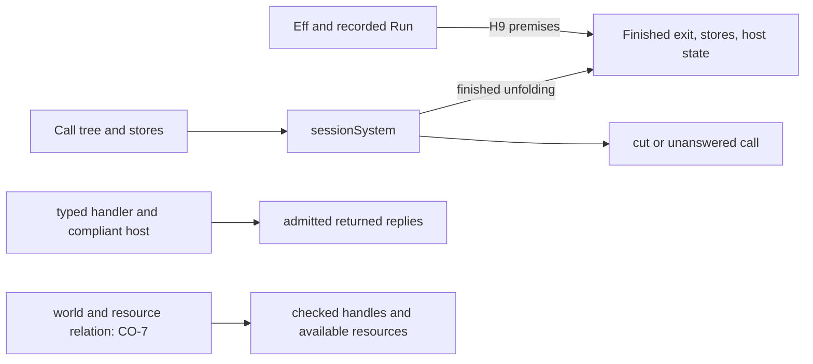

# Typed layers, indexed replies, and the session system

The narrow review passes through Effect4 `a78fcad8` and Effects `bf5ab8f`.
The executable driver still checks replies from a typed layer.
The new law removes the guard from the denotation, not from the driver.
Finish that adapter connection before describing the execution path as needing no guard.

## Reviewed state

| Item | Commit |
| --- | --- |
| Previous reviewed implementation | `d4c869ee321d83abdc4ee0b8d66b2007cfa06c97` |
| Previous local review checkpoint | `44f285f8139c4ec210219b830791a36b873c4418` |
| Typed layers | `2b67873c` |
| Finished unfolding observation | `39b38f068c1355b3529bc92cd6ad9848a4932299` |
| Existence of a finished unfolding | `a78fcad8741d634193e568b51ab7f249c1df12e7` |
| Initial Effects pin | `24a91a151de80db402e38809f883ab6be59e4c8f` |
| Final Effects pin | `bf5ab8fd26ee009abbf465821a3664ea20948a49` |

`pins.json` and `pins-followup.json` retain the source hashes.
The snapshots retain the checked source and package contract.
Authority documents remain pinned by commit and hash, without copying their generated reports.
The isolated overlay supplies previously reviewed dependencies.
The package root's final change only adds its version to a comment.
The final narrow check uses that exact source too.

Three GPT-6.1 Sol agents independently review typed layers, `Effects.ISignature`, and session observations.
The reviewer checks their conclusions against source and the controls below.

The active Claude session remains `9ebf38b2-8b2f-44e5-8fd9-2dc0cb5a1f50.jsonl`.
Bounded tails confirm its working directory as `/Users/pooks/Dev/lean4-effect4`.
The completion converse starts as working changes and lands during this review.
Claude then files literature and starts CO-6b's service generation.
That work includes `Program/Eff.lean`, the generator manifest, wire tags, and `Tools/ProgramStructure.lean`.
The reviewer changes none of those files and sends no message to Claude.

## Typed layers

**Role:** simulation, concept translation-simulation, requirement R6.
**Evidence:** compiled theorem application, independent host premise, and finite controls.
**Scope:** distinct row keys, `StraightRows`, a funded run at rest with a root exit, a typed layer, and a compliant lower host.

`runWith_layer_denotes` in `src/Effect4/Laws/Api/HostDrive.lean` connects the layered host to the driver observation.
`Comodel.Meets.through` in `Effects/Coalgebra/Sat.lean` supplies the layered host's reply condition.
`hostGuard_through` then removes the guard from `hostRun`.
The layer's typing and the lower host's compliance remain explicit premises.

`TypedLayerControls.lean` supplies those premises for a host whose first answer fails and changes its state.
The retry layer then asks again.
The finite run makes three lower calls, applies two session replies, and returns number seven.
The theorem application relates that result, the stores, and final host state.
Removing the retry leaves the first failure as the exit.
The fixture uses an empty cause admitted by `externalProtocol`.
It claims no outside runtime behavior.

The package battery also checks typed handler composition and the rejected untyped implementation.
This review reproduces that battery at the pinned package source.
Neither reply typing nor these tests establish progress.

## New: HCO-11 finish the connection to the unguarded driver

**Role:** author interface and driver correspondence.
**Evidence:** the statement of `runWith_layer_denotes` and `TypedLayerControls.lean` at `a78fcad8`.
**Scope:** a typed layer over a host meeting its lower protocol, with distinct table keys.

STATE says a typed layer needs no guard.
The theorem's driver still calls `(Reactor.ofHost table layered).guardRows`.
Its conclusion removes only `hostGuard` from the denotation.
The theorem is valid, but it does not yet justify removing the driver's reply check.
This is a consolidation gap, not a false theorem or a measured performance regression.

The finite control drives the same program without that check and obtains the same result and host state.
A second control rules out a tempting generalization.
A row with the same key but a different answer column receives an answer from the raw adapter.
Its guarded adapter refuses that answer.
Thus global equality of the two reactors is false, even for the compliant layered host.
The driver supplies actual table rows, which is the narrower condition the connection needs.

The smallest follow-up keeps the existing data structures and driver interface:

1. Prove that `Reactor.ofHost` returns only exits.
2. Prove its envelope condition on actual external rows, under distinct keys and `externalProtocol` compliance.
3. Prove the unguarded adapter's round trip under those same premises.
4. Apply `runWith_denotes` to the unguarded adapter and use the round trip.

Use `rowPosition_external` and `admit_of_answerAdmits` from `src/Effect4/Laws/Api/HostDrive.lean` for the envelope step.
Use the existing protocol for the nonexternal-row case of the round trip.
It admits no answer there.
Do not replace the scoped statement with global reactor equality.

Proposed call site after that connection:

```lean
let layered := backend.through (Run.retry built.table)
Run.runWith built (Run.Reactor.ofHost built.table layered) initial
```

**Obligation placement:** translation-simulation; claim `rows-denotation-driver`, whose pointer is `Effect4.Run.runWith_denotes` in `tools/ProofGraph/Registry.lean`.
**Reach:** actual external rows, distinct keys, typed handlers, and the lower host's protocol.
**Consumer:** the unguarded specialization of `runWith_layer_denotes`.
**Limit:** funding, rest, and root-exit premises remain; checked call instances and allocation remain outside this connector.
**Requirement:** R6, connecting the driver to its host observation without expanding the stored program representation.

Until that connector lands, describe the result as guard elimination in the denotation.
No new public entry or configurable reply predicate is needed.

## Indexed replies

**Role:** reply typing and exact embedding into the one-world case.
**Evidence:** package laws, the rebuilt contract battery, and `IndexedControls.lean`.
**Scope:** Effects contract ENSURES 12 to 14, `Effects/Coalgebra/Indexed.lean` at `bf5ab8f`.

`IProgram.Sat.sound` gives a postcondition on the final world and returned value.
Its premises include both program typing and host compliance.
It does not relate the host's private state to the world.
The package contract explicitly excludes that relation.

| Control | Observation |
| --- | --- |
| Ordinary job host | number and flag worlds, number ten, corresponding private state |
| Forgetful but compliant host | the same world and number, with empty private state |
| Compliant silent host | no answer |
| Await in a valid world with missing private state | no answer |
| One-world embedding under a declining host | the unanswered result stays unanswered |
| Reverse embedding at the multi-operation program | the package's inverse law applies |

The forgetful control also applies `IProgram.Sat.sound` to its successful run.
It demonstrates the theorem's actual scope without violating it.
No defect is found in the indexed claims reviewed here.

For CO-7, connect worlds to checked call addresses, instantiated columns, and allocated handles through an explicit state relation.
Its proposed placement is host reply admission under R6.
Its consumer is the Effect4 indexed-host adapter.
It must relate an opened operation to an available resource, not infer availability from its answer type.
Keep that work separate from the generic package's finished typing slice.

## Session unfolding

**Role:** simulation, concept translation-simulation, requirement R6.
**Evidence:** both theorem applications in `SessionControls.lean`, plus cut and unanswered controls.
**Scope:** the recorded `StraightRows` run satisfies H9's reachability, funding, rest, host-answer, and root-exit premises.

`sessionSystem_finished` and `sessionSystem_finishes` live in `src/Effect4/Laws/Api/HostDrive.lean`.
The first identifies every finished unfolding's exit, stores, and host state with the recorded run.
The second supplies some finishing depth under those same premises.
It uses `System.run_peel_complete` in `Effects/Coalgebra/Run.lean`.
This resolves the finished-observation portion of HCO-03.

`SessionControls.lean` applies both laws to the recorded two-call session from the previous review.
The host state affects the second answer.
The controls distinguish a completed result, an unfolding cut, and an unanswered call.
A cut after one answer retains the advanced host state.
Zero compilation fuel leaves the machine run unfinished while the abstract unfolding finishes.
Unfolding depth therefore cannot stand for the machine's compilation or command budget.

A separate hidden-state control uses the package's `tickAsk` fixture.
Its next call retains changed inner state in the residual system.
An unanswered run returns no observation of that state.
A cut also omits the residual call and inner state from the run result.

The new theorems concern finished observations.
They do not establish resumable rendering, command-journal equality, progress, scheduler correspondence, or a uniform depth bound.
Keep the residual system state when implementing a session view or a resume operation.
Use the recorded `Run` when the view needs session keys, applied replies, or command budgets.



## Boundaries and next ownership

The source check finds no new core import edge.
Only the law module and its session battery change under `src`, `Test`, or `tools` in the reviewed Effect4 range.
`Eff` remains the stored program representation.
The Forms-to-Eff-to-checked-TypeScript path does not change in these commits.
`Effects.Program` and its indexed variant remain proof-side carriers with Lean continuations.

`externalProtocol` names the restricted predicate used by typed layers.
That supplies a concrete consumer for the newer guarded-driver path.
The older `RowProtocol` helpers still need the consolidation recorded as HCO-08.
HCO-01 and HCO-07 through HCO-10 otherwise retain their preceding scope and disposition.
This receipt does not repeat their unchanged evidence.

Row 338 chooses service generation shape (b) before shape (c).
Claude's later CO-6b plan is `ab71b8b5`; its implementation is outside this reviewed range.
Do not duplicate that work or infer generated-service behavior from these host laws.

## Verification

The isolated worktree runs every Lean command sequentially with `LEAN_NUM_THREADS=3` and warnings as errors.
The compiler is Lean `4.33.1`.
`PLAN.md` places the obligations before their controls are written.

| Command | Recorded result |
| --- | --- |
| `LEAN_NUM_THREADS=3 python3 docs/research/2026-10-09-host-typed-indexed-review/compile.py` | changed typed and indexed modules, package battery, driver, and session battery compile |
| `LEAN_NUM_THREADS=3 python3 docs/research/2026-10-09-host-typed-indexed-review/compile-followup.py` | landed completion theorem, exact package root, package battery, and driver compile |
| `LEAN_NUM_THREADS=3 python3 docs/research/2026-10-09-host-typed-indexed-review/probe.py` | typed-layer, indexed, and session controls compile; `#axiom_audit` passes |
| `python3 docs/research/2026-10-09-host-typed-indexed-review/verify.py` | frozen source, package pin, claim placement, and source import checks pass |

The audit reports 241 declarations within `[propext, Quot.sound]`, with no planned goals or dependencies on planned goals.
The exact output is `checks-followup/Audit.log`.
`checks/` and `checks-followup/` retain commands, return codes, and output.
`generated/semantics.md` places the new helpers under R6 and leaves R6 open.
This is a narrow dependency audit, not the full trust, root, or module-closure gate.

Probe corrections resolve names and make a dependent answer type explicit.
They change no implementation or theorem statement.
No full sweep, TypeScript check, outside runtime comparison, merge, or push runs.
All changed files belong to this isolated review folder.
