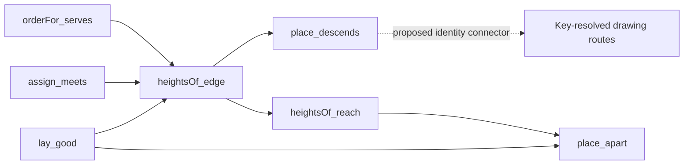

# Layout law review

The four principal layout laws pass the narrow build and stay within the declared axiom set.
The retained drawing comparison finds no changed output.
Correct the claim wording before treating these laws as proofs about every rendered route.

## Reviewed state

The base is `28ed6727e1979b544a4d9c619cc837509511c0b6`.
The reviewed commit is `bfe97080657ecb87d4551fc8a4511580369f698d`.
The support branch is `codex/program-graph-layout-review`.
It changes research artifacts only.

The bounded Claude session tail confirms cwd `/Users/pooks/Dev/lean4-effect4`.
It records D3's landing and work starting on `tools/Tools/View/AlgGraph.lean`.
The latter remains work in progress for this review.
The review neither changes the implementation checkout nor messages its owner.
Two independent Sol reviewers inspect the statements, representation and drawing consumers.
The parent reproduces the build, trust output and controls.

The completion criteria are in `docs/research/2026-10-09-layout-review-plan.md`.
The measured checkpoint and controls are in `docs/research/2026-10-09-layout-review/`.
The MCP findings MCR-1 through MCR-5 remain at review commit `7e22063f`.
This layout landing changes no MCP implementation.

## What is established

| Declaration | Reach | Evidence |
| --- | --- | --- |
| `lay_good` | Every flow with nonnegative node widths produces a well-formed part under `Good` | Narrow Lean build; axiom inspection |
| `assign_meets` | An edge's ordered endpoints meet its height constraint under a duplicate-free order | Narrow Lean build; axiom inspection |
| `place_descends` | Every structural edge's target stands below its source's bottom, at item positions | Narrow Lean build; axiom inspection |
| `place_apart` | Two distinct positions containing boxes are separate, under nonnegative node widths | Narrow Lean build; axiom inspection |

All four declarations are in `tools/Tools/View/FlowLaws.lean`.
Their transitive axiom output is exactly `[propext, Quot.sound]`.
This is an inspection of those declarations, not a whole-library axiom gate.

The source exposes one width function to the arithmetic laws.
The view supplies `nodeWidth`, which reads label lengths.
This isolates text measurement from placement without changing the caller's `ofPage` interface.
`Box.append` shifts every positional reference together: edges, frames, waits, exits, returns and marks.
That concentration is a useful shared operation.

The proof dependencies are:



The view driver still runs independent finite checks.
It does not import or apply these endpoint theorems.
The law placement is the design note's section 6, under `initial-algebras-folds`, as tool laws.
No semantics registry or requirement status changes in this review.

## D3R-1: tighten the recorded claims

The docstring of `place_descends` says accepted waits are met too.
Its theorem premise includes only edges of `layWith`.
Accepted waits are added later through `acceptWaits` and `orderFor` in `tools/Tools/View/Flow.lean`.
Thus that theorem alone does not establish the extra sentence.
No counterexample to accepted-wait placement is established here.

The finite controls include a nonempty cross wait whose order passes and whose height constraint holds.
A cycle-closing wait remains a lane and does not constrain height.
The flow's own edges still descend in that negative control.
These observations distinguish accepted constraints from diagnostic lanes.

The smallest correction is to narrow the comment.
Alternatively, place a conditional accepted-wait corollary before proving it.
Its premise must retain the wait edge in the graph selected by `orderFor`.
`assign_meets` supplies the arithmetic step once `orders` has supplied the endpoint order.

The design note needs three accompanying corrections:

- Name the landed `place_descends` and `place_apart` declarations instead of the proposed `layout_descends` and `layout_apart` names.
- State nonnegative node widths in the landing paragraph.
- Replace section 8's stale statement that no section 4 law is proved with the actual remaining obligations.

These are evidence and documentation corrections, not established geometry failures.
The source note is `docs/research/2026-10-09-program-graph-design.md`.

## The acknowledged drawing connection

`layout` translates item positions to keys.
`Laid.find` resolves a key by first match in `tools/Tools/View/Graph.lean`.
Distinct keys are therefore necessary when transferring the position law to a route resolved by keys.
The landing explicitly records this open premise.

The positive sequence uses distinct keys and passes lookup and rendered-edge checks.
The negative sequence uses the same key twice.
Its boxes remain separate, but key lookup selects the first item twice and `Laid.edgesDescend` answers false.
This is a control of the documented premise, not a newly introduced program failure.
No duplicate keys from `ofProgram` are established by this review.

Propose one small connector instead of another graph representation.
For a valid item position and unique keys, translating the position to a key and resolving it must return that same item.
Its consumers are `Laid.segments` and `Laid.edgesDescend`.
Separately establish unique keys for `ofProgram` and the layout's synthetic points.
The pairwise box law itself needs no key-uniqueness premise.

| Proposed obligation | Placement and role | Reach and consumer | Exclusions |
| --- | --- | --- | --- |
| Selected wait constraints | `initial-algebras-folds`; tool compatibility law | Accepted wait retained by the selected order; uses `assign_meets`; serves the cross-wait drawing | No wait admitted after fallback, no run-order or deadlock claim |
| Position-to-key lookup | `initial-algebras-folds`; tool compatibility law | Valid position, unique keys and unchanged item data; serves route resolution | No program-key uniqueness, animation or region containment by itself |
| Program and synthetic key uniqueness | `initial-algebras-folds`; tool preservation law | Canonical addresses and disjoint synthetic-key construction; serves the previous connector | No stability across arbitrary edits or equality with runtime identity |

These are proposed questions for the owning slice, not registered claims or newly proved statements.
They support D5's selected address and the R14 authoring view indirectly.
They establish no scheduler progress, runtime order, region containment, animation or rigid subtree motion.
D1 faithfulness remains explicitly deferred.

## D3R-2: retain a separate cost obligation

Section 4 promises layout time linear in the program.
That promise predates this landing.
The implementation already builds all-pairs alignment constraints for parallel branches.
The new `parBottom` keeps that construction.
The retained branch controls measure these edge counts:

| Branches | Edges |
| --- | --- |
| 1 | 5 |
| 2 | 12 |
| 4 | 32 |
| 8 | 96 |
| 16 | 320 |

These counts follow the nested branch iteration in `parBottom`.
They are finite measurements, not timing results or a new complexity theorem.
`relax` also scans edges for each item, and list append and lookup add further costs.
The arithmetic layout laws establish no cost bound.

Label linear cost as a target until its algorithm and cost argument exist.
One concrete direction is a shared maximum exit height for every port of a join.
A future implementation must establish agreement with today's constraints before replacing their all-pairs construction.
This is existing design debt, not a performance regression attributed to `bfe97080`.

## Verification

`LEAN_NUM_THREADS=3 lake build Tools.View.FlowLaws Drivers.View` succeeds.
The final restoration build succeeds too.
`Axioms.lean` reproduces the four declarations' stated dependency sets.
`Controls.lean` evaluates the retained positive and negative controls.
`check.py` records their measured count and refuses a missing or changed observation.

The same `Snapshot.lean` runs at the base and reviewed commits.
It generates every corpus build page, the flow specimen and the graph specimen.
Each page produces SVG, device calls and page text.
The byte comparison covers every generated file; counts and hashes are in `checkpoint.json`.
No native window, animation, browser or external client runs.

Run the current-side checks from the review checkout:

```sh
LEAN_NUM_THREADS=3 lake build Tools.View.FlowLaws Drivers.View
LEAN_NUM_THREADS=3 lake env lean docs/research/2026-10-09-layout-review/Axioms.lean > docs/research/2026-10-09-layout-review/axioms.txt
LEAN_NUM_THREADS=3 lake env lean --run docs/research/2026-10-09-layout-review/Controls.lean > docs/research/2026-10-09-layout-review/controls.json
LEAN_NUM_THREADS=3 lake env lean --run docs/research/2026-10-09-layout-review/Snapshot.lean docs/research/2026-10-09-layout-review/out-after > docs/research/2026-10-09-layout-review/snapshot-after.txt
python3 docs/research/2026-10-09-layout-review/check.py
```

For `out-before`, use the same snapshot file at `28ed6727` in an isolated checkout.
First build `Tools.View.Build`, `Tools.View.FlowSpecimen`, `Tools.View.Specimen` and `Tools.View.Output` with the same thread bound.
Pass `docs/research/2026-10-09-layout-review/out-before` to the snapshot command.
Retain its output in `snapshot-before.txt` and the current command's output in `snapshot-after.txt`.
Restore the reviewed commit before running `check.py`.
The drawing directories are reproducible outputs; only their hashes and count logs enter this packet.

The initial build command named nonexistent `Tools.View.Frames`; the corrected command uses the actual driver.
The first control compilation lacked the JSON import and used an unnecessary defaulted list access.
The corrected controls pass.
These preparation errors are not product findings.

No full sweep, production repair, merge or push occurs.
