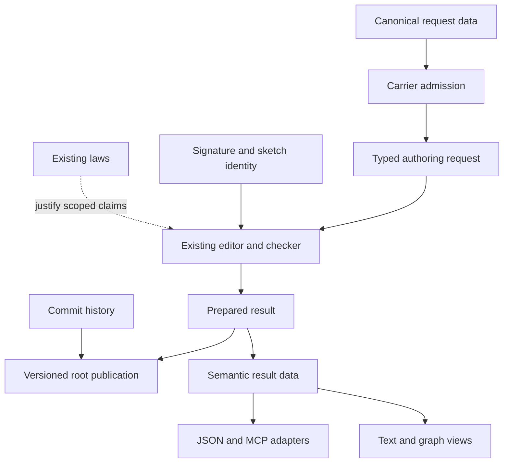

# MCP design support review

Start with typed authoring requests and a compatibility adapter.
Narrow the proposed schema, cache and rebase guarantees before their proofs begin.
The existing editor remains the semantic owner.
The MCP catalogue supplies discovery and transport metadata.

## Reviewed state and ownership

The design commit is `c4b6b795638399fcbd6026630c05afb8bd75b268`.
The final verified implementation is `28ed6727e1979b544a4d9c619cc837509511c0b6`.
The source note is `docs/research/2026-10-09-mcp-code-mode-design.md`.
This support branch is `codex/mcp-design-review`, based on the final verified implementation.
It changes research artifacts only.

The bounded Claude session tail confirms cwd `/Users/pooks/Dev/lean4-effect4`.
Claude owns the graph layout, `FlowLaws.lean`, and the source note.
Claude lands the JSON number repair at `28ed6727` during this review.
The review advances to that commit and reruns its controls.
This review implements none of those changes and sends Claude no message.
Three independent reviewers inspect schemas and reuse, editor guarantees, and module ownership.

The completion criteria and scope are in `docs/research/2026-10-09-mcp-support-plan.md`.
The controls and measured checkpoint are in `docs/research/2026-10-09-mcp-support/`.
This receipt proposes corrections; it changes no ruling or semantics registry status.

## Confirmed design corrections

### MCR-1: a shape is not the carrier's codec admission rule

The retained schema accepts the list `[2, 1]` for `Canonical.shape (Row Nat)`.
The shape reader also accepts it.
The canonical carrier reader refuses it because the row is not ascending.
The positive control `[1, 2]` passes all three readers.

The source is `Canonical` for `Row` in `src/Effect4/Store/Domain/RowCanonical.lean`.
A carrier can impose conditions beyond its structural shape.
Therefore O1 must separate schema validity, shape reading and carrier codec admission.
Program typing remains another judgment after these.

The schema probe has three further profile gaps.

| Control | Schema result | Reader result | Correction |
| --- | --- | --- | --- |
| Unknown reference kind | accepts | refuses | Generate the finite enum from `Kind` |
| Two cases with one name and distinct tags | rejects their rendered value | reads the first case | Require distinct case names; numeric tag uniqueness is insufficient |
| A name whose definition names another definition | accepts | refuses | Keep the existing one-hop named-shape rule, or specify a separate change |

Distinct case names, a registered reference kind and one direct named binding provide the corresponding positive controls.
The duplicate-case value fits its shape, and `wellTagged` accepts its distinct numeric tags.
Reading its rendered value also gives a different constructor, so schema rejection is not the only lost distinction.

Reuse `ShapeDoc.read_exact` and `Canonical.ofJson_exact` after reading succeeds.
Do not restate their codec exactness proofs.
First prove compatibility with the restricted shape language.
Then state which carrier refinements the schema expresses, and which the carrier reader still decides.
A generated structural schema can remain useful without claiming to characterize every accepted carrier value.

Sources: `ProbeMcp.schemaOf` in the retained `ShapeSchemaProbe.lean`; `ShapeDoc.read` in `src/Effect4/Store/Domain/ShapeRead.lean`.
The exactness laws are in `src/Effect4/Laws/Store/ShapeRead.lean`.

### MCR-2: checked content and edit history need different identities

`Sketch` stores the program and its holes.
`EditSession` additionally stores the application's signature and a derived table.
Two admitted signatures give the same external call different answer types: natural and boolean.
Consequently, a sketch digest alone cannot identify a checked table or a reusable piece.

Cache coherent sessions by the application revision and sketch digest.
`EditSession.Coherent.ext` already proves equality when both the application and sketch agree.
A new cache theorem should consume this result and state the lookup observation.
No unrestricted assumption of SHA-256 injectivity is needed where the store already detects and refuses collisions.
The successful-lookup claim must retain the successful, non-conflicting put premise.

Undo needs another identity.
A session reached by a fill and a reopened session have the same sketch and view.
Their journals differ, and only the first session can undo.
Keep the commit or history identifier separate from the checked snapshot identifier.
Cache only the reconstructible editor state by snapshot; read undo history through the commit identifier.

Sources: `Sketch` in `src/Effect4/Program/Sketch.lean`; `EditSession` in `src/Effect4/Program/Edit.lean`.
`Tools.Session.State` and `answer` are in `tools/Tools/Session.lean`.
`EditSession.Coherent.ext` is in `src/Effect4/Laws/Program/Edit.lean`.

### MCR-3: a word of edits does not supply transactional refusal

`EditSession.run` continues after an invalid address.
The invalid edit returns `unchanged`; earlier edits remain, and later edits still run.
This behavior is consistent with the editor's existing contract.
It does not implement the proposed script's first refusal and no-publication behavior.

Add a checked script interpreter above `feed`.
Resolve each target, record its operation index, and stop on a located refusal.
Prepare the candidate without moving a root.
Publish only after the script completes and the declared refusal policy passes.
Define failure atomicity over the root and committed history; immutable candidate nodes may already exist in the store.

Separate a word of operations from its base identifier.
The composition law for failure indices must offset the second word's index by the first word's length.
Resolve targets against a specified state: the base, the current intermediate state, or an explicit address transport.
An earlier replacement can delete a later target.

A hole label is not yet a unique target.
Two distinct rows named `h0` can each appear once in the program.
The existing data allows this case.
Use a snapshot-scoped hole identity and a unique active occurrence, or refuse ambiguous labels.
Keep the label for display.

Sources: `EditSession.feed` and `run` in `src/Effect4/Program/Edit.lean`; `Sketch.omitAt` in `src/Effect4/Program/Sketch.lean`.

### MCR-4: disjoint program syntax does not imply independent typing

Two edits can touch disjoint children while sharing a typing dependency.
The control starts with a bind that produces a natural and returns the bound value.
One edit changes the first child to a string.
The other increments the bound value in the second child.
Each edit checks independently against the base.
Their combined program is refused, although the two replacement orders produce identical syntax.
A type-preserving change to the first child provides the positive control.

Keep syntactic commutation separate from successful checked replay.
Initially replay the script against the newer snapshot and check the result.
Reject a stale target or newly invalid result according to the declared policy.
A faster success theorem needs type-preserving edits and the relevant context premises.

Opposite omission orders create hole tables `[ha, hb]` and `[hb, ha]`.
Both programs check, but their stored programs differ.
Their reconciliation requires a permutation fixing the old row prefix, not an order-preserving renaming.
Compare the resulting sketches under that permutation; their digests need not agree.

O5 does not discharge the current R14 question named `sketch-renumbering`.
That question concerns application-row growth before the hole table.
O5 explicitly fixes those rows.
Propose a distinct hole-permutation claim and retain application-growth renumbering as open.

Sources: `Sketch.omitAt`, `Node.replaceAt`, and `Tools.Semantics.registry` in `tools/ProofGraph/Registry.lean`.

### MCR-5: generated declarations need the right law and runtime values

O7's TypeScript print-to-read direction uses `Classes.readTyChecked_of_readable`.
`readTyChecked_exact` supplies the converse direction after reading succeeds.
Both live in `src/Effect4/Laws/Codegen/Classes.lean`.
Their readable-type premise remains explicit.

`EditSession.feed_repaint` concerns table entries, not arbitrary generated files.
A state API can contain global hole declarations, and its changes can include removed addresses.
Define its pointwise projection and global dependencies before claiming incremental generation.
Return removals, replacements and global declaration changes separately.

The source note labels its TypeScript sketch unchecked.
Its value imports from `state.d.ts` need a runtime provider before execution is a deliverable.
Generate a data module or provide snapshot data separately from its declarations.
The TypeScript checker remains advice; destination program admission remains authoritative.

## Minimal shared data and module ownership

These are proposed carriers and locations, not new landed declarations.

| Shared data | Owns | Does not identify |
| --- | --- | --- |
| Checked snapshot reference | Application revision plus sketch digest | Edit history, root ownership or rendering choices |
| Commit reference | Parent commit, script, checked result and recorded deltas | A cache entry for only the current sketch |
| Located target | Snapshot reference plus address or hole identity | A bare path valid across arbitrary edits |
| Prepared edit result | Candidate snapshot, changed addresses, refusals and operation outcomes | A published root update |
| Piece description | Program, environment and effective signature dependencies | A program reusable under any table with similar types |

For cached generated text, add the producer revision and relevant rendering options to the key.
Keep these as view-cache inputs, not extra program syntax.
A digest names data.
The relevant codec or program judgment supplies the required evidence.

The first slice needs typed requests and ordinary result carriers for `open`, `fill`, `omit` and `view`.
A single generated catalogue can advertise them without unifying their state machines with runs or transport handling.
Do not introduce another stored program representation.

| Owner | Minimal action | Import direction |
| --- | --- | --- |
| `Program/Edit.lean` and typing modules | Keep edit and checking semantics | Core only |
| Proposed `Program/AuthorSession.lean` | Add typed editor requests and operation-specific results | Existing editor and carrier modules |
| Proposed `Laws/Program/AuthorSession.lean` | Connect request interpretation to existing edit laws | Author-session core |
| Proposed `Store/Domain/ShapeSchema.lean` | Emit restricted schema data after the O1 profile is defined | Store shape data |
| `Tools.Query` and `Tools.Session` | Preserve the existing JSON transcript through adapters | Core plus Laws |
| Proposed `Tools.AuthorCatalog` | Generate names, descriptions and request/result schema selection | Core carriers and generation metadata |
| Proposed MCP driver | Handle envelopes, version metadata, resources and errors | Tool catalogue and adapters |
| Future Live task adapter | Translate the selected run observation into task status | The ruled Live face |

The names are suggestions; the ownership split is the recommendation.
One catalogue owns tool metadata.
One semantic interpreter owns each operation's result.
Transport code must not reimplement `feed`, checking, weakening or reply admission.
Core imports neither `Tools.Query` nor the Laws graph.
Law names explain an answer; transporting their names does not transport a proof certificate.



For callers, the intended interface is: load a checked snapshot, prepare an edit word, and publish against an expected root version.
The server owns target resolution, exact reading, checking, deltas and publication checks.
Callers do not manage binder levels, table splices or intermediate root mutations.

## Obligation map

Every row below is proposed work, unless it explicitly names an existing law.
Each row states its concept, claim role, requirement, reach, exclusions and first consumer.
The source note's O labels remain the cross-reference; they are not semantics registry status.
Register each selected statement before its proof starts.

| ID and proposed question | Placement | Existing support | Exact remaining reach | Consumer and exclusions |
| --- | --- | --- | --- | --- |
| O1: schema and reader compatibility | `exact-codecs`; compatibility; R8 and R14 | `ShapeDoc.read_exact`, `Canonical.ofJson_exact` | A well-formed restricted shape, numeric profile, name rules and sufficient budgets; carrier admission remains separate | M2 schema producer and reader; no typing or external-validator equivalence |
| O2: derived cache equality | `initial-algebras-folds`; compatibility; R14 | `EditSession.Coherent.ext`, `get_put` | Same application, sketch and producer; coherent cached table; successful non-conflicting retrieval | M3 cache; excludes undo history, presence and cost |
| O3: checked edit-word action | `initial-algebras-folds`; preservation; R14 | `run_coherent`, `Sketch.check_fill_focusAt`, `Sketch.check_omit_focusAt` | Resolved targets, explicit first-failure behavior, exact focus premises and a root-publication rule | M5 script preparation; excludes commutation and liveness |
| O4: disjoint replacement and checked replay | `initial-algebras-folds`; compatibility; R14 | `at_replaceAt_disjoint`, typed replacement laws | Separate syntax equality from admission; retain type preservation or recheck the destination context | M8 rebase; excludes list insertion, overlap and context-changing success |
| O5: hole permutation | `initial-algebras-folds`; substitution; R14 | Existing hole typing and table laws | A bijection fixing old application rows, with every occurrence and definition body renamed consistently | M8 omissions and pieces with holes; excludes application-row growth |
| O6: destination-checked piece reuse | `initial-algebras-folds`; weakening; R14 | `Checker.check_weaken`, `effTy_weaken`, `check_ext`, `Sketch.check_fill_focusAt` | Destination signature and part context; exact focused type; `WeakenNatural` or `SigExtends` where used | M7 reuse; excludes unsupported references, arbitrary signature changes, smaller types and behavior |
| O7: state declarations agree | `exact-codecs`; compatibility; R8 and R14 | `readTyChecked_of_readable`, `readTyChecked_exact`, `feed_repaint` | Readable printed types; explicit projection dependencies and removals; a separate runtime data provider | M6 declarations; excludes tsgo implying program admission and whole-file locality |
| O8: task observation agrees | `host-session-protocol`; compatibility; R6 and R12 | `HostSession.inspect`, `HostProtocol.observe`, `Session.callInstance` | The chosen Live observation distinguishes runnable, pending-call, budget, terminal and cancellation states | M9 task adapter; excludes host progress and immediate cancellation |
| O9: row/tool codec correspondence | `exact-codecs`; compatibility; R5, R6 and R8 | Internal `ofSchema_exact`, `ofSchema_schema`, checked reply admission | An admitted external JSON Schema profile and a result encoding distinguishing answer, typed failure and tool failure | M12 import/export; excludes arbitrary tools, host behavior and cross-process handles |

O3's typing premises include an admitted starting sketch and the replacement's exact focus type under its part signature.
Omission also requires the existing closed, normal and formed column premises.
Coherence establishes agreement with checking; it does not establish that checking succeeds.

O6 cannot use environment types and program bytes alone as its reuse certificate.
`Checker.check_weaken` keeps one signature fixed and equates successful-check projections.
`check_ext` requires `SigExtends`.
Use a destination check first; optimize it only under the named laws.

O8 requires a chosen observation before its theorem is stated.
`HostSession.inspect` distinguishes finished, frontier and stuck.
`HostProtocol.observe` checks pending calls and all fibers.
Receiving an interrupt request is separate from completing interruption and cleanup.
The note already defers Live; that deferral is not a regression.

O9's Schema bridge concerns internal `Representation`, not JSON Schema documents or MCP completion messages.
Add those two connectors before claiming row/tool correspondence.
A single tool error flag does not encode every machine failure cause.

### Two missing connections before publication

**Transport dispatch.** Propose `author-transport-agrees` under `exact-codecs`, compatibility, serving R8 and R14.
For each admitted request, decoding, dispatch and result encoding must select the same typed operation and answer.
Its first consumers are the old JSON adapter and M3's MCP adapter.
Request-name/argument mismatches and malformed envelopes provide negative controls.
This establishes no network availability, authentication or host execution theorem.
O2's cache equality cannot replace this connection.

**Root publication.** Propose `author-publish-base` under `initial-algebras-folds`, preservation, serving R14.
Require the prepared result's base to match the expected root snapshot and commit.
`Store.putRoot` expects the next version; the adapter converts the caller's expected current version.
A refused preparation or stale publication must leave the committed root and history unchanged.
The first consumers are M4 publication and M8 replay.
The external store must serialize this operation; the pure store theorem does not prove filesystem or distributed atomicity.

## Protocol checks and first landing

MCP requires explicit identifiers for cross-request state.
It does not require application state to disappear.
The same protocol forbids automatic network-reference fetching by default and recommends refusing unresolved external schema references.
See the [MCP base protocol](https://modelcontextprotocol.io/specification/2026-07-28/basic).

Therefore a resource named `e4://schema/Eff` is not automatically a resolvable schema reference for every client.
Keep callable schemas self-contained with local definitions, or define an explicit preloaded resolution contract.
A program digest or canonical byte field is another compact input representation.
Publishing a resource alone supplies no client-validator agreement.

The current tools specification permits structured outputs of any JSON value conforming to their output schema.
An object output envelope is a chosen profile, not a universal MCP requirement.
See [MCP tools](https://modelcontextprotocol.io/specification/2026-07-28/server/tools).

Task cancellation is cooperative and can finish with a different terminal status.
Use this distinction when narrowing O8.
See [MCP Tasks](https://modelcontextprotocol.io/extensions/tasks/overview).

The JSON number profile also needs a parser boundary.
Under the tested JavaScript parser, decimal `9007199254740993` becomes `9007199254740992` before the note's upper-bound check.
The latter integer is exact, so this is a parsing issue beyond the abstract binary64 law.
Use a safe-integer envelope for converted integer values, or exact decimal admission before conversion.
Larger naturals can travel as canonical bytes or decimal strings with their own reader.
This control establishes no general lexical exactness claim.

The first landing should contain only typed editor requests, result carriers and the old transcript adapter.
Keep the current JSON face byte-compatible where promised.
Add mismatched-operation and malformed-carrier controls beside the existing transcript check.
Generate schemas after stating their validation profile.
Then add snapshot storage and script preparation before any root mutation or automatic rebase is advertised.
MCP discovery can land earlier if it advertises only implemented operations.

Defer the piece index, task binding and HTTP front according to their existing dependencies.
No new umbrella dispatcher, storage framework or generalized graph representation is needed for this first slice.

## Reproduction and evidence limits

Run from the isolated support checkout, based on the final verified implementation.

```sh
LEAN_NUM_THREADS=3 lake build Tools.Session
LEAN_NUM_THREADS=3 lake env lean --run docs/research/2026-10-09-mcp-support/SessionControls.lean > docs/research/2026-10-09-mcp-support/session-output.json
python3 docs/research/2026-10-09-mcp-support/prepare-schema.py
LEAN_NUM_THREADS=3 lake env lean --run docs/research/2026-10-09-mcp-support/SchemaControls.lean > docs/research/2026-10-09-mcp-support/schema-output.json
node docs/research/2026-10-09-mcp-support/number-controls.mjs > docs/research/2026-10-09-mcp-support/number-output.json
python3 docs/research/2026-10-09-mcp-support/check.py
python3 scripts/check-language.py --strict docs/research/2026-10-09-mcp-support-plan.md docs/research/2026-10-09-mcp-support-receipt.md
```

The build completes with exit status zero.
The retained outputs and `checkpoint.json` record the measured control counts.
Each control compares an actual observation with its stated expectation and fails the process on disagreement.
Expected refusals and counterexamples are positive evidence for the stated design corrections, not repaired production behavior.

`prepare-schema.py` copies the retained probe's declarations and appends independent inputs and expectations.
`schema-source.json` records both source and generated hashes.
The schema validator is still the original custom validator, not an independent external client implementation.
No external JSON Schema validator is available in the inspected project or bundled runtime.
The JavaScript output records its Node version; no TypeScript compiler is run.

The first session-probe attempt used an option accessor on an `Except` result.
The corrected probe uses the admitted-result projection and passes.
This preparation error is not a product finding.

No new theorem is declared, so this packet adds no theorem axiom output.
No full battery, axiom sweep, MCP server, client session, HTTP binding or C ABI runs.
The evidence is finite Lean evaluation, JavaScript evaluation, source inspection and linked primary specifications.
The remaining claims stay proposed until their owning slices state and prove them.
