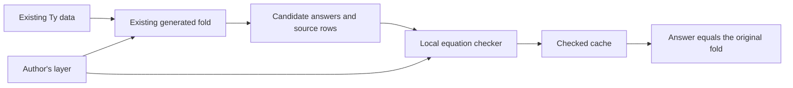

# OpenAI mathematics results: reusable checks for Effect4

The useful transfer is a small checker around an existing calculation.
The board-game reconstruction checks local equations, then proves that every cached answer agrees with the original recursive definition.
Effect4 can use this technique for reusable folds, proof dependencies and application graph queries.
The research prototypes use existing Effect4 folds and graph relations.
They introduce no second program IR.

Proof role: research tool laws and proposed production obligations.
Evidence status: local Lean proofs, finite controls and upstream source inspection.
Scope: type folds, finite dependency snapshots and directed paths in the existing flow graph.

Claude's primary checkout remains unchanged.
The final slice changes the codec and its consumer only in the isolated review worktree.
The review uses `git:b459daecd0ce148ba9d1c44641d1735a80db97dd` as its build base.
The implementation head is `git:4bbd28a05bedc3e30f9db72e3893872a771b81da`.
The implementation commit contains only the five production paths listed in `integration.json`.
The inspected primary HEAD is `git:52faff49324e4ef3e14d246f4460b30c44c51abe`.
Claude's active work extends program parameters and the typing laws.
This work adds analysis prototypes and a separate prepared-codec implementation.

## Source and trust boundaries

The upstream pin is `fd4aeeb2ee4fc729c18d98444fed42fd0529eeeb` from [openai/math](https://github.com/openai/math/tree/fd4aeeb2ee4fc729c18d98444fed42fd0529eeeb/lean/docs).
`inventory.py` records the note catalogue, comparator configurations, selected source hashes and toolchains in `inventory.json`.
The inventory is source evidence, not a proof audit.
The upstream repository uses a different Lean toolchain and imports Mathlib.
Its comparator configurations permit `Classical.choice`.
A permitted axiom does not establish that a selected proof uses it.

No upstream build, comparator run or transitive proof-dependency check forms part of this receipt.
The prototypes import no upstream module and add no dependency.
Their exact axiom walks use Effect4's cycle-aware collector through `ProofGraph.Proof` in `tools/ProofGraph/Proof.lean`.
The base predates `tools/ProofGraph/AxiomAudit.lean`.
The checked theorem pointers enforce the existing ceiling of `propext` and `Quot.sound`.
The logs record the actual dependencies of the selected proofs.

## Transfer from the board-game reconstruction

The relevant source is `rowAt_unique` in [SnakyCertificate/Invariants.lean](https://github.com/openai/math/blob/fd4aeeb2ee4fc729c18d98444fed42fd0529eeeb/lean/OAI/Combinatorics/SnakyCertificate/Invariants.lean).
Its premises require backward references and the local equation at each row below the selected bound.
Strong induction then identifies every cached row with its recursively defined meaning.
`rowAt_eq_cached` and `certificate_correct` consume this result in [SnakyCertificate/Main.lean](https://github.com/openai/math/blob/fd4aeeb2ee4fc729c18d98444fed42fd0529eeeb/lean/OAI/Combinatorics/SnakyCertificate/Main.lean).
That reconstruction theorem alone does not supply a winning game strategy.

Effect4 already has generated constructor views and fold equations in `src/Effect4/Program/TyFoldExtras.lean`.
`TyCache.lean` uses those definitions instead of maintaining another constructor match.
An earlier standalone recurrence experiment became redundant and was removed.



The proposed authoring interface has two operations.
`prepare` builds and checks the rows.
`query` reads an answer for an exact source already covered by the checked cache.

```lean
match TyCache.prepare summaryLayer source with
| none => -- preparation is unanswered
| some cache => cache.query source
```

`answer summaryLayer source` combines preparation and the root query.
The layer remains a proof-side analysis function, not stored program syntax.
Every returned answer agrees with `cata_ty` for the same layer and exact type.
`answer_reconstructs` specializes that law to reconstruction of the original type.

The controls distinguish repeated child occurrences, child order, field names, optional flags, missing children and changed algebras.
A child stored once can contribute twice to its parent's answer.
An equal scalar summary does not establish equal source data.
The reconstruction controls test that distinction explicitly.

This prototype calculates the whole fold before validating its rows.
It retains duplicates and uses linear lookups.
It establishes no incremental speedup or universal success theorem for `prepare`.
The useful production continuation is checked reuse across edits, following D6 in `docs/research/2026-10-09-program-graph-design.md`.

## Cycles need evidence in both directions

Proof dependencies contain cycles, so backward indices cannot describe every dependency snapshot.
`Reachability.lean` uses one finite table for nodes, local labels and outgoing references.
A certificate records an optional distance for each node-label pair.
This is derived analysis data, not another representation of a program.

The checker requires three properties.

1. Include every local label in the node's answer.
2. Include every child's answers in the parent's answer.
3. Give each reported label a local origin or a smaller distance through an actual child.

The first two properties prevent omissions.
The third prevents a cycle from inventing an answer through circular support.
Different labels can require opposite distance directions on the same cycle.
A single rank per node would reject those valid answers.

`check_summary_exact` proves both directions of the observation.
A reported label occurs exactly when a finite directed path reaches a local origin for that label.
The theorem applies to the supplied graph and accepted certificate.
It does not certify extraction from Lean's environment or the truth of a theorem represented by a node.

The controls cover a cycle with an origin, a missing answer, a seedless cycle, invented circular support and opposite per-label directions.
Independent review found an avoidable search through every smaller numeric distance.
The repaired checker compares stored distances directly.
A large-distance kernel control checks the repair.
The current checker still examines all node pairs and labels.
A production implementation should visit actual edges and prove agreement with the same `Valid` predicate.

## A consumer in the actual proof graph

`ProofGraphProbe.lean` captures real Lean declarations through `usedConstantsOf` in `tools/ProofGraph/Axioms.lean`.
The current `reachedAxiomsMany` supplies candidate answers.
Independent distance propagation supplies their support witnesses.
`analyze` captures, queries and checks under one environment and stopping policy.
It returns a snapshot and certificate linked by the accepted check.

The finite probe uses the existing collector on a cyclic inductive dependency.
The checker accepts its answers and rejects a deliberately omitted answer.
It also produces a named path explaining the dependency.
The probe checks the path's endpoints and every intervening edge.
The log records the captured graph size and the actual explanation.

A stopped declaration becomes a local label with no outgoing dependencies.
An axiom becomes a local label while its type dependencies remain visible.
A missing declaration or exhausted capture budget refuses the analysis.
Neither case becomes an empty dependency set.

The extraction adapter remains a reflection boundary.
The finite probe does not establish that every environment snapshot contains all semantic dependencies.
The checker observes label membership, not output order or a proof of the collector algorithm.
A future explanation theorem should connect every returned path with the checked relation.
The immediate production use is an optional checked explanation mode for existing axiom and planned-goal reports.
That continuation can use the existing claims in `tools/ProofGraph/Registry.lean`.

## Connectedness and application graphs

The useful connectedness source is [ThinTrees/Encoding/GreedyTree.lean](https://github.com/openai/math/blob/fd4aeeb2ee4fc729c18d98444fed42fd0529eeeb/lean/OAI/Combinatorics/ThinTrees/Encoding/GreedyTree.lean).
`connected_correct` connects an executable bounded search to the source's cut-based connectedness judgment.
`deletePass_correct` tracks connectedness through edge removal.
`tree_correct` produces a spanning tree under the source's `Connected univ` premise.
These smaller results suggest practical graph APIs without importing the entire thin-tree construction.

Application graphs need an explicit choice of edge relation.
The same query engine can serve different relations without identifying their meanings.

| Relation | Existing anchor | Question it can answer | Claim it cannot supply alone |
| --- | --- | --- | --- |
| Program containment | Program addresses and `Flow.region` in `tools/Tools/View/Flow.lean` | Which source region contains this operation? | Runtime order |
| Flow order | `Flow.Reach` in `tools/Tools/View/FlowLaws.lean` | Is there a directed path between these flow positions? | Which fiber actually runs next |
| Recorded fiber dependence | `Run.fiberGraph` in `tools/Tools/View/Run.lean` | Which recorded fork or observer relationships connect these fibers? | Absence of deadlock from missing edges |
| Proof dependence | `usedConstantsOf` in `tools/ProofGraph/Axioms.lean` | Which selected axiom or goal is reachable? | Proof of the represented theorem |
| Weak connectedness | Explicitly forget direction after choosing a relation | Which nodes belong to the same connected component? | Directed reachability or program scope |

`FlowReachability.lean` connects the shared certificate checker to the existing `Flow.Reach` relation.
Its premises bind valid positions and the exact directed edge list.
This provides a formal connection for application queries without changing the program language.
The connector does not claim a scheduler observation.
Its command output records the proof audits and finite controls.

A small application interface can expose `reachableFrom`, `components`, `select` and `forest` over a selected relation.
The boundary retains the source graph and its identities.
`select` retains both internal edges and edges crossing the selection boundary.
`forest` returns selected original edge occurrences for an overview.
The full edge set remains available for directed queries and cycle checks.
A reduced drawing must not replace the graph that those checks read.

`graph_controls.py` probes this interface independently in Python.
It compares directed queries with a separate transitive-closure calculation.
It exhausts four-vertex undirected graph shapes with a canonical orientation, then checks their selections.
It does not exhaust every directed graph.
It covers empty graphs, isolated nodes, parallel edges, self loops and invalid endpoints.
It demonstrates that a forest can retain weak connectedness while losing a directed path.
The spanning-forest producer has finite evidence only; no Effect4 forest theorem lands in this slice.

## Additional results worth retaining

| Source | Useful transfer | Boundary |
| --- | --- | --- |
| [ParityLifts/GraphIso.lean](https://github.com/openai/math/blob/fd4aeeb2ee4fc729c18d98444fed42fd0529eeeb/lean/OAI/Combinatorics/ParityLifts/GraphIso.lean), graph-isomorphism invariance of refinement | Group graph neighborhoods and reject impossible matches before expensive comparison | Equal histograms do not certify isomorphism, connectedness or cache identity |
| [Scheduling/RegisterMachine.lean](https://github.com/openai/math/blob/fd4aeeb2ee4fc729c18d98444fed42fd0529eeeb/lean/OAI/Computability/Scheduling/RegisterMachine.lean), `Eval.compile` | Add a data-size cost interpretation to an existing Effect4 representation | Machine steps and fuel alone do not measure copying or allocation work |
| [UniformKServer/Main.lean](https://github.com/openai/math/blob/fd4aeeb2ee4fc729c18d98444fed42fd0529eeeb/lean/OAI/Combinatorics/UniformKServer/Main.lean) | Keep legal responses, probabilistic performance and adversary assumptions as separate obligations | The startup wrapper and additive bound do not supply a practical low-latency allocator |
| [ComparatorChallenges/README.md](https://github.com/openai/math/blob/fd4aeeb2ee4fc729c18d98444fed42fd0529eeeb/lean/ComparatorChallenges/README.md) | Freeze the independent statement and compare the selected proof against it | Configurations, theorem names and source compilation are different evidence |

The refinement control compares a cycle with disconnected triangles.
Their bounded refinement summaries agree while their connectedness differs.
Direction and edge roles also affect the refined summary.
A shared palette across both inputs prevents accidental comparison of unrelated color numbers.
These controls rule out refinement summaries as exact source keys.

The broader catalogue also contains results whose present transfer is limited.

- Static scheduling results do not establish Effect's cancellation, interruption or fairness behavior.
- Mean-payoff winning sets do not establish bounded waiting or an executable winning strategy by themselves.
- Complexity-class equalities do not supply a trace-preserving Effect4 transformation.
- L1 metric embeddings do not supply a two-dimensional drawing algorithm.
- A named machine whose definition is noncomputable does not supply an executable deployment artifact.
- The comparator selected for a note may prove a narrower statement than its title suggests.

## Boundaries that matter for reusable folds

Exact source identity alone is insufficient for an inherited analysis.
`Controls.lean` applies the actual program checker to unchanged `.succeed (.var 0)` syntax under different type environments.
Both nonempty environments succeed, but they produce different answers.
The empty environment refuses the program.
This is a cache-key control, not a defect in the checker.

`FlowAt` in `tools/Tools/View/Flow.lean` also receives an address.
`flowLayer` reads a root-derived `waitsOf` input.
Caching a final drawing by subtree content alone can therefore reuse the wrong addresses or wait relationships.
Prefer a context-independent summary, or include the analysis's inherited inputs in its exact cache contract.
A hash can accelerate lookup only after exact source and context agreement establish reuse.

The distinction applies to the ongoing parameter work too.
A definition body and its program holes can share stored source data.
Typing and meaning still depend on the environment that fills those holes.
The new cache machinery cannot erase that premise.

## A concrete reuse improvement: prepared codec

The user asks for a real consumer of reusable folds.
The prepared codec retains the normalized type and the existing wire fold result.
The exact retained interpreter is `wire (layout normal)`, following the current JSON boundary.
Its proof fields bind that data to the source type.
Methods receive the prepared value explicitly, so repeated calls do not rebuild that interpretation.

```lean
let codec := Effect4.Schema.Codec.prepare sourceType
let decoded := codec.decode input
let reencoded := decoded.bind codec.encode
```

The current public encoding, decoding and codec-value operations share the prepared implementation.
The numeric section of `harness/truth/schema-codec/Emit.lean` uses the same prepared value for decoding and reencoding.
The new API retains value membership, exact recovery and every existing refusal.
It does not introduce structural support as a condition for encoding an individual value.
An absent optional field can still encode when that field's type lacks structural support.

The existing exact embedding theorem statements remain unchanged.
One dependent membership proof now uses the named decoding policy instead of unfolding the old implementation.
The connector proofs belong to `exact-codecs` and serve the existing claims listed in the operational plan.
The research control retains the old operation bodies as an independent semantic reference.
The harness output also has an independently retained pre-change byte baseline.
`verification.json` records the proof, control and byte-comparison results.

This API reuses a fold result constructed by the existing implementation.
It needs no external row certificate, because callers do not supply cached answers.
The earlier checked-cache prototype serves that different input boundary.
Each prepared operation still checks value membership and exact recovery where required.
Existing single-call wrappers prepare on each call; explicit prepared values enable reuse.
Neither interface claims an elapsed-time speedup from these checks alone.

## Proposed production slices

These are proposals, not owner rulings.
The placements and assumptions appear before the proof work in `OPERATIONAL-PLAN.md`.

| Slice | Change | Required result before promotion |
| --- | --- | --- |
| Cached fold preparation | Move the checked-cache interface behind D6's existing fold boundary | Prove producer success and reuse after edits; retain exact payloads, order and inherited context |
| Proof explanations | Add an optional checked snapshot and explanation to current reports | Validate snapshot extraction assumptions, prove explanation paths and implement sparse checks |
| Application graph queries | Use one certificate checker behind explicitly chosen edge relations | Keep the connector to `Flow.Reach`; add connectors for each additional relation |
| Reduced graph views | Return a forest of original edge occurrences while retaining the full graph | Prove weak-component agreement for the chosen producer and retain crossing-edge provenance |
| Cost interpretation | Add measured data-size work to an existing fold | Connect the cost to the actual operation being accelerated; keep host timings separate |

Universal correctness of returned cache answers is proved.
Universal success of the row producer remains open.
General incremental invalidation and a transport theorem for changed inputs remain open.
The proof-graph and flow connectors do not discharge runtime, host or source-admission obligations.
No runtime coverage number changes.

## Reproduction and files

Run the local checks from this worktree:

```sh
bash docs/research/2026-10-09-openai-math-probe/check.sh
```

The script checks the research sources, the changed codec and its narrow dependents.
It serializes Lean commands with `LEAN_NUM_THREADS=3`.
It writes command results to `verification.json` and individual logs.
It performs no full sweep and runs no TypeScript compiler.

Reproduce the upstream inventory separately:

```sh
python3 docs/research/2026-10-09-openai-math-probe/inventory.py \
  /private/tmp/effect4-openai-math-20261009 \
  --effect4 /Users/pooks/Dev/lean4-effect4 \
  > docs/research/2026-10-09-openai-math-probe/inventory.json
```

| File | Purpose |
| --- | --- |
| `OPERATIONAL-PLAN.md` | Obligation placements, observations and exclusions |
| `TyCache.lean` | Mechanical row production, checked cache and agreement proofs |
| `Reachability.lean` | Shared cyclic-summary certificate and exact-membership theorem |
| `ProofGraphProbe.lean` | Actual collector adapter, explanation and mutation control |
| `FlowReachability.lean` | Connection to existing application flow paths |
| `Controls.lean` | Actual checker control for inherited context |
| `graph_controls.py` | Independent finite application-graph probes |
| `graph-results.json` | Measured finite probe results |
| `inventory.py`, `inventory.json` | Pinned upstream catalogue and inspected source hashes |
| `check.sh`, `verify.py`, `verification.json` | Serialized local commands and measured results |
| `integration.json` | Implementation paths, source hashes and read-only patch check |
| `PreparedCodecControls.lean` | Independent old-policy agreement and exact dependency checks |
| `PreparedCodecReuse.lean` | Bounded compiler inspection of prepared operations |
| `codec-before.ts`, `codec-after.ts` | Exact retained pre-change and fresh harness output |

The production changes occupy the codec, its laws, the codec battery and the numeric harness consumer.
One dependent membership proof uses the new policy equation.
All other changes belong to this research directory.
`verification.json` records the passing local checks.
`integration.json` records the successful read-only patch check against the inspected primary files.
That patch check does not compile Claude's changing parameter implementation.
Integrate the prepared-codec commit separately from the research prototypes.
The generic cache and graph interfaces remain research prototypes.
The prepared codec is the concrete implementation slice.
