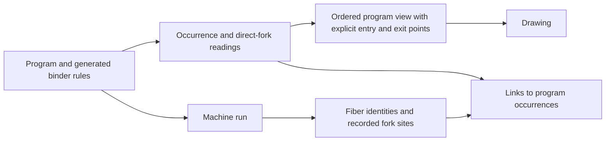

# Program graph landing support

At `78f7bcbe`, computed wait targets, cleanup order and empty layouts still need corrections.
Claude's landed binding repair passes the independent controls.
The earlier candidate patch is superseded and must not be applied to the landed tree.

## Reviewed state

The reviewed commit is `78f7bcbef09fc286242eedc549462e647c7c0b33`.
The support branch is `codex/program-graph-support`, based on that commit.
It starts at `88d4a1f5` and advances when Claude lands the graph.
This branch adds only research artifacts.
The primary checkout, Claude's session and owner rulings remain unchanged by this work.

The starting design is `git:88d4a1f5:docs/research/2026-10-09-program-graph-design.md`.
Computer use identifies Claude's session as “Chunk T & S hand-back review” in `lean4-effect4`.
Claude owns the graph reading, layout, drawing and landing.
Codex supplies independent controls and this receipt.
Two independent reviewers inspect constructor meaning, proof placement and the retained evidence.

The packet is `docs/research/2026-10-09-program-graph-support/`.
Its `checkpoint.json` records measured results and outstanding findings.
The earlier graph inventory remains on `codex/graph-tree-audit` at `120307a3`.
That inventory is not repeated here.

## Open findings at the reviewed commit

All draft and landed graph declarations below belong to `tools/Tools/View/Flow.lean`.

| ID | Observation | Consequence | Smallest correction |
| --- | --- | --- | --- |
| PGS-2 | `flowLayer` groups `acquireRelease` with `onExit`; the drawing orders markers as acquire, release, protected work | A control-order view shows cleanup before the protected work | Keep registration and scope-close relationships separate from immediate sequencing |
| PGS-3 | `sideBySide` gives the empty race negative width | The layout passes `boxesApart` and `edgesDescend` while its dimensions are invalid | Handle empty compositions explicitly and check dimensions; retain their separate meanings |
| PGS-6 | `waits` treats both inputs of a tuple projection as wait targets | The drawing adds an unrelated fiber-completion dependency | Infer completion edges only for supported exact targets; keep unresolved targets and variable-reference links separate |

PGS-2 has both machine and drawing evidence.
`Run.runPure` allocates markers in order `10, 20, 30`.
The drawing places those same operations in order `10, 30, 20`.
The program passes `Api.Author.Internal.finishBuild` in `src/Effect4/Api/Author.lean`.
`Controls.lean` and `LandedControls.lean` retain the programs and observations.

PGS-3 has a positive runtime control: the empty race remains live without launching a child.
Its drawing has width `-16` at the retained look.
Both finite layout checks answer true.
Those checks are `Laid.boxesApart` and `Laid.edgesDescend` in `tools/Tools/View/Graph.lean`.
A geometry repair must not equate the live empty race with a completed empty layer merge.

PGS-6 has a program-admission control and an independent target-value evaluation.
The await target selects component zero from a tuple containing two fiber handles.
`evalTerm` in `src/Effect4/Machine/Term.lean` returns only the first handle.
The graph's `waits` names both forks.
`Flow.andThen` uses inferred waits for joins.
`layout` uses them for height constraints and cycle classification.
The extra edge therefore changes the control reading, not only a label.
It can place the await below an unrelated completion or contribute to a spurious deadlock report.

The immediate repair needs no general evaluator.
Keep direct-variable targets and explicitly understood handle-list constructions.
For other expressions, show an unresolved target without adding a completion edge.
A missing static edge establishes neither absence of a wait nor absence of deadlock.
Tuple projections can follow when a target-origin reader follows the selected component.

## Resolved findings

| ID | Landing observation | Evidence limit |
| --- | --- | --- |
| PGS-1 | `forkOf` keeps lexical order, and `bindersAlong` clears closed scopes | Every retained direct-binding control passes; general alias resolution remains outside the reader |
| PGS-4 | A detached spawn no longer draws its child's exit into the parent's continuation | The synthetic drawing control checks that visible edge; it proves no scheduling law |
| PGS-5 | Choice diamonds and parallel bars remain distinct in drawing data | The control compares marks, routes and positions, not a rendered window |

`flowLayer` also puts the body before the selected handler for `catchCause` and `matchCause`.
`stack` connects adjacent exit and entry points.
It does not use all-pairs graph connection for sequencing.
These are resolutions of design concerns, not open implementation findings.

The binding controls use manually stated source paths and the actual `waits` function.
Each program separately passes program admission.
They cover nested bindings, generator bindings, closed layers, release bindings and the direct-fork profile's alias limit.

The historical draft fails the binding controls.
Removing only its reversal leaves the closed-layer control failing.
The combined candidate passes, and Claude's landed correction independently passes the same cases.
`binding-repair.patch` remains historical evidence against `draft.patch` only.
It is superseded by `0782cc3d` and does not apply to `78f7bcbe`.

The authority is `evalTerm` in `src/Effect4/Machine/Term.lean`.
`Point.childWith` in `src/Effect4/Program/Compile.lean` appends a bound value.
`Node.closedChild` and `Node.childLevel` in `src/Effect4/Program/Binders.lean` define the closed-child rule.
No new public interface is needed for that repair.

## Shared structure and proof placement

Keep occurrence identity, runtime identity and drawing identity distinct.
A program address identifies one occurrence within one program revision.
A runtime fiber also needs its owning run and fiber identity.
`ForkRecord.site` in `src/Effect4/Machine/Fibers.lean` links these identities without equating them.
The repeated-fork control creates distinct fibers at one source site.
An ordinary fork's site is its action address, above its child program.
A race entrant's recorded site is its list-cell address.

Keep variable-reference collection separate from target-origin analysis.
They answer different questions even when both read the same term algebra.
PGS-6 is the finite control that forces this distinction.



The reusable foundation is `initial-algebras-folds` in `docs/core/semantics.md`.
Tool layout remains scoped by decisions row 334, point 3.
This packet adds no registry claim or planned theorem.
The following questions are proposed placements for the owning slice.

| Work | Exact question and premises | Consumer | Exclusion |
| --- | --- | --- | --- |
| D1 connector | Does every emitted edge name existing endpoints, with occurrence identity and port order retained? | The drawing input | Edge-set equality forgets order, multiplicity and entry or exit roles |
| D2 reading | Does each supported constructor retain its stated structural order and source locations across all program syntax-family sorts? | The program graph page | A structural reading does not establish runtime scheduling, termination or host agreement |
| D2 wait origins | For supported targets in a fixed binding environment, does every inferred edge name a fiber the target actually selects? | Joins and cross edges | Reading a variable does not establish waiting for the fiber it names |
| D3 placement | Under distinct keys, supported composition and valid dimensions, are boxes separate and routes contained? | The drawing | Containment alone does not exclude crossings |
| D3 translation | With fixed labels, look and supported composition, does translation move every item and route consistently? | Motion after a splice | A text-layout theorem does not establish this graph-layout statement |

`cataFam` and `EffAlgebra.ofLayer` in `src/Effect4/Program/LayerView.lean` already supply the family fold.
`cata_fusion`, `cata_prod` and `cata_keeps` in `tools/Tools/View/Algebra.lean` supply reusable proof steps.
Each new proof must state its exact observation, hypotheses and consumer before work begins.
A graph relation's algebraic laws do not establish equal ordered drawings.

D4 through D7 remain deferred.
Their cache keys must retain relevant typing context, view policy and revision context.
An edit journal needs the edit session's laws, not an unqualified reference to the runtime journal.
The existing finite controls do not close those obligations.

## Checks and reproduction

Run these commands from the support checkout at the reviewed commit.
The output of `check.py` gives the measured counts and retained differences.

```sh
LEAN_NUM_THREADS=3 lake build Tools.View.Flow Tools.View.Run
LEAN_NUM_THREADS=3 lake env lean --run docs/research/2026-10-09-program-graph-support/Controls.lean
LEAN_NUM_THREADS=3 lake env lean --run docs/research/2026-10-09-program-graph-support/LandedControls.lean --require-bindings
python3 docs/research/2026-10-09-program-graph-support/check.py
python3 scripts/check-language.py --strict docs/research/2026-10-09-program-graph-support-plan.md docs/research/2026-10-09-program-graph-support-receipt.md
```

The runtime controls pass at `78f7bcbe`.
They observe `Run.runPure` with compile and command budgets of 400 and no host rows.
Their source retains expected exits, allocation orders, fork counts and identity checks.
The detached-child assertion requires that the recorded child exists and remains live.
The empty-race control expects a live frontier.

The landed binding controls pass.
The same command records the remaining geometry and projected-target findings.
`--require-bindings` does not assert that those other findings are repaired.
`check.py` checks the retained positive and negative observations without rerunning Lean.

The packet also retains a historical draft, its hashes and the intermediate repair outputs.
Historical replay requires clean base sources at `88d4a1f5`, not the landed tree.
Apply `draft.patch`, build `Tools.View.Flow`, and run `FlowControls.lean` there.
Apply `binding-repair.patch`, rebuild, and run `FlowControls.lean --require-bindings` to reproduce the candidate repair.
The intermediate level-only variant removes `.reverse` without adding the closed-child reset.
All temporary production-source changes are restored before advancing to the landed commit.

An earlier capture occurred during editing and did not build.
The retained capture includes Claude's subsequent compile repairs and builds.
Probe preparation also corrected a constructor name and diagnostic formatting before the retained runs.
Neither preparation failure is a product finding.

The retained patches include single-space context lines required by unified diff.
The whitespace check permits exactly those lines in the two patch files.
Every other staged file and every other patch line passes the whitespace check.

No new theorem is declared, so this packet has no new theorem axiom output.
No axiom sweep, full battery, TypeScript compiler or outside host comparison runs.
The evidence is finite Lean evaluation and source inspection.
The three remaining findings stay with Claude's graph implementation.
