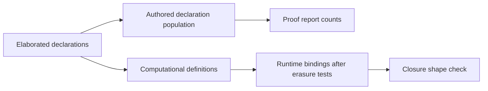

# Proof report and closure audit review

The new closure check misses executable table rebuilding and rejects a proof binding that the compiler erases.
Repair its declaration population and binding classification before relying on its clean result.
The report optimization passes its existing controls and the added cache controls.

## Reviewed state

The implementation base is `356cc11d35be8e36f297903f760ed50b7bbb10af`.
The reviewed head is `4867cf2b2c41502460949c60143cc9ed0d97b4ab`.
The report optimization is `889c0a7491e12f22da4f19e7533745b620e4e009`.
The prior review receipt is committed at `c3dc7e2913e077191c39cc60d03f5f21e6f3dd3b`.

`pins.json` records frozen dependency artifacts and source hashes.
`followup.json` confirms that the frozen sources match the reviewed commit.
The previously reviewed service sources remain unchanged.
Their three open findings retain the checkpoint in `docs/research/2026-10-09-co6b-public-boundary/CHECKPOINT.json`.

The active Claude session remains `9ebf38b2-8b2f-44e5-8fd9-2dc0cb5a1f50.jsonl`.
Bounded tails confirm the repository directory and both committed tool changes.
Claude then starts a goal-tag refactor, narrower build recipes, and another closure rule for module-array indexing.
That work remains uncommitted at the follow-up observation and is outside this landing review.
`working-audit.diff` shows that the new rule leaves the declaration filter and binding walker unchanged.
The existing `Laws.Program.TyView` change also remains outside the review.
No implementation session message or production edit occurs.

## CLOSURE-POP: the check excludes executable authored definitions

**Role:** finite refusal control for the new authoring policy.
**Evidence:** the actual audit command and generated C from Lean `v4.33.1`.
**Scope:** three definitions with the same table-building body.

`ReviewClosure.rebuilt` in `ClosureControls.lean` builds `List.range n` before returning its lookup function.
The audit refuses it, as intended.
Making that definition private makes the audit skip it.
Naming the same definition `instSizeOfRebuilt` also makes the audit skip it.

The generated C constructs the list inside each of the three functions.
The private declaration and special-looking name do not remove that work.
`checks/compiler-controls.json` retains and checks all three function bodies.
This evidence identifies repeated construction; it does not measure its cost for an application workload.

`elabClosureAudit` in `snapshot/tools/ProofGraph/ClosureAudit.lean` calls `ProofGraph.isAuxiliary` before examining the body.
`isAuxiliary` in `snapshot/tools/ProofGraph/Population.lean` serves counts of authored declarations in the proof report.
Its internal-name test excludes private declarations.
Its `isGeneratedCompanion` test accepts any final component starting with `instSizeOf`.
That test does not establish that the declaration is generated or absent from runtime code.

**Next action:** give the runtime audit a computational-definition population.
Include private definitions and use actual declaration metadata for any generated-code exclusion.
Do not reuse a population whose purpose is presenting authored proof declarations.
Keep the same-body private and renamed controls beside the ordinary refusal control.

## CLOSURE-ERASURE: the check refuses a proof binding with no runtime construction

**Role:** finite acceptance control for the new authoring policy.
**Evidence:** actual audit refusal, a checked proposition binding, and generated C.
**Scope:** a computational function with one local equality proof before its returned function.

`ReviewClosure.proofOnly` in `ClosureControls.lean` binds the proof `n = n` and uses it in a cast.
The audit reports that proof binding as a table before a returned closure.
The generated function only retains and returns its argument.
It constructs no table and calls no compiled Lean function.

`letsBeforeClosure` in `snapshot/tools/ProofGraph/ClosureAudit.lean` records every encountered `letE` binding.
It never asks whether the binding is a proposition or type former.
The audit excludes whole proposition declarations, which does not exclude proof bindings inside computational declarations.

The pinned compiler's `Lean.Compiler.LCNF.ToLCNF.visitLet` explicitly erases proposition and type-former bindings.
`compiler-erasure.lean.txt` retains that source excerpt; `compiler-pin.json` identifies the compiler and source hash.
The fixture checks that the reported binding has proposition type.
Its generated C independently confirms that no computation remains for that binding.

**Next action:** classify each binding in its binder context before reporting it.
Reuse Lean's proposition and type-former tests, as the compiler does.
Keep this accepted proof-binding control beside the rejected table-binding control.

## One boundary for the audit

The smallest shared unit is a view of computational definitions and their runtime bindings.
It separates what executes from what the report counts as an authored declaration.
It does not require another program representation or a second stored inventory.



The current check inspects a leading function and binding sequence only.
Nested binding values and branch bodies remain outside that syntactic inspection.
Describe that limit explicitly; do not describe the check as measured allocation coverage.
The generated C controls confirm the two concrete defects without broadening this limit into another finding.

## Report optimization review

`ProofGraph.walkMemo` caches declaration dependencies and their count category.
Each walk retains its own visited set, nearest nodes, counts, and remaining work.
The selected-node stopping rule still precedes module filtering.
The cache does not store a previous walk's answer.

`GraphControls.lean` exercises two callers of one shared helper.
Cold and warm caches return the same answer.
Changing the selected stopping node changes the answer with a warm cache too.
An exhausted budget returns no result under either cache state.
The report traversal retains repeated-start removal, cycle handling, queue order, and the pending frontier under a short budget.

The existing report controls pass against the recompiled tools.
They exercise imported placement tags, goal statuses, report refusals, register parsing, shared traversal, and displayed names.
Two GPT-6.1 Sol scouts independently review the dependency walk and the closure audit.
No new report-meaning defect is found in this bounded review.

Claude reports an 87-second to 11-second improvement and byte-identical full report output.
Those timing and whole-report comparisons are builder reports, not reproduced results here.
This review runs narrow controls and does not regenerate the full project report.

## Verification and limits

The toolchain is `leanprover/lean4:v4.33.1`.
`freeze.py` pins the relevant compiled dependency closure in the isolated worktree.
`compile.py` recompiles `ProofGraph.Plan`, `ProofGraph.ClosureAudit`, and `Tools.Semantics` from the captured sources.
Other dependencies remain pinned builder artifacts.

```sh
python3 docs/research/2026-10-09-report-overwatch/freeze.py
python3 docs/research/2026-10-09-report-overwatch/compile.py
python3 docs/research/2026-10-09-report-overwatch/check.py
python3 docs/research/2026-10-09-report-overwatch/check-compiler.py
```

`freeze.py` captures the current primary checkout; a later reproduction must compare the recorded source hashes.
Every Lean command uses `LEAN_NUM_THREADS=3`, with one process in the worktree at a time.
`checks/compile-results.json` and `checks/results.json` retain the commands and successful outcomes.
The closure control succeeds by asserting the precise incorrect refusals and omissions of the current audit.
The first proof fixture used invalid cast notation; `checks/initial-fixture-errors.log` retains that setup failure.
The corrected fixture compiles and all of its controls pass.

The compiler output, initial diagnostics, compiler excerpt, and working-tree patch retain their exact captured whitespace.
The whitespace check exempts only those four evidence files; `checks/diff-check.json` names them.

No semantic theorem or planned goal is added.
No axiom gate or full sweep runs.
No TypeScript implementation changes, merge, push, or production file changes occur.

## Checkpoint

The reviewed committed range now ends at `4867cf2b2c41502460949c60143cc9ed0d97b4ab`.
CLOSURE-POP and CLOSURE-ERASURE are new confirmed tool findings.
The CO6B-READ, CO6B-NAMES, and CO6B-KEYS findings remain unchanged.
The goal-tag refactor and the extended closure audit await their own review after landing.
Retest the closure controls when their population or binding classifier changes.
