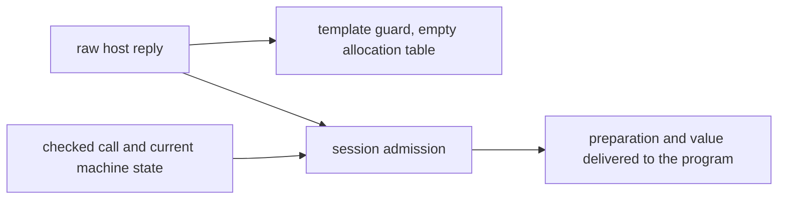

# Row protocol review

The new protocol passes the narrow review at `b98d81c3`.
H9's semantics registry gap is closed.
Before CO-6 closes, distinguish raw reply admission from membership and add a production reader of the guarded run.
The review changes no production file or owner ruling.

## Reviewed state

| Item | Commit |
| --- | --- |
| Previous reviewed implementation | `8a61361518c5409e1aeae309ebb287ded641c47c` |
| Previous review checkpoint | `b7441b646da44908d9e106b74c708d5dd8c84df8` |
| Reviewed implementation | `b98d81c33ffa1721fe61b23d38d167b6e0dd9eca` |
| Effects dependency | `b0dd60797244a04b47bcb1f6eecfe71f7a02ae04` |

`pins.json` records six source hashes.
`snapshot/` retains the compiled module and existing reply battery.
Other evidence is read from the pinned Git objects.
Two GPT-6.1 Sol agents review the statements, placement, and imports independently.

The active Claude session remains `9ebf38b2-8b2f-44e5-8fd9-2dc0cb5a1f50.jsonl` in the repository-specific project directory.
Bounded tail reads confirm its working directory as `/Users/pooks/Dev/lean4-effect4`.
Its most recent inspected message announces work on `Laws/Api/HostDrive.lean`.
That untracked file appears during review and imports `RowProtocol`.
It is work in progress, outside this commit's checks.
No reviewer messages Claude.

## Resolved: HCO-05 semantics registry join

`rows-denotation-host` in `tools/ProofGraph/Registry.lean` points to `denoteRows_eq_session_host`.
The generated report marks that claim proved and keeps R6 open.
The claim retains the finished-run, matching-answer, and `StraightRows` premises.
It makes no progress claim.
The semantics registry also assigns `HostRuns` and `RowProtocol` to their concepts.

The source check confirms the pointer and generated entry.
It does not regenerate the whole report.
H9's proof is unchanged from the preceding narrow audit.

## New control: HCO-07 raw reply admission is not membership

**Role:** scope correction for the typed-host description.
**Evidence:** finite controls in `RowControls.lean`.
**Scope:** raw resource allocation replies, with explicit allocation tables.

The introduction of `src/Effect4/Laws/Program/RowProtocol.lean` describes each admitted success as a member of its answer type.
`rowAdmits` instead reads `externalAdmits` with an empty allocation table.
That admits a raw allocation number for a handle row.

| Reply and context | Observation |
| --- | --- |
| Number `0`, empty allocation table | the row guard admits it |
| Number `0`, handle answer type | the raw number is not a member |
| Preparation of that reply | `externalValue` allocates the handle |
| Number `1`, one prior allocation | contextual admission accepts it; the empty-table guard refuses it |

The allocation boundary already exists in `externalValue` and `externalAdmits` in `src/Effect4/Program/Compile.lean`.
H9 excludes handle rows, so this is not a counterexample to H9.
It requires no expansion of the deferred handle work.

**Next action:** describe `rowProtocol` as raw template admission with an empty allocation table.
Qualify the membership description to data replies.
A future contextual protocol must reuse the checked call and allocation state.
A call address alone does not supply allocation state.

## CO-6 completion item: HCO-08 actual reuse

**Role:** proof placement and production consumer.
**Evidence:** committed source references in `checks/source-checks.json`.
**Scope:** the new protocol helpers at the reviewed commit.

`RowProtocol` is imported only by the Laws root.
Its guard laws have no production consumer outside that module.
Its placement describes a future consumer and names no claim of its own.
Inherited concept placement alone supplies no downstream use.

`RowControls.lean` demonstrates the small missing connection.
It applies `hostAnswered_guardRows`, then H9, to a recorded two-call run.
The host's state affects its second reply.
The guarded run retains the result and final host state.

**Next action:** name `rows-denotation-host` as the helper's existing claim and add this concrete production reader.
No duplicate program representation or wrapper theorem is needed for that reader.
A broader typed-host obligation needs its own placement before more helper laws are added.
This is completion work for CO-6, not a regression in an earlier slice.

## Checked boundaries

`RowsAdmit` remains a separate premise of `hostAnswered_guardRows`.
A tape with no matching request can satisfy `RowsAdmit` vacuously.
The corresponding `HostAnswered` proposition is false in the negative control.
The combined theorem therefore still requires an actual request and matching answer.

HCO-01 remains explicit and deferred.
The existing numeric call instance accepts `some 1`, while the new template guard refuses it.
The module names that distinction and does not claim full session admission.

The new guard reuses `Effects.Comodel.guard` and its laws.
It adds no stored program representation.
The source import check finds no Laws module reachable from the core root.
The Laws root reaches the new module.
The authoring and target pipeline is unchanged by this commit.

## Verification

The compiler is Lean `4.33.1`.
Every Lean command sets `LEAN_NUM_THREADS=3` and runs sequentially in the isolated worktree.
The existing artifact overlay supplies the previously reviewed H9 dependencies.

| Command | Result |
| --- | --- |
| `LEAN_NUM_THREADS=3 python3 docs/research/2026-10-09-row-protocol-review/check.py` | frozen protocol module and existing reply battery compile |
| The same command with `probes` | guarded H9 reader, positive and negative controls, and exact module dependency check pass |
| `python3 docs/research/2026-10-09-row-protocol-review/verify.py` | source hashes, semantics registry join, consumers, and import separation pass |

`checks/results.json` records the exact Lean commands.
`checks/row-axioms.log` records every declaration's result.
All 16 declarations use only the permitted axioms, `propext` and `Quot.sound`.
This is a module audit, not the whole-library gate.

The first probe run exposes an isolated import-path setup error.
Giving the frozen battery a separate module name resolves it.
Later probe edits fix dependent-pair notation and the printable summary.
The final controls and audit pass without changing the reviewed source.

No TypeScript compiler, physical host, full sweep, merge, or push runs.
The checks establish no progress or target execution result.

## Checkpoint

Review through `b98d81c3`.
HCO-05's semantics registry join is resolved.
HCO-07 records the raw-admission description correction.
HCO-08 records CO-6's production-reader completion item.
HCO-01 remains the explicitly deferred call-instance boundary.
HCO-06 remains the driver distinction between invocation and application.
The next review follows Claude's driver proof without repeating these unchanged controls.
