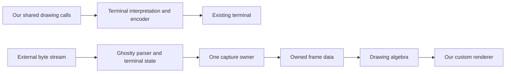
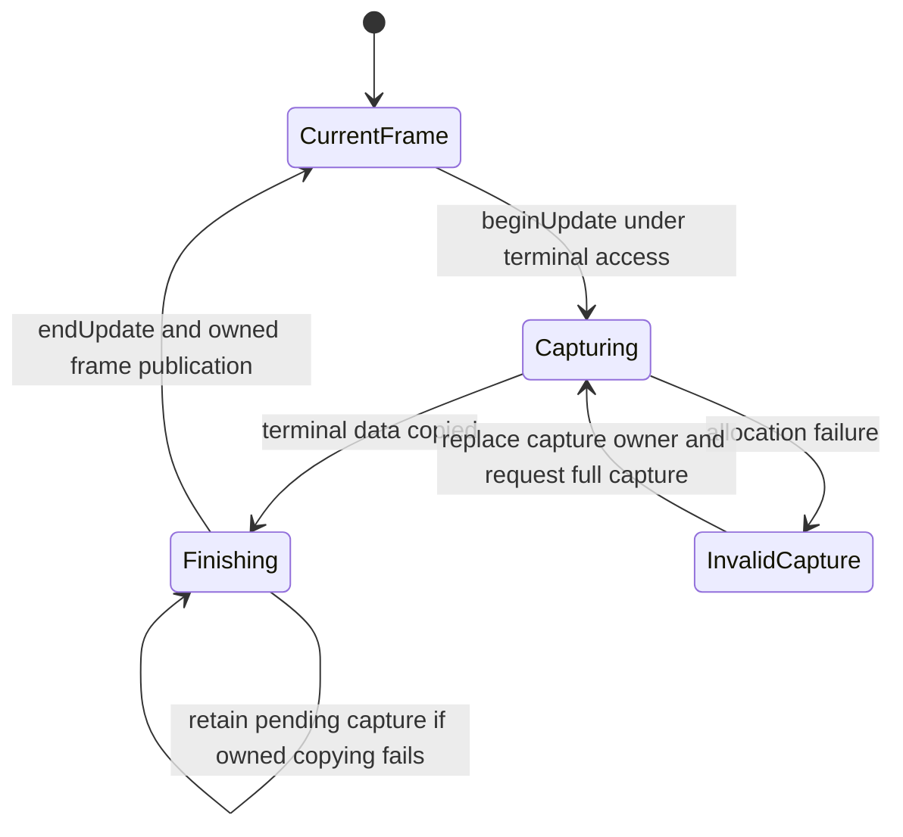

# Ghostty state, capture, and rendering contracts

Keep a persistent terminal and one capture owner.
Share owned frames with the renderers.
Derive bindings from the pinned public declarations and runtime descriptor.
Interpret frame data through algebras of the chosen drawing operations.

This design supports changed-row reuse without exposing foreign pointers to program authors.
It also keeps actual presentation separate from terminal state updates.

## Evidence and scope

The source pin is `246f702876b924a1cb7cade1e99274d1470302fc`.
`ghostty-sources.json` records independently fetched source hashes matching the inspected caches.
The observations below come from source inspection.
No native Ghostty build, timing benchmark, allocation-failure injection, or emulator comparison runs here.

The earlier ABI probe is `docs/research/2026-10-09-ghostty-probe/README.md` at research commit `7447276a`.
It checks declarations with Clang and rejects deliberately incorrect typed wrappers.
It does not execute the library.

## Two connections

Sending our drawing to an existing terminal emits terminal bytes.
That connection needs no embedded Ghostty library.
Embedding Ghostty consumes terminal bytes and exposes terminal state for our renderer.
These directions can share data contracts without sharing their semantic owner.

## Source findings that shape the interface

| Source and declaration | Checked behavior | Interface consequence |
| --- | --- | --- |
| `src/terminal/c/terminal.zig`, `vt_write`; `src/terminal/stream_terminal.zig`, `Handler.vt` | A write advances a persistent parser. Action failures set sticky `semantic_failure`. The write returns no success result. | Record processing-error status. Distinguish accepted bytes, parser ground, held rendering, and published frames. |
| `src/terminal/render.zig`, `RenderState.beginUpdate` | Reads terminal state, copies changed rows, and consumes terminal/page/row dirty flags. | Serialize terminal access during capture. Use one capture owner and distribute its resulting data. |
| `src/terminal/render.zig`, `RenderState.endUpdate` | Expands pending styles using render-state-owned memory, without accessing the terminal. | Release terminal access after the first phase. Keep exclusive render-state access through the second phase. |
| `src/terminal/c/render.zig`, `begin_update`, `end_update` | Wrappers add no locking. An allocation failure returns an error without rollback. | Publish only after both phases finish. Preserve the last published frame after failure. |
| `src/terminal/render.zig`, `RowBuilder.row` | Resets retained row storage before operations that can allocate. Dirty flags can already be cleared. | Treat failed capture as invalidating that capture owner. Recreate it for a full capture before publishing again. |
| `src/terminal/render.zig`, `Row.Id` | Equal row identity plus a clean flag guarantees unchanged content between updates of the same render state. | Scope reuse to the same owner. Include rendering configuration in prepared-row cache keys. |
| `src/terminal/render.zig`, `beginUpdate`; `src/terminal/stream_terminal.zig`, `Handler.setMode` | Cursor and cheap metadata refresh independently of row dirtiness. Cursor visibility can change without a dirty row. | Always compare frame metadata. An empty changed-row list does not imply an unchanged display. |
| `src/terminal/PageList.zig`, `invalidateNodeLayout`, `nodeIsValid` | Page generations and reset epochs distinguish moved or reused storage. Resize can reflow history and tracked positions. | Never use pointer addresses as durable row identity. Invalidate caches across restoration and owner replacement. |
| `src/terminal/stream_terminal.zig`, `Handler.setMode` | Synchronized-output transitions invoke callbacks during byte processing. | Capture the held frame at the begin callback. Queuing that capture until later can observe a partial frame. |
| `src/renderer/generic.zig`, `updateFrame`, `rebuildCells`, `drawFrame` | Prepares rows separately from drawing. Clean rows can reuse prepared cells. | Separate capture, row preparation, and presentation. Cursor animation need not reshape unchanged text. |
| `src/font/shaper/Cache.zig`, `Cache.get`, `put`; `src/font/SharedGrid.zig`, `getIndex`, `renderGlyph` | Caches shaped runs, fallback lookup, and rasterized glyphs at distinct boundaries. | Retain separate row, shaping, and glyph caches. Invalidate them with their font and configuration inputs. |
| `src/renderer/Thread.zig`, `wakeupCallback`, `renderCallback`, `animationTimerCallback` | Output and animation drive different work. Hidden surfaces skip preparation. | Coalesce presentation work and retain explicit animation deadlines. Do not discard terminal input processing. |

These findings favor owned frame data over borrowed cells in the program-facing interface.
The host may later borrow data internally during a protected rendering operation.
That optimization must not change the program-facing lifetime contract.

The source assumes one consumer of terminal dirty information.
Two persistent capture owners can therefore miss each other's consumed changes.
The smallest proposed control initializes both owners, rewrites one cell, then updates each owner in sequence.
Fixed dimensions and viewport avoid the separate full-refresh conditions.
This risk follows from the source, not a reproduced runtime failure.

## Proposed frame data

| Data | Purpose | Boundary |
| --- | --- | --- |
| Owner, epoch, publication sequence | Distinguish captures and reset caches | Adapter-issued identifiers, not program addresses |
| Dimensions, viewport positions, actual overscan | Interpret row placement and bounds | Output data, not native pixel dimensions |
| Ordered row identities and contents | Reuse prepared rows and place them again | Identities scoped to their capture owner |
| Grapheme clusters and width/spacer kinds | Retain terminal cell occupancy and shaping input | Do not flatten into a character-counted string |
| Styles, colors, selection, cursor | Reproduce the chosen visual observation | Keep actual terminal colors separate from authoring roles |
| Processing error, parser ground, render hold | Report distinct operational conditions | None alone says a frame is published |
| Profile and rendering configuration revision | State supported observations and cache inputs | An explicit compatibility boundary |

The first frame format should own all retained data.
An incremental format can follow once its base relation is checked.
The update carries a full frame or changed rows with an owner, epoch, and required base sequence.
Reject unknown row references that omit their contents.
A wrong base sequence requires a full replacement.

The pure reconstruction obligation is exact equality with the corresponding full frame, under these premises.
It does not prove that the foreign capture accurately represents Ghostty's state.
A shared consumer must retain the entire captured result before clearing Ghostty's dirty state.
Each downstream renderer tracks its own presentation progress against that owned result.

The last published frame remains available during recovery.
The diagram models the proposed adapter's publication discipline.
It does not claim transactional rollback inside Ghostty.

## Proposed author face

Follow the existing `open`, `feed`, and `view` pattern from decisions row 334.
A feed event carries input bytes, a resize, or a viewport change.
The resource scope owns terminal retirement.
The adapter owns capture phases, borrowing, dirty flags, cache invalidation, and publication recovery.
Authors must not coordinate those details themselves.

This face remains a proposal.
It enters the existing host-operation mechanism with explicit handle and reply obligations.
It does not require a terminal constructor in the core program language.

## Performance without widening the author API

Batch ordinary byte input before capture where the application's observation permits it.
Keep synchronous render-hold capture callbacks as ordering barriers.
These callbacks run inside byte processing.
Use the same capture owner without recursively taking a non-reentrant lock or writing more terminal bytes.
Do not equate input chunks with atomic terminal transactions.
The persistent parser may await further bytes inside a control sequence or grapheme.

After full frames work, retain unchanged owned rows across captures.
Compare cursor and color metadata independently.
Prepare changed rows in bulk to reduce foreign-function crossings.
Cache shaping by its actual text, font, feature, and configuration inputs.
Cache glyph rasterization by the font grid and rasterization inputs.
An upstream hash is not a Lean proof of semantic identity.

A future delta channel should name its base frame explicitly.
Coalescing several updates must produce the same final owned frame as applying them in order.
Intermediate-frame omission remains a declared presentation policy.
It must not erase input events or claimed execution observations.

## Expressivity that needs separate contracts

The public `libghostty-vt` API exposes terminal data.
The internal Metal/OpenGL renderer depends on application surfaces, fonts, and backend resources.
Generating the C bindings does not make that renderer a portable public service.
`src/renderer.zig` and `src/build/GhosttyLibVt.zig` define that separation.

Hyperlink resolution needs a coherent read of the referenced grid.
`RenderState.linkCells` requires no intervening terminal mutation.
Kitty images need both image identity and placement geometry.
Scrolling or resizing can change geometry without changing image contents.
Add those features through named profile extensions with their own invalidation inputs.

`Tools.View.Dev.cells` does not encode terminal grapheme placement.
`Dev.fill` names an authoring role rather than an arbitrary terminal RGB value.
These are concrete data gaps for embedding a terminal in the current drawing surface.
Resolve them at the output data boundary with a real consumer.
Do not add new `Eff` constructors for rendering details.

A render frame and Ghostty's binary state snapshot are different data.
The binary snapshot can resume parser and history state.
Its READY marker permits activity before all historical data arrives.
Restoration resets some view state and omits some graphical features.
It cannot establish restoration of every displayed feature.
See `src/terminal/snapshot/snapshot.zig` and `src/terminal/snapshot/terminal.zig` at the pin.

## Host controls before an optimization claim

1. Compare two persistent capture owners after one fixed-viewport cell rewrite.
2. Change cursor visibility while rows remain clean.
3. Inject allocation failure during a changed-row capture.
4. Feed hold-start, drawing, release, and another hold-start in one write.
5. Resize across wide characters and move the viewport across retained rows.
6. Apply reordered or wrong-base frame deltas and require refusal.
7. Compare cached and uncached preparation under the same visual profile.
8. Measure parsing, capture, copied bytes, shaping, drawing, and foreign crossings separately.

The source audit motivates these controls.
This packet does not report them as executed.
The Lean and launcher probes in `README.md` have separate evidence.
