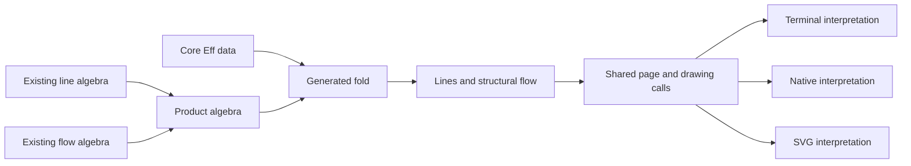

# Terminal interpretations from existing folds

The probe combines existing program readings through the product algebra.
It adds no program constructor or terminal renderer.

## Scope

The dependency base is `bfe97080657ecb87d4551fc8a4511580369f698d`.
The inspected primary commit is `21d8e031f31318db62afea392b3d043beef2e0be`.
The selected program readings have unchanged source at these commits.
The receipt records the compared declarations and their hashes.

Only this research directory changes.
Claude owns the primary checkout and its implementation.
The launcher fixture uses temporary substitutes for Lake and graphical programs.

## Placement before the reader

| Field | Placement |
| --- | --- |
| Concept | `initial-algebras-folds`, `docs/core/semantics.md` |
| Required property | Agreement through the generated fold's uniqueness |
| Existing law | `Tools.View.Algebra.cata_prod`, `tools/Tools/View/Algebra.lean` |
| Consumer | A proposed shared builder for the page's lines and structural flow |
| Role | A law reader instantiated at `Program.layer` and `Flow.flowLayer` |
| Reach | Equality with `Program.lines` and `Flow.ofProgram` for each `NativeEff` |
| Hypotheses | Both readings use the same program and its existing `Flow.waits` table |
| Placement rule | Tool laws under decisions rows 334.3 and 336.8 |
| Requirement served | The view's compositional reading of the sole program representation |
| Exclusions | No claim about execution order, terminal pixels, host execution, typing, or speed |

The wait-target analysis remains a separate input computation.
The product removes duplicated program folds for these readings only.
It does not remove their separate child computations or allocate a terminal state.
The higher-order carriers compute views and never enter stored program syntax.
The generic product law and the concrete string reader have separate trust inspections.
The concrete reader reaches existing string rendering and may inherit its `Classical.choice` dependency.
This research changes no axiom allowance and makes no new core trust claim.

## Checks

1. Apply `cata_prod` to the existing line and flow algebras.
2. Check their equality with the current independent readers.
3. Inspect the reader's trust dependencies without changing the production axiom gate.
4. Exercise the composed reader on the existing flow specimens.
5. Retain controls for erased keys, omitted graphs, and literal terminal controls.
6. Reproduce the launcher fixture with graphical builds unavailable.
7. Record the exact source pins, commands, results, and remaining host obligations.

The probe finishes when these checks pass and the boundary note names the next bounded slice.
A failed check must be repaired or reported with its exact limit.

## Intended connection

The terminal interpretation remains proposed.
Its observations and supported profile must be stated before implementation.
The existing text projection does not establish agreement with the interactive drawing.

## Generator control

The generator control reads the pinned primary `Tools.View.Dev`, including its new `shape` constructor.
It runs the existing `Effect4Gen.Fold` producer from the dependency base.
The producer's ordinary route derives the constructor algebra and its fold laws.
The consumer is the proposed terminal interpretation of the existing device calls under row 336.4.
The control compiles its output and requires repeated generation to produce identical bytes.
The generated uniqueness law serves `initial-algebras-folds` under the same tool-law placement.
This control establishes generation and Lean elaboration only.
It establishes no geometry interpretation or terminal host behavior.

The strict producer control exposes unnecessary termination instructions on nonrecursive types.
The candidate uses Lean's existing component analysis for recursion and names unused leaf parameters explicitly.
The controls include acyclic mutual types and a recursive component beside a leaf.
The existing registered `Fold` output must remain byte-identical.
