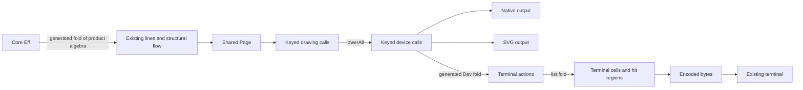

# Terminal output and Ghostty through generated folds

The next adapter should interpret existing drawing calls through a generated algebra.
The probe also checks the product of the existing program readings.
The producer repair remains an isolated candidate.
No production file changes in this packet.

## The integration decision

Keep the sole program representation and the established drawing route.
Generate constructor coverage from the existing type declarations.
Supply each output's meaning through an algebra.
Compose stateful drawing actions with the existing list fold.

Decisions row 336.4 puts terminal output beside native output and SVG, reading the same calls.
`pageText` remains a convenience transcript.
It cannot supply the interactive terminal view after discarding keys and graphs.



The terminal branch is proposed.
The product of program readings is checked in `FoldProbe.lean`.
The terminal actions are functions used during interpretation, never stored program syntax.

## Confirmed findings

### TB-01: the ordinary fold producer fails on the drawing alphabet

`Effect4Gen.Fold.emitBlock` always emits structural termination instructions.
`Tools.View.Dev` has no recursive children.
Strict compilation therefore rejects the generated file.
Removing those instructions exposes unused combining arguments in the leaf functions.

The candidate repairs the producer in a temporary overlay.
It uses `Lean.SCC.scc` to identify recursive components of the constructor dependency graph.
It marks unused leaf parameters explicitly.
It generates the pinned `Dev.shape` constructor without a handwritten constructor list.

The acyclic mutual fixture catches a weaker repair based only on child references.
The mixed fixture exercises a recursive component beside a leaf member.
The existing `Fold` group's regenerated bytes remain unchanged.
`generator/evidence.json` records all commands, comparisons, diagnostics, and trust output.

The concrete candidate is `generator/producer.patch`.
The script generates every retained output, including the original rejection.
No generated file is repaired by hand.
A production landing should register the new consumer group through the existing manifest.
Generate `Call` and `Dev` together if both acquire consumers.
Separate ordinary groups in the same namespace can collide on the generated `MonadMorphism` name.

### TB-02: text mode depends on graphical preparation

`tools/view/v` runs `build.sh` before selecting text mode at the inspected primary commit.
The fixture substitutes a failing graphical build and prerecorded text.
The current text branch fails before writing the text.
The candidate moves graphical preparation into the graphical branches.
Its text branch writes the exact fixture bytes.
Its graphical branches still call the failing build.

`launcher/probe.py` reproduces these observations.
This fixture runs no real Lake, graphical dependency build, window, or terminal emulator.
The candidate leaves the separate looks mode unchanged.

### TB-03: the transcript erases information needed for interaction

`Tools.View.pageText`, in `tools/Tools/View/Page.lean`, discards line keys and the graph panel.
`FoldProbe.lean` changes keys without changing output text.
It also removes each specimen's graph without changing that text.
A refusal's line-state mark does survive the projection.

A literal escape character survives inside line text.
This control never sends that character to a terminal.
An encoder must distinguish display text from terminal commands.
Escape unsupported text before measuring its cells.
Escaping an already padded transcript changes its column widths.

`String.length`, UTF-8 byte length, and terminal cell width are different observations.
The existing `Tools.Code.Doc.width` measures bytes.
Its `undo_layout` law restores the flat print, not terminal cells or erased keys.
Unicode's width property also needs terminal-specific tailoring.
See [Unicode UAX #11](https://unicode.org/reports/tr11/).

## What the product reader establishes

`TerminalBoundary.readings` uses `Program.layer.prod (Flow.flowLayer waitsOf)` through `Algebra.fold`.
`readings_eq` applies the existing `Tools.View.Algebra.cata_prod` at these consumers.
It establishes equality with `Program.lines` and `Flow.ofProgram` for every `NativeEff`.
It adds no constructor cases or inductive proof.

`Flow.waits` still performs its existing input analysis.
The product does not fuse that analysis or establish a speed improvement.
The finite layout comparison uses the dependency base before the organic-stroke change.
The selected program readings match the inspected primary source.
`receipt.json` records the compared source hashes.

| Item | Proof role | Evidence status | Scope |
| --- | --- | --- | --- |
| `cata_prod` | Existing agreement law | Trust inspected | Generic product of program-reading algebras |
| `readings_eq` | Consumer of that law | Lean checked | Exact line and structural-flow data |
| Specimen guards | Finite execution controls | Checked | Existing flow specimens and transcript limits |
| Generated `Dev` laws | Generated constructor laws | Candidate output compiles | Pinned device-call alphabet |
| Launcher fixture | Control of branch dispatch | Checked with substitutes | Normal text, window, and PNG dispatch |
| Ghostty map | Foreign implementation analysis | Source inspected | Pinned files listed in `ghostty-sources.json` |

The generic product law depends on `propext` alone.
The concrete text reader inherits `Classical.choice` from the existing string-based readers, alongside `propext` and `Quot.sound`.
This packet changes no core trust allowance.
The concrete reader is not a new claim under the core's no-choice ceiling.

## The smallest terminal interpretation

The generated `DevAlgebra` supplies one field for each drawing constructor.
A terminal carrier can be `Key → FrameState → FrameState`.
`FrameState` is proposed output data: cells, clipping state, and keyed hit regions.
It is not a second program representation.

The existing `List.foldl` composes these actions in drawing order.
Its append law states that interpreting two joined call lists equals executing their actions in sequence.
Clipping and hit priority make order significant.
The terminal backend must not interpret the call list as an unordered collection.

`lowerAll_append`, `lower_key`, and `pick_append` already constrain lowering and pointer selection in `tools/Tools/View/Picture.lean`.
Their observations concern drawing data.
They do not establish terminal cell placement, Unicode widths, or foreign execution.

Start with an explicit cell profile and a plain-text fallback.
Detect endpoint capabilities as runtime data.
Do not infer them from an emulator's brand or the library's compile-time options.
The vendored `tb_has_truecolor` and `tb_has_egc` report compile-time support.

The same-call interpretation needs an explicit approximation for curves and filled shapes.
A terminal cannot promise native pixel geometry at every viewport size.
Keep program keys distinct from cell coordinates and Ghostty row identities.
Pair input with the displayed revision before passing edits to the existing checked session.

## Obligations before a production adapter

These are proposed obligations, not registered claims or completed proofs.
Each production slice must place its statement before proof work.

| Proposed obligation | Concept and role | Observation and premises | Consumer and exclusion |
| --- | --- | --- | --- |
| Call-action composition | `initial-algebras-folds`, tool composition | Fixed profile and ordered keyed calls | Terminal painter; no host claim |
| Clipping and key retention | `initial-algebras-folds`, tool invariant | Admitted dimensions, clipping policy, hit priority | Selection from displayed frames; no pixel equivalence |
| Literal encoding | `translation-simulation`, target connection | Fixed character profile, text separated from command bytes | Terminal output; no arbitrary Unicode-width claim |
| Frame update reconstruction | `initial-algebras-folds`, data action | Matching owner, epoch, base revision, and known row identities | Incremental presentation; no pointer-lifetime claim |
| Snapshot admission | `store-typing`, boundary obligation | Descriptor, bounds, owned graphemes, widths, and styles | Foreign adapter; codec admission remains separate |
| Host capture agreement | `translation-simulation`, R6/R8 connection | Named cells/styles/cursor observation, pinned library, accepted profile | Ghostty conformance lane; finite probes are not a general theorem |
| Resource retirement | `store-typing`, R6/R11 connection | Ownership, callback serialization, failed-capture recovery, closed handles | Host lifecycle; no liveness claim |

The detailed Ghostty contracts and performance boundaries are in [GHOSTTY.md](GHOSTTY.md).
Generated bindings establish declarations and layouts only.
They do not discharge these operational obligations.

## Next slices

1. Land the producer repair with its leaf and mutual controls.
2. Remove graphical preparation from normal text-mode dispatch.
3. Register the device algebra through the existing generator manifest.
4. Implement one ordered terminal interpretation with explicit profile limits.
5. Add one Ghostty capture owner with owned frames and operational status.
6. Measure changed-row reuse before adding frame deltas or native borrowing.

Claude's active session inspects the core agreement proof during this review.
The review does not modify that work or send instructions to the session.
The previous D1 review remains separate from this adapter probe.

## Reproduction and checkpoint

The research parent is `7447276a`.
The dependency source is `bfe97080657ecb87d4551fc8a4511580369f698d`.
The inspected primary is `21d8e031f31318db62afea392b3d043beef2e0be`.
The Ghostty pin is `246f702876b924a1cb7cade1e99274d1470302fc`.

```sh
python3 docs/research/2026-10-09-terminal-boundary/run.py
python3 docs/research/2026-10-09-terminal-boundary/generator/run.py
```

Run these sequentially in the review worktree.
The scripts set `LEAN_NUM_THREADS=3` and retain exact commands and results.
`receipt.json`, `generator/evidence.json`, and `launcher/evidence.json` own the measurements.
No TypeScript compiler, full sweep, merge, push, Ghostty build, or native terminal conformance run occurs.

Outstanding: production integration of TB-01 and TB-02, a terminal interpretation, and the foreign controls in `GHOSTTY.md`.
TB-03 bounds the current transcript rather than reporting a broken graph theorem.

The retained producer patch uses standard unified-diff context, including single-space blank context lines.
The whitespace check excludes that patch artifact only.
`document-check.json` records both the unfiltered result and the narrowed check.
The generated Lean files remain under the ordinary whitespace check.
