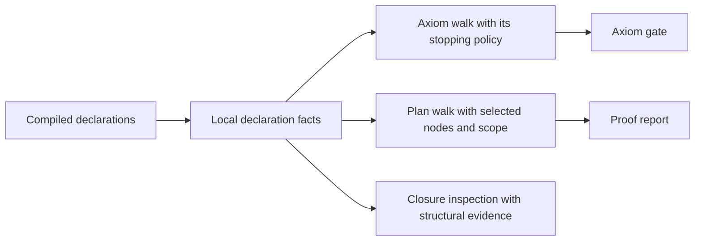

# Narrow-build and goal-tooling review

The faster build rules can reuse an old check after its compiler or package pins change.
The new import reader also drops valid imports around comments.
Repair these two boundaries before relying on the narrower checks.

## Reviewed state

Implementation base: `4867cf2b2c41502460949c60143cc9ed0d97b4ab`.
Reviewed head: `294c89cdee0fd5874c01df45fb2654c5a480b2cd`.
Review branch base: `175ef43f7392a1837335cadf1c7bb9d03129182e`.
The primary checkout remains unchanged by this review.

The active Claude session is `9ebf38b2-8b2f-44e5-8fd9-2dc0cb5a1f50`.
Bounded recent tails confirm its repository directory and the reviewed commit.
Claude reports a full build and two narrowed checks passing.
Those full-build and timing claims remain builder reports.
This review independently checks the smaller boundaries below.

Claude starts CO-6b S3 service-client work during the review.
The later commit `70840796e87480d00a1ad758884e53983c45d59d` separates the explanation commands from the authoring import.
It also marks the cache proposal not pursued.
That later landing and the active service-client edits remain outside the independently compiled range.
Their source diff leaves both new build findings unchanged.
The existing `Laws.Program.TyView` edit remains separately owned.
No message goes to the implementation session.

## BUILD-PINS: a changed build pin does not invalidate a check

**Role:** finite control of check freshness.
**Evidence:** Make dry runs against the unmodified reviewed `Makefile`.
**Scope:** the `cases` marker, with a mirrored source-path inventory and controlled timestamps.

The `cases`, `native`, and `compiler` rules depend on selected source files.
They omit `lean-toolchain`, `lakefile.toml`, and `lake-manifest.json`.
`manifest` in `scripts/lib/conform_report.py` records those three inputs in each conformance receipt.
The new rules can therefore reuse a marker after an input to that receipt changes.

`check-build.py` exercises the actual reviewed Makefile in an isolated directory.
An unchanged tree reuses its marker.
Changing a core source or the checker script schedules the check.
Changing only any of the three build pins does not schedule it.
`checks/make-controls.json` retains every command and result.
No real build runs, and no primary marker changes.

**Next action:** declare these build inputs once and share them across the affected marker rules.
Keep each tool's narrow Lake build.
The local prerequisite repair passes the same changed-input controls in `checks/make-repair-controls.json`.
This repair addresses the tested pins; it does not establish coverage of every tool dependency.

## BUILD-IMPORTS: a second header reader loses valid imports

**Role:** finite control of the build helper's input reading.
**Evidence:** the current host-protocol tool, comment variants, a Lean control, and the actual Make helper with a harmless Lake substitute.
**Scope:** `imports` in `scripts/lean-imports.py` and `build_imports` in `Makefile`.

The new reader stops at the first block comment.
The current `tools/Tools/HostProtocol.lean` has four imports, which both readers find.
A leading ordinary block comment makes the new reader return no imports.
A comment between imports makes it omit the following imports.
`ImportControls.lean` confirms that a leading comment before imports compiles under the pinned Lean compiler.

The actual Make helper then calls `lake build` without targets for the leading-comment control.
Lake's configured default targets include the core, laws, and battery.
A failed file read also reaches the same empty build command instead of stopping first.
`check-shell.py` captures these arguments through a substitute command; it never starts that build.
The file-read failure does not establish that the later gate would succeed.

**Next action:** reuse `header_imports` or `imports_of` from `scripts/lib/lean_imports.py`.
Keep only workspace filtering and duplicate removal in the command adapter.
Propagate a read failure before invoking Lake, and handle an empty workspace-import list without invoking its default targets.

The shared reader already handles these comments and passes its eight existing controls.
Those controls live in `scripts/test-lean-imports.py`.
The present direct Make consumers parse correctly; this finding concerns valid source changes and failed reads.

## The extracted goal command

`goalExt`, `bareSorry`, `tagGoal`, and `elabGoal` move into `ProofGraph.GoalTag` without changing their bodies.
The extension keeps its existing key, `ProofGraph.goal`.
`ProofGraph.Goal` retains the standing walk.
The declaration command and the report computation now have separate import boundaries.

`compile.py` recompiles seven changed tool modules and three existing control modules from the captured sources.
The existing goal, placement, sketch, and closure controls pass.
`TagOnly.lean` checks that the extracted command imports neither the axiom walk nor the standing walk.
`TagImports.lean` checks persisted goals, placements, and standing through compiled imports.
No new trust defect appears in these finite controls.

The broad comment that tool changes rebuild no law module needs a scope qualifier.
At the reviewed commit, `Laws.Author.Explain`, `Auto.Census`, and `Auto.Frames` still reach the walk.
The later authoring-import landing addresses part of that remaining dependency.
This is a dependency-scope qualification, not a proof failure.

## Deferred cache design

The reviewed cache note proposes shared declaration facts.
The note at `70840796` marks this work not pursued, so these observations are retained for any future restart.

Start with local declaration facts and retain each consumer's observation separately.
`CacheShapeControls.lean` gives two functions with the same type, dependency list, declaration kind, and reached axioms.
The current closure check distinguishes them because their bindings occur on different sides of a returned function.
A cache containing only the proposed columns cannot reproduce that distinction.
It must retain that structural evidence or keep the expression inspection.

Other consumers require their own facts too:

- The axiom gate reads unsafe, foreign-implementation, opaque-body, and initialization flags through `Audit.Facts`.
- The axiom walk and goal-stopping walk use different stopping policies.
- Goal tags and placement attributes arrive after declaration creation in `elabGoal` and `addSketch`.
- Imported declarations without entries require a fallback walk or an explicit refusal.
- Nearest plan nodes depend on the selected nodes and scope, beyond a declaration's local dependencies.



These are proposed cache obligations, not defects in an implemented cache.
They need no new program representation.
The current `Eff` and target-generation path remain untouched.

## Verification and limits

The compiler is `leanprover/lean4:v4.33.1`.
`pins.json` records copied dependency artifacts and source hashes.
The source snapshots match the reviewed commit, as checked in `followup.json`.
The ten compiled modules use the pinned dependency closure; other dependencies remain builder artifacts.
Every Lean command uses `LEAN_NUM_THREADS=3`, with one process at a time in the isolated worktree.

```sh
python3 docs/research/2026-10-10-build-overwatch/freeze.py
python3 docs/research/2026-10-10-build-overwatch/compile.py
python3 docs/research/2026-10-10-build-overwatch/check-build.py
python3 docs/research/2026-10-10-build-overwatch/check-shell.py
python3 docs/research/2026-10-10-build-overwatch/check-lean.py
```

`freeze.py` captures current builder artifacts and sources from the reviewed commit.
A later reproduction must compare the stored hashes before reusing those artifacts.
`checks/compile-results.json` and `checks/lean-controls.json` retain the Lean commands and outcomes.
The Make controls retain both ordinary and changed-input results.
Two GPT-6.1 Sol agents independently review build freshness and the proof-tool boundary.

No semantic theorem or planned goal is added.
No full sweep, axiom gate, TypeScript check, merge, or push runs.
The proposed cache is not implemented or benchmarked.

## Checkpoint

The reviewed committed range now ends at `294c89cdee0fd5874c01df45fb2654c5a480b2cd`.
`BUILD-PINS` and `BUILD-IMPORTS` are new confirmed findings.
The previous service and closure findings remain open.
The service implementations and the earlier closure-filter logic remain unchanged.
The expanded module-index closure control passes without repairing those earlier population and erasure findings.
The next review triggers are a build-helper repair, the authoring-import landing, or CO-6b S3.
