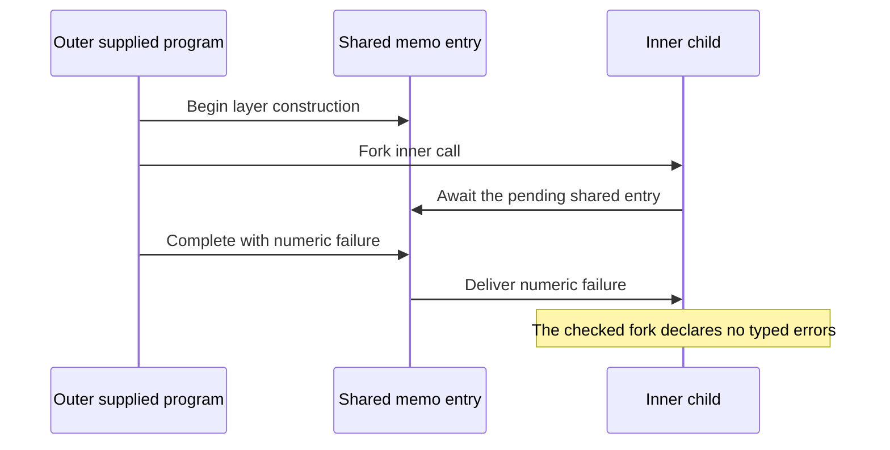

# CX review: parameter contexts and shared layer failures

A shared layer can deliver a cached failure to an admitted child whose declared error type is `never`.
Changing the point predicate alone cannot justify that observation.
Keep the cross-scope obligation open until the admission or sharing contract changes.

## Scope and checkpoint

Reviewed production commit: `f00008eeaef00b67fe93cfd0327754c9f42694ee`.
Review branch base: `785b6b76`, whose production sources equal that commit.
Branch: `codex/review-cx-layer-context`.
The preceding packet is [the CX1a review](../2026-10-10-cx1a-review/README.md).

This packet changes no production file, owner ruling, root import, or implementation session.
The changed files are this packet's plan, controls, audit, verifier, receipts, and source snapshot.
No merge, push, full sweep, or outside-runtime comparison runs.

[verification.json](verification.json) records the checked source and probe hashes.
[working-snapshot.json](working-snapshot.json) records the later, uncommitted implementation state separately.

## The new finite observation

Evidence status: checked finite run.
Proof role: negative control for canonical per-fiber typing.
Observation: the recorded child exit, its creation record, and the checked fork type.

`failureProgram false 2` in [Controls.lean](Controls.lean) has two definitions.
The outer definition accepts a supplied program whose declared error type is `nat`.
Its layer runs that program and discards its successful answer.
The inner definition accepts a supplied program whose declared error type is `never`.
Its layer references the outer layer's address.

The outer supplied program forks the inner call, yields twice, and fails with `7`.
The inner call supplies a program that returns unit.
The child inherits the enclosing memo map and awaits the pending entry at the shared layer address.
Both the root and the child eventually fail with `7`.

The root's numeric error fits its type.
The child's numeric error does not fit the fork's checked error type, `never`.
The probe retains the child's creation record, so the observed child is tied to that fork.

`admitProgram` accepts both ordinary and fresh variants.
`Api.runAdmitted` reproduces the ordinary failure.
Wrapping the inner reference with `fresh` makes the child succeed with unit.
At zero budget, execution reports a live frontier with no exit.



This answers the open failure question in the working design note's section 10.
A fork reads the enclosing map while the enclosing layer is still building.
The later failure reaches that reader even though the enclosing provide's body never runs.

## Controls and limits

| Control | Checked result | What it establishes |
| --- | --- | --- |
| Ordinary cached failure | Child fails with `7` | Accepted execution can cross incompatible error columns |
| Fresh reference | Child succeeds with unit | The shared pending entry causes this finite failure |
| Zero execution budget | Frontier, no exit | Exhaustion is distinct from the observed typed failure |
| Same types, distinct callbacks | Shared result `1`; fresh result `2` | Path identity retains the first construction |
| Closed cross-scope layer | Admission succeeds; execution returns unit | Blanket scope equality rejects this harmless finite example |

The same-type result is consistent with DB-12 and DI-71.
It is not independently reported as a runtime defect.
It constrains an unfolding law that changes layer identity.
That law must name its observation and treatment of sharing.

This packet does not directly refute `M7Exits` or `exits_hasTy`.
Their existential world fixes the root type without independently fixing each child's type from its creation site.
The conflict is with the intended canonical world used by the typed fork and memo proofs.
No completed, goal-free theorem is shown false here.
No finite run establishes a general simulation or progress theorem.
No Effect TypeScript result is claimed.

## Current implementation and proof consumers

The retained working snapshot defines `hop_typed`, `param_arm`, and `invoke_arm` as theorems in `src/Effect4/Laws/Program/Typed/Denotation.lean`.
The session reports their module build passing.
This review does not reproduce that working-tree build.
The later law-graph build remains reported work in progress at the retained session checkpoint.

The retained draft places `crossScopeRef_builds` in `src/Effect4/Laws/Program/Typed/LayerArm.lean`.
`ref_builds` uses that goal for unequal parameter contexts.
This accurately exposes the remaining dependency instead of silently claiming the whole typed result.

An earlier draft added `LayerRefsScoped` to source formation and assumed `layerRefsScoped_of_typeOf`.
The current draft removes both.
The packet retains a local copy of that predicate as `ProposedLayerRefsScoped`.
Two kernel-checked examples negate it for currently admitted programs.
One is the cached-error program; the other is the closed-layer control.
These examples remain controls for any later blanket restriction.

Relevant consumers are:

- `fork_arm`, in `src/Effect4/Laws/Program/Typed/Denotation.lean`, chooses the checked child type.
- `clause_fork` and `Evaluating.spawn_settles`, in `src/Effect4/Laws/Program/Typed/Commands/Clauses/Spawn.lean`, declare that child through `World.addFiber`.
- `preds.exit`, in `src/Effect4/Laws/Program/Typed/Assembly.lean`, requires an exit at its declared columns.
- `LayerCellTyped` and `memoGet_implements`, in `src/Effect4/Laws/Program/Typed/Adequacy.lean`, supply the memo-entry invariant.
- `memoize_typed`, in `src/Effect4/Laws/Program/Typed/LayerArm.lean`, relies on that invariant when a lookup returns an existing entry.

The last two consumers need one compatible error contract for every reader of a shared entry.
A point carrying its caller's context does not alone provide that contract.

## Smallest repair direction

First choose the source contract for parameter-dependent sharing.
The currently admitted counterexample prevents a laws-only repair that keeps all existing behavior and the intended child typing.

A conservative repair rejects references with incompatible parameter types for the parameters their expanded targets actually read.
Compare normalized request, answer, and error types; parameter names and unused slots should not decide compatibility.
Apply the condition consistently to every possible reader of one target, including parent-map lookup from a fork.
The source restriction requires an owner ruling.
This packet proposes the restriction; it does not amend admission.

Reuse the existing structures:

1. Read expanded layer data from the checker's existing `Eff.expandRefs` route in `src/Effect4/Program/Refs.lean`.
2. Collect parameter indices with generated `foldMap_layer` in `src/Effect4/Program/Fold.lean`.
3. Express allowed reads with `readsAlg` in `src/Effect4/Laws/Program/Signature.lean`.
4. Reuse `cata_layer_congr_on` for checker agreement under those reads.
5. Connect the resulting layer columns to the shared memo-entry invariant.

The probe uses `LayerTerm.expandIn` from `src/Effect4/Laws/Program/ReferenceTyping.lean` as the existing subterm shorthand.
Production admission must stay on core expansion data without importing that proof module.
A shared subterm expansion API would require moving its pure definition to core and retaining its laws separately.

The `usedParams` probe implements step 2 with one local constructor clause and no hand-written recursive traversal.
Its controls cover direct reads, invocation arguments, references, and closed layers.
A raw reference contains no parameter reads; expansion must precede collection.
`readsAlg` also treats a raw reference as true, so its agreement theorem has the same requirement.

The existing `check_alg_agreeOn` takes global `SigExtends`.
It does not already provide the proposed support-sensitive context theorem.
That connector, stack transport for the used parameters, and the memo invariant still need proof.
Definition calls use their own parameter contexts; their supplied arguments use the surrounding context.
Nested definition blocks remain outside the admitted fragment.

This design derives metadata from the stored program and existing declarations.
A module author supplies no second inventory or per-module scope proof.
It preserves the sole `Eff` representation.

The conservative rule can reject a cross-context reference even when `fresh` isolates every relevant memo operation.
Relaxing it requires a separate argument about memo-map isolation under DI-71.
Changing the memo key to include invocation identity instead changes DB-12's sharing semantics.
Neither change follows from lexical typing alone.

## Placement of the proposed obligations

Every row names a proposal, not a theorem added by this review.
The listed proof consumer gives each proposal a route to an existing claim.

| Obligation | Concept and property | Claim, role, and consumer | Reach and hypotheses | Exclusions | Requirement |
| --- | --- | --- | --- | --- | --- |
| Layer check agrees on used parameters | `initial-algebras-folds`; agreement of folds | Helper of `denote-typed`; compatibility; context transport into `ref_builds` | Expanded layers; same service and definition tables; compatible parameter types at every used index; rows 153 and 340 | No execution or sharing equality | R4, R5; M5 |
| Admission enforces the chosen sharing contract | `residual-program-typing`; checked source formation | Helper of `denote-typed`; admission; `sourceWF_of_typeOf` | Accepted programs under an explicitly amended source rule; rows 153, 186, 340; DB-12 and DI-71 | Does not preserve today's admitted domain automatically | R4; M5 to M7 |
| Every shared memo reader accepts its entry's errors | `store-typing`; declared cell columns | Helper of `denote-typed`; preservation; `memoGet_implements` and `memoize_typed` | Fixed target identity; compatible readers; typed worlds; parent-map lookup; rows 185 to 187 | Safety only; no progress, termination, or host agreement | R4, R5; M6 to M7 |
| A supplied-program unfolding law respects sharing | `translation-simulation`; equal observation | Proposed CX4 obligation; simulation; later module-law transport | Named observation, captured environment, parameter stack, and explicit layer-identity policy; row 340 | No unrestricted substitution across changed allocation or sharing | R7 and reusable module authoring |

The first three obligations repair one dependency chain.
The fourth is a later meaning obligation and should not expand CX1/CX2 now.
The host boundary stays as defined by `docs/core/host-boundary.md`.

## Reproduction

Run from the review worktree:

```sh
python3 docs/research/2026-10-10-cx-layer-context-review/verify.py
```

The verifier checks production-source equality with the pinned commit before building.
It sets `LEAN_NUM_THREADS=3` and serializes all Lake commands.
It builds `Effect4.Api`, `Effect4.Laws.Program.Typed.Scope`, `Effect4.Laws.Program.ReferenceTyping`, and `ProofGraph.AxiomAudit`.
It then compiles the controls and runs `#axiom_audit Controls`.
Exact commands and exit codes are retained in [verification.json](verification.json).
The trust result is retained in [Audit.log](Audit.log).

The packet's probe modules stay outside the production and battery import graphs.
Generated local `.olean` files are not part of the review packet.

## Next action

Retain the admitted cached-error program before changing the source contract.
Keep `crossScopeRef_builds` visibly open while choosing that contract.
Use the closed-layer and fresh controls to measure the chosen restriction.
Build the context and memo proof on the shared fold machinery after the ruling.
