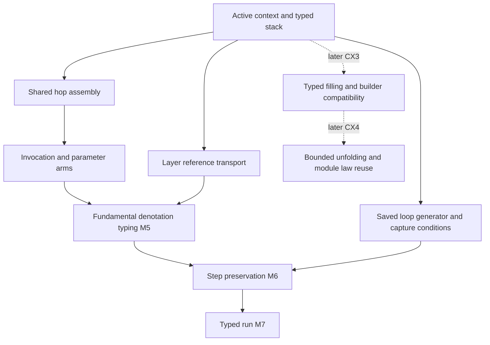

# CX lexical scope: review and proof support

**Resolve layer-reference reuse before adopting the path-only parameter context.**
The admitted `crossRoot` control reaches code inside another definition with its original parameter stack.
The proposed path-based stack condition cannot type that target.
This is a counterexample to the proposed `layerPointTyped_redirect` preservation step, not a runtime failure.

## Snapshot and evidence

- Reviewed source and design: `71799e477d85ff943b1c0f2f291ace98f92613f2`.
- Design: `docs/research/2026-10-10-cx-lexical-scope.md`.
- Branch: `codex/review-cx-lexical-scope`.
- Changed files: this directory only.
- Role: independent design review and finite probes supporting `denote-typed`.
- Evidence status: the accompanying command logs and `verification.json` record the checks.
- Scope: Lean program admission, stored closures, and the imported typing proof graph.
- Exclusions: production repairs, a full sweep, TypeScript, OCaml, outside-host behavior, merge, and push.

Claude's bounded session tail identifies the repository and current work on `Typed/Admission.lean` and `Typed/Denotation.lean`.
The implementation owns those files.
During review, Claude appends section 9 to the design note without committing it.
`working-note.diff` retains that change.
It reuses `withParams`, removing the proposed new signature definition.
That is a useful consolidation, but its path-only parameter context still has the reference counterexample.
The review changes neither them nor the unrelated working change in `TyView.lean`.

## 1. The path-only rule misses shared layers

`Eff.layerRefsWF` (`src/Effect4/Program/Refs.lean`) permits references between definition scopes.
`Point.redirect` (`src/Effect4/Program/Compile.lean`) keeps the parameter stack while changing the path.
`layerPointTyped_redirect` (`src/Effect4/Laws/Program/Typed/LayerArm.lean`) checks the target under the reference site's signature.
Its consumer is `ref_builds` in that file.

The finite `crossRoot` control declares a definition with one program parameter.
Its body contains a closed layer.
The main program references that layer.
The checker admits the whole program, and the raw machine returns unit at the retained budget.
The reference site has path `[1, 0]` and no active parameter.
Its target has path `[0, 0, 0]`, inside the parameterized definition.
The proposed path lookup therefore changes the parameter context from `[]` to `[q]`.
The unchanged empty stack cannot meet the target's proposed condition.

A same-scope premise would narrow the existing admitted program language.
It cannot be inserted into the load theorem as an unproved assumption.
The example also shows why an address alone does not determine every typing instance of reused code.

## 2. Recommended repair: witness the active context

Keep the program representation and runtime point unchanged.
Let the point's typing proof witness its active parameter context, alongside its existing value context.
Let each stored site witness the caller context under which its argument checks.

`ActiveStackTyped` in `Controls.lean` elaborates this candidate as a recursive proposition.
It requires formed parameter declarations.
It checks each stored argument after reference expansion, with a normalized request type.
Its recursive premise checks the remaining stack under that site's caller context.
It never mentions `TypedProg`.

```text
PointTyped source world point type :=
  exists code, valueContext, parameterContext,
    code is at point.path
    and code checks under signature.withParams(parameterContext), valueContext
    and point.env fits valueContext
    and point.completed has its existing typing
    and ActiveStackTyped source world parameterContext point.params
```

| Transition | Parameter context of the target | Source of its evidence |
| --- | --- | --- |
| Load main | Empty | Empty context and empty stack |
| Plain call | Empty | Definition has no program parameter; retained frames are inactive |
| Invocation | Callee's declared parameters | Declaration formation and checked argument sites |
| Parameter execution | Selected site's caller context | Its stored proof witness and the remaining stack |
| Layer reference | Same active context | Expansion checks the reused code in that context |
| Ordinary child, fork, capture, loop | Same active context | Existing point data retain the parameter stack |

A path lookup remains useful for a declaration's default context and editing queries.
It does not replace the active context of a runtime closure.
The finite controls check the layer-reference transition with the same empty active context on both sides.
They do not prove preservation of `PointTyped` for this candidate.

## 3. Correct the site judgment before proving it

The site condition must use the exact checker inputs:

```lean
Checker.check (source.signature.withParams callerParams)
  (env ++ [parameter.request.normalize]) site.path
  (Eff.expandIn source.program argument)
```

`Checker.checkEffs` (`src/Effect4/Program/Checker.lean`) already uses the normalized request.
`Checker.inv_effs_slot` (`src/Effect4/Laws/Program/Typing/CheckInversion.lean`) exposes the checked slot.
Reuse it instead of proving another slot traversal.

The `localReferenceRoot` control keeps a reference and its target within the main program's scope.
The checker admits the expanded argument program and refuses its raw stored syntax.
The `unionParam` control has a closed request whose raw and normalized forms differ.
Both exact checker results are retained.

Require `parameterContext.all ParamDecl.formed = true` in the shared stack condition.
This supplies the closed request, answer, and error columns needed by the parameter row argument.

## 4. Replace the vacuous parameter statement too

`param_arm` (`src/Effect4/Laws/Program/Typed/Denotation.lean`) currently needs only node lookup and point admission.
It proves that no such parameter point exists under the global signature.
After CX1, the statement needs the missing execution premises.

The `badRoot` control separates local call typing from body formation.
An argument calls a definition that declares a natural-number answer but returns a Boolean.
The argument checks at the declaration's row.
The enclosing parameter operation checks at that row too.
The whole-program checker refuses the bad body, while the raw run returns the Boolean.
This control is deliberately unadmitted.
It explains why local argument typing alone cannot justify the run of an arbitrary source.

Give the replacement arm the service-table agreement and the smaller-fuel `ChildDenotes` premise already available to `perform_arm`.
That premise carries the needed execution result for the selected site.
The enclosing induction obtains it under source formation.
With formed contexts in the stack condition, parameter-column formation needs no separate lookup through the source's definitions.
Handle zero fuel through the existing frontier case.

Do not prove the arm by calling `denotesTyped`.
That would make the fundamental theorem depend on itself through its parameter arm.
Change the planned goal's statement before beginning its proof.

## 5. Correct the new generic parameter-row goal

During review, Claude starts `src/Effect4/Laws/Program/Typed/Scope.lean`.
`Scope-draft.txt` retains the read-only snapshot.
Its `Signature.withParams_param` goal quantifies over every signature and every parameter list.
That statement needs an outer-domain premise or a nonempty-list premise.

At an empty list, `withParams []` returns the outer signature unchanged.
An outer signature may already admit a parameter operation.
Then the operation is in the domain, but no declaration exists in the empty parameter list.
The finite `alreadyParamSig` control demonstrates this case.
A checked proposition refutes the unqualified generic statement by that finite instantiation.

Use the source signature's existing outside-domain fact as a premise.
Alternatively, restrict the generic helper to a nonempty list and handle empty source contexts separately.
Do not assume this premise for an arbitrary signature.
This helper serves `denote-typed` under `residual-program-typing`, with `param_arm` as consumer and R4 as its requirement.
It establishes only the parameter row lookup under its corrected hypotheses.

## 6. Migrate saved execution states

The four point predicates are only the entry points.
Saved loop and generator states reconstruct typed points later.
Their conditions must retain the same active context and stack evidence.

| Owner | Conditions and consumers |
| --- | --- |
| `src/Effect4/Laws/Program/Typed/Admission.lean` | `PointTyped`, `LoopPointTyped`, `CaptureTyped`, `LayerPointTyped` |
| `src/Effect4/Laws/Program/Typed/Commands/Clauses/Loop.lean` | `LoopChecked`, `LoopFrameTyped`, `loopEnter_typed` |
| `src/Effect4/Laws/Program/Typed/Commands/Clauses/Gen.lean` | `PosOk`, `Fall`, `GenSt`, `WalkOk`, `walk_typed` |
| `src/Effect4/Laws/Program/Typed/Body.lean` | `acquireIn_typed` |
| `src/Effect4/Laws/Program/Typed/Assembly.lean` | `capture_release`, capture transport, load connectors |
| `src/Effect4/Laws/Program/Typed/Residual.lean` | Row-table extension and point/capture/body transport |
| `src/Effect4/Laws/Program/Typed/LayerArm.lean` | `layerPointTyped_redirect`, `ref_builds` |

The runtime already retains `params` through `Point.capture`, `Point.ofCapture`, and ordinary point updates.
A retained site may execute after its originating call returns.
Second-class syntax means that ordinary values do not contain sites.
It does not establish a lifetime restriction on the machine's retained sites.

## 7. Proof placement and reuse

Each row states the five placement points required by `AGENTS.md`.
The proposed obligations serve existing claims unless a later slice explicitly registers a new claim.

| Obligation | Concept and property | Claim, role, and consumer | Reach and premises | Limits | Unlock |
| --- | --- | --- | --- | --- | --- |
| Active context and stack transport | `residual-program-typing`; fundamental elaboration | Helper of `denote-typed`; preservation; point and capture transport | Formed context; typed captured values; same source; world extension or allowed row append | No progress or arbitrary source replacement | R4; later-world operation continuations |
| Argument site inversion | Same concept and property | Helper of `denote-typed`; inversion; `invoke_arm` | Addressed invocation; checker verdict; expanded arguments; normalized slot request | No independent execution claim | R4; invocation stack construction |
| Hop assembly | Same concept and property | Helper of `denote-typed`; preservation; call, invocation, parameter arms | Target check; typed values, view, stack; service agreement; exact remaining fuel; `ChildDenotes`; answer/error widening | Conditional typing only | M5, then M6 and M7 |
| Reference redirect | Same concept and property | Helper of `denote-typed`; preservation; `ref_builds` | Admitted target; expansion connection; unchanged active context and stack | No same-scope restriction and no termination result | Existing layer sharing remains admitted |
| Saved loop and generator state | `reactive-scheduling`; configuration invariant | Helpers of `step-loop-preserves` and `step-deliver-preserves`; preservation; existing clause proofs | Source formation; service agreement; active context; typed stack, cursor, resumed view | No fairness or termination | M6 and M7 |
| Typed filling | `initial-algebras-folds`; proposed substitution property | Proposed `context-substitution`; substitution; CX3 authoring builders | Capture-avoiding filling; declared type bounds; caller context and requirements | No equality of inferred types | R10 and later R14 adapters |
| Builder compatibility | Same concept; proposed compatibility property | Proposed `authoring-context`; compatibility; definition extraction | Construction commutes with filling; shared constructor certificates | No certificate for arbitrary syntax-inspecting functions | CX3; reusable authoring operations |
| Bounded unfolding | `translation-simulation`; equal observation | Proposed `invoke-unfolds`; simulation; CX4 Pool and Semaphore readers | Typed closures; compatible decisions; named observation and budget relation | No same-fuel equality or unrestricted law transfer | R10; reusable module laws under their premises |



Reuse `Checker.inv_invoke`, `Checker.inv_effs_slot`, and `typedProg_widen`.
Reuse `effsRounds_cons`, `effsRounds_getElem?`, and `denoteR_invoke` for expansion and execution.
Use `withParams` directly, as the working note's section 9 now proposes.
Its empty-list equation keeps the source signature.
Use `Signature.extends_withParams` for the outer signature and `SigExtends.withParams` for row-table transport.
`Lexical.lean` only reproduces the original note's probe; it is not a requested production definition.
These declarations live in `Typing/CheckInversion.lean`, `Typed/Seq.lean`, `Typed/Denotation.lean`, `DenoteR.lean`, and `Laws/Program/Definitions.lean`.

The shared hop helper should assemble target admission, apply the supplied smaller-fuel hypothesis, and widen its answer and error columns.
It needs no new execution representation.
Keep the descriptor-driven authoring work in CX3 and HO-3.
One descriptor can drive program binders, declarations, calls, arity checks, and printing metadata.

## 8. Literature and exact boundaries

| Primary source | Useful connection | Boundary |
| --- | --- | --- |
| [Nanevski, Pfenning, and Pientka: Contextual Modal Type Theory](https://software.imdea.org/~aleks/papers/cmtt/cmtt.pdf), 2008 | Ordinary and contextual variables; postponed substitution; substitution theorems | Effect4 adds worlds, error columns, resources, and recursive definitions |
| [Abel and Pientka: Explicit Substitutions for Contextual Type Theory](https://arxiv.org/pdf/1009.2789), 2010 | Separate ordinary substitutions and meta-substitutions; identity and composition | A source for explicit meta-substitution notation; no existing Effect4 connector |
| [Brachthaeuser, Schuster, Lee, and Boruch-Gruszecki: Effects, Capabilities, and Boxes](https://plg.uwaterloo.ca/~e45lee/publication/boxes/boxes.pdf), 2022 | Distinct value and block entries; captured capabilities; explicit boxing | Its rules use one context with distinct entries; Effect4's two-context presentation is an adaptation |
| [Osvald and colleagues: Gentrification Gone Too Far?](https://www.cs.purdue.edu/homes/rompf/papers/osvald-oopsla16.pdf), 2016 | Stack discipline for that language's second-class functions | Effect4's forks and finalizers retain sites; that lifetime theorem does not transfer |
| [Ager, Biernacki, Danvy, and Midtgaard: A Functional Correspondence between Evaluators and Abstract Machines](https://www.brics.dk/RS/03/13/BRICS-RS-03-13.pdf), 2003 | Explicit closures and staged evaluator-to-machine transformations | It does not prove that Effect4's scheduler is a derived instance |

Describe the stack as deferred filling implemented by closures.
A closure retains its code address, captured values, and the remaining parameter environment.
CX3 and CX4 still owe the connection to substitution and bounded unfolding.
Correct the 2022 author list in the note.
Use the 2010 paper for explicit simultaneous meta-substitution notation.

## 9. Handoff and next check

1. Choose the active-context invariant before editing `PointTyped` preservation proofs.
2. Retain normalized requests, expanded arguments, and formed parameters in its site condition.
3. Add the missing outer-domain premise to `Signature.withParams_param`.
4. Strengthen the parameter arm's statement and reuse the smaller-fuel induction premise.
5. Migrate saved loop and generator states alongside the four point predicates.
6. Keep the admitted cross-scope layer program control during the migration.
7. Re-run the existing invocation, forwarding, and fork controls.
8. Add delayed cleanup, generator, loop, and allocated-handle capture controls at their migrated consumers.

`Graph.lean` measures the dependency path from `m7_proved` to `invoke_arm`.
The retained query finds 15 affected claims in the imported typing graph and 124 absent semantics registry witnesses.
It confirms that `m7_proved` rests on `invoke_arm` through a five-edge dependency path.
The larger note's claim count uses a different import environment.
Its output reports absent semantics registry witnesses separately.
Those absent witnesses cannot be counted as proved or unblocked.
The next review compares Claude's changes with this snapshot and these open items.

Run `python3 docs/research/2026-10-10-cx-lexical-review/verify.py` in this worktree to reproduce the retained checks.
