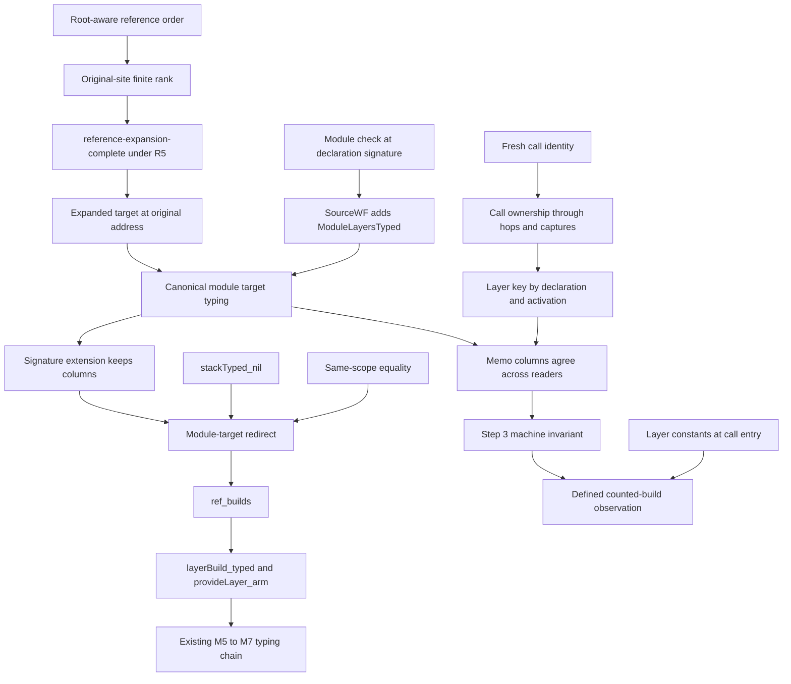

# Proof support for shared and per-call layers

The design keeps the sole `Eff` representation.
The module layer list belongs to the existing definition block.
The source paths, reference expansion, live addresses and runtime points still name distinct observations.

Reviewed source: `41ec1e0c`.
Design: `docs/research/2026-10-10-layer-scopes.md` at that commit.
Ruling: decisions row 341, including its block-child choice and slice order.
This document proposes obligations; it proves none.

## 1. Shared module layers need declaration-site typing

`SourceWF` in `src/Effect4/Laws/Program/Typed/Admission.lean` currently holds only reference formation and `BodiesTyped`.
`ref_builds` and `layerBuild_typed` in `src/Effect4/Laws/Program/Typed/LayerArm.lean` receive reference formation alone.
The current reference hop uses equal lexical parameter contexts.
A body-to-module hop deliberately crosses those contexts.

Add `ModuleLayersTyped` to the proof-side source evidence.
Discharge it from the new module-layer check in `sourceWF_of_typeOf`, in `src/Effect4/Laws/Program/Typed/Assembly.lean`.
Thread it through `provideLayer_arm`, `layerBuild_typed`, `ref_builds`, and their body consumers.
Keep the final admitted-program guarantee unchanged.
Do not leave the new premise assumed at the M7 boundary.

The transport splits into two cases:

- A same-scope target uses the existing scope equality.
- A module target uses its declaration-site typing and signature-extension agreement.

A target's expansion checks at the module typing signature before it checks at any caller signature.
`stackTyped_nil` then admits the target's inactive parameter stack.
The target's service, answer and error columns remain those of its declaration.

The negative control in `Probe.lean` uses a layer whose effect runs parameter zero.
It checks under one caller signature and refuses under the source signature.
Copying a term into a caller therefore cannot supply declaration-site typing.
The closed positive control checks alike at both signatures.

## 2. Keep the existing reference-expansion proof

Use the proposed reference order in the existing finite-rank argument.
Rank the original reference sites.
Do not rank only the remaining references: a diamond can increase their count during expansion.
Prove the comparator's strictness, transitivity and the target-extension fact consumed by `target_refs_prior`.

Recognize module paths only when the root is a definition block.
The implementation draft already applies this guard.
The `handlerBackward` and `handlerForward` controls retain the ordinary meaning of child `2` under `matchCause`.

Keep the existing theorem's placement.
`expanded_refs_nil_of_wf` in `src/Effect4/Laws/Program/ReferenceExpansion.lean` carries requirement R5.
Its registry claim is `reference-expansion-complete`, with role `substitution`.
R4 is a typing consumer; the design table's R4 label does not replace R5.

The expansion-address connector needs an exact premise and conclusion.
At a module target's original path, extracting from the expanded root must return that target's own expansion.
A copied occurrence has a different source relationship.
Do not identify those two addresses in the editor or proof.

## 3. Call identity needs a separate invariant

`StackTyped` types program arguments.
It does not establish which dynamic call owns a frame.
`stackTyped_nil` accepts every stack when the parameter list is empty.
Plain calls retain the parameter stack in `suspendBodyAt`, in `src/Effect4/Program/Compile.lean`.

Allocate a fresh identity on each executed `call` and `invoke`, including zero-parameter calls.
Keep it through ordinary continuations, forks, loop iterations and finalizer captures.
Restore the caller's identity when a passed program runs.
Use a module target's path alone for its memo key.

| Execution | Required identity relation | Control |
| --- | --- | --- |
| Two sibling calls of one definition | different identities | Equal source body, overlapping provides |
| One call site repeated by a loop | different identities | Same source call path, two executions |
| Recursion | different identities | Nested calls of the same body |
| Two layer uses within one call | one identity | One active body, repeated reference |
| Loop iterations within one call | one identity | Layer declaration allocated at call entry |
| A passed program executes | caller identity | Argument captured before the callee's frame |
| A delayed finalizer runs | captured identity | Caller body already returned |
| A child fiber runs | inherited identity until a new call | Fork before and after a call |
| A module layer is read | path-only key | Readers in different bodies |

A source call path, body index or stack depth is insufficient.
Opaque identities still affect sharing through their equality.
Their absence from values does not prove equal observations.

The printed TypeScript constants must be allocated once at the definition's suspension entry.
That placement supports the proposed reuse across loop iterations within one call.
It does not describe a layer object constructed anew inside a loop callback.
Retain this distinction in the counted-build fixtures.

One object also does not imply one lifetime build.
The memo protocol can remove an entry after its last observer closes.
Use overlapping scopes when a fixture observes sharing, or state the retention premise.
Preserve private memo maps for `fresh` under the existing ruling.

## 4. Proof dependency graph

Reference expansion and runtime building have different dependency edges.
A module layer may call a definition that references that module layer.
Reference expansion can remain acyclic while the runtime waits for an unfinished memo entry.
This is a source-inspected shape, not a checked deadlock result.
The expansion theorem establishes no runtime progress property.

## 5. Placement of every proposed obligation

| Obligation | Concept and required property | Question, role, consumer | Reach and hypotheses | Not established | Unlock |
| --- | --- | --- | --- | --- | --- |
| Root-aware order and finite rank | `initial-algebras-folds`; reference expansion | Existing `reference-expansion-complete`, role `substitution`; `target_refs_prior` and `expanded_refs_nil_of_wf` | Generic operation alphabet, formed references, original reference-site rank | No typing, runtime acyclicity or progress | R5, then R4 admission |
| Expanded module target extraction | `initial-algebras-folds`; address correspondence under expansion | Helper of `reference-expansion-complete` and `denote-typed`; module target transport | Original module target, appropriate reference formation, no reference ancestor | No correspondence for arbitrary copied paths | R5 and the M5 layer proof |
| Module target typing transport | `residual-program-typing`; preservation | Helper of `denote-typed`, role `fundamentalProperty`; `ref_builds` | Module target checked at its declaration signature; signature extension agreement | No termination or host agreement | R4; M5 to M7 |
| Canonical memo columns | `store-typing`; memo-cell typing | Helper of `denote-typed`; `memoGet_implements` and `memoize_typed` | All readers use the same target's checked columns | No liveness or one-build lifetime claim | R4 and R5; shared layers |
| Call ownership and freshness | Proposed property under `residual-program-typing` and `store-typing` | Helper of `denote-typed`; future memo-key selection and machine invariant | Executed calls, parameter restoration, captured continuations, compatible worlds | No equal-observation theorem by identity opacity | R4 and R5; step 3 |
| Per-call printed identity | `translation-simulation`; equal observation on layer builds | Proposed named claim for DI-71's observation; printer admission of body layers | Declared placement fragment, overlapping scopes or explicit retention premise | Finite fixtures do not prove generic host agreement | R2 and R3 |
| First fault location | `initial-algebras-folds`; located refusal | Proposed R14 helper; `Api.explain` and source diagnostic placement | `firstRefFault = some (site, target, why)`; prefix of earlier reference sites has no fault | No type preservation or runtime claim | R14 |
| Structured tool refusal | `initial-algebras-folds`; exact serialization | Reuse generated `Canonical TypeRefusal` laws; tool and rendering projection | Full refusal carrier; original snapshot identity supplied by its enclosing answer | Summary text alone remains lossy | R14; tool authoring |

The proposed claims need registry placement before production proof work.
The generated codec already supplies retraction and exactness.
No extra representation or duplicate proof family is proposed.

## 6. Smallest next slices

Follow the ruled order: located refusals, shared module layers, HO-3, then per-call layers.
Keep the richer tool projection as a separate small tool change.
Add its data consumer before proving another serialization theorem.

For shared layers, place the module typing predicate and its admission constructor first.
Then migrate the reference rank and discharge the target transport.
Keep the same-scope proof as the positive control.

For per-call layers, state the identity invariant before changing the memo key.
Exercise zero-parameter calls and parameter restoration before adding printer support.
Keep full host behavior claims separate from the finite counted-build controls.
