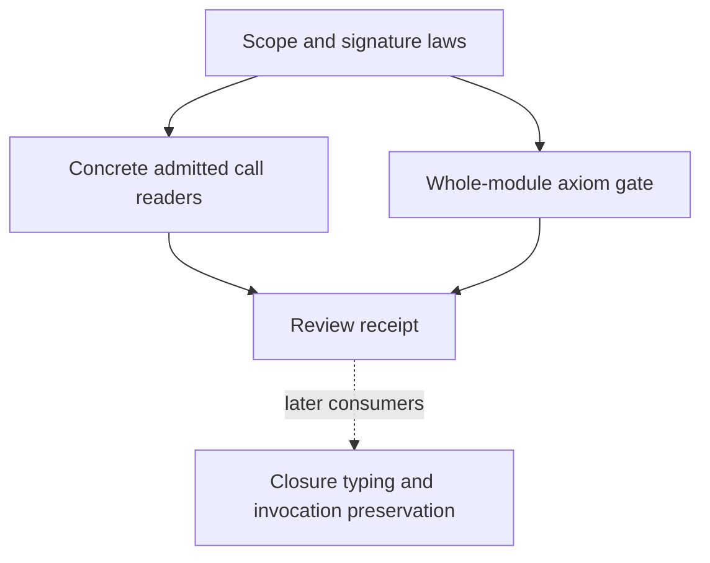

# CX1a landed-scope review

Review `f00008eeaef00b67fe93cfd0327754c9f42694ee` without changing production files.
The prior review is `ddab43db64c83bac44f0b83a952989825ae6aa43`.
It already records the layer-reference context issue and the corrected outer-domain premise.

## Claim and finish criteria

Check the landed scope lookup laws and `Signature` helpers against concrete checked invocation programs.
Reproduce the narrow build and audit every declaration of `Effect4.Laws.Program.Typed.Scope`.
Retain positive readers, a missing-premise control, and a malformed-address control.
Distinguish scope lookup from node existence and dynamic closure typing.
Record new evidence and changes to outstanding findings.
Keep Claude's primary worktree and active session unchanged.

## Proof placement

No production theorem changes in this review.
Each reader serves `denote-typed` under `residual-program-typing`, requirement R4.

| Reader | Consumer | Reach and premises | Limits | Unlock |
| --- | --- | --- | --- | --- |
| Scope at bodies and children | `call_arm`, `invoke_arm`, `pointTyped_child` | Valid node lookup; declaration lookup; non-block premise for arbitrary suffixes | No claim for redirects into shared layers | Ordinary body and child typing |
| Parameter row lookup | `param_arm` | Outer operation outside the domain; extended operation admitted; matching parameter index | No execution or progress result | Read declared parameter columns |
| Typing signature agreement | Row and service arms | The operation has no parameter index, or the field stays unchanged | No host execution claim | Reuse outer row and service evidence |

The existing forwarding and fork controls provide finite machine observations only.
The changed module imports no target printer or external runtime.
This review therefore reaches no outside-implementation behavior gate.
CX1b and CX2 remain work in progress.

## Memo-table migration probe

Check a layer inside a definition whose body calls a passed program.
Concept: `store-typing`; property: a memo entry's declared columns.
The helper is `LayerCellTyped`; its consumers are `memoBuild_world`, `memoGet_implements`, and `memoComplete_implements`.
These support `step-loop-preserves` through `StoreImplements` and layer memoization.
The observation is the program typing checker's verdict on one layer under two signatures.
The control also checks whether the old cell condition constrains that layer.
The probe uses a root accepted by the program typing checker, a fixed layer address, and the actual landed cell predicate.
It proves no failure of the completed runtime or future typed-run proof.
It identifies one stored-state consumer that CX1b must migrate consistently, serving R4 and M6.

## Retained cleanup control

Concept: `residual-program-typing`; property: typed captured cleanup.
Consumers: `acquireIn_typed`, `CaptureTyped`, `finalizerAdmitted_mono`, `capture_release`, and `denoteFin_typed`.
The existing `denote-typed` claim reaches these consumers through finalization, serving R4 and M6.
The program acquires an external handle, invokes a cleanup registrar, then reads the handle after that invocation returns.
Its outer scope later runs the retained parameter program, which closes the captured handle.
The finite run fixes a budget and a fixture reply tape.
The program typing checker must refuse a wrong variable index; an unanswered close must remain a frontier.
This proves no arbitrary-world transport, fairness, lifecycle theorem, or agreement with an outside host.
