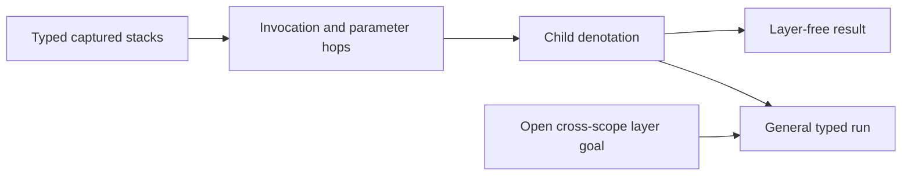

# CX2 landing review plan

Review `9e818b39596971d62b89299ca9ccc4e96ad8ea07` against `f00008ee`.
Keep production sources and Claude's active session unchanged.

## Finish criteria

Build the changed law modules in the isolated review worktree.
Audit their transitive proof dependencies with `#axiom_audit`.
Inspect the plan status of invocation, parameter hops, the layer-free fragment, and M7.
Check loop, generator, finalizer, and world-extension propagation independently.
Retain the shared-layer finding from the preceding packet without reporting it as new.
Record exact commands, commits, hashes, and limits.

## Placement

Concept: `residual-program-typing`; property: the fundamental elaboration property.
Question: `denote-typed`, role fundamental property, through `invoke_arm`, `param_arm`, and `childDenotes_upto`.
Consumers: `denotesTyped_of_layerFree`, `denotesTyped`, and `m7_proved`.
Reach: the unchanged hypotheses of the checked declarations at the pinned commit.
Limits: no progress, liveness, substitution theorem, or outside-runtime agreement.
Unlock: check the CX1/CX2 contribution to R4 and the M5 to M7 proof graph.
No new proof obligation or production theorem is added.

