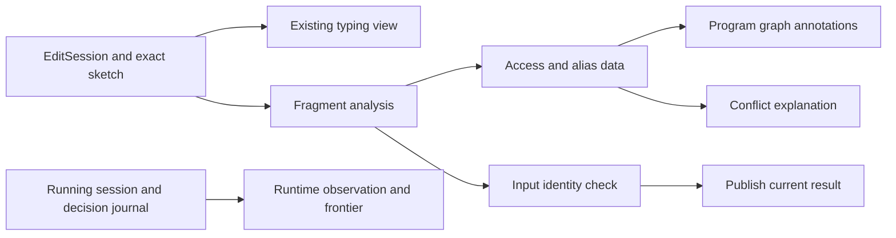

# Fragment and editor design

## Scope and vocabulary

A **phase** is one finite region of a program with allocation, leaf workers, joins, and a sequential continuation.
An **origin** is the program address of a cell allocation in that phase.
An **access occurrence** records an origin, operation class, worker, and program address.
A **summary** is derived analysis data about those occurrences and returned value shapes.
A summary is not stored program syntax or a second execution model.

The probe uses an empty application and an empty row table.
It starts from the ordinary load of one closed program.
It does not accept an arbitrary preexisting machine store.

## Author interface

Reuse `Api.author`, `Api.Typed`, and the existing Ref and fork builders.
The author supplies no resource IDs, disjointness lists, commutativity flags, or scheduler parameters.

The proposed production surface is:

```lean
-- Proposed API shapes, not landed declarations.
Api.Typed.scheduleAnalysis : Api.Typed [] → Except Schedule.Refusal Schedule.Analysis
-- After the theorem lands, retain evidence indexed by the exact program.
Api.Typed.checkSchedule : (p : Api.Typed []) → Except Schedule.Refusal (Schedule.Checked p)
```

Keep one analysis implementation behind both phases of that API.
Do not expose the probe's mutable-looking `State` as a public certificate.
During development, return analysis data with an explicit unproved evidence status.

The executable probe already has the corresponding seam:

```lean
DetProbe.analyze : Api.Typed [] → Except DetProbe.Fault DetProbe.State
DetProbe.inspect : NativeEff → Except DetProbe.InspectRefusal DetProbe.State
```

`inspect` retains the exact `Api.check` refusal.
`analyze` consumes exactly the program held by the typing certificate.
It has no separate program argument that could disagree with that certificate.

For example, the existing authoring builders suffice:

```lean
bind "r" (Ref.make (nat 0))
  (bind "left" (Forms.forkChildDefault
      (Ref.updateWith (var "r") fun x => app "add" [x, nat 1]))
    (bind "right" (Forms.forkChildDefault
      (Ref.updateWith (var "r") fun x => app "add" [x, nat 2]))
      (thenDo (joinNamed "left")
        (thenDo (joinNamed "right") (Ref.get (var "r"))))))
```

`thenDo` and `joinNamed` are local abbreviations in `Controls.lean`.
They introduce no new program constructor.

## The admitted program grammar

The following table defines the probe's boundary.
Ordinary program typing runs first.

| Position | Supported behavior | Restriction |
| --- | --- | --- |
| Sequential prefix | Pure terms and natural-valued cell allocation, reads, and updates | All cell allocations occur before the first fork |
| Fork region | A fixed list of non-daemon leaf workers | No immediate start, nested fork, or fork after the first join |
| Worker body | Pure terms, binds, suspension, explicit yields, and supported cell operations | No allocation, external row, time observation, race, interruption, loop, scope, or definition call |
| Worker answer | Unit, natural numbers, Boolean/string atoms, and binary pairs | No handle, including a handle nested in a pair |
| Join region | Root joins of known worker handles | All workers must be joined; parent cell access waits for every join |
| Sequential continuation | Pure computation and cell operations after joins | No further allocation or fork |
| Final answer | Ordinary data | No cell or fiber handle escapes |

The recognized term operations are `pair`, `succ`, `add`, and `mul` with checked arities.
Variables retain their abstract identity through binds and pure aliases.
Record operations, aggregate selectors, and term folds currently refuse.
These are conservative cuts, not claims that those operations cause nondeterminism.

The probe permits pure work between forks and joins.
It rejects parent cell access while any worker remains unjoined.
This rule can reject an access to a separate cell.
It gives the first proof one clear phase boundary.

## Access compatibility

Compare access occurrences in different workers.
Within one worker, ordinary sequencing fixes the order.

| Same cell origin | Read | General update or write | Recognized addition returning unit |
| --- | --- | --- | --- |
| Read | Accept | Refuse | Refuse |
| General update or write | Refuse | Refuse | Refuse |
| Recognized addition returning unit | Refuse | Refuse | Accept |

Different cell origins are compatible.
Aliases have the same origin even when their bound names differ.
A shared read-only cell can supply returned worker values.
A worker cannot read a cell that another worker writes.

For a private cell, the worker may compute updates and retain their answers.
For a shared cell, the accepted update family is `x ↦ x + k`, with a natural literal `k`.
The probe also recognizes `succ x`.
The operation returns unit, so it exposes no intermediate answer.

The intended shared law is an action of natural addition on one natural-valued cell.
Its proof must include both the answer and store components of the operation.
The equation for final cell values alone is insufficient.

The probe rejects reversed addition and captured addends, even when an author can prove them harmless.
A later normalization law can widen this family without adding a caller-supplied truth flag.

`NativeOp.refSet` currently answers the cell in this machine.
`DetProbe.row` follows that declared behavior.
`NativeOp.row` records the rc.112 difference as DI-98 in `src/Effect4/Program/Native.lean`.
This packet makes no TypeScript conformance claim.

## One analysis, several consumers

Use the generated `TermAlgebra` and `EffAlgebra` folds.
`Fragment.lean` uses `cata_term` and `cata_eff` through `EffAlgebra.ofLayer`.
Unknown constructors and operations refuse.

The probe's layer adapter matches generated constructor names.
For production, generate closed-profile coverage checks from the constructor inventory.
Keep those internal names out of the author interface.
Reuse the binder inventory for abstract environments rather than copying every construct's scope rule.

Keep these shared fields:

| Data | Consumer |
| --- | --- |
| Allocation address and abstract origin | Alias explanation and access grouping |
| Worker address and ordinary result shape | Join analysis and graph labels |
| Access address, origin, and mode | Conflict checks and editor links |
| First conflicting address pair | A located explanation with both causes visible |
| Binder-result provenance | Invalidation after an alias-producing edit |
| Exact input and policy identity | Reuse of a cached analysis |

Graph views should project these fields.
They should not rediscover accesses through another recursive program traversal.

## Typing, rejection, and evidence

Use distinct judgments and display states.
A fragment refusal never changes the program's ordinary type.

| State | Meaning | Suggested editor text |
| --- | --- | --- |
| Typing refusal | The existing checker refuses the program or sketch | Show its original path and reason |
| Body summary needed | A typed hole lacks behavior information | “Type checked; fill this body to check its accesses” |
| Outside fragment | The program types, but this analysis cannot accept its behavior | Show the unsupported construct or conflict paths |
| Analysis passed | The executable fragment check accepts | “Fragment check passed; general proof not yet connected” |
| Certified result, later | A theorem applies to this exact input and decision profile | State the observation and permitted schedules |
| Stale response | The response describes an earlier input | Hide the result and request fresh analysis |

Do not label every conflict refusal a counterexample.
A conservative rule can refuse two writes that happen to assign the same value.
Likewise, an unsupported construct need not cause schedule dependence.

`LiveView.classify` keeps these distinctions executable.
It conservatively defers every nonempty hole table, including unused declarations.
Production should inspect reachable hole calls, so filling the last used hole can restore analysis.
`Sketch.fillAt` intentionally keeps old hole declarations.
Deleting those declarations to satisfy this probe would be the wrong repair.

A hole's type does not constrain its future accesses enough for the fragment.
Later contextual summaries can state those behavioral assumptions explicitly.
Do not infer them from answer, error, and requirement types alone.

## Editor identity and invalidation

Use the existing `EditSession.open`, `feedStep`, and `view` face.
Use `Tools.Session.Snapshot` as the cache pattern.
It compares both canonical byte strings of `Sketch.encode`.
Its `Cache.Valid` and `resolve_agrees` make the cache's premise explicit.

Bind analysis to the exact program bytes, hole bytes, typing signature of the application, and policy.
Also carry session generation and revision through asynchronous publication.
A request correlation ID is not a revision identifier.

The live probe fixes the application to `{}` and the policy to version one.
It checks program changes, hole-table changes, revision changes, generation changes, and policy changes.
Each mismatch hides the stale result.
These guards are finite checks, not an authenticated cache or concurrency proof.

An analysis digest alone cannot identify a program.
`success 1` and `success 2` have the same empty access metadata.
Their canonical program bytes differ.
Use full input equality or a separately justified identity mechanism.

The checked alias edit is:

```text
before: allocate r; allocate s; let a = r; fork write a; fork write s; join both
 after: allocate r; allocate s; let a = s; fork write a; fork write s; join both
```

Both programs have the same type.
The edited address is `[1, 1, 0]`.
`EditSession.feed` splices the typing table at that address.
The unchanged continuation now aliases the same cell twice.
Fresh fragment analysis refuses it.

Initially recompute the enclosing phase after an actual edit.
Later reuse must track abstract environments, binder results, worker membership, join context, referenced origins, and callee summaries.
`EditSession.feed_repaint` does not establish locality for those dependencies.

## Performance and graph presentation

The reference conflict check compares all cross-worker access pairs.
Its worst-case cost is quadratic in the number of access occurrences.
Index by origin to avoid comparing different cells.

`Tools.Graph.Index.ofList` and `bucket_ofList` already supply stable occurrence buckets.
Use them in the tooling adapter, which may import both core summaries and graph tools.
Do not import `Tools.Graph.Index` into core.
Keep the reference checker while proving the indexed result agrees with it.

Retain occurrence ranks when selecting the first conflict.
Grouping alone can change which explanation the editor displays.
Measure comparisons, allocations, and elapsed time before claiming an improvement.
The probe also uses list append for paths and environments.
It makes no claim that the entire analysis is linear.
No speedup is measured in this packet.

Show allocation nodes, worker nodes, and access links through existing program paths.
Highlight both conflicting operations and their shared allocation.
Show a join barrier separately from a data-dependency edge.
Do not draw a possible access as an executed event.

Keep the editable program graph and a running session graph distinct.
A run retains its input program, stores, decisions, and frontier.
An edit creates a new candidate program.
This analysis does not migrate an existing run or reinterpret its handles under the new program.



## Modules and later widening

Do not require authors to inline modules permanently.
The later module summary should be parameterized by abstract argument origins and ordinary result shapes.
Instantiation must follow the current lexical scope and captured environment.

Connect that summary through the planned context-substitution and unfolding laws.
A module's ordinary type does not establish its access summary.
Leave Claude's CX and module-layer ownership unchanged.

Later slices can add bounded loops, scoped resources, and promise dependencies.
Each needs its own summary composition and machine connector.
Finalizer accesses participate in conflicts and keep state produced before failure.
A failure-free first fragment cannot justify dropping that rule later.
