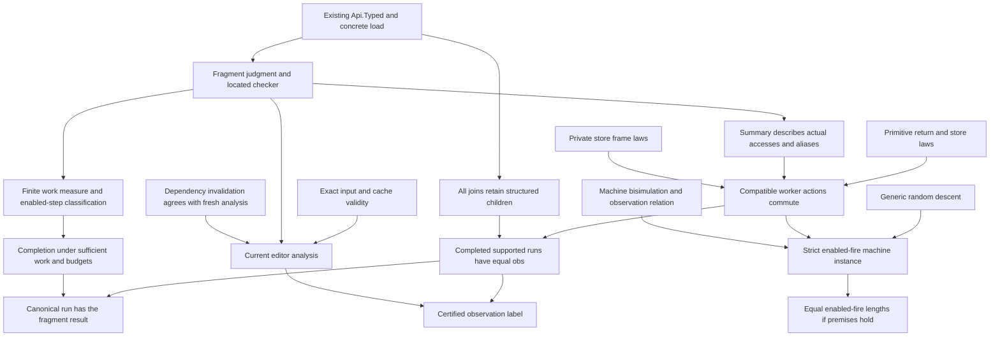

# Proposed obligations and proof graph

## Evidence boundary

This document places future statements.
It adds no production goal, theorem, registry claim, or authority ruling.
`PLAN.md` records placement before the executable probes.

The generic random-descent proof is reproduced from the reviewed note.
Its statements remain unchanged.
The fragment and editor probes are computations without a general semantic theorem.

The proposed claims `schedule-independent` and `analysis-view-consistent` need registry placement before production proof work.
Add the corresponding required property to `semantics.md` in that landing.
Do not attach the new work to an unrelated proved node merely to obtain a green status.

## Statement boundaries

Define a fragment judgment over the existing `Eff`, its abstract environment, and its analysis result.
Its derivation is evidence about that program, not another executable program.
State the judgment independently of the executable Boolean or result.
The executable analysis should decide this judgment by located refusal.

Use a proof-only predicate for funded executions of the existing machine.
It relates the ordinary load, initial evaluation, and subsequent enabled fire decisions.
It keeps each sufficiency receipt.
It does not define another machine interpreter.

The first result statement has this shape:

```text
fragment_observations_agree
  (checked : Api.Typed [])
  (accepted : analyze checked = ok summary)
  (left  : FundedFireExecution checked.program initial finalLeft)
  (right : FundedFireExecution checked.program initial finalRight)
  (leftFinished  : finalLeft.finished = true)
  (rightFinished : finalRight.finished = true) :
  Machine.obs finalLeft = Machine.obs finalRight
```

`initial` is the same ordinary load under the fixed empty application.
All executions use the concrete `Program.evaluatorFor` and `Program.interpOf`.
`Machine.obs` retains every fiber exit and the full store.
This statement excludes trace equality, callback counts, external replies, and arbitrary initial stores.
It also leaves completion open.

Explicit program yields are part of the fragment.
Externally inserted preemption verdicts require a separate execution relation and extension statement.
The finite controls include them, but do not prove that extension.

An unfinished tape or insufficient budget remains a live frontier.
It is not a contrary observation and not a typing refusal.
Tape exhaustion permits further decisions.
Fuel exhaustion requires replay with more fuel or a separately retained continuation.
The public decision boundary does not retain the full driver remainder.
`docs/core/machine-state.md` states that distinction.

For the strict random-descent application, define enabled fire as a transition with an actual armed owner.
Require a live machine, an existing owner, and sufficient command budget.
A disabled raw `.fire` is not a transition of that relation.
Do not map insufficient fuel to `none` and then classify the state as terminal.

The strict application additionally owes:

```text
Equivalence R
RD.Bisim enabledFire R
RD.Diamond enabledFire R
R a b → a.finished → b.finished → Machine.obs a = Machine.obs b
```

`RD.complete_unique` then gives equal observations and equal enabled-fire lengths at terminal endpoints.
A separate classification must connect terminal endpoints to finished runs or named frontiers.
The fragment result need not wait for this stronger length theorem.

## Dependency graph



## Five-point placement

All claims below are proposed unless a source is explicitly described as existing.
A helper names its consuming node.

| Node | Concept and required property | Question, role, and consumer | Reach and premises | Does not establish | Requirement |
| --- | --- | --- | --- | --- | --- |
| `fragment_explain_exact` | `reactive-scheduling`; executable fragment judgment | Helper of proposed `schedule-independent`; consumed by `fragment_summary_sound` | Existing typing certificate; exact finite-phase grammar; located rejection agrees with that judgment | Refusal is not a proof of schedule dependence | R14 |
| `fragment_summary_sound` | `reactive-scheduling`; proposed access noninterference | Helper of `schedule-independent`; consumed by `worker_actions_commute` | Abstract origins agree with loaded cells; supported terms and operations; aliases follow binds | No result equality from metadata alone | R12 fragment |
| `private_access_frame` | `store-typing`; proposed store separation connection | Helper of `schedule-independent`; consumed by `worker_actions_commute` | An access affects only its allocated origin; other origins remain available | No commutation of returned answers by itself | R12 fragment |
| `addition_answer_store_commute` | `reactive-scheduling`; proposed operation commutation | Helper of `schedule-independent`; consumed by `worker_actions_commute` | Same natural cell; literal additions; both answers unit; atomic `refStep` | No returned update answers, clock, or other effects | R12 fragment |
| `worker_actions_commute` | `reactive-scheduling`; proposed local independence | Helper of `schedule-independent`; consumed by `fragment_observations_agree` | Compatible cross-worker accesses; fixed leaf workers; concrete evaluator | No arbitrary command diamond or generic evaluator result | R12 fragment |
| `fragment_observations_agree` | `reactive-scheduling`; proposed equal final observation | Top statement of `schedule-independent`; consumed by the certified analysis face | Same checked program and ordinary load; funded supported executions; both finished | No trace equality, termination, fire-count equality, or external runtime simulation | R12 fragment; stronger result beside R13 |
| `fragment_finishes` | `reactive-scheduling`; finite enabled execution classification | Proposed termination part; consumed by `fragment_run_agrees` | Finite bodies and joins; no outside waits; decreasing work; sufficient budgets and continued enabled scheduling | No infinite preemption policy, fairness theorem, or host response guarantee | R12 fragment |
| `fragment_run_agrees` | `translation-simulation`; canonical driver connection | Helper consuming result equality and completion; used by the application face | `flush` expands to permitted funded fires; concrete canonical run finishes | No equality of raw tape lengths or wall time | R8 and R12 fragment |
| `fragment_preemption_agrees` | `reactive-scheduling`; proposed preemption extension | Later helper of `schedule-independent`; consumed by a wider policy label | Concrete safe points; admitted preemption verdicts; finished funded runs | Finite controls do not establish arbitrary preemption | Later R12 fragment |
| `enabled_fire_replay` | `translation-simulation`; replay connector | Helper of strict RD instance; consumed by `fire_bisim` and `fire_diamond` | Armed existing owner, live state, sufficient fuel, per-step receipts | No disabled fire or fuel-cut terminal state | RD application |
| `fire_bisim` and `fire_diamond` | `reactive-scheduling`; strict random-descent premises | Helpers of strict RD instance; consumed by `RD.complete_unique` and `RD.bounded` | Equivalence relation with one-step matching and the 0/0 or 1/1 diamond | General confluence or a final-store equation is insufficient | Optional stronger fragment result |
| `analysis_snapshot_agrees` | `initial-algebras-folds`; cache compatibility | Helper of proposed `analysis-view-consistent`; consumed by result publication | Exact sketch, application, policy, generation and revision; valid cached result | No theorem about schedules or concurrent publication machinery | R14 |
| `incremental_analysis_agrees` | `initial-algebras-folds`; analysis-view consistency | Helper of `analysis-view-consistent`; consumed by incremental updates | Complete invalidation dependencies and valid prior summaries; equality with fresh analysis | A typing-table splice alone does not suffice | R14 |
| `indexed_conflicts_agree` | `initial-algebras-folds`; explanation compatibility | Helper of `analysis-view-consistent`; consumed by the tooling index | Same origin buckets and occurrence ranks; exact first refusal | No machine behavior or measured speedup | R14 |
| `promise_dependencies` | `reactive-scheduling`; finite progress extension | Later helper of `fragment_finishes` | Unique producer, guaranteed production, program order and await edges; acyclic event rank | Single writer alone does not guarantee completion | Later R12 fragment |

## Existing proof structure to reuse

| Existing declaration | Source | What it contributes | Missing connection |
| --- | --- | --- | --- |
| `LawfulArena.peek_poke_other` | `src/Effect4/Laws/Machine/Arena.lean` | Other-cell reads survive a write | Instantiate actual origins and operation answers |
| `put_get`, `put_put` | `src/Effect4/Laws/Program/StoreComodel.lean` | Store equations for the concrete comodel | Distinct-cell commutation and answer relations |
| `Step.frame`, `frame_read` | `src/Effect4/Laws/Step.lean` | Untouched fields retain their values | Reads are also dependencies; write sets alone do not suffice |
| `step_updates`, `step_keeps_cell` | `src/Effect4/Laws/Step/Store.lean` | Atomic update and cell typing facts | The addition family's answer-and-store commutation |
| `replayEval_append`, `Suffices` | `src/Effect4/Laws/Machine/Approximation.lean` | Replay composition and budget premises | Enabled-fire relation and canonical driver expansion |
| `EditSession.reached_view`, `feed_repaint` | `src/Effect4/Laws/Program/Edit.lean` | The typing view and its repaint relation | Behavioral-summary invalidation |
| `Snapshot.resolve_agrees` | `tools/Tools/Session/Snapshot.lean` | Exact-input cache compatibility under `Valid` | Corresponding validity for analysis results |
| `Index.bucket_ofList` | `tools/Tools/Graph/Index.lean` | Stable occurrence filtering by key | Exact conflict ordering after grouping |
| `Walk.read?` | `tools/Tools/Graph/Path.lean` | Checked composable paths with endpoints | Derive actual dependency edges from program events |

The M5, M6, and M7 chain establishes typing properties.
Schedule independence neither replaces that chain nor follows from it.
Reuse the typed load and step invariants when constructing the fragment's reachable-state relation.
Do not broaden their existing claim by renaming a premise.

## Promise extension

`PromiseControls.cycle` has one writer per promise.
Both writers wait for the other's result before producing their own.
The machine remains unfinished with no armed owner.

`PromiseControls.handshake` publishes one result before waiting.
It finishes under the tested run.
A worker-level dependency graph can show a cycle in both examples.
An operation-event graph distinguishes them through program order.

Derive producer, await, and continuation events from the existing folds.
Keep unresolved targets explicit.
A supplied topological rank must check every edge and every referenced event.
Prove the graph extraction and producer obligations before using its acyclicity for machine progress.
The current rank probe uses supplied edges only.
