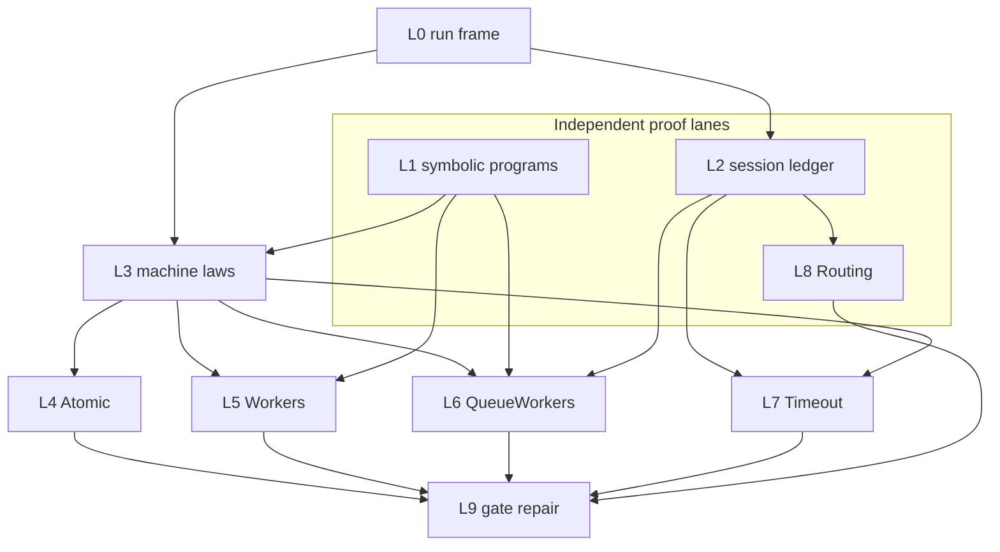
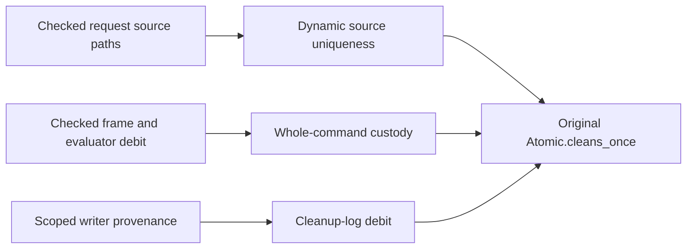

# The final scenario goals

The implementation starts at `b74ebab6f2b3f39f0c60d04b25014488b274f197`.
The working branch is `codex/last-planned-goals`.
This plan records checked evidence, proposed placements, and the owner-approved timeout amendment.

## Finishing criteria

Each original scenario proposition has a proof, or a retained counterexample with an explicit unresolved decision.
No proved claim depends on a planned goal.
Every helper serves a named scenario clause or registered property.
Every landing passes its narrow build and `#axiom_audit`.
The final gate pass checks every changed behavior and repairs affected imports and reports.
No work is pushed.

## Theory and ownership

The run frame belongs to `host-session-protocol`, requirement R13.
The proposed claim `run-history` has role compatibility and points to `Run.reached_history`.
Its module is `src/Effect4/Laws/Run/Frame.lean`.
`Run.Keeps.reached` and its row induction serve that claim and the session key ledger.
`HistoryOf` uses `Machine.Lift.Admitted` over the existing machine.
It retains reply admission at the program's call table.
A control history has no direct answers. Arbitrary script rows still pass session admission.
These laws carry supplied invariants. They establish no progress or host implementation claim.
The consumers are the thirteen scenario clauses over scripts, under R4 through R13.

The central machine work follows `docs/core/semantics.md` concept 4.
Its proof technique uses trace invariants and interference checks, as the Owicki and Gries connection describes.
`Machine.Lift` already owns induction through commands, decisions and histories.
`Book` already owns transfer between the frame and reference machines.
A new law must use those owners and give its consumer.

## Landing order

The Workers comparison selects shared command laws and program-specific assertions at every command boundary.

| Landing | Modules and result | Narrow build and audit |
| --- | --- | --- |
| L0 | `Effect4.Laws.Run.Frame`, shared scenario adapter, one frame for all families | Build both modules, audit both |
| L1 | `Effect4.Laws.Api.AuthorBuild`, `Test.Dogfood.Scenario.Programs`, symbolic crew equations | Build both modules, audit both |
| L2 | `Effect4.Laws.Run.Journal`, session key uniqueness and tape ending | Build Journal and its scenario reader, audit both |
| L3 | General machine step laws selected by the Workers comparison | Build new law modules and actual consumers, audit each |
| L4 | Store write discipline and Atomic invariant | Build the support module and Atomic, audit each |
| L5 | Workers control positions and release accounting | Build the support module and Workers, audit each |
| L6 | Queue wrapper segments and one crew invariant | Build Queue law and support modules, then QueueWorkers, audit each |
| L7 | Correct timeout race and one fetch invariant | Build P1HttpCache, support modules and Timeout, audit each |
| L8 | Routing segment proof and call provenance | Build Routing support and Routing, audit each |
| L9 | Gate repair and generated proof graph | Run only the checks reached by the landed changes |

## Decisions and evidence

| Question | Recommendation | Current evidence |
| --- | --- | --- |
| Timeout race | Follow the timeout form's returned failure and retain the four-attempt bound. The owner approves this amendment. | Both Lean and rc.112 probes refute the original host-reply premise. The runtime probes include controls without forced yield. |
| Cleanup premise | Preserve the existing proposition. Use session-admitted history in its proof. | The scenario already passes every raw row through session admission. |
| Stale reply provenance | Preserve clause four. Prove provenance separately from key uniqueness. | `ending_of_tape` does not imply the original clause. |
| Routing budget | Preserve the current budget unless a checked necessity requires a ruling. | The larger generic sufficient bound alone proves no necessity. |
| Unauthorized scripts | Preserve every script. | A restriction would weaken the proposition. |
| Symbolic job count | Preserve every job count. | The symbolic-program lane checks and replaces the stalled probe. |
| Shared machine structure | Reuse command induction and prove program-specific assertions at every command boundary. | Both Workers probes compile. Cuts and forced yields defeat the ordinary resting table. |

## Deferred gates

No behavior gate runs before the major proof structures land.
Pure law modules change no executable behavior.
Root import closure, semantics regeneration and scenario control repairs follow their structure landings.
A timeout form change reaches `check-truth`, `check-target`, `check-compiler`, `check-native` and `check-ocaml`.
The receipt records each actual command and result.
The whole battery and whole-tree axiom gate remain owner-triggered sweeps.

## Current checked evidence

`LEAN_NUM_THREADS=3 lake build Effect4.Laws.Run.Tape Effect4.Laws.Program.Guard.Core ProofGraph.AxiomAudit Test.Dogfood.Scenario` passes.
The build reports 1025 jobs.
`LEAN_NUM_THREADS=3 lake build Effect4.Laws.Run.Frame Test.Dogfood.Scenario.Frame` passes with 1020 jobs.
`AuditFrame.lean` audits 107 declarations within `[propext, Quot.sound]`, with no planned goals or dependencies on goals.
The fixture checks that a direct answer as a raw session row keeps the machine unchanged.

The machine lane compiles both Workers probes at one job.
A fuel cut leaves a non-resting state.
A forced yield leaves a resting state with a delayed entry.
The selected route combines shared command laws with assertions at every command boundary.
A table restricted to ordinary resting states cannot cover the existing propositions.
This finite probe selects proof structure. It proves no scenario invariant.

## Atomic proof placement

`Program.HeapSites.heap_sites_keep` states the proposed `cell-invariant-from-write-sites` claim.
Its concept is `store-typing`, its role is soundness, and its requirement is R4.
The write-site premise covers each `perform` at its source address and binder level.
Its reach is every control history of a built program, with any compile budget.
It establishes no progress, multi-cell relation or outside runtime behavior.
Its consumer is the original `Atomic.bounded` proposition.

`Atomic.Store.shop_stages` is a step of the `atomic` claim, under `store-typing` and R4.
Its consumers are the original `Atomic.counted` and `Atomic.committed` propositions.
The premise is a successful build of the shop and a control history.
The stage assignment relates request outcomes and the stores; it establishes no progress.
Its existence remains a planned obligation until code-position and store preservation are proved.
The extracted program, scripts, observations and original propositions remain unchanged.

## Worker release placement

`Workers.Assertions` serves the original `Workers.releases_once` clause, under `scope-lifetime-finalization` and R11.
Its source facts hold for every job count and identify the two acquisition paths.
It counts registrations, release starts and log writes separately.
Its reach includes every budget, script, yield and interruption admitted by the session.
It proves no progress or release order.
The original clause follows from three preservation goals through the shared history law.
The general release proof needs custody across scope entries, active close code and the registration continuation.
The scope's `close_twice` law alone cannot supply that custody.

## Source position cautions

The packet's suggested raw-point level invariant needs a name-specific statement.
`EffName.gen` keeps the generator root path while its environment advances with a separate program counter.
The relevant source address includes that counter; the raw point alone does not locate the active statement.
`PointTyped` retains source typing but does not assert unique dynamic use of a source site.
The existing typed capstones do not supply native source ownership for table-aware, variable-budget histories.

## Owner ruling: timeout retries

The owner selects the source-aligned contract on 2026-10-11.
A retry follows a declared failure returned by the completed timeout form.
The four-attempt bound remains.
The applied host reply does not determine which entrant wins the timeout race.
The retained decision note is `codex/timeout-contract-decision.md`.
Its host probe checks rc.112 with tsgo `7.0.0-dev.20260629.1` and Bun.
It uses a controlled callback timer, not a physical clock or the exponential delay.
The canceled-waiter defect of the old timeout form remains a separate repair.

## Routing call-prefix structure

The source tree's token check now compiles for every request and every admitted reply tape.
`Routing.Calls.tree_needs_token` proves this check without a planned goal.
`Run.CallTree.bound_in_tree` states the remaining connection from recorded bindings to tree waits.
Its concept is translation-simulation, R6; its proposed registry claim is `recorded-call-tree-prefix`.
It serves the original `Routing.unauthorized_calls_nothing` clause at its unchanged script scope.
The generated fold supplies the no-cause-handler test.
The connection adds no progress, fairness, fork, scope, or outside-host claim.

`lake build Test.Dogfood.Scenario.Routing` passes with 1042 jobs.
The landing audit reports 139 declarations, three modulo declarations, and one planned goal.
The original infrastructure clause is proved; the authorization clause rests on `bound_in_tree` alone.

## Atomic cleanup placement

`Atomic.Cleanup.cleaned` serves the unchanged `Atomic.cleans_once` claim under R11.
Its source placement check identifies all six request paths in the admitted shop.
`Program.FinalizerRun.funded_reachable` carries registration custody through the native run.
`Program.FinalizerRun.once_placed_pushes_once` connects a static once-placement to dynamic pushes.
`Atomic.Cleanup.log_debits` connects each logged identity to its own finalizer starts.
The three obligations establish different properties and remain separate in the proof graph.
They cover the original scripts and budgets and establish no progress or host behavior.

## Whole-run finalizer custody

`Program.FinalizerRun.funded_reachable` now proves the custody obligation in place.
The proof covers every native command and all decision edits through `Machine.Lift.machineFact_stepDecision`.
The existing fork-ledger invariant supplies distinct fiber identities.
The accounting includes frame finalizers, reified finalizer programs and native scoped exits.
The selector and program remain arbitrary; the proof assumes no admission, fairness or sufficient budget.
It establishes no unique source use, log-writer provenance, progress or outside behavior.

The remaining dependencies of `Atomic.cleans_once` are source uniqueness and cleanup-log provenance.
`codex/FinalizerRunAudit.out` records the checked statuses and their exact statements.
The narrow build covers `Program.FinalizerRun` and its Atomic consumer.
Superseded replacement helpers leave the tree when the complete command proof replaces them.

## Behavior pass after the structures

The first gate repair lands at `d585fdb50`.
The custody and timeout source slices land at `7d2511cfa` and `dd7dedb93`.
`codex/behavior-pass-receipt.md` records the generated OCaml refresh and every affected behavior gate.
All those gates pass; the timeout host comparison retains its explicit missing readers.
The universal source-state and custody obligations remain open and keep their scenario consumers.

### Scheduler custody closure

`ReleaseCustody.Execution.outer_custody` is proved in place from the explicit native command contract.
Its direct worker consumer compiles. The audit leaves one planned goal in `Execution`: `command_custody`.
The retained proof and audit are in `codex/CustodyOuter.lean` and `codex/CustodyOuterAudit.out`.
The receipt is `codex/CustodyOuterReceipt.md`.

### Scope-credit transfer closure

`ReleaseCustody.ScopeTransfer` proves every native synchronous store-credit bound and the exact registration response split.
It also proves administrative fiber-linkage accounting and state-first close transfer.
`Machine.ScopeIdentity.syncOpStep_keysFresh` shares the existing freshness census with `Simulation.Hooks`.
The reader and premise controls compile. The narrow audit reports no planned-goal dependency.
Evidence: `codex/ScopeTransferReceipt.md` and `codex/ScopeTransferAudit.out`.

### Command correlation control

`codex/CustodyCommandControl.lean` compiles and refutes the unrestricted internal command contract.
It does not refute an original application statement or an admitted run.
`codex/CustodyLiftReceipt.md` records the missing command and saved-frame correlation.
Retain the existing Guard ownership and token relations when repairing this internal premise.
The checked scheduler proofs now live below execution assembly in `ReleaseCustody/Lift.lean`.

The refuted internal command goal is removed from the active proof graph.
`ReleaseCustody.Execution.history` now states the remaining obligation on actual admitted histories.
Workers' release-step assembly keeps its original statement and extends that history before reading the bound.
The checked local proofs remain; the replacement command decomposition must retain saved-frame and resume correlation.

### Applied receipt observation

`HostAppliedObservation.applied_body_seen` proves the observation reader required by timeout value flow.
Every successful applied receipt appears as an answered HTTP call in the current fetch observation.
The theorem covers every script and imposes no move restriction.
`codex/HostAppliedObservationReceipt.md` records the build and the audit, with no planned dependencies.
The native returned-body invariant remains separate and open.
