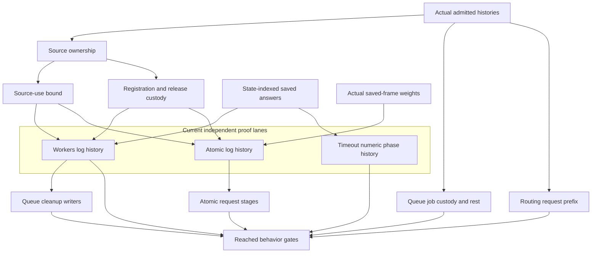

# The final scenario goals

The shared histories, registration bounds, and release accounting now serve the original scenario claims.
The concrete writer, application-stage, timeout, and routing-prefix obligations remain open.
`codex/GoalStatus.out` records their checked dependencies through the Queue cleanup source landing.

Base: `b74ebab6f2b3f39f0c60d04b25014488b274f197`.
Branch: `codex/last-planned-goals`.
The previous plan and chronological evidence remain at `git:6dd60c882:docs/research/2026-10-10-goals-packet/PLAN.md`.
Each retained receipt below gives its commands, audit, placement, and limits.

## Finishing criteria

Prove each original scenario proposition, unless a retained counterexample requires an unresolved owner ruling.
A proved claim must depend on no planned goal.
Keep every helper on a path to a scenario clause or registered property.
Build each landing narrowly and run `#axiom_audit` over its modules.
Repair reached behavior gates after the major structures land.
Preserve the original statements except for the approved timeout amendment.
Commit explicit paths and never push.

## Checked endpoints

The statuses below come from `codex/GoalStatus.lean`, run through `lake env lean`.
The reader reports nine next planned goals.
It does not measure completion of the wider semantics.

| Original proposition | Checked status | Remaining dependency |
| --- | --- | --- |
| `Workers.releases_once` | modulo | `Workers.Assertions.logs_step` |
| `QueueWorkers.releases_once` | modulo | `QueueWorkers.Assertions.logs_history` |
| `Atomic.cleans_once` | modulo | `Atomic.Cleanup.log_debits` |
| `Timeout.cleanup_keeps` | goal | Actual fixed-budget timeout phase history |
| `Atomic.bounded` | proved | None |
| `Atomic.counted` | modulo | `Atomic.Store.shop_stages` |
| `Atomic.committed` | modulo | `Atomic.Store.shop_stages` |
| `QueueWorkers.held_within_fed` | modulo | `QueueWorkers.Assertions.jobs_step` |
| `QueueWorkers.fed_accounted` | modulo | `jobs_step` and `rest_step` |
| `QueueWorkers.queue_settled` | modulo | `jobs_step` and `rest_step` |
| `Timeout.stale_never_applies` | proved | None |
| `Timeout.retries_declared` | goal | Completed-form failure and four-attempt history |
| `Routing.unauthorized_calls_nothing` | modulo | `Run.CallTree.request_leads` |
| `Routing.infrastructure_escapes` | proved | None |

These are the original scenario names under `Test.Dogfood.Scenario`.
Their admitted histories retain the program's actual call table and explicit budgets.
No statement establishes progress, fairness, or whole-runtime agreement.

## Shared proof owners

`Run.Frame` owns the session-to-machine history connection under host-session-protocol, R13.
`Machine.Lift` owns induction through actual commands, decisions, and histories.
`Machine.Book` lifts a relation between two machine instances through the shared loop.
`SourceScope.ConfigurationAt` owns source-bearing machine fields on its explicit lexical fragment.
`SourceOpportunityHistory` counts source use through those actual histories.
`ReleaseCustody.Execution` retains registration credit through native commands and scheduling.
`Machine.AnswerFlow` relates actual incoming answers to ordered saved callbacks at their permitted future states.
`Machine.FrameWeights` owns the scalar accounting of saved-frame pops.

The source fragment excludes raw generators, layers, definitions, calls, and program parameters.
The concrete Workers, QueueWorkers, and Atomic sources discharge that fragment.
These facts do not complete the general typed-point or stack-path laws.
A generator's effective address includes its statement counter.
A captured release's effective destination supplies the remaining exit binder.
Do not replace those name-specific contracts with a raw-point environment equation.

## Remaining landing order

The [shared accounting plan](../2026-10-11-machine-models/codex/PLAN.md) now orders the remaining landings.
It consolidates the scenario traversals before completing their history producers.
Read the latest [consolidation audit](../2026-10-11-machine-models/AUDIT.md) before each slice.
The family rows below identify consumers; they do not authorize another private evaluator or command pass.

The worker probes select shared machine laws with program-specific assertions at every command boundary.
Fuel cuts and forced yields exclude an invariant restricted to ordinary resting states.
The actual finite probes and their verdicts remain in the previous plan and packet receipts.

| Landing | Concrete work and consumers | Verification |
| --- | --- | --- |
| L0–L3, retained | Run frame, symbolic source equations, session ledger, actual command and history structures | Existing narrow-build and audit receipts |
| L4, active | Atomic active-writer count through actual finalizer starts; then `shop_stages` | Build Atomic writer modules and Atomic; audit touched modules |
| L5, active | Workers exact initial slots, captured identities, and log-writer history | Build source consumers and Workers; audit touched modules |
| L6, after L5 | Reuse cleanup writers for QueueWorkers; prove job custody and queue rest | Build Queue support and QueueWorkers; audit touched modules |
| L7, active | Timeout concrete numeric phases and completed-form exits at the original fixed budget | Build timeout proof modules and Timeout; audit touched modules |
| L8, independent | Routing actual request position through session prefixes | Build CallTree consumers and Routing; audit touched modules |
| L9, after structures | Repair reached behavior gates and deterministic projections | Run only the checks reached by executable changes |

Atomic, Workers, and Timeout run in separate worktrees.
The coordinator supplies shared laws and integrates checked slices.
Queue cleanup source bounds reuse the completed shared histories now.
Queue writer reuse follows the Workers result; it does not duplicate that unfinished proof.

## Current application evidence

Workers registration uniqueness and release-start accounting follow the shared actual histories.
Its actual initializer and live-owner separation are checked for every job total.
Its saved constant callbacks retain exact transient stages without unrestricted code weakening.
The remaining log proof needs actual current-code preservation and captured identity ownership.
Evidence: `codex/WorkersInitializerIntegrationReceipt.md` and `codex/AnswerFlowFramesReceipt.md`.

QueueWorkers now uses the same registration and release histories at all three source acquisitions.
`Assertions.cleanup_step` keeps its statement and depends only on `Assertions.logs_history`.
Job conservation and queue rest remain separate planned goals.
Evidence: `codex/QueueCleanupSourceReceipt.md`.

Atomic cleanup identity membership holds on the original admitted history.
The actual finalizer issues the active note allowance, and the note write consumes it.
The remaining count proof must carry that allowance through actual callbacks and history.
Evidence: `codex/AtomicPhaseIntegrationReceipt.md`.

Timeout has checked numeric store transitions and the actual four-command counter-entry prefix.
The original entry uses command fuel 2000; arbitrary smaller cuts do not supply the same phase invariant.
Its whole numeric phase producer remains open.
Evidence: `codex/TimeoutEntryIntegrationReceipt.md`.

Routing's source-tree token check is proved.
The recorded-binding reader identifies the actual preceding machine.
`request_leads` remains the connection from that machine to a reached local call-tree position.
Evidence: `codex/PrefixIntegrationReceipt.md` and `codex/HostSourceReceipt.md`.

## Adjacent machine-base work

The second packet runs beside this order: `../2026-10-11-machine-from-the-base/CODEX-PROMPT.md`.
The native guard cleanup reuses moves and footprints with unchanged consumer statements.
The command classification distinguishes live frame transport from exited-stack clearing.
The birth classification records actual fresh fiber construction at the allocation boundary.

The stack-region law derives the bracket's stack shape through an actual finite command prefix.
Its premise excludes an executed detached evaluation that finishes the region.
The outer scheduler and decision-history extension remains separate.
Evidence: `codex/StackRegionReceipt.md`.

B4's general point law and B5's call-segment and parameter-link stack law remain open.
Reuse the checked lexical fragment and existing generated binder table when extending them.
B6 waits for the existing owner ruling on the context note's option A.
Do not start the services-chain lane before that ruling.

## Decisions

| Question | Settled direction | Evidence or boundary |
| --- | --- | --- |
| Timeout retries | Follow the completed timeout form's declared failure; retain four attempts | Owner-approved amendment; `codex/timeout-contract-decision.md` |
| Cleanup premise | Keep the original proposition | Raw script rows still pass session admission |
| Stale provenance | Keep all original clauses | Key uniqueness alone does not prove provenance |
| Routing budget | Keep the original budget | The infrastructure clause is proved |
| Unauthorized scripts | Keep every original script | The request-prefix connection remains open |
| Symbolic job count | Keep every natural count | Actual source equations compile symbolically |
| Shared structure | Use actual command and history laws with program-specific assertions | The resting-table probes expose missing intermediate states |

The timeout runtime probes use rc.112 and tsgo `7.0.0-dev.20260629.1`.
Their controlled callback timer is neither a physical-clock law nor an exponential-delay law.
No further approval of the timeout amendment is required.

## Gate repair

Pure proof additions change no executable behavior.
Their narrow builds, touched-module audits, and root imports land with them.
A timeout form change reaches truth, target, compiler, native, and OCaml comparisons.
The retained behavior pass and later history sweep record the actual executed gates.
See `codex/behavior-pass-receipt.md` and `codex/history-behavior-sweep-receipt.md`.
The timeout host comparison retains its explicitly missing whole-observation readers.
A passing finite comparison does not close a universal scenario goal.
The whole Test battery, whole-tree axiom gate, policies, and document checks remain owner-triggered sweeps.
