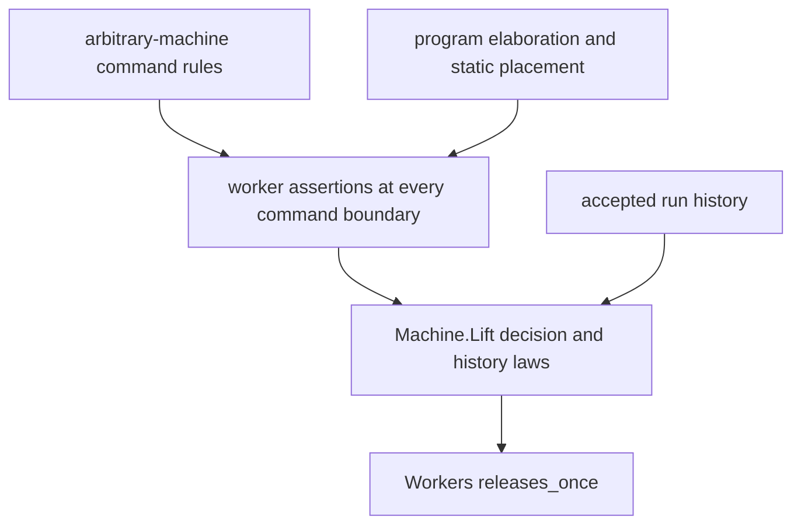

# Arbitrary-fiber command rules

The first landing connects an arbitrary fiber to the existing command and decision lifts.
It introduces no program representation and changes no evaluator.

## Placement

- Concept: `reactive-scheduling`, invariants over execution traces in `docs/core/semantics.md`.
- Question: proposed `fiber-local-positions`, role soundness, through the packet's `shop_stages` and `crew_invariant`.
- Reach: one command on any machine, with explicit lookup, interruption, yield and store-answer premises.
- Limits: command equations give no stage closure, control linearity, write provenance, liveness or host agreement.
- Consumer: the compiled worker probe uses the rules at a real worker primitive. R4, R10 and R11 need this step.

`Machine.Lift` already owns command, decision and history induction in `src/Effect4/Laws/Machine/Lift.lean`.
`Machine.Book` transfers representations in `src/Effect4/Laws/Machine/Book.lean`.
`MaskRuns` supplies the ghost-world pattern in `src/Effect4/Laws/Machine/MaskRuns.lean`.
`Handles` supplies handle existence in `src/Effect4/Laws/Machine/Handles.lean`.
Handle existence does not identify a write's source node.

The stage route still needs arbitrary-machine command equations.
A table restricted to resting host stages cannot serve scripts with fuel cuts or forced yields.
The probe compares those cases on `Workers.crew 1` before selecting the route.

## Checked comparison

`MachineRoutes.lean` compiles on `Workers.crew 1`.
Its six selected runs give the following finite evidence.

| Run | Every fiber rests | Injected continuation remains |
| --- | --- | --- |
| parked | true | false |
| running job | true | false |
| finished | true | false |
| root cancelled | true | false |
| start at command fuel 1 | false | false |
| worker 1 forced to yield | true | true |

The last two rows rule out the resting host table as the invariant for every budget and every raw control.
They do not refute a table that includes every command boundary.
The general step route compiles with symbolic machine, worker, stack, store answer and command residue.
The concrete reader uses a representative worker write.
It does not yet certify the write's source point.

Recommendation: use shared arbitrary-machine equations and program assertions at every command boundary.
Use `Machine.Lift` for commands, decisions and histories.
Construct the program assertions before proving a separate generic control-linearity law.

Owicki and Gries require each process step to keep the other processes' assertions.
Their rule supports the command-boundary route, not a claim that shape classification gives closure.
Source: [An Axiomatic Proof Technique for Parallel Programs I](https://www.cs.tau.ac.il/~msagiv/courses/apl12/owicki.pdf), definition 3.3.
The trace literature in `docs/DESIGN-BASIS.md` is marked by name.
It supplies no checked Effect4 closure theorem.
