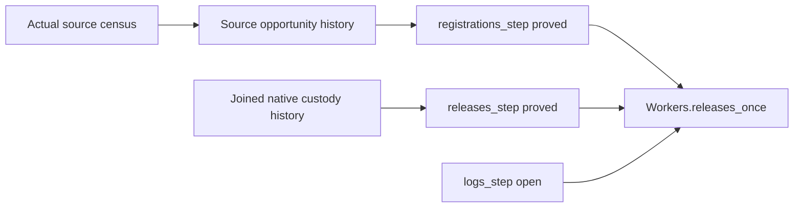

# Original worker counting obligations

The original registration and release-count obligations are proved.
The worker cleanup theorem still depends on `logs_step` alone.

Base: `e6675d709`. Head: the commit containing this receipt.
Custody history comes from `587df0c69`; source history comes from `e6675d709`.

## Placement and proof graph

Concept: scope-lifetime-finalization, R11.
Consumer: the original `Workers.releases_once` claim.
Reach: all job counts, compile budgets and admitted decision histories.
The source census discharges the generic fragment restrictions from the actual built crew.
No original statement or admission predicate changes.
These proofs establish no release progress, cleanup-log provenance or host observation.

`Workers.Assertions` imports the actual source-history reader and replaces `registrations_step` in place.
The file removes nine intermediate command wrappers with no source consumer.
Their checked generic laws remain available through the complete history proof.
The file changes from 450 to 206 lines.
`ReleaseCustody.Execution` imports its history module directly; fifteen transitive imports are removed.
The import traversal confirms all removed imports remain reachable through that module.
`Effect4.Laws` reaches the new source-history modules.

## Verification

- `LEAN_NUM_THREADS=3 lake build Test.Dogfood.Scenario.Workers Test.Dogfood.Scenario.Atomic Effect4.Laws.Program.MaskRuns`: passed, 1181 jobs.
- `LEAN_NUM_THREADS=3 lake env lean docs/research/2026-10-10-goals-packet/codex/SourceCustodyIntegrationAudit.lean`: passed.
- The audit reports 192 declarations within `[propext, Quot.sound]`, two modulo goals, and one planned goal.
- `registrations_step`: proved, no next goals.
- `releases_step`: proved, no next goals.
- `Workers.releases_once`: modulo `logs_step` alone.

The output files retain the exact commands' results and remaining goal statement.
Behavior gates remain scheduled after major proof structures.
The full battery and whole-tree axiom gate are not run here.
