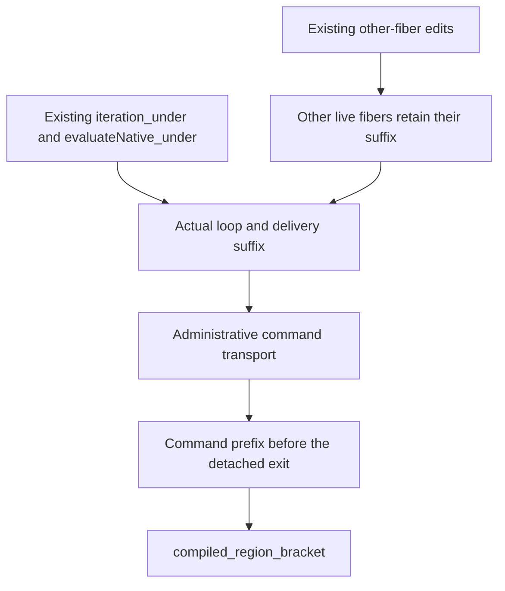

# Region stack through actual commands

Placement: scope-lifetime-finalization, R11, the saved-mask region bracket.
Question: discharge the stack-shape premise of `compiled_region_bracket` from an actual command prefix.
Reach: a named live fiber, a fixed entry stack, and every native command cut before the region ends.
Limit: the region boundary is a semantic condition, not an unconditional promise that execution never pops the entry.
Consumer: `compiled_region_bracket`, then the protected permit and Pool use properties.

The existing native evaluation law compares one detached frame with the same frame above its entry stack.
Detach exactly the known entry suffix before testing whether that evaluation finishes.
A detached evaluation that continues retains the entry suffix through actual settlement.
The current command classifier already proves that other-fiber edits retain identity and exit.
Its other-fiber edits also retain the exact saved stack.
Use that classification for interference; do not repeat the native evaluator census.

Administrative commands answer, interrupt, or push frames above the entry suffix.
Only the guarded clear of an exited fiber drops the suffix.
The watched assertion therefore ranges over live fibers only.
A fresh fiber cannot replace the watched identity, which precedes the allocation counter.

The command lift must retain a boundary alternative when the detached body finishes.
Do not replace that condition by the final stack-shape premise or by arbitrary possible move words.
The latter overapproximation allows invented evaluation sequences between the same endpoints.

Completion requires actual command closure, the command-prefix lift, the bracket reader, and narrow build plus cycle-aware audit.
