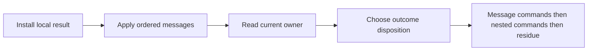

# R2 integration receipt

The full proof library passes with the repaired message order.
The original Timeout scenario still needs its later message-transport adapter.
The behavior sweep remains due after the major proof structures land.

Base: `b4dcef4f12c7ae6eeda97c6c9937596bdc42b61f`.
Head: the commit containing this receipt.
Changed source paths: `R2ChangedPaths.txt` beside this receipt.
No push occurs.

## Placement

Concepts: reactive-scheduling, program-meaning, store-typing, and scope-lifetime-finalization; R4 and R11.
The shared edit words serve command transport, guard ownership, typing, reference simulation, and the original accounting histories.
The runtime messages contain observer data, cancellation tokens, or fresh interruption causes.
They contain no host closures or second program representation.
The helpers retain actual lookup prefixes when they resolve record payloads.

Settlement installs the local fiber, applies ordered messages, reads the current owner, and then chooses the outcome disposition.
Message commands precede the original nested commands and the remaining queue.
The countdown callback reads its current waiter after interruptions and checks that its pending guard survives.
It installs that waiter before adding the next observer.
The repaired self-interrupt regression retains the original admitted program and its fixed budget.

## Shared proof structure

`Edits` owns primitive writes and their words.
`EditWords` and `EditObserverWords` connect actual helpers to those words.
The observer producer gives one path, one command-cost equation, and generated-command provenance.
Accounting, saved-frame, and queue instances consume those projections.
`FiberSumMessages` supplies the shared message and settlement bounds.
`StoreExecution.RefTransfer` supplies the actual reference-store witness to the native and Timeout instances.
`Eliminators` retains Lean's generated evaluator eliminators and matcher equations once for the law graph.

The native and reference iteration relation now equates their message lists.
The existing equal-observation endpoints keep their statements.
The typed adapters install prepared frames before applying messages and retain the current selected owner.
No scenario statement changes in this landing.

## Raw helper limits

Unrestricted raw iterations need not retain their selected owner or reserve observer keys.
The precise raw helper equations therefore retain explicit owner or empty-message premises.
Actual native history endpoints derive their message permissions from the existing producer.
Their statements acquire no new hypothesis.
The raw controls are finite Lean examples, not reached-history counterexamples.

## Verification

`LEAN_NUM_THREADS=3 lake build Effect4.Laws Test.Machine.EditMessages Test.Dogfood.Proofs.HostTimeoutNumberFlow` passes, with 1,464 jobs.
`R2IntegrationBuild.out` retains the output.
This rebuild includes the final spawning, command, and close typing adapters.
The earlier full run found the stale spawning literals; this run checks their repair.

`LEAN_NUM_THREADS=3 lake env lean -DwarningAsError=true docs/research/2026-10-10-goals-packet/codex/R2IntegrationAudit.lean` passes.
The audit covers 113 changed library and test modules.
It reports 18,982 declarations within `[propext, Quot.sound]`, zero modulo planned goals, and zero planned goals.
`R2IntegrationAudit.out` retains the output.
This is the landing audit, not the whole-tree axiom gate.

The two raw helper controls pass with warnings treated as errors.
`R2IntegrationControls.out` retains both commands and their zero exit codes.
`git diff --check` passes.

The selected runtime battery includes the seven approved aliasing cuts and the self-interrupt regression.
It also checks canceled pending guards, missing owners, accumulated causes, message order, and a nonaliasing join.
`R2SourceReview.md` records the independent source review and its bounded scope.

## Measured source change

`git diff --cached --numstat -- src Test` reports 8,255 added lines and 4,197 removed lines.
The shared words account for most new modules.
The field-rule and names consolidations remain subsequent reductions.

## Remaining obligations

`HostTimeoutParkSteps` and its later settlement consumers need addressed-message transport before the original Timeout endpoint builds again.
The numeric history producers and the original application planned goals remain open.
The field-rule consolidation and canonical token filter follow this checkpoint.
The approved typed context region and separate exit guarantees follow in their lane.
Regeneration and reached behavior gates remain due at the coordinated sweep.
The checked proofs establish no progress, fairness, or unrestricted agreement with the outside runtime.
