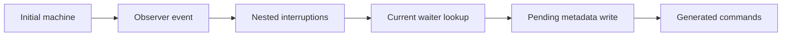

# Shared observer custody repair

The coordinator must integrate both checked snapshots together.
The existing observer interfaces keep their statements.
The runtime change still requires the coordinator's full Laws build and reached behavior gates.

## Placement

Concept: scope-lifetime-finalization.
Requirement: R11.
Question: the helper serves ReleaseCustody.Execution.history and Workers.Assertions.releases_step.
Role: structure.
Reach: actual native countdown callbacks, distinct fiber identities, native pending continuation shapes, and existing registration funding.
The theorem includes dispatcher task credit and the generated command queue.
The theorem establishes no source uniqueness, progress, or outside implementation agreement.

The shared producer also serves AdministrativeKept and AdministrativeQueue.
Those consumers supply their own actual producer premises.

## Files and evidence

The base is 662b978ff.
The worktree head is 80eb3feb278bb9fcfa75efffe20228868a29ea8f.
This slice changes two sources:

- src/Effect4/Laws/Machine/EditObserverWords.lean
- src/Effect4/Laws/Program/ReleaseCustody/ObserverDebit.lean

The shared file has one observer producer census.
observer_word and observer_path project that census.
The richer path retains the current record's frame, dispatcher, and parked state.
It retains actual observer kinds and store result premises.
It also retains generated command cost and membership.
The membership predicate requires no command equality decision.
The interruption command fold is shared.
Its cost interface projects that fold.

The countdown custody proof instantiates the shared path.
It proves Funded at each actual prefix.
It uses the original pending continuation shape for the generated resume command.
It never reinstalls the waiter captured before nested interruptions.

Eight existing theorem headers remain unchanged.
The comparison checks two shared headers and six custody headers.

Both sources pass lean -DwarningAsError=true against the coordinator's current checked dependencies.
The dependency overlay is /private/tmp/guard-r2-reader.
The commands use LEAN_NUM_THREADS=3.
The exact check logs are:

- /private/tmp/machine-observer-producer-check.log
- /private/tmp/machine-custody-observer-check.log

The combined #axiom_audit checks both modules.
It reports 117 declarations within [propext, Quot.sound], zero modulo goals, and zero planned goals.
The audit log is /private/tmp/machine-custody-observer-audit.log.

The checked shared snapshot is /private/tmp/MachineObserverProducerChecked.lean.
Its SHA256 is 40d06ffff42e32565251c6c032713ec385c9e259eddbf6f31838169081691a25.
The checked custody snapshot is /private/tmp/MachineCustodyObserverChecked.lean.
Its SHA256 is c28b46b532de19e8014d31290460c61199fa751acc147ef4188039535d515d3a.

## Limits

This slice adds no proof_goal.
It changes no original scenario statement.
The evidence is a Lean proof check, not a finite runtime comparison.
The coordinator owns integration, the full Laws build, and reached behavior gates.
No runtime commit or push occurs in this slice.

## Joint integration

The later full law build and landing audit pass.
`r2-integration-receipt.md` records their commands, counts, and remaining Timeout adapter obligation.
