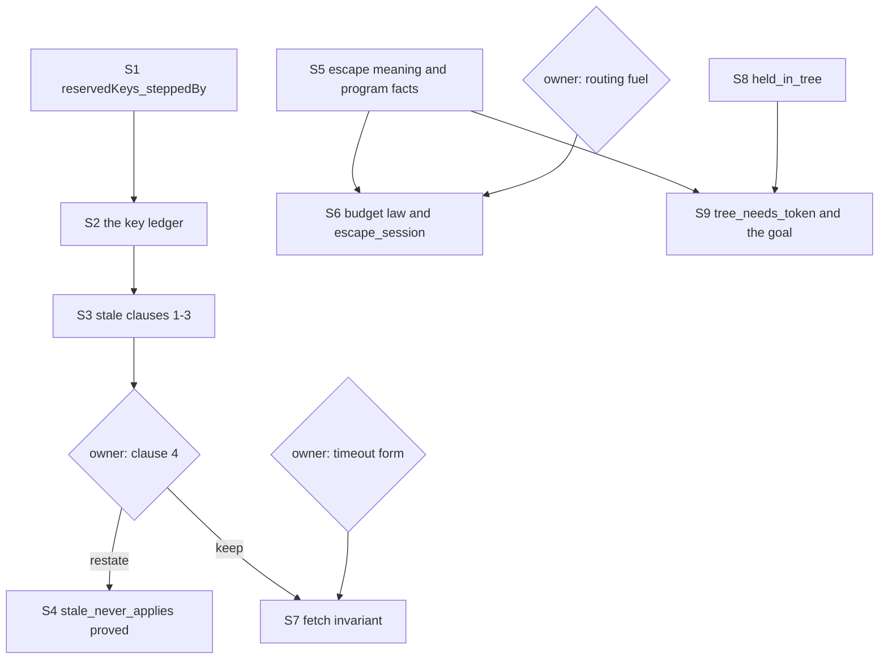

# The host-protocol family: the probe and the plan

Status: a research note (history, not authority). It rules nothing. Base `5b40699ae`
(`refactor/phase1-phase3`), branch `probe/goals-host-protocol`. The family is four planned
goals: `stale_never_applies` and `retries_declared` (`Test/Dogfood/Scenario/Timeout.lean`),
`unauthorized_calls_nothing` and `infrastructure_escapes` (`Test/Dogfood/Scenario/Routing.lean`).
The probe is `Probe.lean` in this folder. It compiles with `lake env lean` in the worktree in
about 12 s, and it edits no file outside this folder.

## 1. The one thing to know first

**`retries_declared` is false, and the probe proves its negation** (`retries_declared_refuted`,
`Probe.lean`). Two scripts of plain moves make `fetch` retry after its first call was answered.
The cause is `timeoutForm` (`Test/Dogfood/P1HttpCache.lean`). Its race awaits the attempt
through a forked fiber, so the timer can win after the attempt finished. rc.112's race has no
such gap. The repair is the owner's (section 3.2).

The other three goals stand, each proved in the probe modulo one planned goal:

- **`stale_never_applies` is a session law in three clauses of four.** The probe proves clauses
  one to three for every program (`session_keys_once`), from one new machine law
  (`reservedKeys_steppedBy`). Clause four is a data-flow fact of `fetch` alone
  (`root_answers_applied`). Its R6 content, restated, is proved for funded runs
  (`ending_of_tape`).
- **`infrastructure_escapes` rests on the run's budget premise** (`escape_session`). The probe
  proves the meaning half (`escape_meaning`) for every tag, and the whole goal at any fixed tag
  by the kernel (`escapes_sqlError`).
- **`unauthorized_calls_nothing` rests on one general law**: the calls of a run are calls of
  the one-fiber call tree, under every script (`held_in_tree`). The program's half
  (`tree_needs_token`) is proved.

## 2. The summary

| Goal | Verdict | Route | New lemmas, general | New lemmas, specific | Size | Confidence |
| --- | --- | --- | --- | --- | --- | --- |
| `stale_never_applies` | true | the key ledger, then clause four | `reservedKeys_steppedBy`, `below_steppedBy`, `session_keys_once`, `ending_of_tape` (all proved) | `root_answers_applied` (planned) | clauses 1–3: 3 h to land; clause 4: 2–4 weeks, or 1 h if the owner restates it (`ending_of_tape`) | clauses 1–3: high; clause 4 as written: low |
| `retries_declared` | false | `retries_declared_refuted` (proved) | none | none | owner decision first; a repaired claim costs what clause 4 costs | high |
| `infrastructure_escapes` | true at every fixed tag (proved); true on every finite instance tested | `denoteRows_eq_session` plus `escape_meaning` (proved) | a budget law for host-driven runs of `StraightRows` programs (planned) | `escape_session` (planned) | 2–4 days; 1–2 days if the owner raises the battery's fuel | medium-high |
| `unauthorized_calls_nothing` | true on every finite instance tested | `held_in_tree` plus `tree_needs_token` (proved) | `held_in_tree` (planned) | none left | 1–2 weeks as written; 3–4 days if restated to host-driven scripts | medium |

## 3. The goals

### 3.1 `stale_never_applies`

**The statement.** Under every script of the driver's alphabet, with its raw rows, the timeout
observation satisfies `Observation.staleNeverApplies`:

1. no retired call has a reply application;
2. no key has two accepted reply receipts;
3. no key has two reply applications;
4. when the root answers a body, a held `Http.getQuote` call has the fate `answered` with it.

**Placement.** Concept `host-session-protocol`, R6. Consumer: the claim `timeout`. Reach: the
program `fetch`, every script of `Move`, the battery's budgets.

**The answer to the central question.** Clauses one to three are session facts of every
program. Clause four is a fact of `fetch`'s data flow.

- The tree's session laws cover single steps. `applied_selects` and `control_retires`
  (`src/Effect4/Laws/Run/Rows.lean`) say what one application and one control do.
  `receipt_inert` (`Test/Dogfood/Scenario.lean`) says a receipt leaves the machine alone.
- The missing law is one of the machine over time. A guard that the machine dropped never holds
  a request again, because a later park takes a fresh token (`FreshPark`,
  `src/Effect4/Laws/Program/Guard/ReturnFields.lean`). The probe proves it for every decision as
  `reservedKeys_steppedBy`. It assembles the guard tree's per-decision lemmas, as
  `guardState_steppedBy` (`src/Effect4/Laws/Program/Guard/Decision.lean`) does.
- One run invariant then carries clauses one to three (`Ledger`, section 4). A bound key is
  live or spent. A spent key holds no request and stays below the token counter. A received
  live key holds its stored reply. An applied or retired key is no longer live.
- The clauses need neither reply admission at the application nor the retirement edge of the
  host protocol. Both stay open parts of R6. The proof reads the session's refusals
  `duplicateCall`, `staleCall` and `pendingReply`, and the definitions of `applyReply` and
  `retire` (`src/Effect4/Api/HostSession.lean`).
- Clause four is no session fact. A program that answers a constant body keeps clauses one to
  three and breaks clause four. The DOGFOOD receipt says the goal has no faulty twin
  (`docs/research/2026-10-05-seat-DOGFOOD-receipt.md`, section 5.5). Clause four has one.

**The evidence today.** Proved in the probe, within `[propext, Quot.sound]` by the probe's exact
walk (section 7):

| Declaration | What it states | Rests on |
| --- | --- | --- |
| `reservedKeys_steppedBy` | a list of keys below the token counter with no request keeps none through any decision, at any budget | nothing |
| `below_steppedBy` | a decision keeps every token below the counter below it | nothing |
| `ledger_reached` | every recorded run of every program keeps `Ledger` | nothing |
| `session_keys_once` | bound, received and applied keys each appear once, and no retired key is applied | nothing |
| `stale_clauses` | clauses one to three of the observation, for every built program and script | nothing |
| `stale_never_applies_modulo` | `StaleNeverApplies` | `root_answers_applied` |
| `ending_of_tape` | two funded recorded runs of one built program, at one budget, with one tape, have one exit | nothing |

Clause four, tested: no word of the searches of section 3.2 (97338 words, with yield verdicts and
interruptions at every fiber) breaks `staleNeverApplies`.

**The decomposition.**

| Lemma | Lean statement (short) | Status | Scope | Placement | Size to land |
| --- | --- | --- | --- | --- | --- |
| `reservedKeys_steppedBy` | `GuardState m → ReservedKeys m keys → ReservedKeys (steppedBy p fuel table m d) keys` | proved | general | `host-session-protocol`; step of `keys-once` | 1 h |
| `below_steppedBy` | `GuardState m → t < m.nextToken → t < (steppedBy p fuel table m d).nextToken` | proved | general | same | with the above |
| `Ledger`, `ledger_step`, `ledger_reached` | the run invariant, kept by every row | proved | general | step of `keys-once` | 2 h |
| `session_keys_once` | `Run.Reached s → (boundKeys s).Nodup ∧ (submittedKeys s).Nodup ∧ (appliedKeys s).Nodup ∧ ∀ k ∈ retiredKeys s, k ∉ appliedKeys s` | proved | general | proposed claim `keys-once`, R6, role preservation | with the above |
| `stale_clauses` | clauses one to three of `Observation.staleNeverApplies` | proved | any program | consumer `stale_never_applies` | 30 min |
| `root_answers_applied` | `fetch`'s root answers only a body that a reply applied at a held `Http.getQuote` call stored | planned | specific | `translation-simulation`, R10 | 2–4 weeks |

**The routes of clause four.**

1. **A restatement (recommended).** The R6 content of clause four is that a stale reply never
   reaches the machine. A row changes the machine only by its decision (`decisionOf`,
   `src/Effect4/Run/Tape.lean`): a control's, or an applied reply's. Clause one keeps a retired
   call's reply out of them. For a funded run the machine is the replay of its tape
   (`funded_replays`, `src/Effect4/Laws/Run/Tape.lean`). The owner may replace clause four by
   "the root's ending is a function of the decisions", which those laws carry. The provenance
   statement then moves to a separate R10 goal. The probe proves the restated clause:
   `ending_of_tape`, a corollary of `funded_replays`. It takes `funded` as its premise, as the
   queue-workers goals do (`Test/Dogfood/Scenario/QueueWorkers.lean`).
2. **A program invariant over `fetch`'s reachable machines.** Templates of machine states with
   free values (reply bodies, the clock, the counters), each transition checked by the kernel
   (`kernel_rfl`, section 6). The kernel runs `fetch` with a free reply body, since the program
   never compares one (`free_body`, `scratch/Symbolic2.lean`, 1.4 s). It stops where a free
   string meets a literal: the retry test reads a failure's tag. Each failure class then needs
   its own argument, as `caught_tagged_none` gives the routing handlers. `fetch` forks, races
   and sleeps, so no denotation of the tree reaches it (`StraightRows` and `LoopedRows` refuse
   `withFiber` and `iterate`).

**What it does not establish.** `session_keys_once` says nothing of which reply a host sends: a
host may answer the second call with the first call's body. It says nothing of reply admission
at the application, of the order of two applications, or of the retirement edge.
`ending_of_tape` says nothing of a run that a budget cut, and nothing of which body the root
answers.

**Existing laws it reads.** `FreshPark` (`src/Effect4/Laws/Program/Guard/ReturnFields.lean`);
`guardState_reachable` and `guardState_steppedBy` (`src/Effect4/Laws/Program/Guard/Decision.lean`);
`reached_play` (`Test/Dogfood/Scenario.lean`); `funded_replays`
(`src/Effect4/Laws/Run/Tape.lean`). Every lemma of the tables above is new, and the probe holds
each.

**Traps.** `List.nodup_singleton` does not exist: write
`List.nodup_cons.mpr ⟨List.not_mem_nil, List.nodup_nil⟩`. `List.Sublist.cons₂` is deprecated,
and a warning fails the tree's build: write `List.Sublist.cons_cons`. `List.filter_true` does
not exist: the probe proves `filter_all_true`. `reservedKeys_steppedBy` needs its program and
table explicit. Bind `List.find?_some h` with `have` before using it.

### 3.2 `retries_declared`

**The statement.** Under every script of plain moves (`Move.plain`), the observation satisfies
`Observation.retriesDeclared`. Every held call but the last ended in a declared failure or a
retirement. The held calls are no more than the attempts, and the attempts are at most four.

**Placement.** Concept `translation-simulation`, R10, a behaviour law of p1's two forms on one
program. Consumer: the claim `timeout`.

**It is false.** The probe proves `retries_declared_refuted : ¬ RetriesDeclared` from two
kernel-checked runs (`cx_refutes`, `cxYield_refutes`, `decide +kernel`, 1.3 s each). Both
scripts are plain (`cx_plain`, `cxYield_plain`).

| Script after `parked` | Observation |
| --- | --- |
| `.cancel ⟨3⟩, .receive http (ok body1), .apply http, .tick 2000, .tick 100, .flush, .hold http` | `calls = [answered "body-1", live]`, two attempts (`cx_calls`) |
| `.control (.yieldVerdict ⟨1⟩ true), .receive http (ok body1), .apply http, .tick 2000, .tick 100, .tick 200, .flush, .hold http` | `retriesDeclared = false` |

**Why.** `timeoutForm` races `await entrant` and `await timer` in two forked fibers, 3 and 4.
The attempt finishes when its reply is applied, and fiber 3 learns it only when it runs again.
A yield verdict at fiber 1 or 3, or an interruption of fiber 3, delays that run past the timer.
The race then takes the timer, and the retry form retries a `Timeout` after a success. rc.112's
`Effect.timeout` races the body itself (`raceAllFirst`,
`vendor/effect-4.0.0-rc.112/src/internal/effect.ts:1535-1580`). The body's own exit observer
decides the race (line 1568). So the gap is the form's.

**The evidence.** Two bounded searches played every short word over a scheduling alphabet (tested;
finite probes). A fixed tail then lets a second attempt start and be held.

| Search | Alphabet | Words | `retriesDeclared` fails | on a fair host's words | `staleNeverApplies` fails |
| --- | --- | --- | --- | --- | --- |
| `scratch/Search1.lean` | 41 moves, length 3, from `parked` | 70644 | 6 | — | — |
| `scratch/Search2.lean` | 45 moves, length 3, from `parked` | 93196 | 12 | 0 | 0 |
| same | 45 moves, length 2, from the timed-out run | 2071 | 0 | 0 | 0 |
| same | 45 moves, length 2, from a received first reply | 2071 | 3 | 0 | 0 |

Of the 41 moves, 36 are a fire, an evaluation, a yield verdict and an interruption at each of the
fibers 0 to 8. A flush, two clock steps, the reply's receipt and its application are the other
five.
`Search2` adds three failing answers and the hold. A fair host plays no yield verdict and interrupts only an attempt's
caller, fiber 1 or 5. Each failing word holds a yield verdict at fiber 1 or 3, or an interruption
of fiber 3. The DOGFOOD search (16 plain moves, length 4) held none of these moves.

**The refutation's declarations.** All are new and in the probe: `cx`, `cxYield` (the scripts),
`cx_plain`, `cxYield_plain` (by `decide`), `cx_refutes`, `cxYield_refutes`, `cx_calls` (by
`decide +kernel`) and `retries_declared_refuted`. Trap: inside the scenario's namespace
`Scenario.play` names the structure's field; write `Test.Dogfood.Scenario.play`.

**The decision it needs.** The owner chooses one:

1. **Repair the form.** Make `timeoutForm` decide the race at the attempt's own exit, as rc.112's
   `raceAllFirst` does. The language's race takes the first success, so the repair needs a
   first-exit race or another encoding. The claim may then hold as written.
2. **Narrow the alphabet.** Take every yield verdict, and every interruption of a fiber that holds
   no held call, out of `Move.plain`. Every failing word of the search above then leaves the
   alphabet. The narrowed claim excludes a host that schedules unfairly.
3. **Keep the counterexample as a red control** and drop the goal.

Recommendation: option 1, since the fault is the form's and the claim states rc.112's behaviour.
Either repaired claim needs a program invariant of `fetch` (section 3.1, route 2). Its control
position: the retry loop's cursor, the race's state, and the attempt fiber's place before, at or
after its call. Its journal part: each held call's fate. The size is that of clause four.

### 3.3 `infrastructure_escapes`

**The statement.** The script is `failing tag message`. The tag is neither `NotFound` nor
`Unauthorized`. For every user id, id text, message and such tag, the routing root's outcome is
the failure `Cause.fail (.tagged tag message)`.

**Placement.** Concept `translation-simulation`, R10, the handler form's behaviour on one
program. Consumer: the claim `routing`.

**The answer to the central question.** `request` is in `StraightRows` and in `LoopedRows`, for
every token, id and id text (`straight_free`, proved by the kernel). So `denoteRows_eq_session`
(`src/Effect4/Laws/Api/SessionMeaning.lean`) carries it, with `escape_meaning` at the meaning:

- **The meaning (proved).** `escape_meaning`: under the two answers the call tree fails with the
  repository's failure. The kernel runs the handled body with every value free (`escape_body`),
  and `caught_tagged_none` rewrites each handler's test.
- **The run at a fixed tag (proved).** `escapes_sqlError` proves the whole goal at the tag
  `SqlError`, for every id, id text and message. It is one kernel check of 0.4 s. It reads the
  program off the elaboration (`build_program`, `progOf_eq`), since the build's checker reads the
  literals. Any fixed tag goes the same way.
- **The run at a free tag (planned).** The kernel stops at the two tests: `String.decEq` compares
  the tag's bytes, and a free string has none. So the run's premises go through the agreement
  layer instead: `escape_session` (funded, at rest, host-driven, the two applied exits).

`infrastructure_escapes_modulo` proves the goal from `escape_session` alone.

**The decomposition.**

| Lemma | Statement (short) | Status | Scope | Size |
| --- | --- | --- | --- | --- |
| `build_program`, `built_request` | a build's program is its elaboration; its table is the module's | proved | general | 30 min to land |
| `progOf_eq`, `straight_free`, `elaborate_free` | the elaborated request, written out, in the fragment, with free leaves | proved (kernel) | specific | landed with the battery |
| `escape_meaning` | the tree under the two answers fails with the repository's failure | proved | specific | landed with the battery |
| budget law (planned, not in the probe) | at a fuel of at least `4 * defaultBudget + 8`, every host decision on a `Holds` machine settles | planned | general | 1 day: `seg_settles` and `load_evaluate` (`src/Effect4/Laws/Program/Agreement/Hosted.lean`) already bound a segment |
| `escape_session` | the run of `failing` is funded, at rest, host-driven, and applied the two answers | planned | specific | 1–2 days on the budget law |

The budget law needs a fuel of at least `4 * defaultBudget + 8`, and the routing battery runs at
the default fuel, 1000 (`Api.Budget`, `src/Effect4/Api.lean`). Two ways close the gap:

1. **The owner raises the battery's fuel** (`opened`, `Test/Dogfood/Scenario/Routing.lean`) to
   at least 8200. A decision that settles at fuel 1000 gives the same result at a larger fuel
   (`stepDecisionState_stable`, `src/Effect4/Laws/Machine/Approximation.lean`). So each funded
   control run stays as it is, and the budget law applies.
2. **A size bound for loop-free segments.** A segment of a `StraightRows` program visits each
   node at most once, so its commands are bounded by the program's size. This general law
   (2–3 days) keeps the fuel at 1000.

**The route of `escape_session`, in part unverified.** The script plays seven rows. Only the
last, the repository's failure applied, compares the tag. The error column is
`.prod .string .string`, so the receipt compares none. At the tag `SqlError` the first six rows
give the verdicts `progressed, bound, preflight, applied, bound, preflight`. That prefix is
funded, host-driven and at rest, with a tape of two decisions (`scratch/Prefix.lean`, `#eval`,
tested). The same file states `pre_free`: these facts for every tag, message, id and id text, by
`kernel_rfl`. Its run ended when the coordinator stopped the work, and its result was not
captured: **unverified**. The last row then needs `holds_answer` and the budget law.

**Existing laws it reads.** `denoteRows_eq_session`
(`src/Effect4/Laws/Api/SessionMeaning.lean`); `holds_answer`, `seg_settles` and `load_evaluate`
(`src/Effect4/Laws/Program/Agreement/Hosted.lean`); `stepDecisionState_stable`
(`src/Effect4/Laws/Machine/Approximation.lean`); `Authoring.build_table`. `caught_tagged_none`
is the probe's.

**Traps.** The build's checker reads literals, so the kernel refuses a free id through `build`:
read the program off the elaboration (`build_program`). The elaborator's `whnf` times out on the
played run: `generalize` it first. The kernel cannot decide `tag = "NotFound"` for a free tag.

**What it does not establish.** Another script; a business tag; a record payload.

### 3.4 `unauthorized_calls_nothing`

**The statement.** Under every script, if no submitted reply carries `ok (configOf token
pageSize)` for any page size, the host holds no repository call.

**Placement.** Concept `context-requirements`, R5. Consumer: the claim `routing`.

**The answer to the central question.** The invariant reads the root's control position and the
replies that the session applied. The root sits at a position of the call tree under the
applied exits. Two facts carry it:

1. **The calls of a run are calls of the tree** (`held_in_tree`, planned, general). Every call
   the host held is a wait of the program's call tree under a tape of applied exits, each
   admitted at its row (`admittedTapeHost`). `rows_loop_frontier`
   (`src/Effect4/Laws/Api/SessionMeaningLoop.lean`) proves the funded, at-rest, host-driven case.
   The goal's scripts add interruptions, clock steps, yield verdicts, fires and budget cuts. For
   a program whose code catches no interruption (`NoCauseHandler`), each only stops or delays
   the root.
2. **The tree needs the token** (`tree_needs_token`, proved, specific). The tree waits at the
   repository only after a first answer that is the configuration with the request's token. The
   proof runs the tree's sequence (`runRowsO_pbind`, `andThen_eq_waiting`). The 200 response
   and the two handlers answer terms, so they never wait (`catchK_done`, `seqSucceed_done`).
   The configuration column admits only the canonical record frame (`admitted_config`, from
   `Val.hasTy`'s record arm). The token check then decides (`denote_routeSel`, by the kernel).
   Three controls validate the formulation: `tree_green`, `tree_red_token` and `tree_red_frame`.

`unauthorized_calls_nothing_modulo` proves the goal from `held_in_tree`. The premise excludes the
reply that the tree needs.

**The size.** `held_in_tree` as stated: 1–2 weeks, an extension of the agreement layer's forms
(`Holds`, `Settled`) to an interrupted root, a yield verdict and a cut segment. The owner may
restrict the goal to host-driven scripts at the raised fuel of 3.3. `held_in_tree` then reduces
to `rows_loop_frontier` at each bind: 2–3 days.

**The decomposition.**

| Lemma | Statement (short) | Status | Scope | Placement | Size |
| --- | --- | --- | --- | --- | --- |
| `held_in_tree` | a held call of a reached run of a `StraightRows` program with `NoCauseHandler` is a wait of `treeWaits` under a tape of submitted exits | planned | general | `translation-simulation`, R6; consumer the goal | 1–2 weeks; 2–3 days restricted |
| `tree_needs_token` | a wait at row 1 of the routing tree follows a first answer `configOf token pageSize` | proved | specific | `context-requirements`, R5 | 2 h to move |
| `repo_position`, `noCauseHandler_free`, `straight_free` | the repository is row 1; the program catches no cause; it is in the fragment | proved | specific | steps of the goal | with the above |
| `unauthorized_calls_nothing_modulo` | `UnauthorizedCallsNothing` | proved modulo `held_in_tree` | specific | consumer `routing` | with the above |

**Existing laws it reads.** `rows_loop_frontier` (`src/Effect4/Laws/Api/SessionMeaningLoop.lean`)
for the restricted route; `Val.hasTy`'s record arm for the column. The tree-stepping lemmas are
new.

**Traps.** In `andThen_eq_waiting` the waiting case needs `cases h` before `Or.inl rfl`: the
type parameters differ. `catchK_done` needs `simp only [catchK]` first. In `first_call` write
`⟨⟨0, _⟩, .unit⟩`; an explicit `Nat.zero_lt_succ` breaks type correctness.

**What it does not establish.** What an authorized request calls. A handler that looks the
caller up first (a red control). A host that withholds the configuration forever.

## 4. The frame

The family's invariant is a run invariant that every row keeps. The probe states the frame:

```lean
def RunKeeps (I : Run → Prop) : Prop := ∀ (s : Run) (c : Api.Runner.Command), I s → I (s.step c)

theorem reached_keeps {I : Run → Prop}
    (opened : ∀ b id budget profile, I (Run.open b id budget profile)) (keeps : RunKeeps I) :
    ∀ s, Run.Reached s → I s
```

`ledger_reached` is `reached_keeps ledger_open ledger_step`. A script reaches only recorded runs
(`reached_play`, `Test/Dogfood/Scenario.lean`), so a scenario law needs no lemma for moves. The
tree holds no `RunKeeps` today; `Run.Reached`'s induction is the frame.

The machine half of an invariant over arbitrary decisions is the guard tree's `GuardState`
(`src/Effect4/Laws/Program/Guard/Core.lean`), which every reachable machine keeps
(`guardState_reachable`, `src/Effect4/Laws/Program/Guard/Decision.lean`). `Ledger` reads it
through its field `reach`.

## 5. The slices for Codex



| Slice | Content | Depends on | Parallel with | Narrow build | Audit |
| --- | --- | --- | --- | --- | --- |
| S1 | `reservedKeys_steppedBy`, `below_steppedBy` and the two helpers into `src/Effect4/Laws/Program/Guard/Decision.lean` | — | S5, S8 | `LEAN_NUM_THREADS=3 lake build Effect4.Laws.Program.Guard.Decision` | `#axiom_audit Effect4.Laws.Program.Guard.Decision` |
| S2 | `Ledger`, `ledger_reached`, `session_keys_once` and `RunKeeps` in a new `src/Effect4/Laws/Run/Keys.lean`; registry claim `keys-once`; root import at the coordinator's anchor | S1 | S5, S8 | `lake build Effect4.Laws.Run.Keys` | `#axiom_audit Effect4.Laws.Run.Keys` |
| S3 | `stale_clauses` and the sublist lemmas beside the observation (`Test/Dogfood/Scenario/Timeout.lean`) | S2 | — | `lake env lean Test/Dogfood/Scenario/Timeout.lean` | `#axiom_audit` on the battery's module |
| S4 | `ending_of_tape` into S2's module, not the widely imported `Tape.lean`; clause four restated with `funded`; `stale_never_applies` a theorem | S3, owner | — | same | same |
| S5 | `build_program` into `src/Effect4/Laws/Program/Author.lean`; `progOf_eq`, `escape_meaning` into the routing battery | — | S1, S2 | `lake build Effect4.Laws.Program.Author`; the battery | both |
| S6 | the budget law into `src/Effect4/Laws/Program/Agreement/Hosted.lean`; `escape_session`; `infrastructure_escapes` a theorem | S5, owner if the fuel moves | S8 | `lake build Effect4.Laws.Program.Agreement.Hosted` | `#axiom_audit` on it and on the battery |
| S7 | `fetch`'s program invariant: `root_answers_applied` if kept, then the repaired `retries_declared` | owner | — | the timeout battery | the battery |
| S8 | `held_in_tree` for every script into `src/Effect4/Laws/Api/SessionMeaningLoop.lean` | — | S1, S5 | `lake build Effect4.Laws.Api.SessionMeaningLoop` | `#axiom_audit` on it |
| S9 | `tree_needs_token` and its helpers into the routing battery (proved in the probe: a move, 2 h); `unauthorized_calls_nothing` a theorem | S5, S8 | — | the routing battery | the battery |

`kernel_rfl` (section 6) is a tactic, and the coordinator places it. The law graph's tactics stand
in `src/Effect4/Laws/Auto/`.

## 6. Shared machinery

Each item below serves other families too.

- **`reservedKeys_steppedBy` and `below_steppedBy`.** Any statement that a dropped guard, a
  spent key or a token stays spent across arbitrary decisions. The queue and worker families'
  "released once" and "applied once" claims read the same fact.
- **`Ledger` and `session_keys_once`.** Every scenario's receipts, applications and retirements.
  The workers scenario's clauses "selection" and "retirement" read single steps of it.
- **`RunKeeps` and `reached_keeps`.** The frame every seat's run invariant fits.
- **`ending_of_tape`.** Any scenario claim that a reply the session never applied changes no
  outcome. It reads only `funded_replays`.
- **`kernel_rfl`** (`Probe.lean`, top). It assigns `Eq.refl` and lets the kernel check an
  equation with free variables. The elaborator's `rfl` failed on the same runs
  (`scratch/Symbolic1.lean`). With it the kernel runs a whole machine run with free values that
  the program never compares: a reply body, a message, an id. The measured times:

  | Run | Kernel time |
  | --- | --- |
  | a routing run with a free message | 0.65 s |
  | the escape at a fixed tag, every id, id text and message | 0.4 s |
  | `fetch`'s answered run with a free body (`free_body`, `scratch/Symbolic2.lean`) | 1.4 s |
- **`build_program` and reading a program off its elaboration.** A build runs the checker, which
  reads literals; the elaboration does not. Any goal quantified over a program's literals needs
  it.
- **The budget law for host-driven runs of `StraightRows` programs.** Every one-fiber scenario
  claim that goes through `denoteRows_eq_session` needs a funded run.
- **The tree-stepping kit.** `runRowsO_pbind`, `andThen_eq_waiting`, `runRowsO_admitted_vis`,
  `catchK_done` and the record inversion `namedHasTy_cons_required`. Any fact of the form "the
  tree reaches this call only after that answer" uses them, as `tree_needs_token` does.
- **`held_in_tree`.** Every "calls nothing" claim of a one-fiber program, under every script,
  such as the draft's `add_empty_calls_nothing`
  (`docs/research/2026-10-07-packet-application-claims.md`, section 3.7).

## 7. The evidence and the commands

Every command ran in the worktree, after `cp -c -R` of the main checkout's packages. The words
are those of `docs/core/controlled-english.md` §3.8: proved means the kernel accepted it within
`[propext, Quot.sound]`; tested means a finite run passed.

| Command | Result |
| --- | --- |
| `LEAN_NUM_THREADS=2 lake build Test.Dogfood.Scenario.Timeout Test.Dogfood.Scenario.Routing ProofGraph.AxiomAudit Effect4.Laws.Program.Guard.Decision` | restored from the cache, 1057 jobs, 2 s |
| `LEAN_NUM_THREADS=2 lake build Effect4.Laws.Api.SessionMeaning Effect4.Laws.Api.SessionMeaningLoop` | restored, 493 jobs, 33 s |
| `LEAN_NUM_THREADS=2 lake env lean docs/research/2026-10-10-goals-packet/host-protocol/Probe.lean` | no error, no warning; 46.6 s wall and 24.4 s user under `/usr/bin/time -p`, with other seats building; the audit below (`probe-run.log`). After that run two docstrings changed, and no Lean run checked them |
| `lake env lean …/scratch/Prefix.lean` | the `#eval` at the tag `SqlError`: six verdicts, funded, host-driven, at rest, two decisions. `pre_free` with free values: **unverified**, its result was not captured |
| `lake env lean …/scratch/KernelCost.lean` | the kernel checks `build fetch` in 0.38 s and the first counterexample's run in 1.28 s |
| `lake env lean …/scratch/Search1.lean` | 70644 words, 6 failures (section 3.2) |
| `lake env lean …/scratch/Search2.lean` | 97338 words; 15 failures of `retriesDeclared`, none on a fair host's words; no failure of `staleNeverApplies` |
| `lake env lean …/scratch/Symbolic1.lean` | free message: accepted in 0.65 s; free id and id text through the build: refused by the kernel |
| `lake env lean …/scratch/Symbolic2.lean` | `fetch`'s answered run with a free body: accepted in 1.4 s |
| `lake env lean …/scratch/Explore2.lean` | the escape run; the fragment; the canonical frame and the negative integer refused at their columns |

The probe's audit (`#probe_audit`): the axiom gate's exact walk (`ProofGraph.reachedAxiomsMany`,
planned goals as leaves) over every declaration under `Probe.HostProtocol`. `#axiom_audit` takes
only imported modules, and the probe is no module.

```text
#probe_audit: 174 declarations walked, 3 planned goals [held_in_tree, root_answers_applied,
 escape_session]; 0 outside [propext, Quot.sound]
resting on planned goals:
  infrastructure_escapes_modulo rests on [escape_session]
  unauthorized_calls_nothing_modulo rests on [held_in_tree]
  stale_never_applies_modulo rests on [root_answers_applied]
```

`retries_declared_refuted`, `session_keys_once`, `ending_of_tape`, `escape_meaning`,
`escapes_sqlError` and `tree_needs_token` rest on no planned goal.

## 8. The decisions for the owner

| Decision | Options | Recommendation |
| --- | --- | --- |
| `retries_declared` is false | repair `timeoutForm`; narrow `Move.plain`; keep the counterexample as a red control | repair the form |
| clause four of `stale_never_applies` | keep it (a program invariant of `fetch`); restate it as "the root's ending is a function of the decisions" and move provenance to an R10 goal | restate: `ending_of_tape` proves it for funded runs |
| the routing battery's fuel | raise it to at least 8200; keep 1000 and land the size bound | raise it |
| `unauthorized_calls_nothing`'s scripts | every script (`held_in_tree` as stated); host-driven scripts | every script if S8 is scheduled anyway; otherwise host-driven |

Proposed registry claim: `keys-once` (concept `host-session-protocol`, R6, role preservation),
pointer `session_keys_once`. Proposed required property for `docs/core/semantics.md`, concept 9:
"no stale application: a session binds, receives and applies each key once, and never applies a
retired call".
