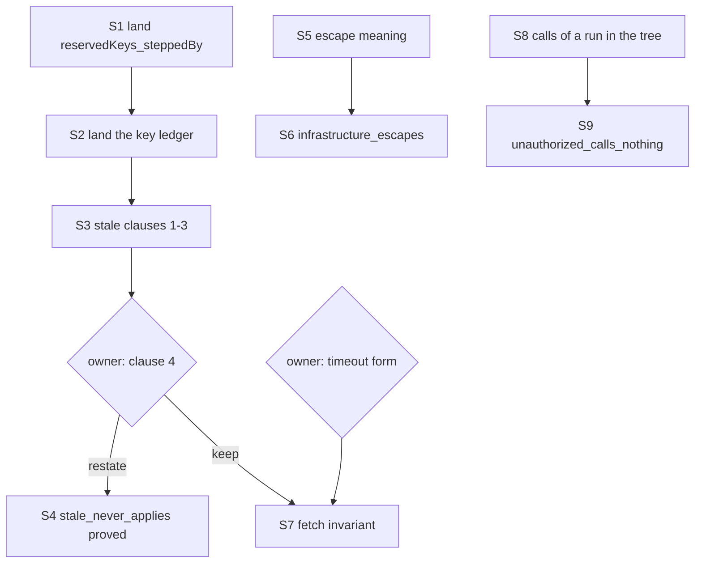

# The host-protocol family: the probe and the plan

Status: a research note (history, not authority). It rules nothing. Base `5b40699ae`
(`refactor/phase1-phase3`), branch `probe/goals-host-protocol`. The family is four planned
goals: `stale_never_applies` and `retries_declared` (`Test/Dogfood/Scenario/Timeout.lean`),
`unauthorized_calls_nothing` and `infrastructure_escapes` (`Test/Dogfood/Scenario/Routing.lean`).
The probe is `Probe.lean` in this folder. It compiles with `lake env lean` in the worktree.

## 1. The one thing to know first

**`retries_declared` is false, and the probe proves its negation.** Two scripts of plain moves make
`fetch` retry after its first call was answered (`retries_declared_refuted`, `Probe.lean`). The
cause is `timeoutForm` (`Test/Dogfood/P1HttpCache.lean`). Its race awaits the attempt through a
forked fiber, so the timer can win after the attempt finished. The repair is the owner's (section
3.2).

The other three goals stand, at different costs:

- **`stale_never_applies` is general in three clauses of four.** The probe proves clauses one to
  three for every program (`session_keys_once`). Clause four is a data-flow fact of `fetch`
  alone, and it is the family's hardest part.
- **`infrastructure_escapes` is not closable by the kernel alone.** The kernel computes the run
  with a free message, and it stops at the two string tests of a free tag.
- **`unauthorized_calls_nothing` needs a general law** that the one-fiber call tree bounds the
  calls of every run, under every script.

## 2. The summary

| Goal | Verdict | Route | New lemmas | Size | Confidence |
| --- | --- | --- | --- | --- | --- |
| `stale_never_applies` | true; clauses 1–3 proved in the probe for every program | the key ledger (`Ledger`) plus one machine law | general: `reservedKeys_steppedBy`, `below_steppedBy`, `session_keys_once` (proved); specific: `root_answers_applied` (planned) | clauses 1–3: 3 h to land; clause 4: 2–4 weeks, or restated by the owner | clauses 1–3: high; clause 4: low |
| `retries_declared` | false | `retries_declared_refuted`, kernel-checked | none | owner decision first | high (proved) |
| `infrastructure_escapes` | true on every finite instance tested | the denotation (`denoteRows_eq_session`) plus the escape's meaning | specific: `escape_meaning`; general: a budget bound for straight segments, or a larger scenario budget | 3–6 days | medium |
| `unauthorized_calls_nothing` | true on every finite instance tested | a call-tree bound for every script, plus the program's tree | general: `held_in_tree`; specific: `tree_needs_token`, `config_canonical` | 1–2 weeks | medium-low |

## 3. The goals

### 3.1 `stale_never_applies`

**The statement.** Under every script of the driver's alphabet, with its raw rows, the timeout
observation satisfies `Observation.staleNeverApplies`. That is four clauses:

1. no retired call has a reply application;
2. no key has two accepted reply receipts;
3. no key has two reply applications;
4. when the root answers a body, some held `Http.getQuote` call has the fate `answered` with that
   body.

**Placement.** Concept `host-session-protocol`, R6. Consumer: the claim `timeout`. Reach: the
program `fetch`, every script of `Move`, the battery's budgets.

**The answer to the central question.** Clauses one to three are session facts of every
program. Clause four is a fact of `fetch`'s data flow.

- The session's laws in the tree cover single steps. `applied_selects` and `control_retires`
  (`src/Effect4/Laws/Run/Rows.lean`) say what one application and one control do.
  `receipt_inert` (`Test/Dogfood/Scenario.lean`) says a receipt leaves the machine alone.
- What was missing is a law of the machine over time. A guard that the machine dropped never
  holds a request again, because a later park takes a fresh token. The probe proves it as
  `reservedKeys_steppedBy`. It assembles the guard tree's per-decision lemmas, as
  `guardState_steppedBy` (`src/Effect4/Laws/Program/Guard/Decision.lean`) does.
- With that law, one run invariant carries clauses one to three (`Ledger`, section 4). Every
  bound key is live or spent. A spent key holds no request. A received live key holds its
  stored reply. An applied or retired key is no longer live.
- Clauses one to three need neither reply admission at the application nor the retirement edge
  of the host protocol. Both stay open parts of R6. The proof reads the session's refusals
  `duplicateCall`, `staleCall` and `pendingReply`, and the definitions of `applyReply` and
  `retire` (`src/Effect4/Api/HostSession.lean`).
- Clause four is no session fact. A program that answers a constant body satisfies clauses one
  to three and breaks clause four. The DOGFOOD receipt says the goal "has no faulty twin"
  (`docs/research/2026-10-05-seat-DOGFOOD-receipt.md`, section 5.5); clause four has one.

**The evidence today.** Proved in the probe, within `[propext, Quot.sound]` by the probe's exact
walk (section 6):

| Declaration | What it states | Rests on |
| --- | --- | --- |
| `reservedKeys_steppedBy` | a list of keys below the token counter with no request keeps none through any decision | nothing |
| `below_steppedBy` | a decision keeps every token below the counter below it | nothing |
| `session_keys_once` | in every recorded run of every program, bound, received and applied keys are each without duplicates, and no retired key is applied | nothing |
| `stale_clauses` | clauses one to three of the observation, for every built program and script | nothing |
| `stale_never_applies_modulo` | `StaleNeverApplies` | `root_answers_applied` |

**The decomposition.**

| Lemma | Lean statement (short) | Status | Scope | Placement | Size |
| --- | --- | --- | --- | --- | --- |
| `reservedKeys_steppedBy` | `GuardState m → ReservedKeys m keys → ReservedKeys (steppedBy p fuel table m d) keys` | proved | general | `host-session-protocol`; step of `keys-once` | land: 1 h |
| `below_steppedBy` | `GuardState m → t < m.nextToken → t < (steppedBy p fuel table m d).nextToken` | proved | general | same | with the above |
| `Ledger`, `ledger_step`, `ledger_reached` | the run invariant, kept by every row | proved | general | step of `keys-once` | land: 2 h |
| `session_keys_once` | `Reached s → (boundKeys s).Nodup ∧ (submittedKeys s).Nodup ∧ (appliedKeys s).Nodup ∧ ∀ k ∈ retiredKeys s, k ∉ appliedKeys s` | proved | general | proposed claim `keys-once`, R6 | with the above |
| `stale_clauses` | clauses one to three of `Observation.staleNeverApplies` | proved | general in the program | consumer `stale_never_applies` | with the above |
| `root_answers_applied` | `fetch`'s root answers only a body that a reply applied at a held `Http.getQuote` call stored | planned | specific | `translation-simulation`, R10 | 2–4 weeks |

**The route of clause four.** `fetch` forks, races and sleeps, so no denotation of the tree
reaches it (`StraightRows` and `LoopedRows` refuse `withFiber` and `iterate`). Two routes exist:

1. **A program invariant over `fetch`'s reachable machines.** Write templates of machine states
   with free values: reply bodies, the clock and the counters. Check each transition with the
   kernel (`kernel_rfl` in `scratch/Symbolic1.lean` assigns `Eq.refl` and lets the kernel check
   it). The kernel computes a run with a free reply body (section 3.3). It stops where a free
   string meets a literal: the retry test compares a failure's tag. Each failure class then
   needs a concrete representative and an argument that the others behave alike.
2. **A restatement.** The R6 content of clause four is that a stale reply never reaches the
   machine. The tape already carries it: the machine is a function of its tape (`tape_replays`,
   `src/Effect4/Laws/Run/Tape.lean`), and clause one keeps a retired call's reply off the tape.
   The owner may replace clause four by "the root's ending is a function of the tape", which
   the existing laws prove, and move the provenance clause to a separate R10 goal.

The second route is cheap and keeps the R6 meaning. The first is the only route to the
statement as written.

**What it does not establish.** `session_keys_once` says nothing of which reply a host sends: a
host may answer the second call with the first call's body. It says nothing of reply admission
at the application, the order of two applications, or the retirement edge.

### 3.2 `retries_declared`

**The statement.** Under every script of plain moves (`Move.plain`), the observation satisfies
`Observation.retriesDeclared`. Every held call but the last ended in a declared failure or a
retirement. The held calls are no more than the attempts, and the attempts are at most four.

**Placement.** Concept `translation-simulation`, R10, a behaviour law of p1's two forms on one
program. Consumer: the claim `timeout`.

**It is false.** The probe proves `retries_declared_refuted : ¬ RetriesDeclared` from two
kernel-checked runs (`cx_refutes`, `cxYield_refutes`, `decide +kernel`). Both scripts are plain.

| Script after `parked` | Observation |
| --- | --- |
| `.cancel ⟨3⟩, .receive http (ok body1), .apply http, .tick 2000, .tick 100, .flush, .hold http` | `calls = [answered "body-1", live]`, two attempts |
| `.control (.yieldVerdict ⟨1⟩ true), .receive http (ok body1), .apply http, .tick 2000, .tick 100, .tick 200, .flush, .hold http` | `retriesDeclared = false` |

**Why.** `timeoutForm` races `await entrant` and `await timer` in two forked fibers. The attempt
finishes when its reply is applied, and fiber 3 learns it only when it runs again. A yield
verdict at fiber 1 or 3, or an interruption of fiber 3, delays that run past the timer. The race
then takes the timer, and the retry form retries a `Timeout` after a success. rc.112's
`Effect.timeout` observes the body's exit itself (`raceFirst`,
`vendor/effect-4.0.0-rc.112/src/internal/effect.ts:3677-3727`, as `timeoutForm`'s docstring
cites it), so this gap is the form's.

**The evidence.** A bounded search played every word of length 3 or less over 41 moves from
`parked`, then a fixed tail (`scratch/Search1.lean`, `scratch/search1.log`; tested). The moves
are fire, evaluate, a yield verdict and an interruption at each of fibers 0 to 8, three clock
steps, and the reply's receipt and application. 70644 words; 6 fail, each a yield verdict at
fiber 1 or 3 or an interruption of fiber 3. The DOGFOOD search (16 plain moves, length 4) held
none of these moves.

**The decision it needs.** The owner chooses one:

1. **Repair the form.** Make `timeoutForm` observe the attempt's exit with no fiber between, as
   rc.112 does. The claim may then hold as written. Its proof still needs a program invariant
   of `fetch`, as clause four of 3.1 does.
2. **Narrow the alphabet.** Take the yield verdict and the interruption of a fiber that holds no
   call out of `Move.plain`. The search above finds no failing word then. The narrowed claim
   says less: a host that schedules unfairly is outside it.
3. **Keep the claim as a refuted control.** Record the counterexample as a red control and drop
   the goal.

Recommendation: option 1. The fault is the form's, and the claim states what rc.112 does.

### 3.3 `infrastructure_escapes`

**The statement.** On the script `failing tag message`, for every user id, id text, message and
tag other than `NotFound` and `Unauthorized`, the routing root's outcome is the failure
`Cause.fail (.tagged tag message)`.

**Placement.** Concept `translation-simulation`, R10, the handler form's behaviour on one
program. Consumer: the claim `routing`.

**The answer to the central question.** `request` is in `StraightRows` and in `LoopedRows`
(tested, `scratch/Explore2.lean`). So `denoteRows_eq_session`
(`src/Effect4/Laws/Api/SessionMeaning.lean`) reaches it. But the goal is not closable outright:

- The kernel computes the run with a free message (`free_message`, `scratch/Symbolic1.lean`,
  0.65 s; tested). A free value that the program never compares costs nothing.
- With a free id and id text the kernel stops inside the build: the checker reads the literals.
  A route that reads `b.program` off the elaboration, not off the build, avoids it.
- With a free tag the kernel stops at the two tests `tagIs "Unauthorized"` and `tagIs "NotFound"`.
  `String.decEq` compares the bytes of the tag, and a free string has none. No case split over
  strings is finite.

**The decomposition.**

| Lemma | Statement (short) | Status | Scope | Size |
| --- | --- | --- | --- | --- |
| `build_program` | `build m = .ok b → elaborateModule m = .ok b.program` | new, cheap | general | 1 h |
| `escape_meaning` | the meaning of `request`'s program under `[ok config, failed tag message]` is that failure | planned | specific | 1 day: `simp only` over `denoteRows` with the two tag facts |
| `escape_session` | the escape run is recorded, funded, at rest and host-driven, and its applied exits are the two answers | planned | specific | 1–2 days given a budget bound |
| budget bound | a host decision on a settled one-fiber `StraightRows` machine settles within the run's fuel | planned | general | 2–3 days, or nothing if the owner raises the scenario's fuel to at least `4 * defaultBudget + 8` (`seg_settles`, `src/Effect4/Laws/Program/Agreement/Hosted.lean`) |

`denoteRows_eq_session` then turns `escape_meaning` into the root's exit. The free tag never
reaches the kernel on this route. The meaning is rewritten by `simp only`, and the machine's
facts come from the agreement layer's general lemmas (`holds_answer`, `tape_holds`).

**What it does not establish.** Another script; a business tag; a record payload.

### 3.4 `unauthorized_calls_nothing`

**The statement.** Under every script, if no submitted reply carries `ok (configOf token
pageSize)` for any page size, the host holds no repository call.

**Placement.** Concept `context-requirements`, R5. Consumer: the claim `routing`.

**The answer to the central question.** The invariant is over the root's control position and
the replies the session applied. A repository call is a node of `request`'s call tree that only
a configuration answer with the request's token reaches. Two facts carry it:

1. **The calls of a run are the calls of the tree** (general). Every call the host holds is a
   wait of the program's call tree under a prefix of the applied exits. `rows_loop_frontier`
   (`src/Effect4/Laws/Api/SessionMeaningLoop.lean`) proves this for funded, at-rest, host-driven
   runs. The goal's scripts hold interruptions, clock steps, yield verdicts and budget cuts. The
   law must hold for those too. For a program whose code catches no interruption, they only
   stop the root or delay it.
2. **The tree needs the token** (specific). In `request`'s tree, the repository row waits only
   after a first answer `success c` with `adminToken = token`. Admission takes only the
   canonical record frame at the configuration's column (tested, `scratch/Explore2.lean`), so
   then `c = configOf token n`.

The goal's premise excludes such a reply from the journal. Section 5 of the probe states the
pieces.

**What it does not establish.** What an authorized request calls. A handler that looks the
caller up first (a red control). A host that withholds the configuration forever.

## 4. The frame

The family's invariant is a run invariant kept by every row, `Ledger` in the probe. Its
general shape, for the coordinator to unify with the other seats:

```lean
/-- A property of runs that every row keeps. -/
def RunKeeps (I : Run → Prop) : Prop := ∀ s c, I s → I (s.step c)

theorem reached_keeps {I : Run → Prop} (h0 : ∀ b id budget profile, I (Run.open b id budget profile))
    (h : RunKeeps I) : ∀ s, Run.Reached s → I s
```

`ledger_reached` is this lemma at `Ledger`. The driver's scripts reach only recorded runs
(`reached_play`, `Test/Dogfood/Scenario.lean`), so a scenario law needs no separate lemma for
moves. The tree holds no `RunKeeps` today; `Run.Reached`'s induction is the frame.

The machine half of an invariant over arbitrary decisions is the guard tree's
`GuardState` (`src/Effect4/Laws/Program/Guard/Core.lean`), which every reachable machine keeps
(`guardState_reachable`). `Ledger` reads it through `reach : Reachable …`.

## 5. The slices for Codex



| Slice | Content | Depends on | Parallel with | Narrow build | Audit |
| --- | --- | --- | --- | --- | --- |
| S1 | `reservedKeys_steppedBy`, `below_steppedBy` into `src/Effect4/Laws/Program/Guard/Decision.lean` | — | S5, S8 | `lake build Effect4.Laws.Program.Guard.Decision` | `#axiom_audit Effect4.Laws.Program.Guard.Decision` |
| S2 | `Ledger` and `session_keys_once` in a new `src/Effect4/Laws/Run/Keys.lean`; registry claim `keys-once` | S1 | S5, S8 | `lake build Effect4.Laws.Run.Keys` | `#axiom_audit Effect4.Laws.Run.Keys` |
| S3 | `stale_clauses` beside the observation in `Test/Dogfood/Scenario/Timeout.lean` | S2 | — | `lake env lean` on the battery | `#axiom_audit` on the battery's module |
| S4 | clause four restated; `stale_never_applies` becomes a theorem | S3, owner | — | same | same |
| S5 | `build_program`, `escape_meaning` | — | S1, S2 | `lake env lean` on the routing battery | same |
| S6 | the budget bound or the larger fuel; `escape_session`; `infrastructure_escapes` | S5, owner if the fuel moves | S8 | `lake build Effect4.Laws.Api.SessionMeaning` if the bound lands there | `#axiom_audit` on it |
| S7 | `fetch`'s program invariant: `root_answers_applied`, then `retries_declared` as the owner restates it | owner | — | the battery | the battery |
| S8 | `held_in_tree` for every script, on `StraightRows` with no interruption handler | — | S1, S5 | `lake build Effect4.Laws.Api.SessionMeaningLoop` | `#axiom_audit` on it |
| S9 | `tree_needs_token`, `config_canonical`; `unauthorized_calls_nothing` | S8 | — | the routing battery | the battery |

## 6. The evidence and the commands

Every command ran in the worktree, after `cp -c -R` of the main checkout's packages.

| Command | Result |
| --- | --- |
| `LEAN_NUM_THREADS=2 lake build Test.Dogfood.Scenario.Timeout Test.Dogfood.Scenario.Routing ProofGraph.AxiomAudit Effect4.Laws.Program.Guard.Decision` | restored from the cache, 1057 jobs, 2 s |
| `lake env lean docs/research/2026-10-10-goals-packet/host-protocol/Probe.lean` | no error, no warning; `#probe_audit` output below |
| `lake env lean …/scratch/KernelCost.lean` | the kernel checks `build fetch` in 0.38 s and the first counterexample's run in 1.28 s |
| `lake env lean …/scratch/Search1.lean` | 70644 words, 6 failures (section 3.2) |
| `lake env lean …/scratch/Symbolic1.lean` | free message: 0.65 s, accepted; free id and id text: the kernel refuses |

The probe's audit (`#probe_audit`, the gate's exact walk over the probe's declarations): see the
final section, which the last run writes.
