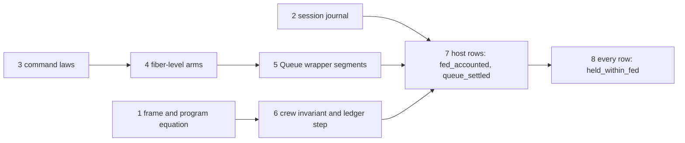

# queue-run: the three Queue goals of the crew

Status: a probe seat's packet (history, not authority). Family `queue-run`: requirements R10 and
R12, concepts `translation-simulation` and `reactive-scheduling`. The goals are `held_within_fed`,
`fed_accounted` and `queue_settled` in `Test/Dogfood/Scenario/QueueWorkers.lean`, on the program
`crew`. `releases_once` in the same file is the `release-once` family's. Branch
`probe/goals-queue-run`. The probe is `Probe.lean` in this folder, and the scratch probes and their
outputs are in `scratch/`.

## The one thing to know first

No goal is false on the evidence. All three rest on one inductive invariant of the crew's runs on
the fiber machine. Its parts are a stage table of every fiber, the stores, and the session's
ledger. The table is small and measured: 12 fiber shapes under host acts, 53 under every move
kind (section 8). No law can prove the invariant's step today. The machine's step laws cover one
plain fiber (`LoopedRows`, `src/Effect4/Laws/Program/Agreement/Machine.lean`), and the crew forks,
masks, opens scopes and waits on `Deferred` cells. That law of the machine is the bulk of the work, and every
scenario family needs it. The whole plan is about 285 to 500 hours, 120 to 185 of them that
general machine law (section 6.2).

Two traps stand before any proof.

1. **The elaboration of `crew total` does not reduce at a symbolic `total`**, and every goal
   quantifies over `total` (tested; section 8.3). At a fixed `total` it reduces: `rfl` takes 4.7
   seconds and `decide` 20 seconds. The stuck step is `elaborateModule`'s pass that places the
   module's layers, over a tree with a minted loop and a symbolic literal. It is the first slice's
   work.
2. **Need 5's reason is the op budget, not the mask.** The docstring says that no interruption is
   taken between a take's commit and its note "because the caller holds no mask". The operative
   fact is that the commit and the note run in one entry of the worker's fiber. An entry's op
   count stays far below the budget of 2048: at most 49 in 153,920 states (tested). So no yield
   falls between them, and no host act either. The proof must carry that count.

## 1. The goals: placement, reach, evidence

Each goal's placement is its docstring's (decisions rows 254 and 275). The probe restates each
proposition and proves it modulo two planned goals (section 4 of `Probe.lean`).

| Goal | Plain words | Concept; requirement; claim | Consumer |
| --- | --- | --- | --- |
| `held_within_fed` | Under every script of a funded run, each job stands among the held jobs at most as often as among the fed ones | `translation-simulation`; R10; an instance of `queue-expansion-agrees` and `waiting-request-obligation-preserved` | the claim `queueWorkers` |
| `fed_accounted` | Under every script of host acts, funded and at rest, the fed jobs are no more than the held ones, plus one where the feeder is gone | `reactive-scheduling`; R12; an instance of `waiting-request-obligation-preserved` and `queue-expansion-agrees` | `queueWorkers` |
| `queue_settled` | Under the same premises the queue's cell is settled: the first profile's shape, the waiting takers are the idle workers, an offer pends exactly where the feeder is idle, no job beside a taker, an offer only at a full buffer | `reactive-scheduling`; R12; an instance of `wait-registration-no-gap` and of the delivery clause of `waiting-request-obligation-preserved` | `queueWorkers` |

**Reach.** The program `crew` at every job count, every command budget at the compile budget 2000,
under `funded`. The first goal takes every script of the driver's alphabet with its raw rows. The
other two take scripts of host acts (`Move.hostAct`) and a machine at rest (`atRest`).

**Limits.** The goals are safety statements and invariants at rest. They establish no delivery of a
fed job, no order of two deliveries, no fairness, no starvation freedom and no liveness. They say
nothing of another client of the Queue. They read the queue's cell up to its handles.

**Evidence today** (tested, finite; each run is the Lean machine on `crew 3` at command budget 1000).

| Source | What it ran | States | Failing states |
| --- | --- | --- | --- |
| The scenario's controls (`controlsOf`) | 31 named runs, 35 controls, 18 green and 17 red | 31 | none |
| Seat WORKQ's search, part A | 17 host moves to length 4, six start states | 532,446 | none |
| Seat WORKQ's search, part B | 18 moves with the start, to length 4, totals 1 to 3 | 333,453 | none |
| Seat WORKQ's search, part C | 28 moves with raw rows, to length 3, six states | 136,590 | none |
| This probe, host acts | 19 host moves, with cancellations of helpers 4 and 5, to length 3, five states | 36,200 | none |
| This probe, every move kind | 31 moves: the host moves, forced yields, fires, raw evaluations, the middleware latch, an interruption with an interruptor, to length 3, five states | 153,920 | none |

Seat WORKQ's evidence is in `docs/research/2026-10-06-seat-WORKQ-receipt.md`, item 2.3, with the
files of `docs/research/2026-10-06-seat-workq-evidence/`. Its wide alphabet held no forced yield,
no middleware latch, no interruption with an interruptor and no cancellation of a helper. This
probe's census adds them (`scratch/Census.lean`, `scratch/CensusG1.lean`).

## 2. The seven needs, checked

The goals' docstrings list seven things that the goals would follow from. Each row says whether
the thing exists and whether it is true on the machine. It gives the statement that the thing
needs, and whether it is general (any client of the Queue) or about `crew`.

| # | The need | Exists | True on the machine | The statement it needs | General or `crew` |
| --- | --- | --- | --- | --- | --- |
| 1 | Each step of the queue's cell starts at a cell of the first profile, for a request that keeps `Requested`; the attempt laws give the model's reply and next state | The attempt laws are proved for one store step (`take_attempt_minted`, `offer_attempt_minted`, `poll_attempt`, `take_withdrawal_minted`, `offer_withdrawal_minted`, `src/Effect4/Laws/Library/Queue/Ops.lean`), and the step agreements under them (`takeStep_agrees` and its siblings, `src/Effect4/Laws/Library/Queue/Steps.lean`). The premise at a reached machine is not stated | Yes (tested: no failing state in 190,120; at rest the view is never malformed, since `settled` holds) | The cell part of the invariant: `cell s 0 = some (cellVal tb Val.nat r.s)`, `FirstRunInv r`, with the table `tb.handle n = ⟨n⟩` (a request's model identity is its identity handle's index) and `tb.hint` its current hint. A step's identity and hint are read at the wrapper's minted binders | General: any client whose Queue cells only the Queue's steps write. Distinct requests hold distinct identity handles, by a store-level freshness lemma (new; `deferredMake_fresh` asks for a typed world) |
| 2 | No other step writes the queue's cell, and only a worker's note writes `assigned` | No | Yes, by the program's text | A write-site lemma over `crew`'s elaborated program: every write's handle term, with the scope prefix that every point of the body holds, `[cell 0, cell 1, cell 2, cell 3, cell 4, deferred 0]` | `crew`. A decidable write discipline is the general form (the coordinator's note of 2026-10-06), and the goals do not need it |
| 3 | A take that exits with a job enters its caller's continuation once with that job | No | Yes: the commit and the return run in one entry (tested: no fiber inside that path between rows, in 190,120 states) | The take's commit segment: from the attempt with `(Model.take s ⟨id, 1, 1⟩).2.1 = .got [m]`, the segment posts one helper for each signal, pops the wrapper's frames and answers `Val.nat m` to the frames below, once | General: any client stack below the take |
| 4 | A request ends by its commit or by its withdrawal, and a withdrawal consumes nothing (decisions row 222) | The model's withdrawals and their step laws exist; the wrapper's interruption path is not stated | Yes (the controls `cancelled-waiting`, `cancelled-offer`, `cancelled-accepted`; the red controls `unwithdrawn` and `stays`) | The interruption segment of a parked take or offer: it runs `Model.withdrawTake` (`withdrawOffer`), posts that step's wake, and exits the operation with the interruption | General |
| 5 | At rest no worker stands between its take's commit and its note | No | Yes, by the op budget (the one thing above, trap 2). Measured: at most 49 ops in an entry, against 2048 | Two parts: (a) an entry whose count stays below the budget, with no yield override, runs to its next park or exit with no preemption; (b) the stage table holds no stage inside the window | (a) general, (b) `crew` |
| 6 | Each posted helper runs once, resolves its hint, and the waiter runs its next attempt inside the helper's task; at rest no signal is outstanding | No | Yes. An unstarted fiber is runnable (`isRunnable`, `src/Effect4/Api/Frontier.lean`), so a machine at rest holds no unstarted helper. A cancellation before the start is harmless: the helper is uninterruptible, and it still wakes the taker (tested: `scratch/HelperCancel.lean`) | The helper's segment: a fork with a deferred start, a daemon, uninterruptible, whose body is `Deferred.succeed hint answer`, runs once at its start task, completes the hint, resumes each waiter now, and exits | General |
| 7 | The model's run invariant holds along the run's steps | For the model alone: `first_step_inv`, `first_run_inv`, `first_run_flags` (`src/Effect4/Laws/Library/Queue/Invariant.lean`) | Yes | The link: a ghost model run advances by `Model.step .none r op` at each queue step of the machine, with `firstOp op` and `Requested r.s op`. For settledness at rest, the obligation fact: each request in `r.signalled` has an unstarted helper that targets its current hint | The link is general; the obligation fact's instance is `crew`'s |

Three corrections to the docstrings' wording, none of them a change of a statement.

- Need 5's reason (above).
- The attempt laws ask a membership premise (`member : Fits w (cellVal tb msg s) (Queue.cellTy A)`).
  A run of `crew` has no typed world: typed state is proved at the empty row table only, and the
  crew has two host rows. The segment lemmas use the step agreements with `step_updates`
  (`src/Effect4/Laws/Step/Store.lean`), which ask no membership.
- Need 7's link needs one fact that `first_run_inv` does not give: `r.signalled` is empty at rest.
  It is the obligation fact, and it is the crew's instance of `waiting-request-obligation-preserved`.

## 3. The general claims: through them, or not

| Claim | Through it? | Why | What the goals take from it |
| --- | --- | --- | --- |
| `queue-expansion-agrees` (R10) | Not through the claim as worded | It is layer 3 of the coordinator's note of 2026-10-06: agreement with a client written against abstract operations, which needs a machine that answers them (R6, parked). The goals need no abstract client | Its layer-1 and layer-2 parts: the cell invariant (need 1, need 7's link) and the wrapper's run laws (needs 3, 4, 6) |
| `waiting-request-obligation-preserved` (R10 to R12) | Yes, its wrapper half first | Its first clause is the helper's segment with the obligation fact; its second is need 4; its third is need 3's commit; its last, an old token is inert, exists (`drive_resume_wrong_token`, `src/Effect4/Laws/Machine/Clauses.lean`). The clause on a masked interruption is not used: `crew` holds no mask | The obligation fact's instance (settledness at rest) |
| `wait-registration-no-gap` (R12) | Yes, its wrapper half first | The take's attempt enrols and parks in one segment, and the model's `wake_blocked` says that the enrolment changes no wake | Part 4 of `settled` at rest |

**The recommendation: general first for the Queue's wrapper, `crew` for its own code.** The
wrapper's segments must be proved at the crew's paths anyway. Stating them for any client stack
below and any scope depth costs about 20 to 40 percent more than stating them at the crew's
paths. The extra work is two things. The shapes are written relative to the operation's path.
A frame lemma says that the stack below is not read until the operation's frames pop. Layer 3
is not on the path of these goals, and it should stay open.

## 4. The frame (proved, `Probe.lean` section 1)

No run-level invariant frame existed. The closest are the machine's lifts (`driveState_lift`,
`DecisionLift`, `FoldLift`, `src/Effect4/Laws/Machine/Lift.lean`) and the run's reachability
(`Run.Reached`, `src/Effect4/Laws/Run.lean`). The probe states the frame at the run, over the rows
that the tape reads, so that `funded` is used once and by name.

```lean
def rowReads (s : Run) (c : Command) : Bool :=
  !((Api.Runner.result s.runner c).phase == Phase.frontier) &&
    (Run.decisionOf s c (Api.Runner.result s.runner c).phase).all (Run.readsOn s)

def RowKeeps (allowed : Command → Prop) (I : Run → Prop) : Prop :=
  ∀ s c, allowed c → rowReads s c = true → I s → I (s.step c)

theorem play_keeps {allowed I} (keeps : RowKeeps allowed I) :
    ∀ rows s, (∀ c ∈ rows, allowed c) → (Run.tapeFrom s rows).2 = [] → I s → I (s.play rows)

theorem scenario_keeps {allowed I} (keeps : RowKeeps allowed I) (fuel b moves)
    (rowsAllowed : ∀ c ∈ scriptRows (openedAt fuel b) moves, allowed c)
    (start : I (openedAt fuel b))
    (h : Run.funded (Test.Dogfood.Scenario.play (openedAt fuel b) moves) = true) :
    I (Test.Dogfood.Scenario.play (openedAt fuel b) moves)

theorem hostAct_scriptRows : ∀ s moves, moves.all Move.hostAct = true →
    ∀ c ∈ scriptRows s moves, HostRow c
```

- `rowReads` is `tapeFrom`'s own test, so `funded` gives it at every row
  (`tapeFrom_read_cons`, `funded_rows`).
- A row that the tape reads ran its decision with enough command fuel: no command was dropped. So
  the step lemma never meets a cut, and `funded` is not carried in the invariant.
- `scriptRows` reduces a script to its rows (`play_scriptRows`), and `openedOf_play` ties
  `funded`'s fresh open to the script's start.
- `HostRow` is the rows that a host act plays. A reply receipt of a host act carries an exit
  (`.ofExit`).
- A goal with no budget premise needs the frame over every row, cut or not: `RowKeepsAll`,
  `play_keepsAll` and `scenario_keepsAll`, proved beside it. `RowKeepsAll.reads` gives `RowKeeps`
  from it.

Placement: concept `host-session-protocol`, requirement R13, beside `journal_replays`; consumer:
every scenario goal over scripts, the four families' first. It is general: any program, any
invariant. The coordinator unifies the four seats' frames; this one asks nothing of the program.

## 5. The invariant

The probe states the invariant's three obligations as two planned goals, in the frame's shape
(`Probe.lean` section 3):

```lean
structure CrewInvariant (total : Nat) (I : Run → Prop) : Prop where
  start : ∀ fuel b, Effect4.Api.Author.build (crew total) = .ok b → I (openedAt fuel b)
  step : RowKeeps (fun _ => True) I
  ledger : ∀ s, I s → ∃ a : Ledger, a.Shows (observe s) ∧ a.Conserved

structure CrewHostInvariant (total : Nat) (I : Run → Prop) : Prop where
  start : ∀ fuel b, Effect4.Api.Author.build (crew total) = .ok b → I (openedAt fuel b)
  step : RowKeeps HostRow I
  rest : ∀ s, I s → Run.atRest s = true →
    ∃ a : Ledger, a.Shows (observe s) ∧ a.Conserved ∧ a.custody = [] ∧
      a.lost.length ≤ (if (observe s).live 3 then 0 else 1) ∧ a.RestQueue (observe s)

proof_goal crew_invariant (total : Nat) : ∃ I, CrewInvariant total I
proof_goal crew_host_invariant (total : Nat) : ∃ I, CrewHostInvariant total I
```

The three goals follow from them, with the ledger's lemmas proved (`Probe.lean` sections 2 and 4).
The rest of this section names the `I` that each planned goal asks for.

### 5.1 The ledger (proved)

`Ledger` is the invariant's data: the queue's model run, the fed jobs, the assignment, the root's
leftover, the jobs in custody and the lost jobs. `Ledger.Shows` reads the observation's queue,
assignment, fed jobs and leftover. `Ledger.Conserved` is one permutation:
`fed ~ cellJobs ++ assigned ++ leftover ++ custody ++ lost`. Three lemmas give the readings.

| Lemma | From | Gives |
| --- | --- | --- |
| `heldWithin_of_ledger` | `Shows`, `Conserved` | `held_within_fed`'s reading |
| `accounted_of_ledger` | `Shows`, `Conserved`, no custody, `lost.length ≤ (if live 3 then 0 else 1)` | `fed_accounted`'s reading |
| `settled_of_ledger` | `Shows`, `RestQueue`: `FirstRunInv`, no signalled request, capacity one, the takers as the idle workers, one offer exactly where the feeder is idle | `queue_settled`'s reading |

A job is a natural number: `Jobs.take` answers `.nat`, and the session's envelope admits no other
answer (`admit`, `src/Effect4/Program/Admit.lean`). So the message map is `Val.nat`, which is
injective, and `held` is the ledger's held jobs under it (`held_of_shows`).

### 5.2 The stage table (measured; the classifier is `scratch/Stages.lean`)

Between two moves no fiber is running (tested: 190,120 states, none), and a receipt row changes
no machine, so the same holds between two rows. Each live fiber is parked at one of the shapes
below, or it is unstarted. A shape is a fiber's current primitive and stack. Each frame is read
as its constructor and the path of the point its name carries. Values, handles, tokens and the
compile fuel are free. `L₁ = [1,1,1,1,1,1,0,0,0,0,0,0,1]` and `L₂ = [1,1,1,1,1,1,0,0,1,0,0,0,0,1]`
are the workers' loop paths, `F = [1,1,1,1,1,1,0,0,1,1,0,0,0,0,1]` the feeder's. A member's fork
path is its loop path less its last two steps.

| Stage | Fiber | Current | Stack, top first | At rest |
| --- | --- | --- | --- | --- |
| gate | 0 | `async (registerAwait gate)` | `asyncFinalizer (withWaiter (cancelAwait _))`, `onExit (scopedExit _) false`, `onSuccess (cont [1,1,1,1,1,1])` | yes |
| taking | 1, 2 | `async (registerAwait hint)` | `asyncFinalizer (withWaiter (cancelAwait hint) _ _)`, `setInterruptible false`, `onExit (fin (L++[0,0,1,0,1,0,0,1,1,1,1,0,0])) false`, `onSuccess (cont (L++[0,0,1,0,1,0,0,1,1,1,1,0]))`, `whileLoop (loop (L++[0,0,1,0,1,0]))`, `onSuccess (cont (L++[0,0,1,0,1]))`, `setInterruptible true`, `onSuccess (cont (L++[0]))`, `whileLoop (loop L)`, `onExit (scopedExit _) false` | yes |
| running | 1, 2 | `async (external (L++[0,1,1,0,0]))` | `onFailure (caughtError (L++[0,1,1,0]))`, `onSuccess (cont (L++[0,1,1]))`, `whileLoop (loop L)`, `onExit (scopedExit _) false` | yes |
| calling | 3 | `async (external (F++[0,0]))` | `onSuccess (cont (F++[0]))`, `whileLoop (loop F)`, `onExit (scopedExit _) false` | yes |
| offering | 3 | `async (registerAwait hint)` | `asyncFinalizer (withWaiter (cancelAwait hint) _ _)`, `setInterruptible false`, `onExit (fin (F++[0,1,1,0,1,1,1,1,0])) false`, `setInterruptible true`, `whileLoop (loop F)`, `onExit (scopedExit _) false` | yes |
| unstarted | 1, 2, 3 | `withFiber (act fork)` | empty | no |
| helper | 4 and up | `sync (op _)`: the hint's completion | empty; uninterruptible; it may hold a recorded interruption | no |

Every move kind adds 41 shapes to these 12, 53 in all (tested at depth 3; section 8.2 groups
them). Some are the same stages with a recorded forced yield. Others are entries delayed by an
injected yield. Two are the root parked inside its scope's close. A yield falls only at an
entry's first op (`injectYield`, `src/Effect4/Machine/Fibers.lean`:
the override answers at the next check, and the latch allows one per entry). So the window from a
take's commit to its note never stands between two rows, under any script. Only the feeder may
hold a job between rows: parked on a yield, with the reply's value as its next answer.

### 5.3 The invariant's parts

The planned goals ask for an `I`. This is the one to build. `CrewAt total a s` holds when the run
`s` is the crew's and the ledger `a` reads it, through seven parts.

| Part | What it says | Owner |
| --- | --- | --- |
| P1 program | `s.built.program = crewProgram total`, the table is `[Jobs.take, Jobs.run]`, the compile budget is 2000 | `crew` (N1) |
| P2 session | the journal facts (`JournalOk`, N2), and `fedOf s = a.fed.map Val.nat` | general, with `crew`'s row name |
| P3 stores | the five cells once the root made them (`cellVal tb Val.nat r.s`, the opened and released lists, the assignment, the count); the gate and each request's identity and hints in the `Deferred` store, each live waiter registered on its current hint; the four scopes with their finalizers; no timer | `crew` |
| P4 stages | each fiber at a row of the stage table (section 5.2), with its data: a worker's request and hint, its running job and token, the feeder's request, hint and job, a helper's hint and answer, each point's scope holding the crew's six handles at the front | `crew` |
| P5 dispatchers | each unstarted fiber's start task on its parent's dispatcher, each helper's on the dispatcher of the fiber that posted it; the armed owners are those with a task | `crew`, from general laws |
| P6 the model run | the ghost `r` with `FirstRunInv r`; the takers are the taking workers' requests, in enrolment order; the offer is the offering feeder's; `r.signalled` is the requests with an unstarted helper that targets their current hint (the obligation fact) | general link, `crew` instance |
| P7 the ledger | `a.Conserved`; `a.custody` is the feeder's job where it waits on an injected yield with the reply as its next answer, and empty otherwise; `a.lost.length ≤ 1`, and a lost job means the feeder is gone | `crew` |

Under host acts no injected yield occurs, so P7's custody is empty and P4 holds the twelve host
stages: that is `crew_host_invariant`'s `I`. `crew_invariant`'s `I` adds the yield-parked and
override stages and the root parked inside its close.

## 6. The decomposition

### 6.1 Proved in `Probe.lean`

| Declaration | What it states | Placement |
| --- | --- | --- |
| `rowReads`, `RowKeeps`, `tapeFrom_read_cons`, `play_keeps` | the frame over the rows that the tape reads | `host-session-protocol`, R13; consumer: every scenario goal over scripts |
| `RowKeepsAll`, `RowKeepsAll.reads`, `play_keepsAll`, `scenario_keepsAll` | the frame over every row, for a goal with no budget premise | the same; consumer: the goals of `Atomic`, `Timeout` and `Workers.releases_once` |
| `scriptRows`, `play_scriptRows`, `journal_play`, `openedOf_play`, `funded_rows`, `scenario_keeps` | a script's run is its rows' run, and `funded` reads them to the end | the same |
| `HostRow`, `hostAct_rows`, `hostAct_scriptRows` | a script of host acts plays host rows only | the same; consumer: the goals at rest |
| `Ledger`, `Ledger.Shows`, `Ledger.Conserved`, `held_of_shows`, `fed_perm` | the ledger and its readings | `translation-simulation`, R10; consumer: the three goals |
| `heldWithin_of_ledger` | the reading of `held_within_fed` | `translation-simulation`, R10 |
| `accounted_of_ledger` | the reading of `fed_accounted` | `reactive-scheduling`, R12 |
| `quiet_nil`, `spent_one`, `within_one`, `settled_of_view`, `settled_of_ledger` | the reading of `queue_settled`, from the model's run invariant | `reactive-scheduling`, R12, a step of `wait-registration-no-gap` |
| `stateJobs_afterAccept`, `take_jobs`, `offer_jobs`, `poll_jobs`, `withdrawTake_jobs`, `flatMap_split`, `withdrawOffer_jobs` | the model's conservation of jobs, one first operation at a time | `translation-simulation`, R10, a step of `queue-expansion-agrees`; consumer: P7's step |
| `exit_eq` | the root's exit of any run is its machine's: a reading with no tape keeps the machine | `host-session-protocol`, R13; consumer: every reading of `rootExit` |
| `opened_exit`, `Ledger.empty`, `ledger_opened` | the ledger at the opened run: the frame's start, on the ledger's part | `translation-simulation`, R10; consumer: `crew_invariant`'s `start` |
| `submitValue`, `appliedValue`, `fedOf_eq`, `rows_step`, `machine_refused`, `bound_refused`, `seenAt_refused`, `submitValue_refused`, `appliedValue_refused`, `fedOf_refused`, `shows_refused` | one row of the step proved outright: a refused row keeps the machine and the fed jobs, so it keeps what the observation shows of a ledger. `fedOf` is restated with its two readers named, so that its lookups rewrite under its binder | `host-session-protocol`, R6 (the journal's readers); consumer: N2 and N8 |
| `held_within_fed_probe`, `fed_accounted_probe`, `queue_settled_probe` | the three goals, modulo `crew_invariant` and `crew_host_invariant` | each goal's own |

### 6.2 New lemmas

Hours are a seat's working hours, with the narrow build and the audit. "General" means any
program, or any client of the Queue. The statements are sketches where the exact form waits on the
general laws' conventions (N3).

| Id | Lemma | General or `crew` | Placement | Route | Hours | Traps |
| --- | --- | --- | --- | --- | --- | --- |
| N1 | `crew_built : build (crew total) = .ok b → b.program = crewProgram total ∧ b.table = crewTable` | `crew`, with one general lemma | `translation-simulation`, R10 (a fact of the program) | Find the stuck step of `elaborateModule` at a symbolic `total` (section 8.3). Prove that its pass that places the module's layers (`placeholderSites`, `placeRounds`, `pointAtPlaced`) is the identity on a tree that names no layer, by the program family's generated fold. Then the main program's elaboration reduces by `rfl`: the minted loop alone reduces at a symbolic literal (tested). Write `crewProgram` as that reduct | 8–16 | `decide` refuses free variables; `rfl` gives up in 0.2 s; each re-reduction of the program costs 5 s, so state the equation once |
| N2 | `JournalOk` with `journalOk_open`, `journalOk_step : RowKeeps (fun _ => True) JournalOk`, and `fedOf_step : JournalOk s → fedOf (s.step c) = fedOf s ++ fedRow s c` | general: write `fedOf` as `appliedOn "Jobs.take"` | `host-session-protocol`, R6 and R13 | `JournalOk`: each active call has its accepted `bind` row, each stored reply its accepted `submit` row, each applied key its earlier `bind` and `submit`, and no key is bound twice (tokens are fresh: `nextToken` grows). Then `seenAt` and the `submit` lookup of an earlier applied key are stable under an appended row (`find_append_fresh`, `src/Effect4/Laws/Run.lean`) | 12–20 | `fedOf` reads the whole journal of the final run, not the run at its row |
| N3 | The command laws on any machine, for a fiber whose current primitive is plain (`PlainCode`): a loop step, a store operation, a finish, with the op count below the budget, no override and no deferred interruption; the other fibers untouched | general | `translation-simulation`, R8, beside `drive_loop_running` | Generalize `src/Effect4/Laws/Program/Agreement/Machine.lean` from its one-fiber machine `M` to `m.update`, and carry the count: it starts at zero at each `Cmd.evaluate` and grows by one at each iteration | 25–40 | `rfl` on whole commands does not scale (section 8.4) |
| N4 | The fiber-level arms on any machine: a fork with a deferred start; `Deferred` make, completion with its resumes now, and the await's registration, park and cancel; an external call's park and its answer decision; a scope's open and its sequential close, which awaits each fiber; `acquireRelease`; the mask's frames; an interruption, through `interruptRecord` and the failure's pop through `asyncFinalizer`, `onExit` and `setInterruptible` frames; the loop's frames; `catchIf`; a flush as rounds of `fireState`; an answer decision as preparation and resume | general | `translation-simulation`, R8 to R12; each a step of `posted-task-decision-preserves`, `waiting-request-obligation-preserved` or the scope laws | One law per arm of `evaluatePrim` and `driveStep` that the crew reaches (`src/Effect4/Machine/Fibers.lean`), each on `m.update`, each with the frame fact that the stack below the arm's frames is not read | 95–145 | a store operation's compile reads its handle's shape, so a law takes a cell or `Deferred` handle, not a free value (section 8.4); `stepDecisionState` drops a loop's leftover commands, so a law takes `rowReads`, not `funded` |
| N5 | The Queue wrapper's segments, at any client: take's commit, enrolment, renewal and interrupted withdrawal; offer's acceptance, pending wait, answer and interrupted withdrawal; poll; size; `postAll`; the posted helper | general | `translation-simulation`, R10, parts of `queue-expansion-agrees`; the helper and the withdrawals are parts of `waiting-request-obligation-preserved` | Compose N3 and N4 along each operation's frames, with the step agreements and `step_updates` at the store step; `take_attempt_minted`'s scope premises discharge the minted binders | 40–70 | the attempt laws' `member` premise needs a typed world: use the `_agrees` laws |
| N6 | `CrewAt` (section 5.3) and the stage readers of section 5.2 | `crew` | `translation-simulation`, R10 | Definitions, from the census's shapes. Check the classifier on every state of the scripts before proving anything (`scratch/Stages.lean` classifies 50,680 states) | 12–20 | the two workers stand at different paths: write a stage with its loop path as a parameter |
| N7 | The crew's segments: the root's setup, its close after the gate, its interruption; a worker's start, its reply, its handled failure, its unhandled failure, its interruption at the call and at the queue, its wake; the feeder's start, its fed reply, its failed reply, its interruption at the call and in the offer, its answer; the helper | `crew` | `translation-simulation`, R10 (feeder and worker); `scope-lifetime-finalization`, R11 (the releases); `reactive-scheduling`, R12 (the wake) | Each from a stage with its data to the next stage, by N3 to N5 | 50–100 (17 segments) | the gate's completion resumes the root inside a worker's segment: the root's close interrupts that worker while it runs, and the worker takes the recorded interruption at its next iteration (tested: section 8.5) |
| N8 | The row laws: `CrewAt` kept by each host row (a receipt, a refused row, a reply application to each stage, the root's start, a flush, a clock step, a cancellation of each stage), then by each other row (a fire, a raw evaluation, a forced yield, the middleware latch, an interruption with an interruptor) | `crew` | `reactive-scheduling`, R12 | Compose N7 by the dispatch order of each decision; the clock step is a no-op, since the crew sleeps nowhere | 30–60 | a reply receipt changes `fedOf`'s lookups only through N2 |
| N9 | The ledger's step: P7 kept by each segment, with the conservation lemmas of section 6.1 | `crew` | `translation-simulation`, R10 | One lemma per segment that touches the cell or the assignment | 10–20 | `Model.step` skips an offer whose identity pends already: the offer's identity is fresh, by N4's `Deferred` law |
| N10 | The assembly: `crew_host_invariant` and `crew_invariant` from P1 to P7; the three goals in place (`proof_goal` to `theorem`) | `crew` | each goal's own | `Probe.lean` sections 3 and 4 | 4–8 | — |

**Total: about 285 to 500 hours.** N3 and N4 are 120 to 185 of them, and they are general: every
scenario family needs them (section 10). N5 is the Queue's general part, 40 to 70. The rest is the
crew's.

## 7. The slices for Codex, in order

Each slice lands by explicit paths after a narrow build of the modules it touches, and audits them
with `#axiom_audit`. No slice changes a program, the machine or a printer, so no behaviour gate of
`make check-full` is owed. Each slice that proves a planned goal replaces its `proof_goal` in place
and keeps its placement.



| Slice | Lemmas | Where | Runs beside | Narrow build and audit |
| --- | --- | --- | --- | --- |
| 1 | the frame of `Probe.lean` section 1; N1 | the general frame in a new `src/Effect4/Laws/Run/Keeps.lean`; the driver's parts (`scriptRows`, `scenario_keeps`, `HostRow`) in `Test/Dogfood/Scenario.lean`; N1 beside the crew | 2 and 3 | `LEAN_NUM_THREADS=2 lake build Effect4.Laws.Run.Keeps`; `lake env lean Test/Dogfood/Scenario.lean`; `#axiom_audit Effect4.Laws.Run.Keeps` |
| 2 | N2 | a new `src/Effect4/Laws/Run/Journal.lean` | 1 and 3 | the module; `#axiom_audit` on it |
| 3 | N3 | beside `src/Effect4/Laws/Program/Agreement/Machine.lean`, a module of the multi-fiber command laws | 1 and 2 | the module and its direct dependents; `#axiom_audit` |
| 4 | N4, in four parts that can run in parallel once slice 3 fixed the conventions: forks and dispatch; `Deferred` and external calls; scopes, `acquireRelease` and the mask's frames; interruption | one module each, under `src/Effect4/Laws/Machine/` | each other | each module; `#axiom_audit` on the four |
| 5 | N5 | a new `src/Effect4/Laws/Library/Queue/Run.lean` | 6 | the module; `#axiom_audit` |
| 6 | N6, N9, and the conservation lemmas of `Probe.lean` (model only, so into `src/Effect4/Laws/Library/Queue/`) | the invariant beside the crew, as a `Test` support file | 3 to 5 | the support file with `lake env lean`; `#axiom_audit` on the Queue's law module |
| 7 | N7 and N8 for host rows; `crew_host_invariant`; `fed_accounted` and `queue_settled` in place | the support file; `Test/Dogfood/Scenario/QueueWorkers.lean` | — | `lake env lean Test/Dogfood/Scenario/QueueWorkers.lean` (the gate plays the 31 named runs); `#axiom_audit Test.Dogfood.Scenario.QueueWorkers` |
| 8 | N8 for the other rows; `crew_invariant`; `held_within_fed` in place | the same | — | the same |

**The order of the goals.** The host invariant comes first: twelve stages, no forced yield, no
custody between rows. `held_within_fed` comes last: it adds 41 stages (section 8.2) and the
feeder's custody.

## 8. Measurements

Every run below is the Lean machine on `crew 3` at the command budget 1000, through
`lake env lean` on a scratch file of `scratch/`. Each is tested, finite.

### 8.1 The census

`scratch/Census.lean` and `scratch/CensusG1.lean` play every script of an alphabet to a length.
They start from five states: the fresh run started, `parked`, `running`, `blocked`, and a fed
job's reply applied with no flush. They judge the goals on every funded state, and they record
each live fiber's shape.

| Alphabet | Length | States | Funded | At rest | Largest op count | A fiber running between rows | Shapes (at rest) | Failing states |
| --- | --- | --- | --- | --- | --- | --- | --- | --- |
| 19 host moves | 3 | 36,200 | 36,200 | 23,600 | 48 | none | 12 (7) | none |
| 31 moves of every kind | 2 | 4,965 | 4,965 | 3,128 | 49 | none | 36 (14) | none |
| 31 moves of every kind | 3 | 153,920 | 153,920 | 97,718 | 49 | none | 53 (14) | none |

The host alphabet is seat WORKQ's 17 moves with the cancellations of helpers 4 and 5. The other 12
moves are of five kinds:

- forced yields of fibers 0 to 4;
- fires of fibers 1, 3 and 4;
- raw evaluations of fibers 4 and 5;
- the middleware latch;
- an interruption of worker 1 by fiber 2.

At every move kind only `held_within_fed` is judged, as the goals ask.

`scratch/Stages.lean` checks the stage table on the 19 host moves to length 3. It starts from
seven states: the five above, and the scripts of `closed` and `cancelled-waiting-closed`. Every
fiber of every state is at a row of the table: 50,680 states, all classified, and each of the
twelve stages occurs.
`scratch/HelperCancel.lean`: a host cancels helper 4 before its start; the helper still wakes
worker 1, and the queue is settled.

### 8.2 The extra shapes of every move kind

`scratch/censusg1.out` lists the 41 shapes that every move kind adds to the twelve host stages, at
length 3. They form three groups.

| Group | Count | What it is |
| --- | --- | --- |
| A host stage with a recorded forced yield (`yieldOverride = some true`) | 12 | each of the twelve stages, unchanged but for the flag; the override answers at the fiber's next entry |
| An entry delayed by an injected yield | 27 | the fiber is parked on its yield's token, its current primitive is `success` and its top frame `onSuccessConst` over the answer it was resumed with. Above the taking frames (a wake), the running frames (a host reply), the calling frames (the feeder's reply), the offering frames (the offer's answer), the gate (the root's wake), or at a start (a member's or a helper's). With or without a recorded interruption and a fresh override |
| The root parked inside its scope's close | 2 | uninterruptible, with a recorded interruption: the root was cancelled, and it awaits a member whose forced yield holds its exit |

So `crew_invariant`'s stage is a host stage with two flags, or one more stage of the root. The
flags are the override and the delayed entry with its answer. Only one delayed entry holds a job: the feeder's,
above its calling frames, with the reply's value as its answer. That job is P7's custody.

### 8.3 The kernel and the elaboration

| Test | Result |
| --- | --- |
| `decide` that `elaborateModule (crew 3)` succeeds | 20 s of tactic, 3 s of checking (`scratch/KernelCost.lean`) |
| `rfl` of the same | 4.7 s (`scratch/KernelSymbolic.lean`) |
| `rfl` at a symbolic `total` | fails after 0.2 s |
| `decide +kernel` at a symbolic `total` | refused: the goal holds a free variable |
| Bisection (`scratch/KernelBisect0.lean`, `scratch/KernelBisect.lean`, `scratch/KernelBisect2.lean`) | a module whose main is a test on the symbolic literal reduces, and so does that test in a scope; the same test inside `iterateWith` does not, nor does one worker; one worker at three jobs does. A literal inside `iterateWith` does not reduce; the raw `iterate` lift with written names does; `iterateWith` alone, outside `elaborateModule`, does. So the stuck step is in `elaborateModule`'s pass over the finished tree |

### 8.4 Symbolic execution on the machine

`scratch/SymbolicStep.lean` and `scratch/SymbolicSteps.lean` run worker 1's code after its take
returns a job, at the crew's own evaluator. The job, the values in scope, the stack below and the
stores are symbolic.

| Test | Result |
| --- | --- |
| The continuation's code at the body's point (`contAOf`), by `rfl` | 6.7 s; its head is the next bind's continuation, as computed |
| One command (the pop and the continuation), by `rfl` | 8.0 s |
| Two commands, with the scope's values all symbolic | fails: the note's store operation reads the shape of the assignment's handle |
| Three commands, with the crew's handles in scope and everything else symbolic: the note appends `[v, 1]` to the assignment | 69.6 s |

So the kernel can run the crew's code on symbolic data, but a whole segment by `rfl` does not
scale. One command costs about 3 seconds beyond the program's 5, and three commands cost 70. A
segment holds 20 to 100 commands. That is why N3 and N4 are laws per command and per arm, which a segment
chains by rewriting.

### 8.5 The decision that closes the pool

`scratch/GateTrace.lean` prints the trace of the last move of the run `closed`: worker 1's third
finished job. Worker 1 is resumed by its reply. Its gate's completion resumes the root inside
worker 1's entry. The root's close interrupts the feeder, then worker 2, then worker 1. Worker 1
is running, so its interruption is only recorded. The root parks on worker 1's exit. Worker 1
takes the interruption at its next iteration and exits, and the root resumes and finishes. So
N7's segment of the root's close is nested in a worker's segment.

## 9. What the goals do not establish, and what to watch

The goals establish what their docstrings say, and no more. They establish no delivery of a fed
job, no order of two deliveries, no fairness, no starvation freedom and no liveness. They say
nothing of another client of the Queue. An invariant at rest is no progress. Five more limits and cautions follow.

1. **No statement is false on the evidence.** 190,120 states of the census and seat WORKQ's
   1,002,489 judge the goals, and none fails. The evidence is bounded: one program at three jobs,
   scripts of at most four moves beyond a start state. It is tested, not proved.
2. **The planned goals are frames, not invariants.** `crew_invariant` and `crew_host_invariant`
   each ask for some `I` with the three obligations. A proof constructs `I`; section 5.3 names the
   one to construct. The names do not fix it.
3. **`funded` enters only as `rowReads`.** The invariant is kept by each row that the tape reads.
   A cut row drops a loop's leftover commands and leaves a fiber inside a segment, with no task,
   outside every stage. So the designed invariant needs the premise. Seat WORKQ found no failure
   of `held_within_fed` without `funded` (its item 2.2). Proving that form needs an invariant at
   every op boundary, and this packet does not recommend it.
4. **`held` reads the cell through `queueView`, which answers `none` for a malformed cell.** Then
   `held` drops the queue's jobs, and `heldWithin` holds by default. P3 states the cell's encoding
   at every step, so no proof leans on that default.
5. **The goals quantify over every job count**, `0` included: at `0` the gate never completes, and
   the statements still hold. That quantification is trap 1 (N1).

## 10. Shared machinery

The general parts that another family likely needs too. The coordinator unifies the four seats'
frames; this seat's asks nothing of the program.

| Machinery | This packet's form | Who else needs it |
| --- | --- | --- |
| The frame over rows that the tape reads | `rowReads`, `RowKeeps`, `play_keeps`, `scriptRows`, `play_scriptRows`, `scenario_keeps`, `HostRow`, `hostAct_scriptRows` (proved) | every goal over scripts. A goal that assumes `funded` (`QueueWorkers.releases_once`) uses it as it stands. A goal with no budget premise (`Workers.releases_once`, at every budget; `bounded`, `counted`, `committed`, `cleans_once` of `Atomic`; `stale_never_applies`, `cleanup_keeps`, `retries_declared` of `Timeout`) needs the frame without `rowReads`: an invariant kept by every row, cut or not. That frame is `RowKeepsAll` with `scenario_keepsAll` (proved) |
| A run's readings from its machine | `exit_eq`, `rows_step`, `machine_refused` (proved) | every observation that reads the root's exit, a cell or the rows |
| The session's journal facts | N2: `JournalOk` and the step law of an applied-reply reader | `stale_never_applies` and every reader of receipts, applications or retirements |
| The multi-fiber command laws and the fiber-level arms | N3 and N4 | every family needs N3. Each needs the arms that its program reaches: forks (`Workers`, `Atomic`), scopes (`Workers`, `Routing`), `Deferred` (`Workers`), host calls (`Workers`, `Routing`, `Timeout`). `Timeout` also races an attempt against a timer: the race and timer arms, which the crew does not reach |
| No preemption inside an entry | N3's count: an entry whose op count stays below 2048, with no override, runs to its park or exit | every goal at rest |
| The stage-table method | `scratch/Census.lean`, then `scratch/Stages.lean`: measure the shapes, write the classifier, check it on every searched state, then define the invariant | every family whose invariant reads fibers' positions |
| The elaboration at a symbolic parameter | N1's general lemma on `elaborateModule`'s pass that places the module's layers | every goal that quantifies over a program's number: `Workers.releases_once` takes its `crew total`, and every budget with the compile budget, so its points' fuel is symbolic too |
| The wrapper's run laws | N5 | the release-once family where a worker waits at the Queue (`QueueWorkers.releases_once`) |

`releases_once`, on this file's program, shares the invariant of section 5.3: its observation is
the `released` cell, which P3 holds and P4's segments write. Its own part is that each member's
scope runs its release once. The two families should build one `CrewAt` and read it twice.

## 11. Receipt

**Branch** `probe/goals-queue-run`. **Base** `5b40699ae` (`refactor/phase1-phase3`, the main
checkout's head at the dispatch). The worktree was created on `main` at `9187b9b6`, which has no
`Test/Dogfood/`; the branch was cut from `5b40699ae` before any edit.

**Changed files.** Only this folder: `README.md`, `Probe.lean`, and `scratch/` (the scratch probes
and their outputs).

**Commands and results** (each in the worktree; `LEAN_NUM_THREADS=2`; the free disk checked
before each build: 16 GB, then 14 GB).

| Command | Result |
| --- | --- |
| `lake build Test.Dogfood.Scenario.QueueWorkers` | restored from the cache: `Build completed successfully (1028 jobs).` |
| `lake build Effect4.Laws.Library.Queue.Invariant` | `Build completed successfully (8 jobs).` |
| `lake build Effect4.Laws.Library.Queue.Steps` | `Build completed successfully (534 jobs).` |
| `lake env lean docs/research/2026-10-10-goals-packet/queue-run/Probe.lean` | exit 0, no warning; its one output line is the audit below |
| `lake env lean` on each scratch probe | the outputs in `scratch/*.out`. Four exit 1 by design: `KernelBisect0.lean`, `KernelBisect.lean`, `KernelSymbolic.lean` and `SymbolicSteps.lean`. Each of their errors is an expected failure that section 8 reads |

**Axioms.** `#packet_audit` at the foot of `Probe.lean` runs the gate's exact walk
(`ProofGraph.reachedAxiomsMany`) over every declaration of the probe's namespace, with the planned
goals as stops. Its output:

```text
#packet_audit: 131 declarations within [propext, Quot.sound]; 2 planned goals: [QueueRunPacket.crew_host_invariant,
 QueueRunPacket.crew_invariant]; 3 declarations rest on goals:
  QueueRunPacket.fed_accounted_probe rests on [QueueRunPacket.crew_host_invariant]
  QueueRunPacket.held_within_fed_probe rests on [QueueRunPacket.crew_invariant]
  QueueRunPacket.queue_settled_probe rests on [QueueRunPacket.crew_host_invariant]
```

**Open obligations.** The two planned goals, and N1 to N10 of section 6.2 under them.

**Bounded or host-only evidence.** Every test of section 8 is finite, on the Lean machine. No run is
a host run. The census and the classifier's check are bounded: one program at three jobs, scripts
to length 3 from five or seven start states.
