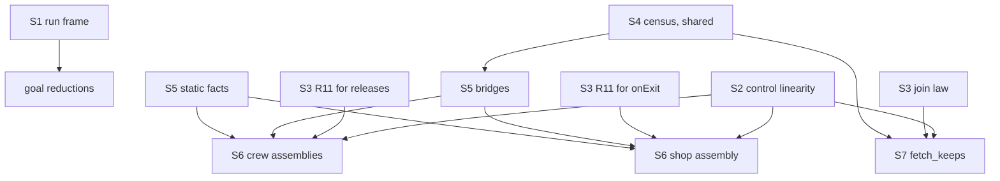

# Release at most once: the plan for four goals (R11)

Status: a probe seat's packet (history, not authority). It proposes and rules nothing. Branch
`probe/goals-release-once`, base `5b40699ae` (`refactor/phase1-phase3`). `Probe.lean` beside this
note compiles with `lake env lean` and proves each goal modulo the planned goals that it declares.

## The one thing to know first

All four goals rest on one new general law, and it is not the scope's own law. It is **control
linearity**: a node that is once-placed in the program is entered at most once along any run of
the machine. R11's clause "at most once per registration" is a second, smaller general law. Neither
reaches a goal alone, because each goal counts log entries by identity. A log entry is bounded only
when both the registering node and the finalizer's body are bounded, and those are linearity facts.

Two more findings bear on the plan.

- `cleanup_keeps` (Timeout) is no at-most-once statement. It needs a program-specific order of the
  timeout form on top of per-fiber linearity. It is false at the machine level once a direct answer
  is allowed (tested, a construction below). So its frame must be the run's decisions, which
  `scenario_runReachable` provides (proved).
- `QueueWorkers.releases_once` does not need its `funded` premise. A budget cut drops work and never
  repeats it (reading, `src/Effect4/Machine/Fibers.lean`). The probe proves the goal without the
  premise, modulo the same planned goals (`queueWorkers_releases_once`).

## Summary per goal

| Goal | Route | New lemmas (general / specific) | Hours | Confidence that the goal holds |
| --- | --- | --- | --- | --- |
| `Workers.releases_once` | frame, linearity at the two `acquireRelease` nodes, R11 per registration, bridge | 2 general, 2 specific | 12 to 22 after the shared laws | high: 90,748 runs tested, every prefix |
| `QueueWorkers.releases_once` | as Workers, three members | 2 general, 2 specific | 14 to 26 after the shared laws | high: 7,999 scripts and 557 budget-sweep runs tested, cut runs included |
| `Atomic.cleans_once` | frame, linearity at six `onExit` nodes, R11 for `onExit`, bridge | 2 general, 2 specific | 12 to 22 after the shared laws | high: 57,375 scripts tested |
| `Timeout.cleanup_keeps` | frame over the run's decisions, per-fiber linearity, the join law, the attempts' order, census | 2 general (per-fiber linearity, the join law), 2 specific (`fetch_attempts_ordered`, `fetch_keeps`) | 40 to 60 after the shared laws, the join law included | medium-high: 123,272 runs tested; the proof needs an ordering invariant |

Three shared laws come first. Control linearity takes 56 to 80 hours, and the two R11 laws take 20
to 32. The census of a cell's writers takes 16 to 24, and the store family shares it. Section
"Slices" orders them.

## 1. Facts read in the source

Each fact is **reading** evidence, from the declarations named.

- A run changes its machine at two places. `HostSession.advance` writes
  `(stepDecisionState (interpOf p t) fuel m d).1`. `HostSession.applyReply` writes `steppedBy p fuel
  t m d`, the same expression (`src/Effect4/Program/Admit.lean`). `bindCall`, `submit` and `retire`
  keep the machine (`src/Effect4/Api/HostSession.lean`).
- A run hands its machine no direct answer. `advance` refuses `answerAsync` (`directAnswer`).
  `applyReply` steps the answer of a preflighted reply, at a host call that a fiber is parked on
  (`preflight_envelope`, `src/Effect4/Laws/Api/HostSession.lean`).
- A budget cut drops work and never repeats it. `driveState` returns the commands that its fuel
  left, and `stepDecisionState` keeps the machine and the receipt only. `fireStep` skips the later
  tasks of a drained snapshot. A fiber whose `Cmd.loop` was dropped stays `running`, and neither
  `Cmd.evaluate` nor `interruptRecord` runs it again (`src/Effect4/Machine/Fibers.lean`).
- A scope close writes its state first. `scopeCloseSnapshot` sets the scope to `closed exit` and
  hands its close order to one program (`src/Effect4/Machine/Stores.lean`). A closed scope has an
  empty close order, so a second close runs nothing (`Effect4.Scope.close_twice`,
  `src/Effect4/Machine/Scope.lean`). A registration after the close runs the release at once and
  registers nothing (`afterScopeAdd`, `src/Effect4/Program/Compile.lean`).
- A compiled release is the finalizer name `FinName.foreign capture`. Its program resolves, in
  `suspendBodyAt`, to the release's code at the capture's point (`src/Effect4/Program/Compile.lean`).
- An `onExit` finalizer starts at `evaluatePrim.finalizerOr`: the exit meets the `OnExit` frame, the
  frame is popped, and the trace gets `RunEvent.finalizerProgram` (`src/Effect4/Machine/Fibers.lean`).
- The trace is the machine's history. `RunMachine.emit` is its one writer, it only appends, and
  `Api.load` starts it empty. The law graph says that it only grows (`RunMachine.Extends`,
  `stepDecision_trace_mono_all`, `src/Effect4/Laws/Machine/Approximation.lean`). The frame machine
  traces every frame push with its frame (`FrameFiber.step`, `src/Effect4/Machine/Frames.lean`). A
  compiled frame's name carries its program point, so a node's entry is a countable event.
- `Guard.Reachable` (`src/Effect4/Laws/Program/Guard/Core.lean`) admits every raw decision at every
  budget, a direct answer included. `reachable_lift_pure` carries a machine fact along it.

## 2. The frame: each goal is a statement about the machines that a run reaches

`Probe.lean`, sections 1 and 2, proves the frame outright (**proved**, within `[propext, Quot.sound]`
by the gate's walk; see "Evidence").

- `RunDecision m d`: a decision that is no direct answer, or an answer at a parked host call.
- `RunReachable p t cf m`: reachable from `Api.load p cf` by such decisions, each at its own budget.
- `step_machine`: every row keeps the machine, or steps it by a `RunDecision`.
- `scenario_runReachable`: the machine of every script of the driver's alphabet, raw rows included,
  is `RunReachable` at the opened compile budget.
- `RunReachable.reachable`: such a machine is `Guard.Reachable`.

Each goal then follows from a statement about cells at every `RunReachable` machine:
`workers_releases_once_of`, `queueWorkers_releases_once_of`, `atomic_cleans_once_of` and
`timeout_cleanup_keeps_of`. The session's ledger plays no part.

The frame is shared by all thirteen goals that range over scripts. Its names, for the coordinator's
unification of the four seats' frames:

- `MachineKeeps p t I := ∀ m fuel d, I m → RunDecision m d → I (steppedBy p fuel t m d)`;
- `runReachable_keeps`: `MachineKeeps p t I → I (Api.load p cf) → RunReachable p t cf m → I m`
  (proved);
- with `scenario_runReachable`, `I` holds after every script.

No such frame existed. The closest are `Run.Reached` and `journal_replays`
(`src/Effect4/Laws/Run.lean`), which say nothing of the machine alone, and `Guard.Reachable` with
`reachable_lift_pure`, which admits direct answers. A family whose invariant holds under every raw
decision can use `Guard.Reachable` and `RunReachable.reachable`. A family whose argument reads why a
park resumed must use `RunReachable`.

## 3. The central question: R11's whole-run clause

R11 reads "at most once per registration, counted by identity" (`docs/core/system-map.md` §8). Its
proved nodes are laws of one scope value and one close: `close_twice`, `close_idempotent`,
`closeOrder_eq`, `close_reentrant_add` (`src/Effect4/Machine/Scope.lean`) and `runState_complete`,
`runState_prefix` (`src/Effect4/Laws/Machine/ScopeMachine.lean`). None speaks of a run.

### 3.0 What R11 already has, and what each node gives the plan

R11's row in `generated/semantics.md` lists these nodes as proved (**reading** of the report and the
sources).

| Node | Where | What it gives the plan |
| --- | --- | --- |
| `close_twice`, `close_idempotent`, `closeOrder_eq`, `close_reentrant_add` | `src/Effect4/Machine/Scope.lean` | one scope value: a second close runs nothing; the close order is the registrations reversed; a step of `release_starts_le_registrations` at the store's close |
| `runState_complete`, `runState_prefix`, `runState_restore` | `src/Effect4/Laws/Machine/ScopeMachine.lean` | a model of one sequential close, apart from the fiber machine; `runState_prefix`'s partition (captured, waiting, pending) is the pattern of the close walk's accounting |
| `saved_mask_chain_runs`, `compiled_mask_chain_runs`, `saved_mask_region_bracket`, `stepped_live` | `src/Effect4/Laws/Machine/MaskRuns.lean`, `src/Effect4/Laws/Program/MaskBracket.lean` | the nearest template: a stack-shape invariant carried through every command and decision by `Machine.Lift`; copy its part B for the coverage invariant |
| `close_refuses`, `drain_waits`, `giveBack_front`, `giveBack_once` | the Pool model | none for these goals; they are a module's model |
| `guardState_reachable`, `reachable_lift_pure`, `driverContract` | `src/Effect4/Laws/Program/Guard/` | the lift over `Guard.Reachable` and the outer drivers (fire, flush, advance), reusable as they stand |
| `stepDecision_trace_mono_all` | `src/Effect4/Laws/Machine/Approximation.lean` | the trace only grows, so a count of its events never falls |

None of these speaks of a whole run's finalizers. The open part "release at most once per
registration, counted by identity" (DB-07) names exactly this packet's four goals.

### 3.1 What the clause says over a run

The machine keeps no record of past finalizer runs, but its trace does. So the clause has an exact
reading over the trace, for each kind of registration (**declared** in `Probe.lean`):

- `release_starts_le_registrations`: for each path `q`, the release starts of the `acquireRelease` at
  `q` are no more than its registrations there. A registration is the push of
  `onSuccess _ (afterScopeAdd _ (foreign c))`. A start is the push of
  `onSuccess _ (releaseUnder p _ _)`.
- `finalizer_starts_le_pushes`: for each path `q`, the finalizer starts of the `onExit` at `q` are no
  more than its pushes. A per-fiber reading is also true (`scratch/marks.out`).

Both hold for every program and every raw decision. Their routes are an accounting of the
registrations still owed. For a release, the owed ones stand in a scope's table or in a close walk's
`closeSeq` list. They also stand in a parallel close's daemons, and in a registration's window
between `scopeAdd` and `afterScopeAdd`. For an `onExit`, the owed ones are the `OnExit` frames on the fiber's stack.

### 3.2 Why the clause reaches no goal alone

The `twice` crews show it (tested). Each registers two releases per worker, at two paths, and each
release starts once (`scratch/marks.out`). R11 per registration holds there. The log still holds each
identity twice, because two registrations write one identity. A goal counts identities, so it needs
two more facts: each identity has one writing node, and that node runs at most once. The second is
control linearity.

The docstring of `QueueWorkers.releases_once` says that the goal would follow from R11's clause for
the crew's three scopes, with a frame fact. That holds only if R11's "identity" is the logged value.
With the registration as the identity, the `twice` crews satisfy the clause and fail the goal.

A variant of control linearity that counts the release starts of a once-placed `acquireRelease`
directly would make `release_starts_le_registrations` unneeded for the three log goals. The plan
keeps both: R11's law holds under loops too, and the module laws need that reading.

### 3.3 The one general theorem: control linearity

**A once-placed node is entered at most once along any run** (**declared**, three readings):

- `once_placed_registers_once`: a once-placed `acquireRelease` registers at most once.
- `once_placed_pushes_once`: a once-placed `onExit` is pushed at most once.
- `once_placed_below_fiber`: a node once-placed below a fork site is entered at most once on each
  fiber forked there.

`OncePlaced root q` is a static test of the program tree, defined in `Probe.lean`. Every step of the
path from the root must be a step that the parent runs at most once per run of itself. The excluded
steps are an `iterate`'s body, a `whileTrue`'s statements, the definition bodies, the invocation
arguments and the layers. `OncePlacedBelow` starts the walk at a fork's action node.

The route is a coverage invariant, carried by `reachable_lift_pure` through each decision:

1. Define the region of each continuation name: the program paths that its resumption can enter.
   `cont p` covers child 1 of `p`'s node, `fin p` covers child 1, `loop p` covers the loop body, and
   `releaseUnder p` covers the release child of `p`'s `acquireRelease`.
2. Define `cover q m`: the code tokens of `m` whose region holds `q`. A fiber's tokens are its
   current code, stack frames, pending resumptions and dispatcher tasks. The other tokens are each
   scope entry's `foreign` capture and each race's programs not yet launched.
3. Prove `countP (entersAt q) m.trace + cover q m ≤ 1` for once-placed `q` at every reachable
   machine. At the load, the trace is empty and the root's code is the one token.
4. Show that each step moves a token below its region, or drops it.
5. Show that an entry event consumes the token that made it.

Traps for steps 4 and 5, each found in the source:

- The registration window. Between `scopeAdd` and `afterScopeAdd`, the scope entry and the
  `afterScopeAdd` frame name one release. The frame covers the release only while the fiber's
  current code is not `success unit`. A cut can freeze that window for good.
- `onSuccessConst body next` and `exitFrame body` frames hold whole codes. An injected yield
  (`injectYield`) wraps the current code in one, and the wrapped code has not run yet.
- A loop name's region must exclude the loop node itself: each iteration pushes `whileLoop` again.
- A parallel close forks one daemon per finalizer (`forkFinalizers`), so tokens move to new fibers.
- Commands of a running decision hold codes: a `Cmd.resume` carries its answer. The invariant of
  the command loop must count them as tokens, and a cut drops them, which only lowers `cover`.
- A park's pending resumption can hold a name (`Resume.continueWith`, `countdownPark`), so the
  fiber's `pending` list is a place of tokens too.

### 3.4 What else each goal needs

- **A bridge per program**: every entry of the log is an identity of the program. Identity `i`
  stands no more often than its finalizer started. It rests on the **census** of the cell's writers:
  only the finalizer's note writes the cell, and the note runs once per start. The census needs
  handle provenance: the variable bound by a `Ref.make` holds that cell's handle, and the queue's
  operations write the queue's cell only. The store family needs the same census.
- **Static facts per program**: the nodes are once-placed (`OncePlaced`, tested on the built
  programs, `scratch/static.out`).
- **For Timeout only**: the order of the attempts, section 4.4.

## 4. The goals one by one

Each goal's placement is its docstring's: concept `scope-lifetime-finalization`, requirement R11.
Each consumer is its scenario's claim.

### 4.1 `Workers.releases_once` (`Test/Dogfood/Scenario/Workers.lean`)

**Statement.** Under every script, every budget and every job count, the crew's `released` cell (cell
1) holds no connection twice. **Reach**: the program `crew`, every move of the driver's alphabet.
**Limits** (the docstring's): no order of the releases, no claim that a release runs, nothing of
another program.

**Evidence before this probe** (**tested**, `docs/research/2026-10-05-seat-DOGFOOD-receipt.md`, item
5.5). The scenario's finite controls, and 877,680 scripts of 23 moves up to length 4 from three
states, with no repeated identity.

**Evidence added** (**tested**, finite, `scratch/SearchWorkers.lean`, output
`scratch/search-workers.out`). The search checks the goal and every planned inequality of the
decomposition after every move:

| Set | Size | Failing |
| --- | --- | --- |
| depth 3 over 19 moves from `parked`, from `running`, from the cancelled run; job counts 0 to 3 | 82,308 runs | 0 |
| command budget 0 to 300 on 5 scripts; job counts 0 to 3 | 6,020 runs | 0 |
| compile budget 0 to 120 on 5 scripts; job counts 0 to 3 | 2,420 runs | 0 |
| red: the `twice` crew, depth 2 | 361 runs | 135 |
| red: the `twice` crew, command budget 0 to 300 | 1,505 runs | 1,282 |

The 19 moves include the raw rows `yieldVerdict`, `evaluate`, `fire`, `interruptFrom` with a fiber
interruptor and `installMiddleware`.

**Decomposition** (`Probe.lean`, section 5, `crew_released`, proved modulo):

1. `scenario_runReachable` (proved).
2. `crew_acquire_once_placed` (declared, specific): both workers' `acquireRelease` nodes, at the paths
   `crewAcquire 1` and `crewAcquire 2`, are once-placed at every job count. Tested at the counts 0,
   1, 2, 3 and 7.
3. `once_placed_registers_once` (declared, general).
4. `release_starts_le_registrations` (declared, general).
5. `crew_released_by_releases` (declared, specific): the bridge. Route: the census of cell 1's
   writers, which are the two releases' notes. Then the release body's one note per start, and the
   capture's acquired value `nat i`, since the acquire answers `nat id`.
6. `nodup_of_count_le_one` (proved).

**Traps.** The release runs on its own worker's fiber, through the `scopedExit` frame of the worker's
`scoped` region; the pool's close only interrupts the worker. The census must exclude the worker
loop's `Ref.updateAndGet` on `count` and the note on `assigned`.

### 4.2 `QueueWorkers.releases_once` (`Test/Dogfood/Scenario/QueueWorkers.lean`)

**Statement.** Under every script of a funded run, the `released` cell (cell 2) holds no connection
twice. **Placement**: as 4.1, R11. **Reach**: the program `crew` over the queue, every move, every
command budget at the battery's compile budget.

**Too strong a premise.** `funded` is not needed. The probe proves the goal from
`QueueCrewReleased`, which has no budget premise (`queueWorkers_releases_once`, modulo). The search
checks cut runs too (section "Evidence"). Seat WORKQ kept `funded` because its route went through
`funded_replays` (`docs/research/2026-10-06-seat-WORKQ-receipt.md`, item 2.2). The route here reads
every machine that `steppedBy` reaches at any budget, so it needs no such premise. That seat's cut
runs agree: `releasedOnce` held on 1,583 cut runs and on 318 cuts of one row (tested).

**Evidence added** (**tested**, `scratch/SearchQueue.lean`, `scratch/SearchQueueSmall.lean`). The
searches play 7,999 scripts: depth 3 from `parked`, depth 2 from `running` and `blocked`. They also
play 557 runs of a command-budget sweep, 326 of them cut. No failure, with no
`funded` premise. Red: the `twice` crew fails 161 of 255 and 32 of 52.

**Decomposition**: as 4.1, with three members (`queueAcquire 1`, `2`, `3`: two workers and the
feeder), `queueCrew_acquire_once_placed` and `queueCrew_released_by_releases`.

**Traps.** The queue's take pushes an `onExit` under the worker's loop, so per path it is pushed
twice (tested, `scratch/marks.out`). It is not once-placed (tested, `scratch/static.out`, red
control). The census must show that the queue's operations, which receive the queue's handle as a
request, write cell 0 only.

### 4.3 `Atomic.cleans_once` (`Test/Dogfood/Scenario/Atomic.lean`)

**Statement.** Under every script, no request's number stands twice in the cleanup log (cell 2).
**Limits** (the docstring's): it counts writes by identity, not a finalizer's invocations.

**Evidence before this probe** (**tested**, the DOGFOOD receipt, item 5.5). It ran 606,420 scripts
of 17 and 15 moves, up to length 4 from eight states, with no failure. The finalizer that notes twice
fails on 3,542 of 3,615.

**Evidence added** (**tested**, `scratch/SearchAtomic.lean`, `scratch/search-atomic.out`), the goal
and every planned inequality after every move:

| Set | Size | Failing |
| --- | --- | --- |
| depth 4 over 15 moves from the open program | 50,625 scripts | 0 |
| depth 3 from `started` | 3,375 scripts | 0 |
| depth 3 from the root's start | 3,375 scripts | 0 |
| red: the finalizer that notes twice, depth 2 | 225 scripts | 7 |

**Decomposition** (`shop_cleaned`, proved modulo): `shop_requests_once_placed` (specific),
`once_placed_pushes_once` (general), `finalizer_starts_le_pushes` (general) and
`shop_cleaned_by_finalizers` (specific, the bridge).

**Traps.** The note's identity is the request's literal number, but its second component is a count
read from the window. The bridge reads the first component only (`Observation.cleaned`). The daemon's
refill loop writes cell 0, never cell 2.

### 4.4 `Timeout.cleanup_keeps` (`Test/Dogfood/Scenario/Timeout.lean`)

**Statement.** Under every script, the cleanup log names the attempts 1, 2, and so on, once each and
in order. The count cell is the log's length or one more. **Reach**: the program `fetch`, every
move, the battery's budgets. **Limits**: no cut inside a masked region (the attempt has none).

**Evidence before this probe** (**tested**, the DOGFOOD receipt, item 5.5). It ran 308,464 scripts:
those of `retries_declared`, and 24 moves with raw rows up to length 3. None failed. The
finalizer that resets the count fails on 2,594 of 4,368.

**It is not an at-most-once statement.** Its values say that the attempts run one at a time: the
`k`-th finalizer reads the count `k`. That holds because `timeoutForm`
(`Test/Dogfood/P1HttpCache.lean`) awaits the attempt's exit before it returns: `join entrant`, or
`Action.interrupt entrant`, which awaits the target (`interruptAs`, `src/Effect4/Machine/Fibers.lean`).

**It is false over raw decisions** (**tested**, `scratch/SearchTimeout.lean`). A run applies attempt
1's reply at budget 2, which leaves attempt 1 running after it counted. With the run's decisions only,
the root then waits on its join of attempt 1 for good, and `keepsAt` holds at every step. One direct
answer to the root's join park lets the retry go on, and no run can send it. Attempt 2 then counts:
the count is 2 and the log is empty. So `FetchKeeps` is stated over `RunReachable`.

**Evidence added** (**tested**): 104,976 scripts at depth 4 from `parked`, and 17,496 at depth 3
over 18 moves from three states. Also 800 runs of a command-budget sweep from 1 to 200. Each prefix
is checked with the goal, the per-fiber goal and the order. Red
control: the finalizer that resets the count fails on 179 of 324 scripts.

**Decomposition.** The probe declares `fetch_keeps : FetchKeeps` (specific) and proves the goal from
it. Its proof needs:

1. `once_placed_below_fiber` (general) at the attempt's fork site `[1, 1, 0, 0, 1, 0, 0, 0, 0]`: each
   attempt fiber pushes its `onExit` once and starts its finalizer once.
2. A **join law** (general, new). Over `RunReachable`, a fiber passes a join or an await of fiber
   `g` only after `g` has exited. The red construction above shows that the
   law fails over `Guard.Reachable`.
3. `fetch_attempts_ordered` (specific, declared): at every `RunReachable` machine, every attempt
   fiber but the last one forked has exited. Tested on every prefix of the Timeout search, and red
   in the direct-answer construction. Route: a phase invariant of the root's retry loop, keyed by
   the cursor of its `whileLoop` frame. The join law serves at the two branches of `timeoutForm`.
4. The **attempt's phases** (specific): an attempt counts before its finalizer can start. Its
   `onExit` push and the count's sync run in one entry, with no suspension between them.
5. The census of cells 0 and 1: each is written by one node of the attempt.

Assembly: the `k`-th attempt that counted reads the count `k` in its finalizer, and at most the last
attempt has counted without cleaning.

## 5. The lemma table

Every statement is in `Probe.lean`. "Declared" is a planned goal there.

| Lemma | Evidence | Kind | Placement (claim served; consumer) | Route | Hours |
| --- | --- | --- | --- | --- | --- |
| `RunDecision`, `RunReachable`, `MachineKeeps`, `runReachable_keeps`, `step_machine`, `play_runReachable`, `scenario_runReachable`, `RunReachable.reachable` | proved | general | the run frame, R11 and all thirteen goals; consumers: the reductions | case split per row over `advance` and `applyReply` | 2 to land in `src/Effect4/Laws/Run/` |
| `workers_releases_once_of`, `queueWorkers_releases_once_of`, `atomic_cleans_once_of`, `timeout_cleanup_keeps_of` | proved | specific | each goal; consumer: the scenario's claim | definitional | 1 |
| `nodup_of_count_le_one` | proved | general | the assemblies | `List.nodup_iff_count` | 0 |
| `load_trace`, `load_count`, `yieldVerdict_trace`, `installMiddleware_trace` | proved | general | each law's base case and two frame cases of its step | the load's empty trace; two decisions that emit nothing | 0 |
| `once_placed_registers_once`, `once_placed_pushes_once`, `once_placed_below_fiber` | declared | general | proposed claim `control-linearity`, R11; consumers: the assemblies, `fetch_keeps` | coverage invariant (3.3) | 56 to 80 |
| `release_starts_le_registrations` | declared | general | R11 per registration; consumers: the crews' assemblies | owed-registration accounting | 12 to 20 |
| `finalizer_starts_le_pushes` | declared | general | R11 per registration (`onExit`); consumer: the shop's assembly | stack accounting | 8 to 12 |
| `crew_acquire_once_placed`, `queueCrew_acquire_once_placed`, `shop_requests_once_placed` | declared, tested | specific | static facts | evaluate `OncePlaced` on the built tree; for every job count, a lemma on the tree's skeleton | 2 to 8 each |
| `crew_released_by_releases`, `queueCrew_released_by_releases`, `shop_cleaned_by_finalizers` | declared, tested | specific | the bridges | the census (shared) and the finalizer body's one note per start | 8 to 12 each |
| the census of a cell's writers (handle provenance) | not stated here | general | shared with the store family | an invariant on env slots bound by `Ref.make` | 16 to 24 |
| the join law | not stated here | general | `fetch_keeps` | the park's resumption comes from the target's exit observer | 8 to 12 |
| `fetch_attempts_ordered` | declared, tested | specific | `cleanup_keeps`; consumer: `fetch_keeps` | a phase invariant of the root's retry loop, with the join law | 16 to 24 |
| `fetch_keeps` | declared, tested | specific | `cleanup_keeps` | items 1, 4 and 5 of 4.4 over the order | 16 to 24 |

## 6. Slices for Codex

1. **S1, the run frame.** Land section 1 of `Probe.lean` in `src/Effect4/Laws/Run/Frame.lean` (a new
   module), and the reductions beside each scenario. Build: `lake build Effect4.Laws.Run.Frame` and
   the four `Test.Dogfood.Scenario.*` modules. Audit: `#axiom_audit Effect4.Laws.Run.Frame`.
2. **S2, control linearity.** The coverage invariant and its three readings, in
   `src/Effect4/Laws/Machine/Linearity.lean`. Build that module; audit it.
3. **S3, R11 per registration and the join law.** In parallel with S2. Same build and audit rule.
4. **S4, the census of a cell's writers.** Coordinate with the store family's seat, which needs it.
5. **S5, the static facts and the bridges.** After S4. One slice per program, in its scenario file.
6. **S6, the assemblies.** Replace each `proof_goal` by `theorem` in place, as the probe's proofs.
7. **S7, `fetch_keeps`.** After S2, S3 and S4.

S2, S3 and S4 can run in parallel. S5 waits on S4, and S6 on everything before it. Each slice owes
its narrow build and `#axiom_audit` over its modules, and no wider gate.

## 7. Proposals (not rulings)

1. Register a claim `control-linearity` in concept `scope-lifetime-finalization`, serving R11, with
   `once_placed_registers_once`, `once_placed_pushes_once` and `once_placed_below_fiber` as its
   planned goals. The store and queue families would cite it too.
2. Give R11's open part on release at most once (DB-07) the trace reading of section 3.1. Its
   planned goals are `release_starts_le_registrations` and `finalizer_starts_le_pushes`.
3. Land the run frame (section 2) before any family's goal, since all thirteen goals over scripts
   use it.
4. The scenario's owner may drop `funded` from `QueueWorkers.releases_once`. The probe proves the
   stronger statement modulo the same goals.

## 8. What this does not establish

- The probe proves no planned goal. Its theorems over the goals are proved modulo them.
- Every search is a finite probe at the moves and budgets named. None reaches a host's choice outside
  the driver's alphabet.
- Control linearity, as stated, says nothing of a node under a loop. R11 per registration does, and
  the module laws need that reading (section "Shared machinery").
- An invariant is not progress. Nothing here says that a release or a finalizer runs.
- The static facts are tested at the job counts 0, 1, 2, 3 and 7 only. The statements range over
  every count.
- `decide` cannot prove a static fact today (tested, `scratch/decide.out`): the elaborator's
  reduction gets stuck in the shop's build. A route needs `decide +kernel` (not tried) or a lemma
  that the build keeps the authored tree's skeleton. Each static fact's hours assume the second.
- The paths of `crewAcquire`, `queueAcquire` and `shopRequest` were read off the traces of the named
  runs, and `scratch/static.out` checks the node kind at each path.
- `RunReachable` lets each decision take its own command budget. The machine-level forms are so
  stronger than the goals, whose runs play every row at one budget. The searches tested one budget
  per run.

## 9. Shared machinery

| Law | Also needed by | Why |
| --- | --- | --- |
| the run frame (`RunReachable`, `scenario_runReachable`) | all four families | each "under every script" goal is a machine statement; a goal whose argument reads a park's resumption needs the direct answers excluded |
| control linearity | store family (`counted`: a deposit node is once-placed per request); queue family (`held_within_fed`, item 3: a take's caller continues once) | a node runs at most once |
| R11 per registration, under a loop | the module laws (`semaphore-protected-permit`, `pool-lease-return`) | a registration inside a loop body |
| the census of a cell's writers | store family (`bounded`, `counted`, `committed`); queue family ("the cell is written only by the module") | which write sites touch which cell |
| the join law | queue family (a waiter resumed by its own hint only); host family (`stale_never_applies`) | a park resumes for its own cause |
| the trace as history (`stepDecision_trace_mono_all`, exists) | every family that counts events | an entry is an event |

## 10. Evidence: commands and results

Base `5b40699ae`. Every command runs in the seat's worktree, one `lake` at a time.

1. Build the imported modules (restored or built; 1,039 jobs):
   `LEAN_NUM_THREADS=2 lake build Effect4.Laws.Auto.Obligations Effect4.Laws.Program.Guard.Core
   Effect4.Laws.Run.Tape ProofGraph.AxiomAudit Test.Dogfood.Scenario.Workers
   Test.Dogfood.Scenario.QueueWorkers Test.Dogfood.Scenario.Atomic Test.Dogfood.Scenario.Timeout`.
   Result: "Build completed successfully (1039 jobs)".
2. Compile the probe: `LEAN_NUM_THREADS=2 lake env lean
   docs/research/2026-10-10-goals-packet/release-once/Probe.lean`. Result: no error, every
   `#guard` passes, and the audit line below.
3. Audit. `#axiom_audit` walks imported modules only, and the probe is no module. So the probe's
   command `#probe_axiom_audit` runs the gate's walk (`ProofGraph.reachedAxiomsMany`, planned goals
   as leaves) over every declaration of its namespace. Result: "probe audit: 78 declarations within
   [propext, Quot.sound], 7 of them modulo planned goals; 13 planned goals".
4. The searches, each `LEAN_NUM_THREADS=2 lake env lean
   docs/research/2026-10-10-goals-packet/release-once/scratch/<file>`, with outputs beside them:

| File | Output | Result (**tested**, finite) |
| --- | --- | --- |
| `scratch/Marks.lean` | `marks.out` | the four marks on every named run of the four scenarios |
| `scratch/Static.lean` | `static.out` | the static test at every planned path, five job counts; two red paths |
| `scratch/SearchWorkers.lean` | `search-workers.out` | 90,748 runs, 0 failing; red 135 of 361 and 1,282 of 1,505 |
| `scratch/SearchAtomic.lean` | `search-atomic.out` | 57,375 scripts, 0 failing; red 7 of 225 |
| `scratch/SearchTimeout.lean` | `search-timeout.out` | 123,272 runs, 0 failing; red 179 of 324; the direct-answer construction |
| `scratch/SearchQueueSmall.lean` | `search-queue.out` | 57 scripts and 52 budget runs (32 cut), 0 failing; red 32 of 52 |
| `scratch/SearchQueue.lean` | `search-queue-large.out` | 7,942 scripts and 505 budget runs (294 cut), 0 failing; red 161 of 255 |
| `scratch/Decide.lean` | `decide.out` | `decide` on the shop's static fact fails: the build does not reduce |

Each search checks, after every move, the goal and every planned inequality that its program's
decomposition uses. The queue searches and the depth-4 Timeout search load the core's shared
libraries by `--load-dynlib`: `libtypescript_TypeScript`, `libhash_Hash`, then `libeffect4_Effect4`.
Interpreted, a queue script costs about a second. A finite probe establishes nothing beyond its scripts and budgets.
