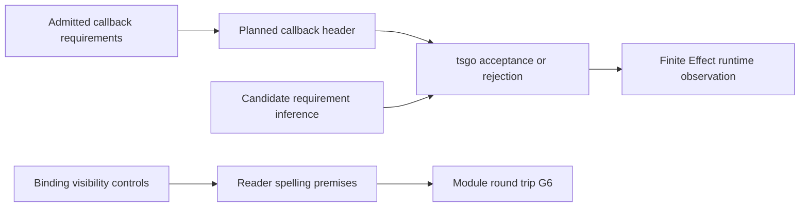

# HO-3 TypeScript printing review placement

The landed source base is `54ed060e6f12ebad49c05acd791a75e4425bd2f9`.
The owner starts HO-3 from `41151468ffd97d0df25ed7d13080eee783ab199e`.
The reviewed design is section 11 of `docs/research/2026-10-09-program-parameters.md` in the owner worktree.
Its implementation is work in progress.
This review changes no production source.

## Completion criteria

Check a callback that needs a service against the Lean checker and machine.
Check the planned header and a candidate header with pinned tsgo 7.
Keep an accepted control and a rejected control for each investigated boundary.
Record the inputs, commands, results, and evidence limits.
Place proposed obligations and their consumers before implementation.
Commit the packet locally.

## Placement

No new theorem or planned goal is introduced by these probes.

1. Concepts: `exact-codecs`, `context-requirements`, and `translation-simulation` in `docs/core/semantics.md`.
   The properties are module reconstruction, requirement propagation, and comparison of the generated program with its source.
2. Questions: `module-defs-round-trip`, role `compatibility`, and the target profile of program parameters under decisions row 340.
   The existing pointer is `readModule_printModule_defs` in `src/Effect4/Laws/Codegen/Module.lean`.
   Its consumers are `readModule_printModule_defs_readable`, `ModuleEmission.readModule`, and `Api.printModule_roundTrip` in `src/Effect4/Laws/Api/ModuleReadable.lean`.
   Target acceptance remains a finite gate under R8; this packet proposes no universal TypeScript theorem.
3. Reach: finite definitions whose callbacks have fixed request, answer, and error columns.
   The Lean checker permits callback service requirements and adds them to the invocation requirements.
   TypeScript samples instantiate the proposed header; they are handwritten design projections, not generated compiler output.
   Decisions rows 340 and 341 retain second-class parameters and the chosen slice order.
4. Limits: finite checks establish no universal simulation, schedule independence, progress, or finalization property.
   Current refusal of `invoke` printing is deliberate and is not a regression.
   Generic source definitions and service methods with callbacks remain deferred to HO-4 and HO-5.
   The host boundary remains at `docs/core/host-boundary.md`.
5. Requirements: R5 for service requirement propagation and R8 for the generated program's connection to its source.
   No M5, M6, or M7 statement changes.

## Probe order

Use one Lean process in the review worktree.
Keep all new files in this packet.
The parent owns execution; the parallel reviewer reads source only.

## Shared spelling audit

Claude adds `LawfulSpelling.extend` while this review runs.
It serves both `LawfulSpelling.withDefs` and `LawfulSpelling.withParams` in `src/Effect4/Laws/Codegen/Definitions.lean`.
The audit uses the same `exact-codecs` placement and G6 consumers above.
It checks the compiled module's dependency ceiling, not the unfinished HO-3 landing.
The owner reports its narrow build; this review independently inspects its compiled dependencies.
