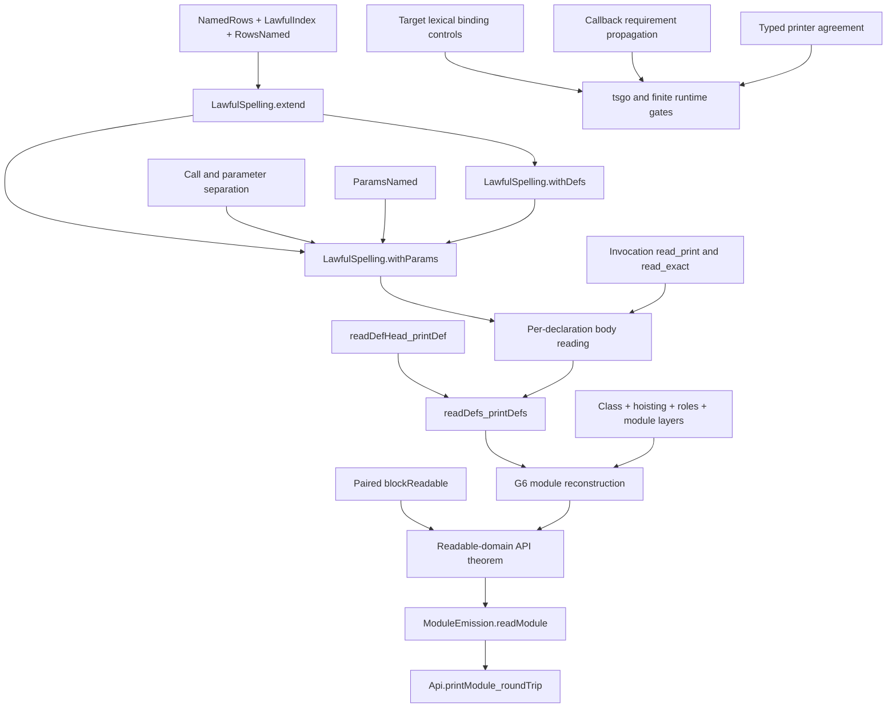

# HO-3 proof dependency outline

The existing module round trip owns this work.
No new obligation is declared by this packet.
The statements below specify how to amend existing helpers before proving their new cases.
The owner is already implementing the shared spelling law and declaration/body pairing.

## Shared placement

1. Concept: `exact-codecs`, the module reconstruction property in `docs/core/semantics.md`.
2. Question: `module-defs-round-trip`, role `compatibility`, in `tools/ProofGraph/Registry.lean`.
   G6 is `readModule_printModule_defs` in `src/Effect4/Laws/Codegen/Module.lean`.
   The leaf laws are `read_print` in `src/Effect4/Laws/Codegen/ReadPrint.lean` and `read_exact` in `src/Effect4/Laws/Codegen/Read.lean`.
3. Reach: readable declaration columns, lawful typing signatures and spelling maps, paired declarations and bodies, and the exact printed TypeScript invocation form.
   Keep existing class, hoisting, role-restoration, module-layer, and name premises.
   Decisions rows 328, 340, and 341 bound the fragment and scope rules.
4. Limits: reconstruction is structural.
   It proves no TypeScript acceptance, execution simulation, edited-source admission, progress, or scheduling property.
   HO-4 generic source definitions and HO-5 service forwarding remain separate slices.
5. Requirement: R8, the generated program's connection to its source.
   Requirement propagation also serves R5.
   No M5, M6, or M7 statement changes.

## Existing nodes and their next consumers

| Node and source | Required statement or premise | Consumer | Evidence status |
| --- | --- | --- | --- |
| `LawfulSpelling.extend`, `Laws/Codegen/Definitions.lean` | Indexed named rows extend a lawful spelling under `NamedRows`, `LawfulIndex`, and `RowsNamed`. | `withDefs`, `withParams` | Working implementation; independently audited compiled module |
| `LawfulParams.withDefs`, same file | Definition extension keeps parameter operations separate from calls and outside the base domain. | `LawfulSpelling.withParams` at a block body | Working implementation; same audit |
| `ParamsNamed` and `paramsNamed_of_fault`, same file | Parameter names are distinct, unspelled by the outer map, and outside reserved value binders. | Per-body spelling law | Working implementation; lexical target capture still needs its separate check |
| `readDefHead_printDef`, `Laws/Codegen/Module.lean` | Reading the header recovers its parameters and the suspension printed under `sig.withParams d.params`. | `readDefs_printDefs` | Working change; whole module proof not independently rebuilt |
| `readDefs_printDefs`, same file | Each pair in `defs.zip bodies.toList` has `ReadsBack` under that declaration's parameter context. | G6 | Working change; retain equal-length information from successful printing |
| `blockReadable` and `blockReadable_pieces`, `Laws/Api/ModuleReadable.lean` | Readability uses the same declaration/body pairs; main and layers keep the block context. | `readModule_printModule_defs_readable` | Remaining integration in the observed draft |
| Invocation case of `read_print`, `Laws/Codegen/ReadPrint.lean` | An indexed call reconstructs every callback at caller depth plus one under the caller's parameter map. | `ReadsBack`, G6 | HO-3b, proposed |
| Invocation case of `read_exact`, same file | Reading an invocation as `e` implies `print sig n e = .ok x` for that same target tree `x`. | Exact reading boundary | HO-3b, proposed; exact syntax-tree equality |
| Typed printing and `printTyped_eq_print`, `Laws/Codegen/PrintTyped.lean` | Typed and ordinary printing agree on the widened invocation arm under the existing `NoJoin` premise. | Typed target pipeline | HO-3b, proposed; keep the frozen comparison statement |
| `ModuleEmission.readModule` and `Api.printModule_roundTrip`, `Laws/Api/ModuleReadable.lean` | Propagate paired readability and lawful parameter maps without dropping existing premises. | Public reconstruction API | Existing consumers to reconnect |

Paths in the table are below `src/Effect4/`.
A helper's consumer is the next node in that row.
Before adding another helper, identify the row that consumes it.
No helper should open an unrelated proof branch.

## Requirements and target annotations

Placement differs from structural reconstruction here.
The concept is `context-requirements`; the property is requirement propagation through invocation and provision.
The target comparison also belongs to `translation-simulation` under R8.
The consumer is HO-3's typed emission and its target gate, not a new machine invariant.

For callback arguments with rows `R0` through `Rn`, the checked invocation requires their union with the definition's row.
The target header should expose the same obligation to TypeScript.
Its generated type variables have no runtime values and add no program representation.
If the target carrier gains binders, update every generated traversal reached by that signature change.

The inverse header reader must recognize the exact generated binder pattern.
It must recover stored declaration requirements separately from the inferred callback requirements.
Do not accept arbitrary generic TypeScript and discard its constraints.
Keep source instantiation under HO-4 distinct from this target annotation mechanism.

These statements do not prove runtime agreement.
The finite externally provided callback is the first gate control.
A future universal target simulation needs its own fragment, observation, and external-host premises.
This packet neither states nor assumes such a theorem.

## Scope controls before G6 is marked ready

| Control | Why it matters |
| --- | --- |
| Existing `InvokeControls.forwardProg` through print/read | A forwarded callback uses its caller's parameters. |
| Nested invocation inside a callback | Each nested arrow introduces one fresh value binder. |
| Two sibling callbacks capturing the same outer value | Siblings start at the same caller depth. |
| Two parameters, body running index one | Parameter order survives header and body reconstruction. |
| Duplicate names, `a0`, and a definition name | The reader's operation and variable namespaces remain distinct. |
| Qualified root, trailing identifier, and payload class collision | JavaScript resolves the intended binding. |
| Wrong callback count or absent definition | Source program admission gives a located refusal. |
| Wrong binder or annotations outside the generated image | The exact reader refuses altered TypeScript syntax outside its profile. |
| Callback supplied to a parameter-free definition | `perform` and `invoke` retain their chosen separate forms. |
| Service initializer or method with a callback | Deferred HO-5 forms do not enter HO-3 accidentally. |
| Service requirement supplied outside the callback | The target type exposes the same remaining requirement as the checker. |

## Minimal code organization

Keep the shared extension proof in `Laws/Codegen/Definitions.lean`.
Keep contextual reading in the existing reader and module laws.
Use one helper for row lexical uses, combining `qualifiedRoot` and `RowArg.names`.
Let parameter hygiene and payload-class hygiene consume it.
Do not build another spelling registry beside the row table or another context representation beside `Signature.withParams`.

Readability metadata should describe the actual declaration/body pairing once.
The printer, reader proof, authoring diagnostics, and cache dependencies can consume that pairing.
A cache's correctness remains a separate claim with explicit invalidation premises.
