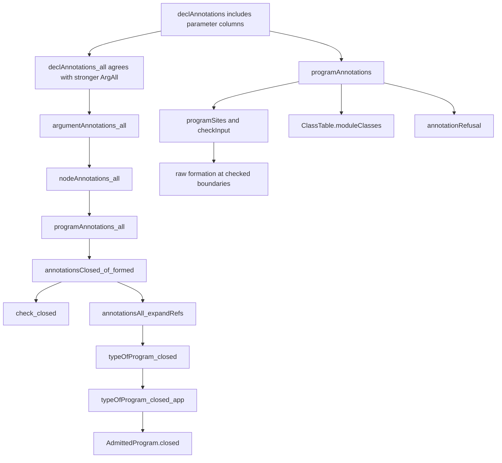
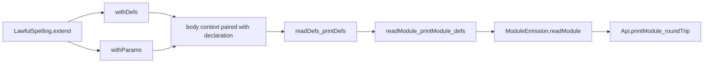

# Callback annotation repair: proof placement and consumers

Extend the existing type inventory and its agreement statement together.
The current agreement relates two definitions that both omit parameter columns.
It does not independently certify full stored annotation coverage.

## Placement before changing statements

| Point | Placement |
| --- | --- |
| Concept and property | `subtyping-algebra`: `raw-formation` and `checked-types-closed` in `docs/core/semantics.md` |
| Question and role | `raw-formation`, decidability, pointer `Formation.checkInput_eq_none_iff`; `checked-types-closed`, inversion, pointer `check_closed` |
| Helper and consumer | `declAnnotations_all` serves `argumentAnnotations_all`; the generic agreement chain serves `check_closed` and `typeOfProgram_closed` |
| Reach | Raw parameter request, answer, and error types at indexed declaration positions; strict formation outside templates; decisions rows 192, 193, and 340 |
| Limits | Output closedness remains the checker theorem's conclusion; no target acceptance, codec admission, inhabitance, execution, progress, or liveness follows |
| Unlock | R14 gains callback column coverage at checked boundaries; R8's existing class collector receives the types printed in TypeScript callback headers |

`declAnnotations_all` retains its existing `subtyping-algebra` and R14 placement.
This note proposes no new registry claim or planned goal.
Its helper change strengthens annotation coverage without changing the stored program representation.

## Minimal statement change

`Formation.ArgAll` in `src/Effect4/Laws/Program/Typing/Closed.lean` currently checks only each definition's three columns.
Its declaration case must additionally require:

```lean
∀ q ∈ d.params, P q.request ∧ P q.answer ∧ P q.error
```

The existing `declAnnotations_all` statement must include the same additional conjunction for every declaration.
Its proof then relates the added raw entries to that conjunction.
Use the existing list and column agreement helpers rather than another program constructor proof.

The statements of `argumentAnnotations_all`, `nodeAnnotations_all`, and `programAnnotations_all` can retain their current shape.
They quantify over the enlarged collector and predicate.
This is a source-based repair outline; the repaired helpers have not been compiled.



`Formation.annotations_closed` also feeds `annotationsClosed_of_formed` through the existing raw formation premise.
The reference-expansion helpers retain declarations and carry the larger parameter conjunction unchanged.
Their callers still need a narrow build; this outline is not a verified repair.

## Checked boundary consumers

`Formation.checkInput` remains the shared raw check.
Its consumers include these declarations:

| Consumer | Path |
| --- | --- |
| `admitProgram`, `AdmittedProgram.formed` | `src/Effect4/Program/Admission.lean` |
| `emitModule`, `emitTypedModule`, `ModuleEmission.formed` | `src/Effect4/Codegen/Checked.lean` |
| `admitModule`, `ModuleReading.formed` | `src/Effect4/Codegen/Admit.lean` |
| `Api.printDecl`, `Api.replayChecked` | `src/Effect4/Api.lean` |

Keep the raw collector in the core graph and its proof helpers in the Laws graph.
Never import the proof helpers into core emission or program admission.
`Api.wellTyped` remains a source typing query; the repeated-field control must use the actual program admission boundary.

## Reconstruction is a separate branch



The current compiled branch passes the independent audit in this packet.
A missing target class falls outside readable callback types and does not refute that branch.
A captured target name can still read back structurally.
Therefore neither branch replaces target binding checks or the reached behaviour gates.

## Landing controls and live editing

Retain one callback-only payload class and its ordinary-column positive control.
Retain the repeated-field input and its located program refusal after repair.
Check request, answer, and error positions, including nested record types.
Run the repaired law module and its direct consumers, then their cycle-aware audit.
Run the reached target and reader gates on current generated code.
The implementation owner determines any further reached behaviour gate from the actual patch.

A callback type edit must invalidate its definition's raw formation result and the module's payload-class inventory.
The body text alone cannot identify either cached result.
Return the parameter position and column with the refusal so the editor can select the faulty declaration.
Source typing, program admission, target support, reconstruction, and runtime observations remain separate tool results.
