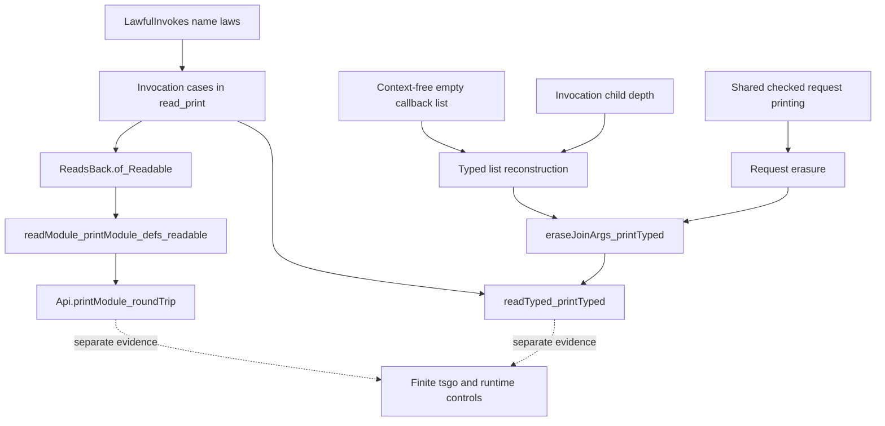

# HO-3b repair order and proof consumers

Repair the shared checked TypeScript printing layer before extending the existing typed erasure proof.
Keep raw reconstruction, checked TypeScript printing, program typing, and target observations as separate claims.

## Existing graph

The dashed arrows identify review consumers, not proof implications.
The diagram does not assert that the unfinished nodes are proved.

## Shared placement

The following repairs serve the `exact-codecs` concept and reconstruction modulo the named erasure.
The existing claims are `typed-print-erasure`, `typed-print-read`, and `typed-print-connector`, each with role `compatibility`.
Their pointers are `eraseJoinArgs_printTyped`, `readTyped_printTyped`, and `printTyped_eq_print` in `src/Effect4/Laws/Codegen/PrintTyped.lean`.
Every helper below has a consumer on those paths.
Decisions rows 325 and 340 bound the checked TypeScript printing fragment.
Every repair serves R8; none establishes target compiler acceptance, runtime agreement, progress, or schedule independence.

## First repair: the empty callback list

`Node.childEnv` in `src/Effect4/Program/Typing/Focus.lean` deliberately stops after an invocation's last callback slot.
`Annotate.checkEffs` in `src/Effect4/Program/Typing/Annotate.lean` records the terminal empty list as unreached.
No program body remains there, and no typing context is needed to print the empty list.

Make `.effs.nil` context-free in `Templates.typedSitesAlg` in `src/Effect4/Codegen/PrintTyped.lean`.
Retain checked contexts for nonempty lists and their callback bodies.
Keep the existing typing and focus rules unchanged.
Do not fabricate a reached context to make a printing proof apply.

The probe overrides only the generated algebra's `effs_nil` field.
A production repair may factor the shared typed layer so its fold equation exposes this case once.
Keep the exception restricted to the empty effect list; do not turn general missing contexts into successful printing.

| Obligation | Existing consumer | Reach and hypotheses | Limit | Requirement |
| --- | --- | --- | --- | --- |
| Expose the empty-list equation in `typedSites_cata_build` | Typed expression and list inversion | Existing generated fold; `.effs.nil` needs no context | States a printing equation only | R8 |
| Restrict `printedCaptureAt_context` to nonempty effect lists, or return an explicit empty-list alternative | `site_template_inv` and list erasure | Successful printing; every context-dependent source still supplies its context | Does not assert a reached empty tail | R8 |
| Handle an empty tail before extracting `tailFound` in `eraseSiteSpine_print_step` | `eraseJoinArgs_printTyped` | Empty output erases to empty output; nonempty tails retain focus and recursive premises | Establishes no typing or execution property | R8 |

These helpers are steps of `typed-print-erasure`, with role `compatibility` inherited from that claim.
The current cons proof obtains `tailFound` and calls `siteFocused_effs_tail` even when the tail is empty.
Split the tail first: close the empty case directly, then use the existing recursive path for a nonempty tail.
Do not weaken the public erasure theorem's readable-program or lawful-spelling premises.

## Second repair: invocation depth

`Node.childEnv` enters callback slots with one additional variable.
Both invocation printers and readers already recurse at caller depth plus one.
`Templates.RowOut.levelAt .invoke` initially returns zero for every argument.
During this review, Claude adds depth one for the callback child at argument index two.
That source repair is active work; its proof changes remain with Claude.

The finite probe observes a caller depth of two and a callback-list context depth of three.
The final probe retains the actual context-depth observation and does not freeze the earlier metadata value.
The review does not claim that the new metadata proof already compiles.

| Obligation | Existing consumer | Reach and hypotheses | Limit | Requirement |
| --- | --- | --- | --- | --- |
| Connect the invocation callback child to its actual depth | `childEnv_template_depth` or a dedicated invocation focus helper | Selected invocation row; child argument index two; successful slot context | Does not type arbitrary callback lists | R8 |
| Keep callback sibling depth constant while advancing parameter declarations | `siteFocused_effs_head`, `siteFocused_effs_tail`, and invocation erasure | Nonempty remaining slots; each head uses its own request type | No context is asserted after the last slot | R8 |

These helpers serve `typed-print-erasure`; their concept, role, limits, and requirement follow the shared placement.
Prefer the existing generated binder data where it supplies the needed fact.
Either extend depth metadata consistently, or keep a dedicated invocation equation with one clear consumer.
Avoid a second handwritten inventory of binder rules.

## Third repair: checked request terms

`PrintEliminators.layer` in `src/Effect4/Codegen/PrintEliminators.lean` sends invocation requests to `printInvoke`.
`printInvoke` in `src/Effect4/Codegen/PrintLeaf.lean` uses raw `printTerm`.
The existing checked term fold already computes the request's required annotations.

Factor invocation assembly to accept an already printed request expression.
The raw caller supplies `printTerm`; the checked caller supplies `PrintEliminators.term` at `ctx.env`.
Keep definition lookup, definition naming, and callback wrapping shared.
Do not add an author option or another program representation.

| Obligation | Existing consumer | Reach and hypotheses | Limit | Requirement |
| --- | --- | --- | --- | --- |
| A checked invocation request erases to its raw request | Invocation case of `eraseJoinArgs_printTyped` | Checked request context and the existing term-erasure premise | Does not prove that tsgo needs the annotation | R8 |
| Callback wrapping retains the caller's depth | Invocation raw and typed reconstruction | Request at `n`; callbacks at `n + 1`; lawful invocation spelling | Does not check callback arity | R8 |

These helpers serve `typed-print-erasure` and `typed-print-connector`, within `exact-codecs` and role `compatibility`.
The named erasure already visits the invocation request with `EraseTermTypes.eraseTerm` at caller depth.
Reuse that boundary and the existing checked term-erasure law.

## Raw reconstruction review

`LawfulInvokes` in `src/Effect4/Codegen/Read.lean` states name selection, name restoration, and separation from ordinary readable row calls.
`LawfulInvokes.withParams` in `src/Effect4/Laws/Codegen/Definitions.lean` explicitly requires parameter operations to differ from definition calls.
`readModule_printModule_defs_readable` in `src/Effect4/Laws/Api/ModuleReadable.lean` passes its existing separation premise.
No new dropped premise appears in the inspected changes.

The invocation cases in `read_print` remain active work.
Their concept is `exact-codecs`; their consumer is G6, `module-defs-round-trip`, with role `compatibility`.
Their reach includes lawful spelling, readable requests at `n`, and callback programs at `n + 1`.
They establish neither callback-count typing nor TypeScript acceptance or execution.
They serve R8 and the HO-3 module-authoring extension under R2.

## Verification after the repair

Run the reduced typed-site controls first.
Run the focused reconstruction modules and their cycle-aware axiom gate.
Then run the existing affected TypeScript and runtime gates for the widened printing surface.
The finite controls in this packet supplement those gates; they do not replace them.
